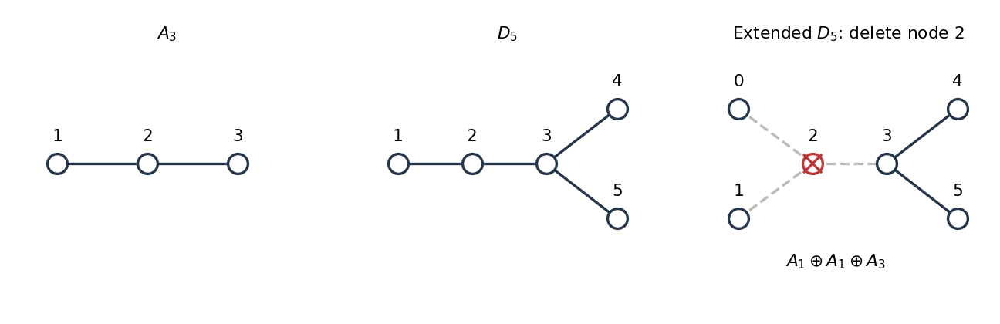

# 2023

↑ **Parent:** [Past exam of the groups and representations course of the University of Oxford](../past-exam-of-the-groups-and-representations-course-of-the-university-of-oxford.md)

Source PDF: [https://mmathphys.web.ox.ac.uk/sitefiles/groups-and-reps.pdf](https://mmathphys.web.ox.ac.uk/sitefiles/groups-and-reps.pdf)

**Table of contents**

- [1](#1)
  - [a](#1/a)
    - [Solution](#1/a/solution)
  - [b](#1/b)
    - [Solution](#1/b/solution)
  - [c](#1/c)
    - [Solution](#1/c/solution)
  - [d](#1/d)
    - [Solution](#1/d/solution)
  - [e](#1/e)
    - [Solution](#1/e/solution)
- [2](#2)
  - [a](#2/a)
    - [Solution](#2/a/solution)
  - [b](#2/b)
    - [Solution](#2/b/solution)
  - [c](#2/c)
    - [Solution](#2/c/solution)
  - [d](#2/d)
    - [Solution](#2/d/solution)
  - [e](#2/e)
    - [Solution](#2/e/solution)
- [3](#3)
  - [a](#3/a)
    - [Solution](#3/a/solution)
  - [b](#3/b)
    - [Solution](#3/b/solution)
  - [c](#3/c)
    - [Solution](#3/c/solution)
  - [d](#3/d)
    - [Solution](#3/d/solution)
  - [e](#3/e)
    - [Solution](#3/e/solution)
- [4](#4)
  - [a](#4/a)
    - [Solution](#4/a/solution)
  - [b](#4/b)
    - [Solution](#4/b/solution)
  - [c](#4/c)
    - [Solution](#4/c/solution)
  - [d](#4/d)
    - [Solution](#4/d/solution)

## 1

↑ **Parent:** [2023](2023.md)

<h3 id="1/a">a</h3>

↑ **Parent:** [1](#1)

<h4 id="1/a/solution">Solution</h4>

↑ **Parent:** [A](#1/a)

A [subgroup](../group.md#subgroup) $H$ of a [group](../group.md) $G$ is a nonempty subset closed under the inherited multiplication and inverses; equivalently, $xy^{-1}\in H$ whenever $x,y\in H$. A [normal subgroup](../group-theory.md#normal-subgroup) satisfies $gHg^{-1}=H$ for every $g\in G$.

A [group representation](../representation-theory.md#group-representation) on a [vector space](../vector-space.md) $V$ is a [group homomorphism](../group-theory.md#group-homomorphism) $R:G\to\operatorname{GL}(V)$, so $R(gh)=R(g)R(h)$ and $R(e)=I_V$. An [irreducible representation](../representation-theory.md#irreducible-representation) has $V\ne0$ and no [invariant subspaces](../representation-theory.md#invariant-subspace) other than $0$ and $V$: there is no proper nonzero $W$ with $R(g)W\subseteq W$ for every $g\in G$. We use finite-dimensional [complex representations](../representation-theory.md#complex-representation), with continuity for [Lie groups](../lie-theory.md#lie-group), throughout.

<h3 id="1/b">b</h3>

↑ **Parent:** [1](#1)

<h4 id="1/b/solution">Solution</h4>

↑ **Parent:** [B](#1/b)

[Branching of a representation](../representation-theory.md#branching-of-a-representation) describes the [irreducible representation](../representation-theory.md#irreducible-representation) content of a [restriction of a representation](../representation-theory.md#restriction-of-a-representation):

$$
R\big|_H\cong\bigoplus_\lambda m_\lambda S_\lambda.
$$

This direct decomposition applies when the [restriction of a representation](../representation-theory.md#restriction-of-a-representation) is a [semisimple representation](../representation-theory.md#semisimple-representation), as for [finite groups](../group.md#finite-group) or continuous finite-dimensional [representations](../representation-theory.md#group-representation) of [compact groups](../topological-group.md#compact-group). For an arbitrary [group](../group.md) and [subgroup](../group.md#subgroup), complete reducibility need not hold. A [vector subspace](../vector-space.md#vector-subspace) preserved by every $R(h)$ for $h\in H$ need not be preserved by the additional $R(g)$ for $g\notin H$, so an [irreducible representation](../representation-theory.md#irreducible-representation) can become reducible.

For a concrete example, take the defining [representation](../representation-theory.md#group-representation) of $G=SU(2)$ on $\mathbb C^2$ and $H=\{\operatorname{diag}(z,z^{-1}):|z|=1\}$, a [subgroup](../group.md#subgroup) isomorphic to the [circle group](../lie-theory.md#circle-group). The defining [representation](../representation-theory.md#group-representation) is [irreducible](../representation-theory.md#irreducible-representation): $SU(2)$ acts transitively on unit vectors, so no complex line is preserved by all its elements. Under $H$, the two coordinate lines are [invariant subspaces](../representation-theory.md#invariant-subspace), and

$$
\boxed{\mathbf2\big|_{U(1)}=\mathbf1_{+1}\oplus\mathbf1_{-1}.}
$$

Here the two [one-dimensional representations](../representation-theory.md#one-dimensional-representation) act by $z$ and $z^{-1}$.

<h3 id="1/c">c</h3>

↑ **Parent:** [1](#1)

<h4 id="1/c/solution">Solution</h4>

↑ **Parent:** [C](#1/c)

Let $\zeta=e^{2\pi i/n}$. The [group homomorphism](../group-theory.md#group-homomorphism) $\mathbb Z_n\to U(1)$ given by $[k]\mapsto\zeta^k$ is injective, identifying the [finite cyclic group](../group.md#finite-cyclic-group) with the [subgroup](../group.md#subgroup) of $n$th [roots of unity](../algebra.md#root-of-unity) in the [circle group](../lie-theory.md#circle-group).

The continuous [irreducible representations](../representation-theory.md#irreducible-representation) of the [circle group](../lie-theory.md#circle-group) are the [one-dimensional representations](../representation-theory.md#one-dimensional-representation) $R_Q(e^{i\theta})=e^{iQ\theta}$ with $Q\in\mathbb Z$. One way to see this is to make the [representation](../representation-theory.md#group-representation) [unitary](../vector-bundle.md#unitary-connection) by averaging, simultaneously diagonalize its commuting [unitary matrices](../linear-operator-theory.md#unitary-matrix), and impose $R_Q(e^{i(\theta+2\pi)})=R_Q(e^{i\theta})$. Its [restriction of a representation](../representation-theory.md#restriction-of-a-representation) is

$$
R_Q(\zeta^k)=e^{2\pi iQk/n}=e^{2\pi iqk/n},\qquad
\boxed{q=Q\pmod n.}
$$

Thus each [irreducible representation](../representation-theory.md#irreducible-representation) remains one-dimensional, and [representations](../representation-theory.md#group-representation) whose integer labels differ by a multiple of $n$ become equivalent. Every [irreducible representation](../representation-theory.md#irreducible-representation) of the [finite cyclic group](../group.md#finite-cyclic-group) occurs this way.

<h3 id="1/d">d</h3>

↑ **Parent:** [1](#1)

<h4 id="1/d/solution">Solution</h4>

↑ **Parent:** [D](#1/d)

Choose a normalization in which the [circle group](../lie-theory.md#circle-group) has period $2\pi$ and the [U(1) charges](../representation-theory.md#u-1-charge) $\widehat Q_i$ of the [complex scalar fields](../scalar-field-theory.md#complex-scalar-field) are integers. By [restriction of a representation](../representation-theory.md#restriction-of-a-representation),

$$
\boxed{\widehat q_i=\widehat Q_i\pmod n.}
$$

Write $v_i=\langle\phi_i\rangle$. A [vacuum expectation value](../quantum-field-theory.md#vacuum-expectation-value) $v_i\ne0$ is preserved by $e^{i\theta}$ precisely when $e^{i\widehat Q_i\theta}=1$. Therefore the specified [finite cyclic group](../group.md#finite-cyclic-group) survives [spontaneous symmetry breaking](../quantum-field-theory.md#spontaneous-symmetry-breaking) exactly when every condensing [complex scalar field](../scalar-field-theory.md#complex-scalar-field) obeys

$$
\widehat Q_i\equiv0\pmod n.
$$

Only [U(1) charges](../representation-theory.md#u-1-charge) of fields with nonzero [vacuum expectation values](../quantum-field-theory.md#vacuum-expectation-value) enter this test; in the paper all $N$ fields condense.

Suppose at least one condensing [U(1) charge](../representation-theory.md#u-1-charge) is nonzero and put $d=\gcd(|\widehat Q_i|:v_i\ne0)$. Since each such [U(1) charge](../representation-theory.md#u-1-charge) is a multiple of $d$, every $d$th [root of unity](../algebra.md#root-of-unity) preserves the [vacuum expectation values](../quantum-field-theory.md#vacuum-expectation-value). Conversely, the [Bezout identity](../algebra.md#bezout-s-identity) expresses $d$ as an integer combination of these [U(1) charges](../representation-theory.md#u-1-charge), so a common stabilizer obeys $e^{id\theta}=1$. The [discrete remnant of a circle symmetry](../quantum-field-theory.md#discrete-remnant-of-a-circle-symmetry) is consequently

$$
\boxed{H_{\rm unbroken}=\mathbb Z_d,\qquad n_{\max}=d.}
$$

A nontrivial retained [finite cyclic group](../group.md#finite-cyclic-group) exists exactly when $d>1$, and its possible orders are the divisors $n>1$ of $d$. For example, condensing [U(1) charges](../representation-theory.md#u-1-charge) $6$ and $10$ leave $\mathbb Z_2$. If $d=1$, the [stabilizer](../group-action.md#stabilizer-subgroup) is trivial. If all condensing [U(1) charges](../representation-theory.md#u-1-charge) vanish, the entire [circle group](../lie-theory.md#circle-group) is unbroken and there is no largest finite $n$; this case does not break the symmetry assumed in the question.

<h3 id="1/e">e</h3>

↑ **Parent:** [1](#1)

<h4 id="1/e/solution">Solution</h4>

↑ **Parent:** [E](#1/e)

Normalize the [circle group](../lie-theory.md#circle-group) as in [solution](#1/d/solution) and count all [Weyl fermions](../relativistic-quantum-field.md#weyl-spinor) as left-handed; a right-handed [Weyl fermion](../relativistic-quantum-field.md#weyl-spinor) is replaced by its left-handed charge conjugate. The [restriction of a representation](../representation-theory.md#restriction-of-a-representation) gives

$$
\boxed{q_a=Q_a\pmod n.}
$$

The triangle coefficient of the [cubic U(1) gauge anomaly](../relativistic-quantum-field.md#cubic-u-1-gauge-anomaly) is proportional to $\sum_aQ_a^3$. In a theory with this single [gauge group](../relativistic-quantum-field.md#gauge-group), cancellation of its local pure [gauge anomaly](../relativistic-quantum-field.md#gauge-anomaly) requires

$$
\boxed{\sum_{a=1}^M Q_a^3=0.}
$$

If absence of the [mixed gauge-gravitational anomaly](../relativistic-quantum-field.md#mixed-gauge-gravitational-anomaly) is also required, as when coupling to a general gravitational background, one additionally needs $\sum_aQ_a=0$. Additional [gauge group](../relativistic-quantum-field.md#gauge-group) factors would require their mixed [gauge anomalies](../relativistic-quantum-field.md#gauge-anomaly) to cancel as well.

Choose integer representatives and write $Q_a=q_a+nk_a$. Expanding the cubic gives

$$
0=\sum_a Q_a^3
=\sum_aq_a^3+n\sum_a\bigl(3q_a^2k_a+3nq_ak_a^2+n^2k_a^3\bigr).
$$

Hence the inherited necessary congruence, and its gravitational counterpart when imposed, are

$$
\boxed{\sum_aq_a^3\equiv0\pmod n,\qquad
\sum_aq_a\equiv0\pmod n\quad\text{(if mixed gravitational cancellation is imposed)}.}
$$

These statements concern the same complete [fermion](../tensor-product-of-quantum-systems.md#fermion) spectrum used in the parent theory. They are consequences of an anomaly-free integer lift, rather than a full classification of intrinsic discrete [gauge anomalies](../relativistic-quantum-field.md#gauge-anomaly) or a sufficient test for such a lift. They also do not imply an ordinary equality for the chosen residues: for $n=3$, the anomaly-free [U(1) charges](../representation-theory.md#u-1-charge) $(1,-1)$ have residues $(1,2)$, whose cubes sum to $9$, rather than zero. Integrating out heavy [fermions](../tensor-product-of-quantum-systems.md#fermion) can require extra contributions to the effective discrete [gauge anomaly](../relativistic-quantum-field.md#gauge-anomaly) accounting.

## 2

↑ **Parent:** [2023](2023.md)

<h3 id="2/a">a</h3>

↑ **Parent:** [2](#2)

<h4 id="2/a/solution">Solution</h4>

↑ **Parent:** [A](#2/a)

[Conjugacy classes](../group-action.md#conjugacy-class) in the [symmetric group](../finite-group-theory.md#symmetric-group) are specified by [cycle type](../finite-group-theory.md#cycle-type), equivalently a [partition](../representation-theory-of-the-symmetric-group.md#partition-of-an-integer) of $4$. If $m_j$ counts cycles of length $j$, the number of [permutations](../combinatorics.md#permutation) of that [cycle type](../finite-group-theory.md#cycle-type) is $4!/\prod_j(j^{m_j}m_j!)$: cyclic rotation of each cycle and interchange of equal-length cycles do not change the [permutation](../combinatorics.md#permutation). This gives

$$
\begin{array}{c|ccccc}
\text{partition}&1^4&2\,1^2&2^2&3\,1&4\\\hline
\text{representative}&e&(12)&(12)(34)&(123)&(1234)\\
\text{class size}&1&6&3&8&6
\end{array}
$$

The sizes sum to $24$. Since the number of complex [irreducible representations](../representation-theory.md#irreducible-representation) of a [finite group](../group.md#finite-group) equals its number of [conjugacy classes](../group-action.md#conjugacy-class), $S_4$ has $\boxed{5}$ inequivalent complex [irreducible representations](../representation-theory.md#irreducible-representation).

<h3 id="2/b">b</h3>

↑ **Parent:** [2](#2)

<h4 id="2/b/solution">Solution</h4>

↑ **Parent:** [B](#2/b)

The [trivial representation](../representation-theory.md#trivial-representation) and [sign of a permutation](../finite-group-theory.md#sign-of-a-permutation) give

$$
R_0(\sigma)=1,\qquad R_1(\sigma)=\operatorname{sgn}(\sigma).
$$

They are [one-dimensional representations](../representation-theory.md#one-dimensional-representation), hence [irreducible representations](../representation-theory.md#irreducible-representation). Their [characters](../representation-theory.md#character-of-a-representation), in the [conjugacy class](../group-action.md#conjugacy-class) order of [solution](#2/a/solution), are

$$
\chi_0=(1,1,1,1,1),\qquad
\chi_1=(1,-1,1,1,-1).
$$

These are the only [one-dimensional representations](../representation-theory.md#one-dimensional-representation). All transpositions are conjugate, so they have the same scalar image $t$ in any [one-dimensional representation](../representation-theory.md#one-dimensional-representation); since a transposition squares to the identity, $t=\pm1$. Transpositions generate the [symmetric group](../finite-group-theory.md#symmetric-group), fixing the whole [representation](../representation-theory.md#group-representation) once $t$ is chosen.

By the [sum of squares of irreducible representation dimensions](../representation-theory.md#sum-of-squares-of-irreducible-representation-dimensions), the three remaining dimensions satisfy $d_2^2+d_3^2+d_4^2=24-1-1=22$, with each $d_i\ge2$. No $d_i$ can be at least $4$, since $16+4+4>22$. Thus the only possible dimensions are

$$
\boxed{d_2=2,\qquad d_3=d_4=3.}
$$

<h3 id="2/c">c</h3>

↑ **Parent:** [2](#2)

<h4 id="2/c/solution">Solution</h4>

↑ **Parent:** [C](#2/c)

Use the composition convention $(\sigma\tau)(i)=\sigma(\tau(i))$. Then $R_+(\sigma)R_+(\tau)e_i=e_{\sigma(\tau(i))}=R_+(\sigma\tau)e_i$. Since the [sign of a permutation](../finite-group-theory.md#sign-of-a-permutation) is multiplicative, the same calculation gives $R_-(\sigma)R_-(\tau)=R_-(\sigma\tau)$. Both send the identity to $I$ and have inverses given by $\sigma^{-1}$, so both are [group representations](../representation-theory.md#group-representation).

The [trace](../linear-algebra.md#matrix-trace) of a [permutation matrix](../vector-space.md#permutation-matrix) counts fixed points, and multiplying that [matrix](../vector-space.md#matrix) by its [sign of a permutation](../finite-group-theory.md#sign-of-a-permutation) multiplies its [trace](../linear-algebra.md#matrix-trace) by that sign. Thus the two [characters](../representation-theory.md#character-of-a-representation) are

$$
\chi_+=(4,2,0,1,0),\qquad
\chi_-=(4,-2,0,1,0).
$$

Let $u=e_1+e_2+e_3+e_4$ and $W=\{x\in\mathbb C^4:\sum_ix_i=0\}$. Both are [invariant subspaces](../representation-theory.md#invariant-subspace), and $\mathbb C^4=\mathbb Cu\oplus W$. On $\mathbb Cu$, $R_+$ is the [trivial representation](../representation-theory.md#trivial-representation) and $R_-$ is the sign [representation](../representation-theory.md#group-representation). Subtracting their [characters](../representation-theory.md#character-of-a-representation) yields

$$
\boxed{\chi_3=\chi_+-\chi_0=(3,1,-1,0,-1),\qquad
\chi_4=\chi_--\chi_1=(3,-1,-1,0,1).}
$$

The [character inner product](../representation-theory.md#character-inner-product) verifies that it is an [irreducible representation](../representation-theory.md#irreducible-representation):

$$
\langle\chi_3,\chi_3\rangle
=\frac{9+6+3+0+6}{24}=1.
$$

The squares of the entries of $\chi_4$ are identical, so its [character inner product](../representation-theory.md#character-inner-product) with itself is also one. Their values at a transposition differ, so these [irreducible representations](../representation-theory.md#irreducible-representation) are inequivalent. Therefore

$$
\boxed{R_+=R_0\oplus R_3,\qquad R_-=R_1\oplus R_4,\qquad R_4=R_1\otimes R_3.}
$$

<h3 id="2/d">d</h3>

↑ **Parent:** [2](#2)

<h4 id="2/d/solution">Solution</h4>

↑ **Parent:** [D](#2/d)

Only the [character](../representation-theory.md#character-of-a-representation) $\chi_2$ of the two-dimensional [irreducible representation](../representation-theory.md#irreducible-representation) remains unknown. Write it as $(2,a,b,c,d)$. The [regular representation](../representation-theory.md#regular-representation) has [character](../representation-theory.md#character-of-a-representation) zero off the identity and decomposes with multiplicities equal to the [irreducible representation](../representation-theory.md#irreducible-representation) dimensions. Thus, for a nonidentity element $g$,

$$
\chi_0(g)+\chi_1(g)+2\chi_2(g)+3\chi_3(g)+3\chi_4(g)=0.
$$

For the four nonidentity [conjugacy classes](../group-action.md#conjugacy-class) this gives $a=0$, $b=2$, $c=-1$, $d=0$. The complete [character table](../representation-theory.md#character-table) is consequently

$$
\boxed{
\begin{array}{c|rrrrr}
&e&(12)&(12)(34)&(123)&(1234)\\\hline
\text{class size}&1&6&3&8&6\\\hline
\chi_0&1&1&1&1&1\\
\chi_1&1&-1&1&1&-1\\
\chi_2&2&0&2&-1&0\\
\chi_3&3&1&-1&0&-1\\
\chi_4&3&-1&-1&0&1
\end{array}}
$$

For example, $\langle\chi_2,\chi_2\rangle=(4+12+8)/24=1$, agreeing with [character orthogonality](../representation-theory.md#character-orthogonality).

<h3 id="2/e">e</h3>

↑ **Parent:** [2](#2)

<h4 id="2/e/solution">Solution</h4>

↑ **Parent:** [E](#2/e)

Use the realization $R_3=W\subset\mathbb C^4$ from [solution](#2/c/solution). Put $x=(\phi_1,\phi_2,\phi_3,-\phi_1-\phi_2-\phi_3)$, which identifies the three-dimensional [scalar field](../classical-field-theory.md#scalar-field) with $W$. The [polynomial invariants of the standard S4 representation](../representation-theory.md#polynomial-invariants-of-the-standard-s4-representation) include the symmetric power sums

$$
I_2=\sum_{i=1}^4x_i^2,
\qquad I_3=\sum_{i=1}^4x_i^3,
$$

because every [permutation](../combinatorics.md#permutation) merely rearranges their summands. In these coordinates,

$$
\boxed{I_2=\phi_1^2+\phi_2^2+\phi_3^2+(\phi_1+\phi_2+\phi_3)^2,\qquad
I_3=-3(\phi_1+\phi_2)(\phi_2+\phi_3)(\phi_3+\phi_1).}
$$

Neither [polynomial](../polynomial.md) vanishes identically: at $(\phi_1,\phi_2,\phi_3)=(1,1,1)$ they equal $12$ and $-24$. Hence coefficients multiplying $I_2$ and $I_3$ provide nonzero invariant quadratic and cubic terms. A change of [basis](../vector-space.md#basis) transports these [polynomial invariants](../representation-theory.md#polynomial-invariant) to any equivalent realization of $R_3$. For a real [scalar field](../classical-field-theory.md#scalar-field), both are real. For a [complex scalar field](../scalar-field-theory.md#complex-scalar-field), a real [scalar potential](../classical-field-theory.md#scalar-potential) may contain $\lambda_k I_k+\lambda_k^*I_k^*$; the quadratic [Hermitian form](../linear-algebra.md#hermitian-form) $\sum_i|x_i|^2$ is another invariant.

As an independent [character](../representation-theory.md#character-of-a-representation) check, the [symmetric square of a group representation](../representation-theory.md#symmetric-square-of-a-group-representation) has [character](../representation-theory.md#character-of-a-representation) $[\chi(g)^2+\chi(g^2)]/2$, and the [symmetric cube of a group representation](../representation-theory.md#symmetric-cube-of-a-group-representation) has [character](../representation-theory.md#character-of-a-representation) $[\chi(g)^3+3\chi(g)\chi(g^2)+2\chi(g^3)]/6$. With $\chi=\chi_3$ these are $(6,2,2,0,0)$ and $(10,2,-2,1,0)$. Their [character inner products](../representation-theory.md#character-inner-product) with $\chi_0$ are both one, so each degree has exactly one independent [polynomial invariant](../representation-theory.md#polynomial-invariant).

## 3

↑ **Parent:** [2023](2023.md)

<h3 id="3/a">a</h3>

↑ **Parent:** [3](#3)

<h4 id="3/a/solution">Solution</h4>

↑ **Parent:** [A](#3/a)

[Schur's lemma](../representation-theory.md#schur-s-lemma) states that an [intertwiner](../representation-theory.md#intertwiner) $T:V\to W$ between [irreducible representations](../representation-theory.md#irreducible-representation) is either zero or an [isomorphism](../algebra.md#isomorphism). In particular, inequivalent [irreducible representations](../representation-theory.md#irreducible-representation) have no nonzero [intertwiners](../representation-theory.md#intertwiner). For a finite-dimensional [irreducible representation](../representation-theory.md#irreducible-representation) over the [complex numbers](../complex-analysis.md#complex-number), every commuting [endomorphism](../algebra.md#endomorphism) is scalar:

$$
\boxed{TR(g)=R(g)T\ \text{for all }g\quad\Longrightarrow\quad T=\lambda I.}
$$

Indeed, the [kernel](../kernel-of-a-linear-map.md) and [image](../set-theory.md#image-of-a-function) of an [intertwiner](../representation-theory.md#intertwiner) are [invariant subspaces](../representation-theory.md#invariant-subspace), proving the first statement. For the second, choose an [eigenvalue](../linear-operator-theory.md#eigenvalue) $\lambda$ of $T$. The [intertwiner](../representation-theory.md#intertwiner) $T-\lambda I$ has nonzero [kernel](../kernel-of-a-linear-map.md), so it must vanish. The scalar conclusion uses an algebraically closed coefficient [field](../algebra.md#field): over the real numbers, planar rotation through $\pi/2$ gives an [irreducible](../representation-theory.md#irreducible-representation) real [representation](../representation-theory.md#group-representation) of $\mathbb Z_4$ and commutes with itself without being a real scalar [matrix](../vector-space.md#matrix).

<h3 id="3/b">b</h3>

↑ **Parent:** [3](#3)

<h4 id="3/b/solution">Solution</h4>

↑ **Parent:** [B](#3/b)

Partition $M$ into the same five-by-five blocks as $R$. The equation for block $(i,j)$ is $M_{ij}R_j(g)=R_i(g)M_{ij}$, so each block is an [intertwiner](../representation-theory.md#intertwiner). By [Schur's lemma](../representation-theory.md#schur-s-lemma), blocks between the two inequivalent [irreducible representations](../representation-theory.md#irreducible-representation) vanish, whereas blocks between identical copies are arbitrary scalar multiples of the relevant identity [matrix](../vector-space.md#matrix). Thus the [commutant of a semisimple representation](../representation-theory.md#commutant-of-a-semisimple-representation) is

$$
\boxed{
M=\begin{pmatrix}
a_{11}I_{n_1}&a_{12}I_{n_1}&a_{13}I_{n_1}&0&0\\
a_{21}I_{n_1}&a_{22}I_{n_1}&a_{23}I_{n_1}&0&0\\
a_{31}I_{n_1}&a_{32}I_{n_1}&a_{33}I_{n_1}&0&0\\
0&0&0&b_{11}I_{n_2}&b_{12}I_{n_2}\\
0&0&0&b_{21}I_{n_2}&b_{22}I_{n_2}
\end{pmatrix},\quad a_{ij},b_{ij}\in\mathbb C.}
$$

Equivalently, $M=(A\otimes I_{n_1})\oplus(B\otimes I_{n_2})$, where $A\in M_3(\mathbb C)$ and $B\in M_2(\mathbb C)$. Substitution proves every such [matrix](../vector-space.md#matrix) commutes with every $R(g)$. There is no invertibility requirement on $M$, and its solution space has complex dimension $3^2+2^2=13$, even if $n_1=n_2$.

<h3 id="3/c">c</h3>

↑ **Parent:** [3](#3)

<h4 id="3/c/solution">Solution</h4>

↑ **Parent:** [C](#3/c)

The identity belongs to the [centralizer](../group-action.md#centralizer) $C_G(H)$. If $x,y\in C_G(H)$, then for every $h\in H$,

$$
(xy)h=x(yh)=x(hy)=(xh)y=h(xy).
$$

Also $xh=hx$ implies $h x^{-1}=x^{-1}h$ by multiplying on both sides by $x^{-1}$. Hence $xy$ and $x^{-1}$ belong to $C_G(H)$, proving by the [subgroup test](../group.md#subgroup-test) that $\boxed{C_G(H)\le G}$. This argument works even when $H$ is any subset, giving the [centralizer of a subset](../group-action.md#centralizer-of-a-subset).

<h3 id="3/d">d</h3>

↑ **Parent:** [3](#3)

<h4 id="3/d/solution">Solution</h4>

↑ **Parent:** [D](#3/d)

Write $D(z)=\operatorname{diag}(z^{-2}I_3,z^3I_2)$ and partition a [matrix](../vector-space.md#matrix) $X$ into $3+2$ blocks. The equation $XD(z)=D(z)X$ makes its off-diagonal blocks obey $(z^3-z^{-2})X_{12}=0$ and $(z^{-2}-z^3)X_{21}=0$ for every $z\in U(1)$. Choosing any $z$ with $z^5\ne1$ forces both blocks to vanish. Conversely, every block diagonal [matrix](../vector-space.md#matrix) commutes with every $D(z)$. Intersecting with the [special unitary group](../topological-group.md#special-unitary-group) gives the exact [centralizer](../group-action.md#centralizer)

$$
\boxed{C_{SU(5)}(U(1))=S(U(3)\times U(2))
=\{\operatorname{diag}(A,B):A\in U(3),\ B\in U(2),\ \det A\det B=1\}.}
$$

Its [Lie algebra](../lie-algebra.md) is $\mathfrak{su}(3)\oplus\mathfrak{su}(2)\oplus\mathfrak u(1)$. At the [group](../group.md) level there is a finite central identification. The surjective [group homomorphism](../group-theory.md#group-homomorphism)

$$
F:SU(3)\times SU(2)\times U(1)\longrightarrow S(U(3)\times U(2)),\qquad
F(A,B,z)=\operatorname{diag}(z^{-2}A,z^3B)
$$

has [kernel](../kernel-of-a-linear-map.md) $\{(z^2I_3,z^{-3}I_2,z):z^6=1\}\cong\mathbb Z_6$. Surjectivity follows by choosing $z$ with $z^{-6}=\det A'$ for any target pair $(A',B')$, and setting $A=z^2A'$, $B=z^{-3}B'$. Thus

$$
\boxed{C_{SU(5)}(U(1))\cong
\bigl(SU(3)\times SU(2)\times U(1)\bigr)/\mathbb Z_6.}
$$

The six distinct [kernel](../kernel-of-a-linear-map.md) elements give a concrete reason the displayed map does not identify the [centralizer](../group-action.md#centralizer) with an unquotiented product.

<h3 id="3/e">e</h3>

↑ **Parent:** [3](#3)

<h4 id="3/e/solution">Solution</h4>

↑ **Parent:** [E](#3/e)

Number the [simple roots](../semisimple-lie-algebra.md#simple-root) of the $A_4$ [root system](../semisimple-lie-algebra.md#root-system) consecutively along its [Dynkin diagram](../semisimple-lie-algebra.md#dynkin-diagram). For a [Young diagram](../representation-theory-of-the-symmetric-group.md#young-diagram) with row lengths $r_i$, its [highest weight](../semisimple-lie-algebra.md#highest-weight-of-a-representation) has [Dynkin labels](../semisimple-lie-algebra.md#dynkin-label) $a_i=r_i-r_{i+1}$. The three [irreducible representations](../representation-theory.md#irreducible-representation) have the following [Young diagrams](../representation-theory-of-the-symmetric-group.md#young-diagram), which can be filled increasingly down the column to give [Young tableaux](../representation-theory-of-the-symmetric-group.md#young-tableau):

$$
\begin{array}{c|c|c|c}
&\text{column of boxes}&\text{tensor}&\text{highest-weight labels}\\\hline
\mathbf5&\boxed{1}&v^i&(1,0,0,0)\\
\overline{\mathbf5}&\begin{matrix}\boxed{1}\\\boxed{2}\\\boxed{3}\\\boxed{4}\end{matrix}
&w^{[i_1i_2i_3i_4]}\ \text{or }\widetilde v_i&(0,0,0,1)\\
\mathbf{10}&\begin{matrix}\boxed{1}\\\boxed{2}\end{matrix}
&T^{ij}=-T^{ji}&(0,1,0,0)
\end{array}
$$

Here $i=1,\ldots,5$, $v^i\mapsto U^i{}_jv^j$, and $T^{ij}\mapsto U^i{}_kU^j{}_lT^{kl}$. Contraction with the invariant alternating [tensor](../multilinear-algebra.md#tensor) identifies $\widetilde v_i=(1/4!)\epsilon_{ii_1i_2i_3i_4}w^{i_1i_2i_3i_4}$, giving the [dual representation](../representation-theory.md#dual-representation) of $\mathbf5$. The dimensions follow from $\binom51=5$, $\binom54=5$, $\binom52=10$.

Use the [centralizer](../group-action.md#centralizer) and [circle group](../lie-theory.md#circle-group) normalization of [solution](#3/d/solution). The first three components have [U(1) charge](../representation-theory.md#u-1-charge) $-2$ and the last two have [U(1) charge](../representation-theory.md#u-1-charge) $3$, so the [branching of a representation](../representation-theory.md#branching-of-a-representation) is

$$
\boxed{\mathbf5\longrightarrow(\mathbf3,\mathbf1)_{-2}\oplus(\mathbf1,\mathbf2)_3,\qquad
\overline{\mathbf5}\longrightarrow(\overline{\mathbf3},\mathbf1)_2\oplus(\mathbf1,\mathbf2)_{-3}.}
$$

For the [dual representation](../representation-theory.md#dual-representation), both [U(1) charges](../representation-theory.md#u-1-charge) reverse and the $SU(3)$ [representation](../representation-theory.md#group-representation) is conjugated; the $SU(2)$ doublet is equivalent to its conjugate. Taking the [exterior square](../multilinear-algebra.md#exterior-square) of the first decomposition gives three types of antisymmetric [tensor](../multilinear-algebra.md#tensor) components: $T^{ab}$, $T^{a\alpha}$, and $T^{\alpha\beta}$, where $a,b=1,2,3$ and $\alpha,\beta=4,5$. Their [U(1) charges](../representation-theory.md#u-1-charge) add, and $\Lambda^2\mathbf3=\overline{\mathbf3}$, $\Lambda^2\mathbf2=\mathbf1$. Hence

$$
\boxed{\mathbf{10}\longrightarrow
(\overline{\mathbf3},\mathbf1)_{-4}\oplus(\mathbf3,\mathbf2)_1\oplus(\mathbf1,\mathbf1)_6.}
$$

The dimensions are $3+6+1=10$. These product labels describe genuine [representations](../representation-theory.md#group-representation) of the quotient [group](../group.md) in [solution](#3/d/solution): every element of its $\mathbb Z_6$ [kernel](../kernel-of-a-linear-map.md) acts trivially on each summand.

## 4

↑ **Parent:** [2023](2023.md)

<h3 id="4/a">a</h3>

↑ **Parent:** [4](#4)

<h4 id="4/a/solution">Solution</h4>

↑ **Parent:** [A](#4/a)

For the [A3 root system](../semisimple-lie-algebra.md#a3-root-system), take [simple roots](../semisimple-lie-algebra.md#simple-root) $\alpha_i=e_i-e_{i+1}$ for $i=1,2,3$ in the hyperplane $\sum_{i=1}^4x_i=0$ of an orthonormal $\mathbb R^4$. Its [Dynkin diagram](../semisimple-lie-algebra.md#dynkin-diagram) is the single-bond chain $1-2-3$. The [Cartan matrix](../semisimple-lie-algebra.md#cartan-matrix) has entries $C_{ij}=2(\alpha_i,\alpha_j)/(\alpha_j,\alpha_j)$, giving

$$
\boxed{C_{A_3}=\begin{pmatrix}2&-1&0\\-1&2&-1\\0&-1&2\end{pmatrix}.}
$$

For a [weight](../semisimple-lie-algebra.md#weight-representation-theory) $\mu$, use [Dynkin labels](../semisimple-lie-algebra.md#dynkin-label) $w_i=2(\mu,\alpha_i)/(\alpha_i,\alpha_i)$. The four [weights](../semisimple-lie-algebra.md#weight-representation-theory) $\mu_j=e_j-\tfrac14\sum_ke_k$ of the defining [representation](../representation-theory.md#group-representation) have labels

$$
\boxed{F=\{(1,0,0),(-1,1,0),(0,-1,1),(0,0,-1)\}.}
$$

They form the [weight system](../semisimple-lie-algebra.md#weight-system) with [highest weight](../semisimple-lie-algebra.md#highest-weight-of-a-representation) $(1,0,0)$. Equivalently, subtract successive rows of $C_{A_3}$ from that [highest weight](../semisimple-lie-algebra.md#highest-weight-of-a-representation). The [dual representation](../representation-theory.md#dual-representation) negates every [weight](../semisimple-lie-algebra.md#weight-representation-theory), so the [weight system](../semisimple-lie-algebra.md#weight-system) with [highest weight](../semisimple-lie-algebra.md#highest-weight-of-a-representation) $(0,0,1)$ is

$$
\boxed{\overline F=-F=\{(0,0,1),(0,1,-1),(1,-1,0),(-1,0,0)\}.}
$$

All these [weights](../semisimple-lie-algebra.md#weight-representation-theory) have multiplicity one. The numbered [Dynkin diagrams](../semisimple-lie-algebra.md#dynkin-diagram) used in this solution and in [solution](#4/b/solution) are shown below.

**[Figure 1](#4/a/image-numbered-dynkin-diagrams-for-the-a3-root-system-and-d5-root-system-with-deletion-from-the-extended-dynkin-diagram). Numbered Dynkin diagrams for the A3 root system and D5 root system, with deletion from the Extended Dynkin diagram**. All bonds are single. In the [Extended Dynkin diagram](../semisimple-lie-algebra.md#extended-dynkin-diagram) of the [D5 root system](../semisimple-lie-algebra.md#d5-root-system), deleting node 2 separates nodes 0 and 1 and leaves the three-node chain 4-3-5, giving the [root subsystem](../semisimple-lie-algebra.md#root-subsystem) $A_1\oplus A_1\oplus A_3$.

<h3 id="4/b">b</h3>

↑ **Parent:** [4](#4)

<h4 id="4/b/solution">Solution</h4>

↑ **Parent:** [B](#4/b)

For the [D5 root system](../semisimple-lie-algebra.md#d5-root-system), take an orthonormal [basis](../vector-space.md#basis) $e_1,\ldots,e_5$ and [simple roots](../semisimple-lie-algebra.md#simple-root) $\alpha_i=e_i-e_{i+1}$ for $i=1,2,3,4$, together with $\alpha_5=e_4+e_5$. The [Dynkin diagram](../semisimple-lie-algebra.md#dynkin-diagram) has single bonds $1-2$, $2-3$, $3-4$, $3-5$, with the fork at node $3$. Thus its [Cartan matrix](../semisimple-lie-algebra.md#cartan-matrix) is

$$
\boxed{C_{D_5}=\begin{pmatrix}
2&-1&0&0&0\\
-1&2&-1&0&0\\
0&-1&2&-1&-1\\
0&0&-1&2&0\\
0&0&-1&0&2
\end{pmatrix}.}
$$

The [fundamental weight](../semisimple-lie-algebra.md#fundamental-weight) $\omega_5=\tfrac12(e_1+e_2+e_3+e_4+e_5)$ has [Dynkin labels](../semisimple-lie-algebra.md#dynkin-label) $(0,0,0,0,1)$. Its pairing with every positive [coroot](../semisimple-lie-algebra.md#coroot) $e_i\pm e_j$, $i<j$, is zero or one. Hence its [half-spin representation](../semisimple-lie-algebra.md#half-spin-representation) is a [minuscule representation](../semisimple-lie-algebra.md#minuscule-representation), so its [weight system](../semisimple-lie-algebra.md#weight-system) is a single [Weyl group](../semisimple-lie-algebra.md#weyl-group) orbit with multiplicity one. The [Weyl group](../semisimple-lie-algebra.md#weyl-group) of the [D5 root system](../semisimple-lie-algebra.md#d5-root-system) permutes coordinates and changes an even number of signs. Consequently its complete [weight system](../semisimple-lie-algebra.md#weight-system) is

$$
\boxed{\mu=\tfrac12(s_1e_1+s_2e_2+s_3e_3+s_4e_4+s_5e_5),
\quad s_i\in\{1,-1\},\quad\prod_i s_i=1.}
$$

There are $1+\binom52+\binom54=16$ such [weights](../semisimple-lie-algebra.md#weight-representation-theory). Their [Dynkin labels](../semisimple-lie-algebra.md#dynkin-label) are $((s_1-s_2)/2,(s_2-s_3)/2,(s_3-s_4)/2,(s_4-s_5)/2,(s_4+s_5)/2)$, explicitly

$$
\begin{array}{rr}
(0,0,0,0,1)&(0,0,1,0,-1)\\
(0,1,-1,1,0)&(0,1,0,-1,0)\\
(1,-1,0,1,0)&(1,-1,1,-1,0)\\
(1,0,-1,0,1)&(1,0,0,0,-1)\\
(-1,0,0,1,0)&(-1,0,1,-1,0)\\
(-1,1,-1,0,1)&(-1,1,0,0,-1)\\
(0,-1,0,0,1)&(0,-1,1,0,-1)\\
(0,0,-1,1,0)&(0,0,0,-1,0)
\end{array}
$$

Here the [Lie algebra](../lie-algebra.md) is $\mathfrak{so}(10,\mathbb C)$, or its compact real form when discussing compact [groups](../group.md). Globally the [half-spin representation](../semisimple-lie-algebra.md#half-spin-representation) is a [representation](../representation-theory.md#group-representation) of $\operatorname{Spin}(10)$, and does not descend to $SO(10)$; the question only specifies the [Lie algebra](../lie-algebra.md).

<h3 id="4/c">c</h3>

↑ **Parent:** [4](#4)

<h4 id="4/c/solution">Solution</h4>

↑ **Parent:** [C](#4/c)

The [highest root](../semisimple-lie-algebra.md#highest-root) of the [D5 root system](../semisimple-lie-algebra.md#d5-root-system) in our numbering is $\theta=e_1+e_2=\alpha_1+2\alpha_2+2\alpha_3+\alpha_4+\alpha_5$. Adjoin $\alpha_0=-\theta$. The [Extended Dynkin diagram](../semisimple-lie-algebra.md#extended-dynkin-diagram) has an extra bond $0-2$. Deleting node $2$ leaves the two isolated nodes $0,1$ and the chain $4-3-5$, hence the [root subsystem](../semisimple-lie-algebra.md#root-subsystem) $A_1\oplus A_1\oplus A_3$.

This is a [maximal Lie subalgebra](../lie-algebra.md#maximal-lie-subalgebra), not merely a full-rank [Lie subalgebra](../lie-algebra.md#lie-subalgebra). In the orthogonal realization it is $\mathfrak{so}(4)\oplus\mathfrak{so}(6)\subset\mathfrak{so}(10)$, acting on a $4+6$ decomposition. The remaining off-diagonal part transforms as the irreducible [tensor product representation](../representation-theory.md#tensor-product-of-group-representations) $(\mathbf4,\mathbf6)$ of dimension $24$. Any intermediate [Lie subalgebra](../lie-algebra.md#lie-subalgebra) containing one nonzero vector in that complement must contain the entire complement, because this [representation](../representation-theory.md#group-representation) is [irreducible](../representation-theory.md#irreducible-representation), and hence all $6+15+24=45$ dimensions. This proves maximality.

To apply the supplied projection, write a [D5 root system](../semisimple-lie-algebra.md#d5-root-system) [weight](../semisimple-lie-algebra.md#weight-representation-theory) as the column $w=(a,b,c,d,e)^T$ of [Dynkin labels](../semisimple-lie-algebra.md#dynkin-label). Then

$$
Pw=(c+d+e,\ c,\ a+b+c+e,\ b+c+d,\ -a-b-c-d)^T.
$$

For example, the [highest weight](../semisimple-lie-algebra.md#highest-weight-of-a-representation) $w=(0,0,0,0,1)^T$ maps to $(1,0;1,0,0)^T$, and $w=(-1,0,1,-1,0)^T$ maps to $(0,1;0,0,1)^T$. Applying the same expression to all sixteen [weights](../semisimple-lie-algebra.md#weight-representation-theory) in [solution](#4/b/solution) gives exactly

$$
\{(\epsilon,0;f):\epsilon=\pm1,\ f\in F\}
\ \cup\ 
\{(0,\epsilon;\bar f):\epsilon=\pm1,\ \bar f\in\overline F\},
$$

where $F$ and $\overline F$ are the four-element [weight systems](../semisimple-lie-algebra.md#weight-system) in [solution](#4/a/solution). Each set has eight distinct [weights](../semisimple-lie-algebra.md#weight-representation-theory), each of multiplicity one. Since an $A_1$ doublet has [weights](../semisimple-lie-algebra.md#weight-representation-theory) $\pm1$ and an $A_1$ singlet has [weight](../semisimple-lie-algebra.md#weight-representation-theory) zero, the [branching of a representation](../representation-theory.md#branching-of-a-representation) is

$$
\boxed{\mathbf{16}\longrightarrow R=(\mathbf2,\mathbf1,\mathbf4)\oplus(\mathbf1,\mathbf2,\overline{\mathbf4}).}
$$

The [highest weights](../semisimple-lie-algebra.md#highest-weight-of-a-representation) of these two summands are $(1,0;1,0,0)$ and $(0,1;0,0,1)$, and $2\cdot1\cdot4+1\cdot2\cdot4=16$ checks the dimensions. Here $SU(2)\times SU(2)\times SU(4)$ is the convenient covering [group](../group.md); its image inside $\operatorname{Spin}(10)$ has a common $\mathbb Z_2$ central identification. Both summands are trivial on $(-I_2,-I_2,-I_4)$.

<h3 id="4/d">d</h3>

↑ **Parent:** [4](#4)

<h4 id="4/d/solution">Solution</h4>

↑ **Parent:** [D](#4/d)

Choose the first $SU(2)$ as $SU_w(2)$ and embed $SU_c(3)$ in the upper-left three-by-three block of $SU(4)$. The [fundamental representations](../semisimple-lie-algebra.md#fundamental-representation) then restrict as $\mathbf4\to\mathbf3\oplus\mathbf1$ and $\overline{\mathbf4}\to\overline{\mathbf3}\oplus\mathbf1$. Thus the [representation](../representation-theory.md#group-representation) in [solution](#4/c/solution), forgetting [hypercharge](../standard-model.md#hypercharge), restricts to

$$
(\mathbf2,\mathbf3)\oplus(\mathbf2,\mathbf1)
\oplus2(\mathbf1,\overline{\mathbf3})\oplus2(\mathbf1,\mathbf1).
$$

This contains every required $SU_w(2)\times SU_c(3)$ [representation](../representation-theory.md#group-representation), with one extra singlet.

For the [hypercharge](../standard-model.md#hypercharge) embedding, let $X=\operatorname{diag}(1,1,1,-3)$ in the $SU(4)$ fundamental [representation](../representation-theory.md#group-representation), and $T_{3R}=\operatorname{diag}(1/2,-1/2)$ in the second $SU(2)$. These commute with $SU_w(2)\times SU_c(3)$. The integer normalization in the paper is

$$
\boxed{Y=X+6T_{3R}.}
$$

Explicitly, this [circle group](../lie-theory.md#circle-group) embeds in the covering [group](../group.md) by

$$
z\longmapsto\left(I_2,\begin{pmatrix}z^3&0\\0&z^{-3}\end{pmatrix},
\operatorname{diag}(z,z,z,z^{-3})\right).
$$

Both nontrivial blocks have determinant one, and the map is injective since the first three entries of the $SU(4)$ block recover $z$.

On $(\mathbf2,\mathbf1,\mathbf4)$, $T_{3R}=0$, so the [branching of a representation](../representation-theory.md#branching-of-a-representation) gives $(\mathbf2,\mathbf3)_1\oplus(\mathbf2,\mathbf1)_{-3}$. On $(\mathbf1,\mathbf2,\overline{\mathbf4})$, the [U(1) charges](../representation-theory.md#u-1-charge) under $X$ are $-1$ on $\overline{\mathbf3}$ and $3$ on $\mathbf1$, while $6T_{3R}$ takes values $\pm3$. Hence

$$
\begin{aligned}
(\mathbf1,\mathbf2,\overline{\mathbf4})&\longrightarrow
(\mathbf1,\overline{\mathbf3})_{-1+3}\oplus
(\mathbf1,\overline{\mathbf3})_{-1-3}\\
&\qquad\oplus(\mathbf1,\mathbf1)_{3+3}\oplus(\mathbf1,\mathbf1)_{3-3}.
\end{aligned}
$$

Combining the two summands gives

$$
\boxed{R\longrightarrow R_F\oplus(\mathbf1,\mathbf1)_0.}
$$

This is the [Pati-Salam charge embedding](../classical-field-theory.md#pati-salam-charge-embedding), with $X=3(B-L)$. In terms of the common [Standard Model](../standard-model.md) convention $Q_{\rm electric}=T_{3L}+Y_{\rm SM}$, the paper's integer [hypercharge](../standard-model.md#hypercharge) is $Y=6Y_{\rm SM}$.

The extra neutral singlet can be interpreted as the left-handed charge conjugate $\nu_R^c$ of a [right-handed neutrino](../standard-model.md#right-handed-neutrino). It is a [sterile neutrino](../standard-model.md#sterile-neutrino) under the [Standard Model](../standard-model.md) [gauge group](../relativistic-quantum-field.md#gauge-group), and completes the sixteen [Weyl fermions](../relativistic-quantum-field.md#weyl-spinor) of one family in this [half-spin representation](../semisimple-lie-algebra.md#half-spin-representation). Its neutrality permits a [Majorana mass term](../relativistic-quantum-field.md#majorana-mass-term) without violating the remaining [Standard Model](../standard-model.md) [gauge group](../relativistic-quantum-field.md#gauge-group).

## ↑ Ancestors (9)

1. [Past exam of the groups and representations course of the University of Oxford](../past-exam-of-the-groups-and-representations-course-of-the-university-of-oxford.md)
2. [Groups and representations course of the University of Oxford](../university-of-oxford.md#groups-and-representations-course-of-the-university-of-oxford)
3. [Year 4 of the mathematical and theoretical physics course of the University of Oxford](../university-of-oxford.md#year-4-of-the-mathematical-and-theoretical-physics-course-of-the-university-of-oxford)
4. [Mathematical and theoretical physics course of the University of Oxford](../university-of-oxford.md#mathematical-and-theoretical-physics-course-of-the-university-of-oxford)
5. [Undergraduate course of the University of Oxford](../university-of-oxford.md#undergraduate-course-of-the-university-of-oxford)
6. [Course of the University of Oxford](../university-of-oxford.md#course-of-the-university-of-oxford)
7. [University of Oxford](../university-of-oxford.md)
8. [List of universities](../README.md#list-of-universities)
9. [Codex Wiki](../README.md)
