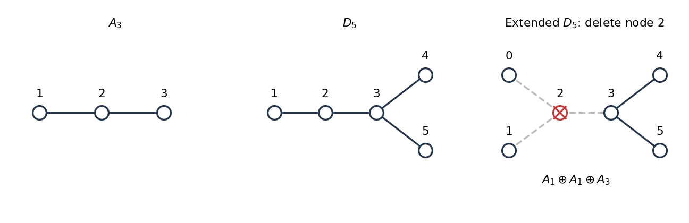

<h1 id="4/a/solution">Solution</h1>

↑ **Parent:** [A](../a.md)

For the [A3 root system](../../../../a3-root-system.md), take [simple roots](../../../../simple-root.md) $\alpha_i=e_i-e_{i+1}$ for $i=1,2,3$ in the hyperplane $\sum_{i=1}^4x_i=0$ of an orthonormal $\mathbb R^4$. Its [Dynkin diagram](../../../../dynkin-diagram.md) is the single-bond chain $1-2-3$. The [Cartan matrix](../../../../cartan-matrix.md) has entries $C_{ij}=2(\alpha_i,\alpha_j)/(\alpha_j,\alpha_j)$, giving

$$
\boxed{C_{A_3}=\begin{pmatrix}2&-1&0\\-1&2&-1\\0&-1&2\end{pmatrix}.}
$$

For a [weight](../../../../weight-representation-theory.md) $\mu$, use [Dynkin labels](../../../../dynkin-label.md) $w_i=2(\mu,\alpha_i)/(\alpha_i,\alpha_i)$. The four [weights](../../../../weight-representation-theory.md) $\mu_j=e_j-\tfrac14\sum_ke_k$ of the defining [representation](../../../../group-representation.md) have labels

$$
\boxed{F=\{(1,0,0),(-1,1,0),(0,-1,1),(0,0,-1)\}.}
$$

They form the [weight system](../../../../weight-system.md) with [highest weight](../../../../highest-weight-of-a-representation.md) $(1,0,0)$. Equivalently, subtract successive rows of $C_{A_3}$ from that [highest weight](../../../../highest-weight-of-a-representation.md). The [dual representation](../../../../dual-representation.md) negates every [weight](../../../../weight-representation-theory.md), so the [weight system](../../../../weight-system.md) with [highest weight](../../../../highest-weight-of-a-representation.md) $(0,0,1)$ is

$$
\boxed{\overline F=-F=\{(0,0,1),(0,1,-1),(1,-1,0),(-1,0,0)\}.}
$$

All these [weights](../../../../weight-representation-theory.md) have multiplicity one. The numbered [Dynkin diagrams](../../../../dynkin-diagram.md) used in this solution and in [solution](../b/solution.md) are shown below.

**[Figure 1](#4/a/image-numbered-dynkin-diagrams-for-the-a3-root-system-and-d5-root-system-with-deletion-from-the-extended-dynkin-diagram). Numbered Dynkin diagrams for the A3 root system and D5 root system, with deletion from the Extended Dynkin diagram**. All bonds are single. In the [Extended Dynkin diagram](../../../../extended-dynkin-diagram.md) of the [D5 root system](../../../../d5-root-system.md), deleting node 2 separates nodes 0 and 1 and leaves the three-node chain 4-3-5, giving the [root subsystem](../../../../root-subsystem.md) $A_1\oplus A_1\oplus A_3$.

## ↑ Ancestors (12)

1. [A](../a.md)
2. [4](../../4.md)
3. [2023](../../../2023-split.md)
4. [Past exam of the groups and representations course of the University of Oxford](../../../split.md)
5. [Groups and representations course of the University of Oxford](../../../../groups-and-representations-course-of-the-university-of-oxford.md)
6. [Year 4 of the mathematical and theoretical physics course of the University of Oxford](../../../../year-4-of-the-mathematical-and-theoretical-physics-course-of-the-university-of-oxford.md)
7. [Mathematical and theoretical physics course of the University of Oxford](../../../../mathematical-and-theoretical-physics-course-of-the-university-of-oxford.md)
8. [Undergraduate course of the University of Oxford](../../../../undergraduate-course-of-the-university-of-oxford.md)
9. [Course of the University of Oxford](../../../../course-of-the-university-of-oxford.md)
10. [University of Oxford](../../../../university-of-oxford-split.md)
11. [List of universities](../../../../list-of-universities.md)
12. [Codex Wiki](../../../../split.md)

## ← Incoming links (1)

- [Solution](../c/solution.md)
