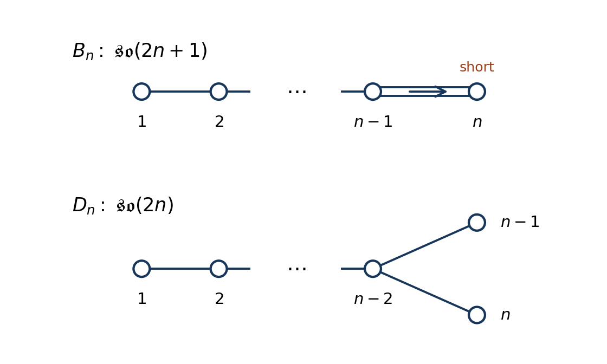

# 2025

↑ **Parent:** [Past exam of the groups and representations course of the University of Oxford](../past-exam-of-the-groups-and-representations-course-of-the-university-of-oxford.md)

Source PDF: [https://mmathphys.physics.ox.ac.uk/sites/g/files/vzsiac2991/files/mmathphys/documents/media/a15090h1.pdf](https://mmathphys.physics.ox.ac.uk/sites/g/files/vzsiac2991/files/mmathphys/documents/media/a15090h1.pdf)

These solutions cover every part of the held paper. Numbered headings identify the corresponding source parts; the question statements are not reproduced.

**Table of contents**

- [1](#1)
  - [a](#1/a)
    - [Solution](#1/a/solution)
  - [b](#1/b)
    - [Solution](#1/b/solution)
  - [c](#1/c)
    - [Solution](#1/c/solution)
  - [d](#1/d)
    - [Solution](#1/d/solution)
  - [e](#1/e)
    - [Solution](#1/e/solution)
- [2](#2)
  - [a](#2/a)
    - [Solution](#2/a/solution)
  - [b](#2/b)
    - [Solution](#2/b/solution)
  - [c](#2/c)
    - [Solution](#2/c/solution)
  - [d](#2/d)
    - [Solution](#2/d/solution)
- [3](#3)
  - [a](#3/a)
    - [Solution](#3/a/solution)
  - [b](#3/b)
    - [Solution](#3/b/solution)
  - [c](#3/c)
    - [Solution](#3/c/solution)
  - [d](#3/d)
    - [Solution](#3/d/solution)
- [4](#4)
  - [a](#4/a)
    - [Solution](#4/a/solution)
  - [b](#4/b)
    - [Solution](#4/b/solution)
  - [c](#4/c)
    - [Solution](#4/c/solution)
  - [d](#4/d)
    - [Solution](#4/d/solution)

## 1

↑ **Parent:** [2025](2025.md)

<h3 id="1/a">a</h3>

↑ **Parent:** [1](#1)

<h4 id="1/a/solution">Solution</h4>

↑ **Parent:** [A](#1/a)

A [group representation](../representation-theory.md#group-representation) on a [vector space](../vector-space.md) $V$ is a [group homomorphism](../group-theory.md#group-homomorphism) $R:G\to\operatorname{GL}(V)$, so $R(gh)=R(g)R(h)$ and $R(e)=I$. A nonzero [group representation](../representation-theory.md#group-representation) is an [irreducible representation](../representation-theory.md#irreducible-representation) if its only [invariant subspaces](../representation-theory.md#invariant-subspace) are $0$ and $V$. Here the [representations](../representation-theory.md#group-representation) and [characters](../representation-theory.md#character-of-a-representation) are finite-dimensional over the [complex numbers](../complex-analysis.md#complex-number).

The [character of a representation](../representation-theory.md#character-of-a-representation) is $\chi_R(g)=\operatorname{tr}R(g)$. Three useful properties are:

- It is a [class function](../representation-theory.md#class-function): $\chi_R(hgh^{-1})=\chi_R(g)$, by the cyclic property of the [trace](../linear-algebra.md#matrix-trace).
- It is additive on a [direct sum](../vector-space.md#direct-sum) and multiplicative on a [tensor product of group representations](../representation-theory.md#tensor-product-of-group-representations): $\chi_{R\oplus S}=\chi_R+\chi_S$ and $\chi_{R\otimes S}=\chi_R\chi_S$.
- The [irreducible characters](../representation-theory.md#irreducible-character) obey [character orthogonality](../representation-theory.md#character-orthogonality):$$
  \langle\chi_r,\chi_s\rangle=\frac1{|G|}\sum_{g\in G}\chi_r(g)^*\chi_s(g)=\delta_{rs}.
  $$

In particular, $\chi_R(e)=\dim V$ and $\chi_R(g^{-1})=\chi_R(g)^*$, the latter following from [unitarization of a finite-group representation](../representation-theory.md#unitarization-of-a-finite-group-representation). The [character inner product](../representation-theory.md#character-inner-product) $\langle\chi_r,\chi_R\rangle$ counts the multiplicity of an [irreducible representation](../representation-theory.md#irreducible-representation) $r$ in $R$.

<h3 id="1/b">b</h3>

↑ **Parent:** [1](#1)

<h4 id="1/b/solution">Solution</h4>

↑ **Parent:** [B](#1/b)

For any $h\in G$, left multiplication permutes the elements of the [finite group](../group.md#finite-group). Consequently [averaging over a finite group](../representation-theory.md#averaging-over-a-finite-group) gives

$$
R(h)Pv=\frac1{|G|}\sum_{g\in G}R(hg)v=\frac1{|G|}\sum_{k\in G}R(k)v=Pv.
$$

Thus $Pv$ belongs to the [fixed-point subspace of a group action](../representation-theory.md#fixed-point-subspace-of-a-group-action) $V^G$; any nonzero such vector spans a [trivial representation](../representation-theory.md#trivial-representation), or singlet. The zero vector is included in the invariance statement.

Conversely $Pw=w$ for every $w\in V^G$, so

$$
\boxed{\operatorname{im}P=V^G,\qquad P^2=P.}
$$

This is a [projection operator](../vector-space.md#projection-linear-algebra) onto all singlets, rather than necessarily onto a one-dimensional [vector subspace](../vector-space.md#vector-subspace). Its [trace](../linear-algebra.md#matrix-trace) is the singlet multiplicity $|G|^{-1}\sum_g\chi_R(g)$.

<h3 id="1/c">c</h3>

↑ **Parent:** [1](#1)

<h4 id="1/c/solution">Solution</h4>

↑ **Parent:** [C](#1/c)

Put $r=g_1$ and $s=g_2$. Direct [matrix multiplication](../vector-space.md#matrix-multiplication) gives

$$
r^3=s^2=I,\qquad srs=r^{-1}.
$$

Moving every $s$ to the right shows that every word in these [generators of a group](../group.md#generator-of-a-group) has the form $r^a s^b$, with $a\in\{0,1,2\}$ and $b\in\{0,1\}$. The three $r^a$ are distinct diagonal [matrices](../vector-space.md#matrix), and the three $r^as$ are distinct off-diagonal [matrices](../vector-space.md#matrix). Hence

$$
\boxed{G=\{I,r,r^2,s,rs,r^2s\},\qquad |G|=6.}
$$

Since $srs=r^2\ne r$, this is a [non-abelian group](../group.md#non-abelian-group). Its [group presentation](../geometric-group-theory.md#group-presentation) identifies it with the [dihedral group](../finite-group-theory.md#dihedral-group) of an equilateral triangle, equivalently the [symmetric group](../finite-group-theory.md#symmetric-group) $S_3$.

The [conjugacy classes](../group-action.md#conjugacy-class) are

$$
\boxed{\{I\},\qquad \{r,r^2\},\qquad \{s,rs,r^2s\}.}
$$

Indeed $s$ interchanges $r$ and $r^2$ by [conjugation](../group-action.md#conjugation), while $r^a s r^{-a}=r^{2a}s$ runs through all three reflections. No reflection is conjugate to a rotation, since [conjugation](../group-action.md#conjugation) preserves [order of a group element](../group-theory.md#order-of-a-group-element).

There are three inequivalent complex [irreducible representations](../representation-theory.md#irreducible-representation), one for each [conjugacy class](../group-action.md#conjugacy-class). The [sum of squares of irreducible representation dimensions](../representation-theory.md#sum-of-squares-of-irreducible-representation-dimensions) gives $d_1^2+d_2^2+d_3^2=6$. One [representation](../representation-theory.md#group-representation) is trivial, and the only possible positive integer dimensions are

$$
\boxed{d_1,d_2,d_3=1,1,2.}
$$

<h3 id="1/d">d</h3>

↑ **Parent:** [1](#1)

<h4 id="1/d/solution">Solution</h4>

↑ **Parent:** [D](#1/d)

Write $\mathbf1$ for the [trivial representation](../representation-theory.md#trivial-representation), $\varepsilon$ for the [sign representation](../representation-theory-of-the-symmetric-group.md#sign-representation), and $\mathbf2$ for the given two-dimensional [group representation](../representation-theory.md#group-representation). Their [matrix representations](../representation-theory.md#matrix-representation) on the [generators of a group](../group.md#generator-of-a-group) are

$$
\begin{array}{c|cc}
 &r&s\\\hline
\mathbf1&1&1\\
\varepsilon&1&-1\\
\mathbf2&\operatorname{diag}(\alpha,\alpha^{-1})&\begin{pmatrix}0&1\\1&0\end{pmatrix}
\end{array}
$$

with $\alpha=e^{2\pi i/3}$. The two [eigenvalues](../linear-operator-theory.md#eigenvalue) of $r$ in $\mathbf2$ are distinct, and $s$ exchanges its two [eigenlines](../linear-operator-theory.md#eigenline); no line is invariant under both. Thus $\mathbf2$ is an [irreducible representation](../representation-theory.md#irreducible-representation). The dimensions already exhaust the [sum of squares of irreducible representation dimensions](../representation-theory.md#sum-of-squares-of-irreducible-representation-dimensions), so this is the complete list.

Since $\alpha+\alpha^{-1}=-1$, the [character table](../representation-theory.md#character-table) is

$$
\boxed{
\begin{array}{c|rrr}
\text{class}&I&\{r,r^2\}&\{s,rs,r^2s\}\\
\text{class size}&1&2&3\\\hline
\chi_{\mathbf1}&1&1&1\\
\chi_{\varepsilon}&1&1&-1\\
\chi_{\mathbf2}&2&-1&0
\end{array}.}
$$

Multiplying [characters](../representation-theory.md#character-of-a-representation) and using [character orthogonality](../representation-theory.md#character-orthogonality) gives every [tensor product of group representations](../representation-theory.md#tensor-product-of-group-representations):

$$
\boxed{
\begin{array}{c|ccc}
\otimes&\mathbf1&\varepsilon&\mathbf2\\\hline
\mathbf1&\mathbf1&\varepsilon&\mathbf2\\
\varepsilon&\varepsilon&\mathbf1&\mathbf2\\
\mathbf2&\mathbf2&\mathbf2&\mathbf1\oplus\varepsilon\oplus\mathbf2
\end{array}.}
$$

For example $\chi_{\mathbf2}^2=(4,1,0)=\chi_{\mathbf1}+\chi_\varepsilon+\chi_{\mathbf2}$. Explicit [Clebsch-Gordan coefficients](../representation-theory.md#clebsch-gordan-coefficients) can be read from two doublets $x=(x_1,x_2)^T$, $y=(y_1,y_2)^T$:

$$
\mathbf1:\ x_1y_2+x_2y_1,\qquad
\varepsilon:\ x_1y_2-x_2y_1,\qquad
\mathbf2:\ \begin{pmatrix}x_2y_2\\x_1y_1\end{pmatrix}.
$$

The first two combinations are invariant under $r$ and respectively even and odd under $s$; the last transforms by the displayed doublet [matrices](../vector-space.md#matrix).

<h3 id="1/e">e</h3>

↑ **Parent:** [1](#1)

<h4 id="1/e/solution">Solution</h4>

↑ **Parent:** [E](#1/e)

Choose the doublet [bases](../vector-space.md#basis) so that the column of barred fields $B=(\bar\psi_L^1,\bar\psi_L^2)^T$ and $R=(\psi_R^1,\psi_R^2)^T$ both transform by the doublet [matrices](../vector-space.md#matrix) in [d](#1/d). This choice follows the source's assignment of the barred doublet itself. Since $H$ transforms in $\varepsilon$, its [Yukawa coupling](../standard-model.md#yukawa-interaction) must multiply a fermion bilinear in $\varepsilon$.

There is exactly one such bilinear in $\mathbf2\otimes\mathbf2$: the [Clebsch-Gordan coefficients](../representation-theory.md#clebsch-gordan-coefficients) in [d](#1/d) give $B_1R_2-B_2R_1$. Equivalently, writing the upper block of the [Yukawa matrix](../standard-model.md#yukawa-matrix) as $A$, invariance requires

$$
D(r)^TAD(r)=A,\qquad D(s)^TAD(s)=-A.
$$

The first equation sets $A_{11}=A_{22}=0$, because $\alpha^2\ne1$; the second sets $A_{21}=-A_{12}$.

A mixed doublet-singlet bilinear remains a doublet after multiplication by $H$, so all four mixed entries vanish. Finally $\bar\psi_L^3\psi_R^3$ transforms in $\varepsilon\otimes\mathbf1=\varepsilon$, and multiplication by $H$ makes it invariant. Therefore

$$
\boxed{\lambda=\begin{pmatrix}0&a&0\\-a&0&0\\0&0&b\end{pmatrix},\qquad a,b\in\mathbb C.}
$$

The allowed [Yukawa interaction](../standard-model.md#yukawa-interaction) is $H\{a(\bar\psi_L^1\psi_R^2-\bar\psi_L^2\psi_R^1)+b\bar\psi_L^3\psi_R^3\}$, together with its [Hermitian conjugate](../hilbert-space.md#hermitian-conjugation) when forming a real [Lagrangian density](../classical-field-theory.md#lagrangian-density).

The displayed texture depends on [basis](../vector-space.md#basis). If instead the unbarred left doublet is assigned $D$ in the same ordering as the right doublet, its barred doublet has the [dual representation](../representation-theory.md#dual-representation) $D^*$ and the equivalent upper block is $a\operatorname{diag}(1,-1)$. Exchanging the two barred components converts between these descriptions. In either convention there are exactly two independent complex [Yukawa couplings](../standard-model.md#yukawa-interaction).

## 2

↑ **Parent:** [2025](2025.md)

<h3 id="2/a">a</h3>

↑ **Parent:** [2](#2)

<h4 id="2/a/solution">Solution</h4>

↑ **Parent:** [A](#2/a)

For a curve $O(t)=I+tX+O(t^2)$ in the [special orthogonal group](../linear-algebra.md#special-orthogonal-group), differentiate $O(t)^TO(t)=I$ at the identity. This gives $X^T+X=0$. Conversely, the [matrix exponential](../linear-operator-theory.md#matrix-exponential) of any real [skew-symmetric matrix](../linear-algebra.md#skew-symmetric-matrix) is orthogonal and has [determinant](../multilinear-algebra.md#determinant) $\det e^{tX}=e^{t\operatorname{tr}X}=1$. Hence

$$
\boxed{\mathfrak{so}(N)=\{X\in M_N(\mathbb R):X^T=-X\},\qquad [X,Y]=XY-YX.}
$$

A [basis](../vector-space.md#basis) is $L_{ij}=E_{ij}-E_{ji}$ for $1\le i<j\le N$, where $E_{ij}$ is a [matrix unit](../vector-space.md#matrix-unit). If $L_{ji}=-L_{ij}$ and $L_{ii}=0$, their [Lie brackets](../lie-algebra.md#lie-bracket) are

$$
[L_{ij},L_{kl}]=\delta_{jk}L_{il}-\delta_{jl}L_{ik}-\delta_{ik}L_{jl}+\delta_{il}L_{jk}.
$$

There are $\binom N2$ independent off-diagonal entries. A [maximal torus](../lie-theory.md#maximal-torus) rotates independently in mutually orthogonal two-planes, generated by $L_{12},L_{34},\ldots$. Thus

$$
\boxed{\dim\mathfrak{so}(N)=\frac{N(N-1)}2,\qquad \operatorname{rank}\operatorname{SO}(N)=\left\lfloor\frac N2\right\rfloor.}
$$

The maximality follows by simultaneously decomposing commuting real [skew-symmetric matrices](../linear-algebra.md#skew-symmetric-matrix) into rotation two-planes, with at most one remaining fixed axis.

<h3 id="2/b">b</h3>

↑ **Parent:** [2](#2)

<h4 id="2/b/solution">Solution</h4>

↑ **Parent:** [B](#2/b)

The unbroken [group](../group.md) is the [stabilizer subgroup](../group-action.md#stabilizer-subgroup) of the [vacuum expectation value](../quantum-field-theory.md#vacuum-expectation-value). For a nonzero vector [vacuum expectation value](../quantum-field-theory.md#vacuum-expectation-value), an [orthogonal transformation](../linear-algebra.md#orthogonal-transformation) puts $\langle\phi\rangle=v e_N$. A special orthogonal transformation fixing it has the block form $\operatorname{diag}(A,1)$ with $A\in\operatorname{SO}(N-1)$. Consequently

$$
\boxed{\operatorname{SO}(N)\longrightarrow\operatorname{SO}(N-1)\quad(v\ne0).}
$$

The zero [vacuum expectation value](../quantum-field-theory.md#vacuum-expectation-value) leaves the entire [special orthogonal group](../linear-algebra.md#special-orthogonal-group) unbroken.

For a real [symmetric tensor](../multilinear-algebra.md#symmetric-tensor) write its [vacuum expectation value](../quantum-field-theory.md#vacuum-expectation-value) as a real [symmetric matrix](../linear-algebra.md#symmetric-matrix) $Q$. The transformation is $Q\mapsto OQO^T$. The [spectral theorem for real symmetric matrices](../linear-algebra.md#spectral-theorem-for-real-symmetric-matrices) gives an orthonormal [basis](../vector-space.md#basis) in which

$$
Q=\operatorname{diag}(q_1I_{m_1},\ldots,q_pI_{m_p}),\qquad q_i\ne q_j\ (i\ne j),\qquad \sum_i m_i=N.
$$

Because $OQO^T=Q$ is equivalent to $OQ=QO$, an unbroken transformation preserves each [eigenspace](../linear-operator-theory.md#eigenspace). The complete unbroken [group](../group.md) is therefore

$$
\boxed{H=S\bigl(O(m_1)\times\cdots\times O(m_p)\bigr)
=\{(A_1,\ldots,A_p):\prod_i\det A_i=1\}.}
$$

Its [identity component](../geometry-and-topology.md#identity-component) is $H^0=\prod_i\operatorname{SO}(m_i)$. This [symmetric tensor vacuum stabilizer](../quantum-field-theory.md#symmetric-tensor-vacuum-stabilizer) shows why the [representation](../representation-theory.md#group-representation) alone does not determine a unique breaking pattern:

- If $Q=qI$, all of $\operatorname{SO}(N)$ survives, even when $q\ne0$.
- If all [eigenvalues](../linear-operator-theory.md#eigenvalue) are distinct, $H\cong(\mathbb Z/2\mathbb Z)^{N-1}$, consisting of diagonal sign changes with total sign $+1$; no continuous symmetry survives.
- If the two [eigenvalue multiplicities](../linear-operator-theory.md#eigenvalue-multiplicity) are $m$ and $N-m$, then $H=S(O(m)\times O(N-m))$, with [identity component](../geometry-and-topology.md#identity-component) $\operatorname{SO}(m)\times\operatorname{SO}(N-m)$.

For example a rank-one tensor $Q=ve_Ne_N^T$ preserves $O(N-1)$ embedded by $A\mapsto\operatorname{diag}(A,\det A)$. Its continuous unbroken [group](../group.md) is $\operatorname{SO}(N-1)$, but it also allows reversal of the distinguished axis. Restricting to a traceless [symmetric tensor](../multilinear-algebra.md#symmetric-tensor) imposes $\sum_i m_iq_i=0$ and otherwise leaves the same classification.

<h3 id="2/c">c</h3>

↑ **Parent:** [2](#2)

<h4 id="2/c/solution">Solution</h4>

↑ **Parent:** [C](#2/c)

The [complexification of a Lie algebra](../lie-algebra.md#complexification-of-a-lie-algebra) gives $\mathfrak{so}(2n,\mathbb C)$ of type [Dn root system](../semisimple-lie-algebra.md#dn-root-system) and $\mathfrak{so}(2n+1,\mathbb C)$ of type [Bn root system](../semisimple-lie-algebra.md#bn-root-system). For $D_n$, the [simple roots](../semisimple-lie-algebra.md#simple-root) $\alpha_i=e_i-e_{i+1}$ for $1\le i<n$ and $\alpha_n=e_{n-1}+e_n$ give a chain $1,\ldots,n-2$ with two terminal nodes $n-1,n$ joined to $n-2$. All edges are single. For $B_n$, use $\alpha_i=e_i-e_{i+1}$ for $i<n$ and $\alpha_n=e_n$. The [Bn Dynkin diagram](../semisimple-lie-algebra.md#bn-dynkin-diagram-and-affine-extension) is a chain with a double final edge and an arrow pointing to the short node $n$.

**[Figure 1](#2/c/image-dynkin-diagrams-of-the-odd-and-even-orthogonal-lie-algebras-with-the-final-arrow-pointing-toward-the-short-root). Dynkin diagrams of the odd and even orthogonal Lie algebras, with the final arrow pointing toward the short root**.

The usual family diagrams apply to $D_n$ for $n\ge4$ and $B_n$ for $n\ge2$. The small cases are $D_3\cong A_3$, $D_2\cong A_1\oplus A_1$, $B_1\cong A_1$; $\mathfrak{so}(2)$ is one-dimensional and Abelian.

To fix [Casimir normalization for orthogonal vector representations](../semisimple-lie-algebra.md#casimir-normalization-for-orthogonal-vector-representations), use Hermitian [Lie algebra generators](../lie-algebra.md#lie-algebra-generator) $t_{ij}=i(E_{ij}-E_{ji})/\sqrt2$, so the defining [representation](../representation-theory.md#group-representation) has [Dynkin index](../semisimple-lie-algebra.md#dynkin-index) $c(\mathbf N)=1$. With long [roots](../semisimple-lie-algebra.md#root-of-a-root-system) of squared length two, the [quadratic Casimir operator](../semisimple-lie-algebra.md#quadratic-casimir-operator) has [Casimir eigenvalue](../semisimple-lie-algebra.md#casimir-eigenvalue)

$$
C_2(\lambda)=\frac12(\lambda,\lambda+2\rho)=\frac12\lambda^TG(\lambda+2\mathbf1),
$$

where $\rho$ is the [Weyl vector](../semisimple-lie-algebra.md#half-sum-of-positive-roots) and $\lambda$ in the final expression is the column of [Dynkin labels](../semisimple-lie-algebra.md#dynkin-label). The defining [fundamental representation](../semisimple-lie-algebra.md#fundamental-representation) has [highest weight](../semisimple-lie-algebra.md#highest-weight-of-a-representation) $(1,0,\ldots,0)$ in the stated family conventions.

For $D_n$, the row supplied in the source has sum $n-1$ and first entry one, so

$$
C_2(\mathbf{2n})=\frac12\{1+2(n-1)\}=\frac{2n-1}{2}.
$$

For $B_n$, the supplied row has sum $n-\tfrac12$, giving

$$
C_2(\mathbf{2n+1})=\frac12\{1+2(n-\tfrac12)\}=n.
$$

Taking the [trace](../linear-algebra.md#matrix-trace) of $\sum_a t_at_a=C_2(R)I_R$ gives the relation between the [Dynkin index](../semisimple-lie-algebra.md#dynkin-index) and [Casimir eigenvalue](../semisimple-lie-algebra.md#casimir-eigenvalue), $c(R)\dim\mathfrak g=C_2(R)\dim R$. Therefore

$$
\boxed{C_2(\mathbf N)=\frac{N-1}{2},\qquad c(\mathbf N)=1.}
$$

There is also a direct check: each coordinate appears in $N-1$ planes and $t_{ij}^2=(E_{ii}+E_{jj})/2$, so $\sum_{i<j}t_{ij}^2=(N-1)I/2$.

If the [Casimir operator](../semisimple-lie-algebra.md#casimir-element) is instead defined by $C(\lambda)=(\lambda,\lambda+2\rho)$, every [Lie algebra generator](../lie-algebra.md#lie-algebra-generator) is larger by $\sqrt2$ and the corresponding answers are $C(\mathbf N)=N-1$ and $c(\mathbf N)=2$. These are the same [Lie algebra](../lie-algebra.md) in a different normalization. At the exceptional small ranks the family [Dynkin labels](../semisimple-lie-algebra.md#dynkin-label) of the vector change, but the direct [matrix](../vector-space.md#matrix) computation remains valid.

<h3 id="2/d">d</h3>

↑ **Parent:** [2](#2)

<h4 id="2/d/solution">Solution</h4>

↑ **Parent:** [D](#2/d)

In the normalization $c(\mathbf8)=1$ of [c](#2/c), the [Adjoint representation](../lie-algebra.md#adjoint-representation-of-a-lie-algebra) of $D_4$ has [highest weight](../semisimple-lie-algebra.md#highest-weight-of-a-representation) $\lambda_{\mathrm{adj}}=(0,1,0,0)$, the [highest root](../semisimple-lie-algebra.md#highest-root). The supplied [Gram matrix](../inner-product.md#gram-matrix) has second row $(1,2,1,1)$, whose sum is five. Hence

$$
C_2(\mathrm{adj})=\frac12(2+2\cdot5)=6.
$$

The [Adjoint representation](../lie-algebra.md#adjoint-representation-of-a-lie-algebra) has the same dimension as the [Lie algebra](../lie-algebra.md), so its [Dynkin index](../semisimple-lie-algebra.md#dynkin-index) is also $c(\mathrm{adj})=6$. The $k$ [Weyl fermions](../relativistic-quantum-field.md#weyl-spinor) form a [direct sum](../vector-space.md#direct-sum) of $k$ vector [representations](../representation-theory.md#group-representation); additivity of the [trace](../linear-algebra.md#matrix-trace) gives $c(r_W)=k$.

Substitution into the given one-loop [renormalization-group beta function](../perturbative-quantum-field-theory.md#beta-function-physics) yields

$$
\boxed{\beta(g)=-\frac{g^3}{16\pi^2}\left(22-\frac{2k}{3}\right)
=-\frac{33-k}{24\pi^2}g^3.}
$$

For positive $g$, [asymptotic freedom](../perturbative-quantum-field-theory.md#asymptotic-freedom) at this order requires a negative [beta function](../complex-analysis.md#beta-function), equivalently

$$
\boxed{k<33;\quad\text{for a nonnegative integer number of fermions, }k=0,1,\ldots,32.}
$$

Indeed, if $b_0=22-2k/3>0$, integrating $\mu\,dg/d\mu=-b_0g^3/(16\pi^2)$ gives

$$
\frac1{g^2(\mu)}=\frac1{g^2(\mu_0)}+\frac{b_0}{8\pi^2}\log\frac\mu{\mu_0},
$$

so the [gauge coupling](../relativistic-quantum-field.md#gauge-coupling) decreases towards zero as the energy scale increases. At $k=33$ the one-loop coefficient vanishes and the given equation cannot decide [asymptotic freedom](../perturbative-quantum-field-theory.md#asymptotic-freedom); $k>33$ has the opposite one-loop running.

With the alternative convention $C(\lambda)=\lambda^TG(\lambda+2\mathbf1)$ described in [c](#2/c), $c(\mathbf8)=2$, $c(\mathrm{adj})=12$, and the same source formula reads $\beta(g)=-(44-4k/3)g^3/(16\pi^2)$. Rescaling the [gauge coupling](../relativistic-quantum-field.md#gauge-coupling) together with the [Lie algebra generators](../lie-algebra.md#lie-algebra-generator) relates the conventions; the bound $k<33$ is identical.

## 3

↑ **Parent:** [2025](2025.md)

<h3 id="3/a">a</h3>

↑ **Parent:** [3](#3)

<h4 id="3/a/solution">Solution</h4>

↑ **Parent:** [A](#3/a)

Adopt the [Minkowski metric](../special-relativity.md#minkowski-metric) $\eta=\operatorname{diag}(-1,+1)$ and the [Clifford algebra](../algebra-over-a-field.md#clifford-algebra) convention $\{\gamma_\mu,\gamma_\nu\}=2\eta_{\mu\nu}I$. The source's [Pauli matrices](../algebra.md#pauli-matrices) give

$$
\gamma_0=\begin{pmatrix}0&-1\\1&0\end{pmatrix},\qquad
\gamma_1=\begin{pmatrix}0&1\\1&0\end{pmatrix}.
$$

They satisfy $\gamma_0^2=-I$, $\gamma_1^2=I$ and $\gamma_0\gamma_1=-\gamma_1\gamma_0=-\sigma_3$, which verifies the required [Clifford algebra](../algebra-over-a-field.md#clifford-algebra). Raising the indices gives $\gamma^0=-\gamma_0$ and $\gamma^1=\gamma_1$.

Fix the sign of the [rapidity](../special-relativity.md#rapidity) $\theta$ by taking the [Lorentz boost](../special-relativity.md#lorentz-boost)

$$
\begin{pmatrix}t'\\x'\end{pmatrix}
=\Lambda(\theta)\begin{pmatrix}t\\x\end{pmatrix},\qquad
\Lambda(\theta)=\begin{pmatrix}\cosh\theta&-\sinh\theta\\-\sinh\theta&\cosh\theta\end{pmatrix}.
$$

The corresponding [Spinor representation of the Lorentz group](../relativistic-quantum-field.md#spinor-representation-of-the-lorentz-group) is

$$
S(\theta)=\exp\left(\frac\theta2\gamma^0\gamma^1\right)
=\exp\left(\frac\theta2\sigma_3\right)
=\operatorname{diag}(e^{\theta/2},e^{-\theta/2}).
$$

For example $S^{-1}\gamma^0S=\gamma^0\cosh\theta-\gamma^1\sinh\theta$ and $S^{-1}\gamma^1S=\gamma^1\cosh\theta-\gamma^0\sinh\theta$, establishing [Lorentz covariance](../special-relativity.md#lorentz-covariance) by $S^{-1}\gamma^\mu S=\Lambda^\mu{}_{\nu}\gamma^\nu$.

Thus the [Dirac spinor](../relativistic-quantum-field.md#dirac-spinor) transforms as $\psi'(x')=S(\theta)\psi(x)$, with infinitesimal law

$$
\boxed{\delta\psi=\frac\theta2\sigma_3\psi,\qquad
\delta\psi_+=\frac\theta2\psi_+,\qquad
\delta\psi_-=-\frac\theta2\psi_-.}
$$

These variations compare the fields at corresponding spacetime points. At a fixed coordinate one adds the usual orbital term $-\delta x^\mu\partial_\mu\psi$. Reversing the [rapidity](../special-relativity.md#rapidity) convention reverses both boost signs consistently. Infinitesimal transformations describe the [proper orthochronous Lorentz group](../special-relativity.md#proper-orthochronous-lorentz-group).

<h3 id="3/b">b</h3>

↑ **Parent:** [3](#3)

<h4 id="3/b/solution">Solution</h4>

↑ **Parent:** [B](#3/b)

Choose the [chirality](../relativistic-quantum-field.md#chirality-physics) operator

$$
\Gamma=\gamma^0\gamma^1=\sigma_3,\qquad \Gamma^2=I,\qquad \{\Gamma,\gamma^\mu\}=0.
$$

A [Weyl spinor](../relativistic-quantum-field.md#weyl-spinor) is a [Dirac spinor](../relativistic-quantum-field.md#dirac-spinor) restricted to one [eigenspace](../linear-operator-theory.md#eigenspace) of $\Gamma$. The [chiral projectors](../relativistic-quantum-field.md#chiral-projector) are $P_R=(I+\Gamma)/2$ and $P_L=(I-\Gamma)/2$. Consequently

$$
\boxed{\psi_R=P_R\psi=\begin{pmatrix}\psi_+\\0\end{pmatrix},\qquad
\psi_L=P_L\psi=\begin{pmatrix}0\\\psi_-\end{pmatrix}.}
$$

The two independent [Weyl spinors](../relativistic-quantum-field.md#weyl-spinor) each contain one complex component. Since $[S(\theta),\Gamma]=0$, each [chirality](../relativistic-quantum-field.md#chirality-physics) is preserved by every connected [Lorentz transformation](../special-relativity.md#lorentz-transformation), with $\psi_R\mapsto e^{\theta/2}\psi_R$ and $\psi_L\mapsto e^{-\theta/2}\psi_L$. A spatial reflection exchanges the two [chiralities](../relativistic-quantum-field.md#chirality-physics).

The left/right names depend on the sign convention for $\Gamma$. Choosing $\gamma_0\gamma_1=-\sigma_3$ as the [chirality](../relativistic-quantum-field.md#chirality-physics) operator exchanges the labels $L$ and $R$; the two invariant one-component [representations](../representation-theory.md#group-representation) are the same.

<h3 id="3/c">c</h3>

↑ **Parent:** [3](#3)

<h4 id="3/c/solution">Solution</h4>

↑ **Parent:** [C](#3/c)

All [gamma matrices](../algebra-over-a-field.md#gamma-matrices) in this [basis](../vector-space.md#basis) are real, and the [Lorentz transformation](../special-relativity.md#lorentz-transformation) $S(\theta)$ is real. Therefore [complex conjugation](../complex-analysis.md#complex-conjugation) commutes with the connected [Spinor representation of the Lorentz group](../relativistic-quantum-field.md#spinor-representation-of-the-lorentz-group). With a suitable phase convention, [charge conjugation](../quantum-field-theory.md#charge-conjugation) is simply $\psi^c=\psi^*$. The [Majorana spinor](../relativistic-quantum-field.md#majorana-spinor) condition $\psi^c=\psi$ becomes

$$
\boxed{\psi_M=\begin{pmatrix}a\\b\end{pmatrix},\qquad a^*=a,\quad b^*=b.}
$$

The reality constraint is preserved by [Lorentz transformations](../special-relativity.md#lorentz-transformation) because $(S\psi_M)^*=S\psi_M$. For fermion fields, real components mean self-conjugate [Grassmann variables](../multilinear-algebra.md#grassmann-variable) or self-adjoint field components, rather than ordinary commuting real numbers.

Moreover, $\Gamma=\sigma_3$ is real, so [charge conjugation](../quantum-field-theory.md#charge-conjugation) commutes with the [chiral projectors](../relativistic-quantum-field.md#chiral-projector). The [Majorana spinor](../relativistic-quantum-field.md#majorana-spinor) and [Weyl spinor](../relativistic-quantum-field.md#weyl-spinor) conditions can therefore be imposed simultaneously. The [Majorana-Weyl spinors](../relativistic-quantum-field.md#majorana-weyl-spinor) are

$$
\boxed{\psi_{MR}=\begin{pmatrix}a\\0\end{pmatrix},\qquad
\psi_{ML}=\begin{pmatrix}0\\b\end{pmatrix},\qquad a^*=a,\ b^*=b.}
$$

The independent real component counts are

$$
\boxed{
\begin{array}{c|c}
\text{spinor type}&\text{real components}\\\hline
\text{Dirac}&4\\
\text{Weyl, either chirality}&2\\
\text{Majorana}&2\\
\text{Majorana-Weyl, either chirality}&1
\end{array}.}
$$

These are component counts before imposing an equation of motion. In particular the simultaneous reality and [chirality](../relativistic-quantum-field.md#chirality-physics) constraints are compatible in this spacetime dimension, unlike the familiar four-dimensional case.

<h3 id="3/d">d</h3>

↑ **Parent:** [3](#3)

<h4 id="3/d/solution">Solution</h4>

↑ **Parent:** [D](#3/d)

Because the present $\gamma_0$ is anti-Hermitian, choose the [Dirac adjoint](../relativistic-quantum-field.md#dirac-adjoint) with Hermitian intertwining matrix $A=i\gamma_0$:

$$
\bar\psi=\psi^\dagger A,\qquad A=i\gamma_0=\begin{pmatrix}0&-i\\i&0\end{pmatrix}.
$$

This convention makes the [Dirac scalar bilinear](../relativistic-quantum-field.md#dirac-scalar-bilinear) $\bar\psi\psi$ Hermitian. For real $m$, a [Lorentz invariant](../special-relativity.md#lorentz-invariance) [mass term](../classical-field-theory.md#mass-term) is

$$
\boxed{\mathcal L_m=-m\bar\psi\psi
=im\left(\psi_+^*\psi_- -\psi_-^*\psi_+\right).}
$$

To check infinitesimal [Lorentz invariance](../special-relativity.md#lorentz-invariance), put $K=\sigma_3/2$. Then $K^\dagger=K$ and $K^\dagger A+AK=\{K,A\}=0$. Using [a](#3/a),

$$
\delta\mathcal L_m=-m\theta\psi^\dagger(K^\dagger A+AK)\psi=0.
$$

Equivalently, $\delta(\psi_+^*\psi_-)=\theta\psi_+^*\psi_-/2-\theta\psi_+^*\psi_-/2=0$, and similarly for its [complex conjugate](../complex-analysis.md#complex-conjugate). Exponentiation gives $S^\dagger AS=A$ and therefore $\bar\psi'(x')=\bar\psi(x)S^{-1}$.

At fixed coordinates $\mathcal L_m$ has only the orbital variation of a [Lorentz scalar](../special-relativity.md#lorentz-scalar); the spacetime measure is invariant under the connected [Lorentz group](../special-relativity.md#lorentz-group), so the integrated [action](../lagrangian-mechanics.md#action) is invariant. The [mass term](../classical-field-theory.md#mass-term) pairs the two opposite [chiralities](../relativistic-quantum-field.md#chirality-physics); retaining only one [Weyl spinor](../relativistic-quantum-field.md#weyl-spinor) removes this Dirac mass. An equivalent spinor phase convention gives a real multiple of $\psi_+^*\psi_-+\psi_-^*\psi_+$ instead.

## 4

↑ **Parent:** [2025](2025.md)

<h3 id="4/a">a</h3>

↑ **Parent:** [4](#4)

<h4 id="4/a/solution">Solution</h4>

↑ **Parent:** [A](#4/a)

For the [A5 root system](../semisimple-lie-algebra.md#a5-root-system), take [simple roots](../semisimple-lie-algebra.md#simple-root) $\alpha_i=e_i-e_{i+1}$, $i=1,\ldots,5$, in the hyperplane $\sum_{i=1}^6x_i=0$. Their squared lengths are two, adjacent [simple roots](../semisimple-lie-algebra.md#simple-root) have [inner product](../inner-product.md) $-1$, and all other pairs are orthogonal. Hence the [An Dynkin diagram](../semisimple-lie-algebra.md#an-dynkin-diagram) is the five-node single-edge chain

$$
\underset{1}{\circ}\! -\!\underset{2}{\circ}\! -\!\underset{3}{\circ}\! -\!\underset{4}{\circ}\! -\!\underset{5}{\circ}.
$$

Its [Cartan matrix](../semisimple-lie-algebra.md#cartan-matrix) is

$$
\boxed{A(A_5)=\begin{pmatrix}
2&-1&0&0&0\\
-1&2&-1&0&0\\
0&-1&2&-1&0\\
0&0&-1&2&-1\\
0&0&0&-1&2
\end{pmatrix}.}
$$

The complex [Lie algebra](../lie-algebra.md) is $\mathfrak{sl}_6(\mathbb C)$; the corresponding compact [special unitary group](../topological-group.md#special-unitary-group) is $SU(6)$, whose [Lie algebra](../lie-algebra.md) is its compact real form.

<h3 id="4/b">b</h3>

↑ **Parent:** [4](#4)

<h4 id="4/b/solution">Solution</h4>

↑ **Parent:** [B](#4/b)

Let $V=\mathbb C^6$ be the defining [fundamental representation](../semisimple-lie-algebra.md#fundamental-representation) of $SU(6)$. Its [weights](../semisimple-lie-algebra.md#weight-representation-theory) are $w_i=e_i-\tfrac16\sum_{j=1}^6e_j$. Pairing with the [simple coroots](../semisimple-lie-algebra.md#simple-coroot) gives [Dynkin labels](../semisimple-lie-algebra.md#dynkin-label) $(w_i)_a=\delta_{ia}-\delta_{i,a+1}$. Thus the complete list is

$$
\begin{array}{c|rrrrr}
 &a_1&a_2&a_3&a_4&a_5\\\hline
w_1&1&0&0&0&0\\
w_2&-1&1&0&0&0\\
w_3&0&-1&1&0&0\\
w_4&0&0&-1&1&0\\
w_5&0&0&0&-1&1\\
w_6&0&0&0&0&-1
\end{array}.
$$

Successive [lowering operators](../semisimple-lie-algebra.md#lowering-operator) subtract the corresponding rows of the [Cartan matrix](../semisimple-lie-algebra.md#cartan-matrix) in [a](#4/a). Each [weight multiplicity](../semisimple-lie-algebra.md#weight-multiplicity) is one.

The complex-conjugate [representation](../representation-theory.md#group-representation) $\overline{\mathbf6}\cong V^*$ is the [dual representation](../representation-theory.md#dual-representation) and has the negatives of these [weights](../semisimple-lie-algebra.md#weight-representation-theory). Its [highest weight](../semisimple-lie-algebra.md#highest-weight-of-a-representation) is $-w_6=(0,0,0,0,1)$, and its entire [weight decomposition](../semisimple-lie-algebra.md#weight-decomposition) is

$$
\boxed{\operatorname{Wt}(\overline{\mathbf6})=\left\{
\begin{array}{r}
(-1,0,0,0,0),\\
(1,-1,0,0,0),\\
(0,1,-1,0,0),\\
(0,0,1,-1,0),\\
(0,0,0,1,-1),\\
(0,0,0,0,1)
\end{array}\right\}.}
$$

Every entry has [weight multiplicity](../semisimple-lie-algebra.md#weight-multiplicity) one.

The [two-index antisymmetric representation](../semisimple-lie-algebra.md#two-index-antisymmetric-representation) is $\Lambda^2V=\mathbf{15}$, of dimension $\binom62=15$ and [highest weight](../semisimple-lie-algebra.md#highest-weight-of-a-representation) $w_1+w_2=(0,1,0,0,0)$. A [weight basis](../semisimple-lie-algebra.md#weight-basis) is $e_i\wedge e_j$ for $i<j$, carrying [weight](../semisimple-lie-algebra.md#weight-representation-theory) $w_i+w_j$. The fifteen sums, all distinct and all of [weight multiplicity](../semisimple-lie-algebra.md#weight-multiplicity) one, are

$$
\boxed{
\begin{array}{c|rrrrr}
ij&a_1&a_2&a_3&a_4&a_5\\\hline
12&0&1&0&0&0\\
13&1&-1&1&0&0\\
14&1&0&-1&1&0\\
15&1&0&0&-1&1\\
16&1&0&0&0&-1\\
23&-1&0&1&0&0\\
24&-1&1&-1&1&0\\
25&-1&1&0&-1&1\\
26&-1&1&0&0&-1\\
34&0&-1&0&1&0\\
35&0&-1&1&-1&1\\
36&0&-1&1&0&-1\\
45&0&0&-1&0&1\\
46&0&0&-1&1&-1\\
56&0&0&0&-1&0
\end{array}.}
$$

The exclusion of $i=j$ comes from the [exterior square](../multilinear-algebra.md#exterior-square), where $e_i\wedge e_i=0$.

<h3 id="4/c">c</h3>

↑ **Parent:** [4](#4)

<h4 id="4/c/solution">Solution</h4>

↑ **Parent:** [C](#4/c)

For the standard [A4 root system](../semisimple-lie-algebra.md#a4-root-system) inside the [A5 root system](../semisimple-lie-algebra.md#a5-root-system), let $p$ delete the fifth [Dynkin label](../semisimple-lie-algebra.md#dynkin-label). Put $v_i=p(w_i)$ for $i\le5$. These are precisely the five [weights](../semisimple-lie-algebra.md#weight-representation-theory) of the defining $SU(5)$ [fundamental representation](../semisimple-lie-algebra.md#fundamental-representation):

$$
(v_1,v_2,v_3,v_4,v_5)=\bigl((1,0,0,0),(-1,1,0,0),(0,-1,1,0),(0,0,-1,1),(0,0,0,-1)\bigr).
$$

Since $p(w_6)=0$, the six projected [weights](../semisimple-lie-algebra.md#weight-representation-theory) of $\overline{\mathbf6}$ are $-v_1,\ldots,-v_5,0$. The first five form the [dual representation](../representation-theory.md#dual-representation) $\overline{\mathbf5}$, with [highest weight](../semisimple-lie-algebra.md#highest-weight-of-a-representation) $(0,0,0,1)$; the last is a singlet. Thus

$$
\boxed{\overline{\mathbf6}\downarrow_{SU(5)}=\overline{\mathbf5}\oplus\mathbf1.}
$$

For $\mathbf{15}$, split the fifteen [weights](../semisimple-lie-algebra.md#weight-representation-theory) in [b](#4/b) into the ten pairs with $1\le i<j\le5$ and the five pairs $i6$. The former project to $v_i+v_j$, the complete [weight decomposition](../semisimple-lie-algebra.md#weight-decomposition) of $\Lambda^2\mathbf5=\mathbf{10}$, with [highest weight](../semisimple-lie-algebra.md#highest-weight-of-a-representation) $(0,1,0,0)$. The latter project to $v_i$, the complete [weight decomposition](../semisimple-lie-algebra.md#weight-decomposition) of $\mathbf5$. Therefore

$$
\boxed{\mathbf{15}\downarrow_{SU(5)}=\mathbf{10}\oplus\mathbf5.}
$$

This [restriction of a representation](../representation-theory.md#restriction-of-a-representation) can also be checked without a table: $V\downarrow_{SU(5)}=\mathbf5\oplus\mathbf1$, so its [dual representation](../representation-theory.md#dual-representation) is $\overline{\mathbf5}\oplus\mathbf1$, while its [exterior square](../multilinear-algebra.md#exterior-square) is $\Lambda^2\mathbf5\oplus(\mathbf5\otimes\mathbf1)$. The dimensions match $6=5+1$ and $15=10+5$.

<h3 id="4/d">d</h3>

↑ **Parent:** [4](#4)

<h4 id="4/d/solution">Solution</h4>

↑ **Parent:** [D](#4/d)

One generation of left-handed [Standard Model fermions](../standard-model.md#standard-model-fermion) fits into $\overline{\mathbf5}\oplus\mathbf{10}$ of an [SU(5) grand unified theory](../perturbative-quantum-field-theory.md#su-5-grand-unified-theory). With [hypercharge](../standard-model.md#hypercharge) defined by $Q=T_3+Y$, their [restriction of a representation](../representation-theory.md#restriction-of-a-representation) to $SU(3)_c\times SU(2)_L\times U(1)_Y$ is

$$
\begin{aligned}
\overline{\mathbf5}&\longrightarrow(\overline{\mathbf3},\mathbf1)_{1/3}\oplus(\mathbf1,\mathbf2)_{-1/2}
&&\text{carrying }d^c,L,\\
\mathbf{10}&\longrightarrow(\mathbf3,\mathbf2)_{1/6}\oplus(\overline{\mathbf3},\mathbf1)_{-2/3}\oplus(\mathbf1,\mathbf1)_1
&&\text{carrying }Q,u^c,e^c.
\end{aligned}
$$

Here $Q$ in the multiplet list denotes the left-handed [quark](../standard-model.md#quark) doublet, and the superscript $c$ labels left-handed [charge-conjugate fields](../quantum-field-theory.md#charge-conjugate-field) of the corresponding right-handed [fermions](../tensor-product-of-quantum-systems.md#fermion).

The results of [c](#4/c) therefore give

$$
\boxed{\overline{\mathbf6}\oplus\mathbf{15}\longrightarrow
\underbrace{\overline{\mathbf5}\oplus\mathbf{10}}_{\text{one ordinary generation}}
\oplus\underbrace{\mathbf1\oplus\mathbf5}_{\text{additional multiplets}}.}
$$

Thus the required matter [representations](../representation-theory.md#group-representation) are present. The extra singlet has [Standard Model representation](../standard-model.md#standard-model-representation) $(\mathbf1,\mathbf1)_0$ and can describe the left-handed [charge-conjugate field](../quantum-field-theory.md#charge-conjugate-field) of a [right-handed neutrino](../standard-model.md#right-handed-neutrino). Its [gauge singlet](../representation-theory.md#gauge-singlet) character permits a [Majorana mass term](../relativistic-quantum-field.md#majorana-mass-term); a [Yukawa interaction](../standard-model.md#yukawa-interaction) with a lepton doublet and a suitable [Higgs field](../standard-model.md#higgs-field) can then supply neutrino masses. The [branching](../lie-algebra.md#branching-rule) alone does not fix those interactions or their scales.

The extra $\mathbf5$ has

$$
\mathbf5\longrightarrow(\mathbf3,\mathbf1)_{-1/3}\oplus(\mathbf1,\mathbf2)_{1/2}.
$$

If it describes [Weyl fermions](../relativistic-quantum-field.md#weyl-spinor), these are additional coloured and electroweak [fermions](../tensor-product-of-quantum-systems.md#fermion) in the conjugate [Standard Model representations](../standard-model.md#standard-model-representation) to the ordinary $\overline{\mathbf5}$. With an additional $\overline{\mathbf5}$, they can form a [vectorlike gauge spectrum](../relativistic-quantum-field.md#vectorlike-gauge-spectrum) and acquire invariant masses. Pairing them with the only ordinary $\overline{\mathbf5}$ would also remove that generation's $d^c,L$ fields, so a realistic heavy pairing needs extra matter. If the $\mathbf5$ instead describes a [scalar field](../classical-field-theory.md#scalar-field), it has the quantum numbers of the usual $SU(5)$ [Higgs field](../standard-model.md#higgs-field): a weak doublet and a coloured triplet. A single fermionic $\mathbf{15}$ does not turn its extra fermions into a scalar [Higgs field](../standard-model.md#higgs-field) merely by [branching](../lie-algebra.md#branching-rule).

There is a further consistency condition if these are the entire chiral matter content of an $SU(6)$ [gauge theory](../classical-field-theory.md#gauge-theory). Normalize the [cubic anomaly coefficient](../semisimple-lie-algebra.md#cubic-anomaly-coefficient) by $A(\mathbf6)=1$. The [dual representation](../representation-theory.md#dual-representation) has $A(\overline{\mathbf6})=-1$, and the [two-index antisymmetric representation](../semisimple-lie-algebra.md#two-index-antisymmetric-representation) has $A(\mathbf{15})=6-4=2$. Thus one copy of each has nonzero [gauge anomaly](../relativistic-quantum-field.md#gauge-anomaly), $A_{\mathrm{total}}=1$. Their inclusion of the desired $SU(5)$ multiplets is therefore not, by itself, a complete consistent chiral unified theory.

For example, [anomaly cancellation](../relativistic-quantum-field.md#anomaly-cancellation) holds for $\mathbf{15}\oplus2\overline{\mathbf6}$, whose [restriction of a representation](../representation-theory.md#restriction-of-a-representation) is

$$
\boxed{\mathbf{15}\oplus2\overline{\mathbf6}\longrightarrow
(\mathbf{10}\oplus\overline{\mathbf5})\oplus(\mathbf5\oplus\overline{\mathbf5})\oplus2\mathbf1.}
$$

This leaves one ordinary generation, a potentially massive [vectorlike gauge spectrum](../relativistic-quantum-field.md#vectorlike-gauge-spectrum), and two possible singlet neutrinos. This anomaly-free matter choice is also used in explicit $SU(6)$ model constructions.[Section 3, equations (14)–(16) and following discussion: the fifteen-dimensional antisymmetric representation has anomaly coefficient 2, and the conjugate fundamental has coefficient −1](../physics-bibliography.md#number-of-fermion-generations-from-a-novel-grand-unified-model-by-pritibhajan-byakti-and-others) These interpretations require additional choices of matter statistics, [spontaneous symmetry breaking](../quantum-field-theory.md#spontaneous-symmetry-breaking), and interactions; the [weight systems](../semisimple-lie-algebra.md#weight-system) determine the multiplet content.

## ↑ Ancestors (9)

1. [Past exam of the groups and representations course of the University of Oxford](../past-exam-of-the-groups-and-representations-course-of-the-university-of-oxford.md)
2. [Groups and representations course of the University of Oxford](../university-of-oxford.md#groups-and-representations-course-of-the-university-of-oxford)
3. [Year 4 of the mathematical and theoretical physics course of the University of Oxford](../university-of-oxford.md#year-4-of-the-mathematical-and-theoretical-physics-course-of-the-university-of-oxford)
4. [Mathematical and theoretical physics course of the University of Oxford](../university-of-oxford.md#mathematical-and-theoretical-physics-course-of-the-university-of-oxford)
5. [Undergraduate course of the University of Oxford](../university-of-oxford.md#undergraduate-course-of-the-university-of-oxford)
6. [Course of the University of Oxford](../university-of-oxford.md#course-of-the-university-of-oxford)
7. [University of Oxford](../university-of-oxford.md)
8. [List of universities](../README.md#list-of-universities)
9. [Codex Wiki](../README.md)
