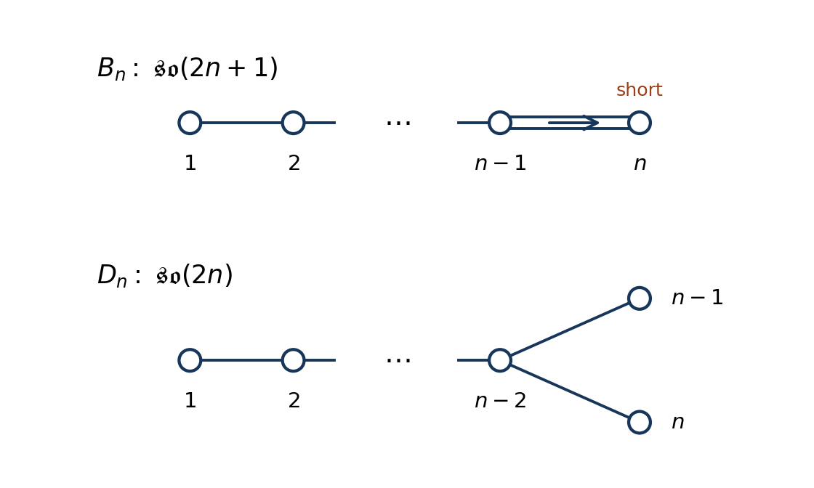

<h1 id="2/c/solution">Solution</h1>

↑ **Parent:** [C](../c.md)

The [complexification of a Lie algebra](../../../../complexification-of-a-lie-algebra.md) gives $\mathfrak{so}(2n,\mathbb C)$ of type [Dn root system](../../../../dn-root-system.md) and $\mathfrak{so}(2n+1,\mathbb C)$ of type [Bn root system](../../../../bn-root-system.md). For $D_n$, the [simple roots](../../../../simple-root.md) $\alpha_i=e_i-e_{i+1}$ for $1\le i<n$ and $\alpha_n=e_{n-1}+e_n$ give a chain $1,\ldots,n-2$ with two terminal nodes $n-1,n$ joined to $n-2$. All edges are single. For $B_n$, use $\alpha_i=e_i-e_{i+1}$ for $i<n$ and $\alpha_n=e_n$. The [Bn Dynkin diagram](../../../../bn-dynkin-diagram-and-affine-extension.md) is a chain with a double final edge and an arrow pointing to the short node $n$.

**[Figure 1](#2/c/image-dynkin-diagrams-of-the-odd-and-even-orthogonal-lie-algebras-with-the-final-arrow-pointing-toward-the-short-root). Dynkin diagrams of the odd and even orthogonal Lie algebras, with the final arrow pointing toward the short root**.

The usual family diagrams apply to $D_n$ for $n\ge4$ and $B_n$ for $n\ge2$. The small cases are $D_3\cong A_3$, $D_2\cong A_1\oplus A_1$, $B_1\cong A_1$; $\mathfrak{so}(2)$ is one-dimensional and Abelian.

To fix [Casimir normalization for orthogonal vector representations](../../../../casimir-normalization-for-orthogonal-vector-representations.md), use Hermitian [Lie algebra generators](../../../../lie-algebra-generator.md) $t_{ij}=i(E_{ij}-E_{ji})/\sqrt2$, so the defining [representation](../../../../group-representation.md) has [Dynkin index](../../../../dynkin-index.md) $c(\mathbf N)=1$. With long [roots](../../../../root-of-a-root-system.md) of squared length two, the [quadratic Casimir operator](../../../../quadratic-casimir-operator.md) has [Casimir eigenvalue](../../../../casimir-eigenvalue.md)

$$
C_2(\lambda)=\frac12(\lambda,\lambda+2\rho)=\frac12\lambda^TG(\lambda+2\mathbf1),
$$

where $\rho$ is the [Weyl vector](../../../../half-sum-of-positive-roots.md) and $\lambda$ in the final expression is the column of [Dynkin labels](../../../../dynkin-label.md). The defining [fundamental representation](../../../../fundamental-representation.md) has [highest weight](../../../../highest-weight-of-a-representation.md) $(1,0,\ldots,0)$ in the stated family conventions.

For $D_n$, the row supplied in the source has sum $n-1$ and first entry one, so

$$
C_2(\mathbf{2n})=\frac12\{1+2(n-1)\}=\frac{2n-1}{2}.
$$

For $B_n$, the supplied row has sum $n-\tfrac12$, giving

$$
C_2(\mathbf{2n+1})=\frac12\{1+2(n-\tfrac12)\}=n.
$$

Taking the [trace](../../../../matrix-trace.md) of $\sum_a t_at_a=C_2(R)I_R$ gives the relation between the [Dynkin index](../../../../dynkin-index.md) and [Casimir eigenvalue](../../../../casimir-eigenvalue.md), $c(R)\dim\mathfrak g=C_2(R)\dim R$. Therefore

$$
\boxed{C_2(\mathbf N)=\frac{N-1}{2},\qquad c(\mathbf N)=1.}
$$

There is also a direct check: each coordinate appears in $N-1$ planes and $t_{ij}^2=(E_{ii}+E_{jj})/2$, so $\sum_{i<j}t_{ij}^2=(N-1)I/2$.

If the [Casimir operator](../../../../casimir-element.md) is instead defined by $C(\lambda)=(\lambda,\lambda+2\rho)$, every [Lie algebra generator](../../../../lie-algebra-generator.md) is larger by $\sqrt2$ and the corresponding answers are $C(\mathbf N)=N-1$ and $c(\mathbf N)=2$. These are the same [Lie algebra](../../../../lie-algebra-split.md) in a different normalization. At the exceptional small ranks the family [Dynkin labels](../../../../dynkin-label.md) of the vector change, but the direct [matrix](../../../../matrix.md) computation remains valid.

## ↑ Ancestors (12)

1. [C](../c.md)
2. [2](../../2.md)
3. [2025](../../../2025-split.md)
4. [Past exam of the groups and representations course of the University of Oxford](../../../split.md)
5. [Groups and representations course of the University of Oxford](../../../../groups-and-representations-course-of-the-university-of-oxford.md)
6. [Year 4 of the mathematical and theoretical physics course of the University of Oxford](../../../../year-4-of-the-mathematical-and-theoretical-physics-course-of-the-university-of-oxford.md)
7. [Mathematical and theoretical physics course of the University of Oxford](../../../../mathematical-and-theoretical-physics-course-of-the-university-of-oxford.md)
8. [Undergraduate course of the University of Oxford](../../../../undergraduate-course-of-the-university-of-oxford.md)
9. [Course of the University of Oxford](../../../../course-of-the-university-of-oxford.md)
10. [University of Oxford](../../../../university-of-oxford-split.md)
11. [List of universities](../../../../list-of-universities.md)
12. [Codex Wiki](../../../../split.md)
