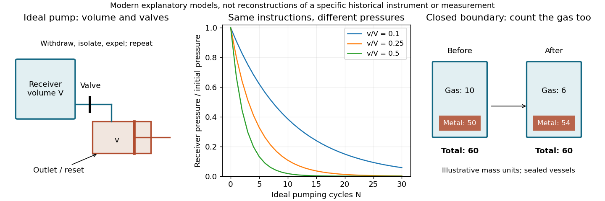

<h1 id="9/solution">Solution</h1>

↑ **Parent:** [9](../9.md)

The [material culture of science](../../../material-culture-of-science.md) comprises the objects, spaces and skilled practices through which inquiry is carried out and made credible. It includes [scientific instruments](../../../scientific-instrument.md) and specimens, but also the workshop which produces them, the arrangements for storing and moving them, the paper on which [observations](../../../observation.md) are recorded, and the bodies trained to operate and inspect them. Its history asks how these things helped make a claim possible. It is not merely a catalogue of old apparatus attached to a history whose explanations are otherwise complete.

A [telescope](../../../telescope.md) is a useful starting point. [Galileo Galilei](../../../galileo-galilei.md)'s celestial reports depended on shaped glass, an arrangement of [lenses](../../../lens-optics.md), pointing and focusing, and a practised interpretation of a small, unstable visual field. A potential witness needed reasons to trust that an unfamiliar appearance was celestial rather than an instrumental artefact. His repeated records of the changing positions near [Jupiter](../../../jupiter.md) supplied an evidential pattern: a sequence was more persuasive than a single spectacular image. The printed drawings and account carried an experience beyond the small group able to look through that particular [scientific instrument](../../../scientific-instrument.md).[Description of the instrument and the successive dated observations of Jupiter's companions](../../../sidereus-nuncius-by-galileo-galilei.md)

[Microscopy](../../../microscopy.md) illustrates why seeing is an activity rather than a passive delivery of facts. A specimen has to be selected, prepared, lit and brought into focus. [Robert Hooke](../../../robert-hooke.md)'s [Micrographia by Robert Hooke](../../../micrographia-by-robert-hooke.md) discusses improving sensory capacities and presents [observations](../../../observation.md) through text and engraving. Its enlarged structures are reasoned representations intended to communicate salient features; a reader cannot assume that an engraving is an unmediated view identical to every observer's sight. The modern question is not whether every historical drawing could be mistaken for a photograph, but how its production and circulation supported particular claims.[Preface; Observation I on a needle; Observation XXXIV on the eyes and head of a fly, including the problems of preparation and illumination](../../../micrographia-by-robert-hooke.md)

The [air pump](../../../air-pump.md) brings construction and maintenance into the explanation. A receiver, piston, connecting passage and valves create a setting in which air can be progressively withdrawn. Leaks, imperfect seals and the size of the pumping chamber affect what a trial actually achieves. In a modern idealized isothermal model with receiver [volume](../../../volume.md) $V$ and fresh evacuated pump space $v$, connecting the two changes the receiver [pressure](../../../pressure-split.md) by the factor $V/(V+v)$. After $N$ such ideal cycles,

$$
\boxed{p_N=p_0\left(\frac{V}{V+v}\right)^N.}
$$

This reconstructive model is not being attributed as [Robert Boyle](../../../robert-boyle.md)'s own derivation. It shows why an instruction to use a pump cannot specify an experimental condition without information about the apparatus and procedure. Nor does a practical pump produce an exact [vacuum](../../../vacuum.md) merely because its operator uses that word.[Apparatus description and reported pneumatic experiments; later collected edition of the work first issued in 1660](../../../new-experiments-physico-mechanical-by-robert-boyle-1682-edition.md)

**[Figure 1](#9/image-material-arrangements-determine-the-conditions-and-records-of-an-experiment). Material arrangements determine the conditions and records of an experiment**. Original explanatory schematics of an ideal pump and a closed-system mass accounting; not reproductions of historical apparatus or measurements.

The second panel makes the same point about a [balance](../../../weighing-balance.md). In a closed vessel, the [mass](../../../mass.md) of all contents can remain constant even while a heated metal gains [mass](../../../mass.md) by incorporating material from the gas. Weighing only the metal, or opening the vessel before the final weighing, defines a different comparison. [Antoine Lavoisier](../../../antoine-lavoisier.md)'s experimental accounting therefore involved vessels, gases, transfer procedures and the choice of system boundary as well as a numerical reading. Knowing that an investigator owned an accurate [balance](../../../weighing-balance.md) is insufficient to reconstruct what a particular weighing established.[Part I on combination with oxygen and Part III on experimental apparatus and manipulation](../../../elements-of-chemistry-by-antoine-lavoisier.md)

Material culture also makes overlooked contributors visible. Glassworking, engraving, machining, collecting and carrying specimens can be prerequisites for a result whose printed account names only a learned author. Differences in access to workshops, money and audiences affect whose [observations](../../../observation.md) can circulate and be repeated. Such dependence does not entail that [observations](../../../observation.md) are arbitrary: failure of a seal or disappearance of a specimen can impose a quite definite physical constraint. Social organization and the resistance of materials are both relevant.

Finally, surviving objects have their own source problems. An [scientific instrument](../../../scientific-instrument.md) in a museum may have been repaired, combined with later parts or removed from the room and working routines which made it useful. A printed plate may depict an ideal arrangement rather than an object that existed in exactly that form. Linking an object to notebooks, accounts and published reports can recover the relation between design and use. **The explanatory aim is to understand how material arrangements, skilled action and records made claims testable and transportable.** It complements intellectual history by showing what an argument required people actually to build, handle and do.

## ↑ Ancestors (11)

1. [9](../9.md)
2. [2016](../../2016-split.md)
3. [Past exam of the history of science supplementary subject of the University of Oxford](../../split.md)
4. [History of science supplementary subject of the University of Oxford](../../../history-of-science-supplementary-subject-of-the-university-of-oxford.md)
5. [Supplementary subject of the physics course of the University of Oxford](../../../supplementary-subject-of-the-physics-course-of-the-university-of-oxford.md)
6. [Physics course of the University of Oxford](../../../physics-course-of-the-university-of-oxford.md)
7. [Undergraduate course of the University of Oxford](../../../undergraduate-course-of-the-university-of-oxford.md)
8. [Course of the University of Oxford](../../../course-of-the-university-of-oxford.md)
9. [University of Oxford](../../../university-of-oxford-split.md)
10. [List of universities](../../../list-of-universities.md)
11. [Codex Wiki](../../../split.md)
