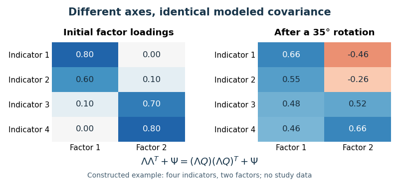

# 2022

↑ **Parent:** [Past exam of the individual differences and clinical psychology course of the year 2 of the psychology (experimental) course of the University of Oxford](../past-exam-of-the-individual-differences-and-clinical-psychology-course-of-the-year-2-of-the-psychology-experimental-course-of-the-university-of-oxford.md)

Worked essays for all five options in the historical Part I paper dated 22 April 2022. Source release: [Oxford psychology examination release](https://www.whatdotheyknow.com/request/experimental_psychology_past_exa/response/2757831/attach/3/New%20Compressed%20zipped%20Folder.zip?cookie_passthrough=1), member `a16819w1.pdf`. The two cover codes identify this single paper. Each answer stays within the printed 1,500-word limit. The scientific evidence and treatment framework used here were available before the examination; these are academic arguments about assessment and evidence, rather than an assessment of an individual patient.

**Table of contents**

- [1](#1)
  - [Solution](#1/solution)
- [2](#2)
  - [Solution](#2/solution)
- [3](#3)
  - [Solution](#3/solution)
- [4](#4)
  - [Solution](#4/solution)
- [5](#5)
  - [Solution](#5/solution)

## 1

↑ **Parent:** [2022](2022.md)

<h3 id="1/solution">Solution</h3>

↑ **Parent:** [1](#1)

**Three useful maintaining mechanisms are catastrophic [threat appraisal](../psychology.md#threat-appraisal), avoidance with [safety behaviors](../animal-behaviour.md#safety-behavior), and [self-focused attention](../psychology.md#self-focused-attention).** They are separable hypotheses about why [anxiety](../psychology.md#anxiety) continues after an immediate threat has passed, not three diagnoses or a claim that every [anxiety disorder](../psychiatry.md#anxiety-disorder) has identical causes. A maintaining factor should predict persistence and, ideally, manipulating it should change [anxiety](../psychology.md#anxiety) or [learning](../animal-behaviour.md#learning). [Correlation](../variance.md#pearson-correlation-coefficient) between a symptom and [anxiety](../psychology.md#anxiety) alone is insufficient, because [anxiety](../psychology.md#anxiety) can itself produce that symptom.

The first mechanism is [catastrophic misinterpretation](../psychology.md#catastrophic-misinterpretation). In [David M. Clark](../psychologist.md#david-m-clark)'s cognitive model of [panic disorder](../psychiatry.md#panic-disorder), a bodily sensation is interpreted as evidence of imminent disaster. Perceived danger increases [anxiety](../psychology.md#anxiety) and bodily arousal; the resulting sensations appear to confirm the interpretation. A racing heart can thereby become evidence _for_ an emergency precisely because the person has become frightened. The model explains a feedback loop and recurrent fear of sensations, rather than requiring a new external danger for every attack. It is a theoretical account with testable predictions, not itself a randomized demonstration that all panic has one cause.[1986, cognitive model and interpretation of bodily sensations](../psychology-bibliography.md#a-cognitive-approach-to-panic-by-david-m-clark)

Treatment addresses the appraisal through collaborative [cognitive behavioral therapy](../psychology.md#cognitive-behavioral-therapy). Therapist and patient identify a specific feared prediction, consider alternatives, and design a [behavioral experiment](../psychology.md#behavioral-experiment) that distinguishes them. For example, a medically appropriate, supervised [interoceptive exposure](../psychology.md#interoceptive-exposure) exercise can test whether a familiar benign sensation necessarily leads to the feared loss of control. The aim is evidence-based revision of a prediction, not repeated reassurance or the assertion that every physical symptom is harmless. Assessment determines what can safely be tested. Changes in conviction, avoidance and functioning matter as well as immediate [anxiety](../psychology.md#anxiety).

Clinical evidence supports the broader approach but requires careful interpretation. In a 1994 comparison involving 64 patients, [David M. Clark](../psychologist.md#david-m-clark) and colleagues compared [cognitive therapy](../psychology.md#cognitive-therapy) with applied relaxation, [imipramine](../pharmacology.md#imipramine) and an initial waiting condition. All active treatments helped; [cognitive therapy](../psychology.md#cognitive-therapy) had advantages at several assessments, including after medication withdrawal. However, all treatments included self-exposure homework, and treatment contact differed. Thus the trial supports a treatment package while leaving open how much benefit arose specifically through appraisal change, exposure, expectancy or their interaction.[1994, treatment conditions, assessments and follow-up](../psychology-bibliography.md#a-comparison-of-cognitive-therapy-applied-relaxation-and-imipramine-in-the-treatment-of-panic-disorder-by-david-m-clark-and-others)

The second mechanism is [avoidance learning](../animal-behaviour.md#avoidance-learning) supported by [negative reinforcement](../animal-behaviour.md#negative-reinforcement). Leaving a feared situation reduces distress immediately, increasing the likelihood of leaving again. Subtler [safety behaviors](../animal-behaviour.md#safety-behavior), such as excessive preparation, monitoring or seeking reassurance, can have the same maintaining effect. They also prevent [expectancy violation](../psychology.md#expectancy-violation): if catastrophe fails to occur, the person attributes safety to the precaution rather than revising the danger belief. Some precautions can increase the very symptom being monitored, making the original belief appear even more credible.

[Paul Salkovskis](../psychologist.md#paul-salkovskis) and colleagues tested this idea in patients with [panic disorder](../psychiatry.md#panic-disorder) and [agoraphobia](../psychiatry.md#agoraphobia). During a brief exposure session, participants either maintained or dropped their within-situation [safety behaviors](../animal-behaviour.md#safety-behavior). Those dropping them showed greater subsequent reductions in catastrophic beliefs and [anxiety](../psychology.md#anxiety). Because exposure occurred in both conditions, this provides more specific evidence about how exposure is conducted than a comparison with no treatment. Nevertheless, it was a brief experimental intervention, not a demonstration that every behavior called “safety seeking” is harmful in every context.[1999, 15-minute exposure manipulation and repeated behavioral test](../psychology-bibliography.md#an-experimental-investigation-of-the-role-of-safety-seeking-behaviours-in-the-maintenance-of-panic-disorder-with-agoraphobia-by-paul-salkovskis-and-others)

The corresponding intervention is planned [exposure therapy](../psychology.md#exposure-therapy) with gradual removal of the behaviors that block [learning](../animal-behaviour.md#learning). A prediction is specified before exposure and the observed outcome compared with it afterward. Repetition across contexts tests whether [learning](../animal-behaviour.md#learning) transfers. Treatment should distinguish unnecessary defensive rituals from objectively useful precautions; indiscriminate risk-taking is not the therapeutic mechanism. Nor is success simply enduring maximum distress until it falls: an informative experience may change expectations even without complete within-session [habituation](../animal-behaviour.md#habituation).

The third mechanism is [self-focused attention](../psychology.md#self-focused-attention), especially prominent in [social anxiety disorder](../psychiatry.md#social-anxiety-disorder). Monitoring one's voice, posture or apparent blushing consumes [attention](../psychology.md#attention) that could register the actual interaction. An internal image based on [anxiety](../psychology.md#anxiety) sensations is then mistaken for how an observer sees the person. Monitoring and rehearsal can disrupt conversation, reduce access to disconfirming social information and increase the subjective impression of poor performance. This explains how private [anxiety](../psychology.md#anxiety) can become apparently public evidence of failure.

[Freda McManus](../psychologist.md#freda-mcmanus) and colleagues first documented greater reported [safety behavior](../animal-behaviour.md#safety-behavior) use among highly socially anxious participants, then experimentally manipulated [safety behaviors](../animal-behaviour.md#safety-behavior) and self-focus. Their results supported adverse effects of these processes. A later clinical component study evaluated a [self-focused attention](../psychology.md#self-focused-attention)/[safety behavior](../animal-behaviour.md#safety-behavior) experiment and [video feedback](../psychology.md#video-feedback), supporting their intended effects on negative self-impressions and symptoms. The combined manipulation does not uniquely isolate [attention](../psychology.md#attention) from every associated behavior, and a single-session component study is not a substitute for a full treatment trial.[2008, interview study and experimental manipulation](../psychology-bibliography.md#why-social-anxiety-persists-by-freda-mcmanus-and-others)[2009, self-focus/safety-behavior and video-feedback procedures](../psychology-bibliography.md#a-demonstration-of-the-efficacy-of-two-of-the-components-of-cognitive-therapy-for-social-phobia-by-freda-mcmanus-and-others)

Treatment can compare inward monitoring with attending to the conversation and can use carefully prepared [video feedback](../psychology.md#video-feedback) to test a concrete prediction about visible performance. The recording should be viewed as evidence, rather than scanned selectively for flaws; otherwise the same bias can operate on the video. Across the three mechanisms, the common principle is to identify a feedback loop, manipulate a hypothesized link and measure what changes. **A good formulation selects the mechanisms actually operating in the person and uses cognitive revision, informative exposure and [attention](../psychology.md#attention) change to interrupt them.** These mechanisms concern persistence; they need not explain why vulnerability first developed.

## 2

↑ **Parent:** [2022](2022.md)

<h3 id="2/solution">Solution</h3>

↑ **Parent:** [2](#2)

**For an adult with established [obsessive-compulsive disorder](../psychiatry.md#obsessive-compulsive-disorder), the core psychological recommendation is [cognitive behavioral therapy](../psychology.md#cognitive-behavioral-therapy) including [exposure and response prevention](../psychology.md#exposure-and-response-prevention); an [SSRI](../pharmacology.md#selective-serotonin-reuptake-inhibitor) is another established first-line option, with choice and combination guided by impairment, preference, previous response and clinical assessment.** There is no single justified prescription from the diagnostic label alone. A recommendation should connect the maintaining process to an intervention and then examine randomized evidence, tolerability and generalizability.

Assessment first distinguishes recurrent [obsessions](../psychiatry.md#obsession) and [compulsions](../psychiatry.md#compulsion) from ordinary unwanted thoughts, practical precautions and other causes of repetitive behavior. [Compulsions](../psychiatry.md#compulsion) may be covert mental reviewing or neutralizing rather than visible washing or checking. Relevant information includes time consumed, distress, interference, avoidance, insight, concurrent [depression](../psychology.md#depression), current risk, physical consequences, family responses and previous treatment. A baseline measure such as the [Yale-Brown Obsessive Compulsive Scale](../psychology.md#yale-brown-obsessive-compulsive-scale) can track severity, but neither a score nor the content of an intrusive thought replaces an assessment of its meaning and associated behavior.

[Paul Salkovskis](../psychologist.md#paul-salkovskis)'s cognitive-behavioral formulation distinguishes an intrusion from its appraisal and the responses that can maintain it. An unwanted thought is interpreted as unusually significant or as creating [inflated responsibility](../psychiatry.md#inflated-responsibility) for preventing harm. Ritualizing, reassurance or avoidance briefly reduces distress. This [negative reinforcement](../animal-behaviour.md#negative-reinforcement) makes repetition more likely and prevents [learning](../animal-behaviour.md#learning) that the intrusion can pass without neutralization. Attempting perfect certainty can generate still more checking. The target is therefore the response to the intrusion and its appraisal, not a requirement to eliminate all unwanted thoughts before normal life can resume.[1985, responsibility appraisals, cognitive-behavioral model and case material](../psychology-bibliography.md#obsessional-compulsive-problems-a-cognitive-behavioural-analysis-by-paul-salkovskis)

In [exposure and response prevention](../psychology.md#exposure-and-response-prevention), therapist and patient agree a hierarchy of relevant situations and feared predictions. Exposure brings the person into contact with an appropriate trigger; response prevention means refraining from the ritual, including covert neutralization and reassurance that would perform the same function. Tasks may be in vivo or, where appropriate, imaginal. For checking, the [learning](../animal-behaviour.md#learning) target is tolerating ordinary uncertainty without repeated checking, rather than obtaining an absolute guarantee that nothing bad can happen. Tasks are collaborative and concern ordinary, acceptable uncertainty; genuine hazards are not deliberately created.

The rationale includes both [learning](../animal-behaviour.md#learning) that distress can change without ritualizing and testing whether [compulsions](../psychiatry.md#compulsion) are necessary. [Habituation](../animal-behaviour.md#habituation) can occur, but a reduction in fear within every session is not the sole criterion of [learning](../animal-behaviour.md#learning). An [inhibitory learning](../animal-behaviour.md#inhibitory-learning) interpretation emphasizes a new association between the cue and a nonritualized outcome that competes with the old threat expectation. Varying situations and planning practice between sessions can support retrieval of that [learning](../animal-behaviour.md#learning) outside the therapy room. Cognitive procedures address overestimation of threat, responsibility and the assumed significance of thoughts; they should facilitate behavioral [learning](../animal-behaviour.md#learning) rather than become endless reassurance.[2014, inhibitory-learning rationale, expectancy violation and retrieval across contexts](../psychology-bibliography.md#maximizing-exposure-therapy-an-inhibitory-learning-approach-by-michelle-g-craske-and-others)

Randomized evidence supports this emphasis. [Edna B. Foa](../psychologist.md#edna-b-foa) and colleagues compared intensive exposure and ritual prevention, [clomipramine](../pharmacology.md#clomipramine), their combination and pill placebo in a trial with 122 adult entrants. All active conditions outperformed placebo, and exposure-based treatment performed better than [clomipramine](../pharmacology.md#clomipramine) alone. Combining [clomipramine](../pharmacology.md#clomipramine) with exposure did not clearly outperform exposure alone. This supports an effective psychological treatment, but does not establish that adding any medication is always useless: the comparison involved a particular drug, intensive expert-delivered exposure, and a particular treatment schedule. Medication could be blinded against placebo; psychological treatment could not be concealed from participants and therapists.[2005, randomized conditions and acute-treatment results](../psychology-bibliography.md#randomized-placebo-controlled-trial-of-exposure-and-ritual-prevention-clomipramine-and-their-combination-in-the-treatment-of-obsessive-compulsive-disorder-by-edna-b-foa-and-others)

An [SSRI](../pharmacology.md#selective-serotonin-reuptake-inhibitor) can be offered when preferred, when psychological treatment is inaccessible or difficult to engage with, or as part of combined care. Medication requires prescribing oversight, discussion of adverse effects, interactions and discontinuation, and a sufficient monitored trial before declaring nonresponse. Its effectiveness does not prove that an individual has a simple serotonin deficiency: changing a signaling system is different from establishing the original cause of a disorder.

The pre-examination [NICE](../biology.md#national-institute-for-health-and-care-excellence) framework used stepped care: lower-intensity [CBT](../psychology.md#cognitive-behavioral-therapy) including [ERP](../psychology.md#exposure-and-response-prevention) for suitable mild impairment, a choice of more intensive [CBT](../psychology.md#cognitive-behavioral-therapy) including [ERP](../psychology.md#exposure-and-response-prevention) or an [SSRI](../pharmacology.md#selective-serotonin-reuptake-inhibitor) for moderate impairment, and combined [CBT](../psychology.md#cognitive-behavioral-therapy)/[ERP](../psychology.md#exposure-and-response-prevention) plus an [SSRI](../pharmacology.md#selective-serotonin-reuptake-inhibitor) for severe impairment. Inadequate response warrants review of diagnosis, treatment adequacy, engagement and comorbidity, followed by an agreed change or combination; persistent difficulty calls for specialist multidisciplinary assessment. These are severity-sensitive alternatives, not a demand that every adult start with combined treatment or that severity can be inferred from one alarming [obsession](../psychiatry.md#obsession).[2005 guideline, adult initial treatment and poor-response recommendations; original full guideline §§7.4.1–7.4.2](../psychology-bibliography.md#obsessive-compulsive-disorder-and-body-dysmorphic-disorder-treatment-by-nice)

For persistent symptoms despite an adequate serotonin-reuptake inhibitor trial, [Helen Blair Simpson](../psychiatry.md#helen-blair-simpson) and colleagues randomized 100 adults to added exposure and ritual prevention, [risperidone](../pharmacology.md#risperidone) or placebo while continuing medication. At eight weeks, exposure-based augmentation produced more clinical response and minimal symptoms than either pill condition; [risperidone](../pharmacology.md#risperidone) did not outperform placebo in this trial. This is strong evidence to consider adequate [ERP](../psychology.md#exposure-and-response-prevention) before routine antipsychotic augmentation in comparable patients. It is not proof that antipsychotics never help any subgroup, nor evidence that the result automatically generalizes to untreated first presentations.[2013, randomized augmentation trial and week-eight outcomes](../psychology-bibliography.md#cognitive-behavioral-therapy-vs-risperidone-for-augmenting-serotonin-reuptake-inhibitors-in-obsessive-compulsive-disorder-by-helen-blair-simpson-and-others)

Practical delivery matters. [Family accommodation](../psychiatry.md#family-accommodation) can unintentionally maintain rituals; with agreement, carers can support ordinary activities without supplying repeated reassurance or completing [compulsions](../psychiatry.md#compulsion). Outcomes should include functioning, valued activities and distress as well as symptom scores. Nonresponse should prompt examination of whether exposure actually occurred and whether subtle rituals continued, rather than blaming the person. A relapse plan identifies early warning signs and maintains independent practice. **The best-supported recommendation is accessible, competent [CBT](../psychology.md#cognitive-behavioral-therapy)/[ERP](../psychology.md#exposure-and-response-prevention), with an [SSRI](../pharmacology.md#selective-serotonin-reuptake-inhibitor) or combined treatment when indicated by assessment and preference, and structured review rather than automatic escalation.**

## 3

↑ **Parent:** [2022](2022.md)

<h3 id="3/solution">Solution</h3>

↑ **Parent:** [3](#3)

**Prevention can reduce the probability of later [mental disorders](../psychiatry.md#mental-disorder) by changing modifiable risk and protective processes before disorder develops; it cannot guarantee that every case will be avoided.** A convincing claim needs an appropriate comparison group, assessment of later disorder or relevant functioning, and evidence that the intervention preceded the outcome. Improving knowledge immediately after a lesson is not equivalent to preventing a first episode years later.

The [universal prevention](../biology.md#universal-prevention), [selective prevention](../biology.md#selective-prevention) and [indicated prevention](../biology.md#indicated-prevention) distinction concerns _who is offered the intervention_. Universal programs address a whole population regardless of individual risk; selective programs target groups with elevated risk; indicated programs target individuals already showing early signs who do not currently meet the relevant diagnostic threshold. This classification differs from the treatment of an established disorder and from [relapse prevention](../psychology.md#relapse-prevention). It also differs from whether delivery occurs in a school, family or clinic. The 2009 National Academies framework explicitly distinguishes these complementary approaches.[Chapter 3, Defining the Scope of Prevention; the 1994 IOM framework and Recommendation 3-1](../psychology-bibliography.md#preventing-mental-emotional-and-behavioral-disorders-among-young-people-2009)

A universal example is the [Good Behavior Game](../biology.md#good-behavior-game), tested in early primary-school classrooms by [Sheppard G. Kellam](../psychiatry.md#sheppard-g-kellam) and colleagues. Teachers use explicit classroom rules, mixed teams and contingent group rewards to support cooperative behavior and reduce disruption. The proposed mechanism is a change in daily peer and classroom contingencies, improving behavioral regulation at an early developmental stage rather than waiting for a later diagnostic crisis. Because the whole class participates, children are not selected solely by a clinical risk score.

The Baltimore [cluster-randomized trials](../causal-inference.md#cluster-randomized-trial) followed participants into young adulthood. Benefits included reductions in several substance-use and antisocial outcomes among males, especially those initially more aggressive and disruptive. A second cohort with less teacher mentoring showed smaller or less consistent effects for several outcomes. Thus a universal offer can have heterogeneous benefits, and implementation support matters. The findings do not show prevention of every disorder or establish equal effects in all populations. Classroom allocation and school context also mean that statistical analysis must respect clustering rather than treating every child as an independently randomized unit.[2008, Baltimore design, young-adult outcomes and replication cohort](../psychology-bibliography.md#effects-of-a-universal-classroom-behavior-management-program-in-first-and-second-grades-on-young-adult-behavioral-psychiatric-and-social-outcomes-by-sheppard-g-kellam-and-others)

A selective example is the [Family Bereavement Program](../biology.md#family-bereavement-program), evaluated by [Irwin Sandler](../psychologist.md#irwin-sandler) and colleagues. Eligibility follows parental bereavement, an elevated-risk circumstance, rather than requiring every child already to have a disorder. Parallel caregiver and youth groups develop positive parenting, [coping](../psychology.md#coping) and communication skills; the program seeks to change the family processes through which a difficult event may affect later adjustment. Bereavement is not itself evidence that a child is psychiatrically ill, so a preventive offer should avoid pathologizing ordinary grief.

The [randomized controlled trial](../causal-inference.md#randomized-controlled-trial) used a literature-control condition providing bereavement books. At six years, intervention participants showed benefits on several measures, including externalizing problems, teacher-rated internalizing problems and self-esteem; parents also had lower [depression](../psychology.md#depression) scores. Diagnostic effects were moderated by baseline problems rather than being a uniform reduction in all diagnoses. This is evidence for a durable change in several outcomes, with the advantage of multiple informants, but the control did not match group contact or [attention](../psychology.md#attention). Attrition and informant disagreement must be examined before interpreting the program as a universally effective causal package.[2010, 12-session intervention, literature control, six-year outcomes and moderation](../psychology-bibliography.md#six-year-follow-up-of-a-preventive-intervention-for-parentally-bereaved-youths-by-irwin-sandler-and-others)

[Indicated prevention](../biology.md#indicated-prevention) is illustrated by cognitive-behavioral skills programs for young people with elevated but subdiagnostic symptoms. These teach ways to evaluate negative predictions, solve problems and manage stress before a current depressive disorder is established. [Judy Garber](../psychologist.md#judy-garber) and colleagues randomized 316 adolescents with parental [depression](../psychology.md#depression) histories and either elevated symptoms, previous [depression](../psychology.md#depression) or both to a group program or usual care. The program included eight weekly sessions and six monthly continuation sessions. It combines selective familial-risk targeting with indicated or recurrence-prevention elements; it should not be relabeled as a pure first-onset trial.

By postcontinuation follow-up, depressive episodes occurred in approximately $21.4\%$ of the intervention group versus $32.7\%$ with usual care. The absolute [risk difference](../biology.md#risk-difference) is $11.3$ percentage points, corresponding to roughly nine participants treated per additional episode prevented over this follow-up, using the reported rounded rates; this is an approximate [number needed to treat](../causal-inference.md#number-needed-to-treat), not an individual guarantee. Benefit was not demonstrated when the parent was currently depressed at baseline. These results support a preventive contribution while identifying family context as a potential limit; because some adolescents had previous episodes, they do not establish an identical effect on first-ever disorder. A subgroup result also needs [replication](../design-of-experiments.md#replication-in-experimental-design) rather than being turned into an absolute eligibility rule.[2009, inclusion criteria, program, incident-depression results and baseline parental-depression interaction](../psychology-bibliography.md#prevention-of-depression-in-at-risk-adolescents-by-judy-garber-and-others)

These programs suggest several routes to prevention: alter a high-frequency social environment, strengthen family support after an identifiable risk event, and teach [coping](../psychology.md#coping) before symptoms become a current disorder. They also show why a [risk factor](../biology.md#risk-factor) is not automatically a useful intervention target. It may be a marker rather than a cause, or may be impractical to change. Randomizing a program tests its overall effect; identifying its active mechanism additionally requires measurement of the proposed mediator before the outcome and care about alternative pathways.

Evaluation should distinguish symptom reduction, new diagnoses, recurrence and functioning, with sufficiently long follow-up and assessors unaware of allocation where feasible. Universal programs can reach many future cases and reduce selection barriers, but dilute average effects and require substantial resources. Targeted approaches concentrate effort, but can miss people whose risk is not recognized and can introduce labeling or access inequalities. Adverse effects, participation, fidelity, costs and transportability therefore belong alongside [statistical significance](../statistical-hypothesis-test.md#statistical-significance). **The strongest strategy combines developmentally appropriate universal support with proportionate targeted intervention, while making only the preventive claims that the design and outcomes actually establish.**

## 4

↑ **Parent:** [2022](2022.md)

<h3 id="4/solution">Solution</h3>

↑ **Parent:** [4](#4)

**Converging family, twin, adoption and molecular evidence establishes genetic contributions to vulnerability to several [mental disorders](../psychiatry.md#mental-disorder); it does not make onset inevitable or identify a single genetic cause for every diagnosis.** The outcome must be specified. Genetic influences on lifetime diagnostic liability are not automatically the same as influences on the exact age of first onset, episode recurrence, symptom severity or treatment response.

Family aggregation provides a starting point. Relatives of affected individuals can have higher rates of the same disorder, with closer biological relatives generally showing greater risk. However, families share environments, social circumstances and diagnostic expectations as well as [genes](../genetics.md#gene). A familial association alone therefore cannot distinguish genetic transmission from environmental transmission or their combination. Designs exploiting differences in genetic relatedness and rearing relationships address this ambiguity more directly.

In a [twin study](../genetics.md#twin-study), [monozygotic twins](../genetics.md#monozygotic-twin) share essentially all inherited sequence variation, whereas [dizygotic twins](../genetics.md#dizygotic-twin) share about half of segregating additive variation on average. Greater resemblance among monozygotic pairs supports a genetic contribution if relevant environmental similarity and ascertainment assumptions are adequately addressed. Under a simple standardized [ACE model](../genetics.md#ace-model), the twin [correlations](../variance.md#pearson-correlation-coefficient) satisfy $r_{\mathrm{MZ}}=A+C$ and $r_{\mathrm{DZ}}=A/2+C$, giving $A=2(r_{\mathrm{MZ}}-r_{\mathrm{DZ}})$. For diagnoses, investigators commonly model an underlying [liability-threshold model](../genetics.md#liability-threshold-model), rather than treating crude concordance percentages as continuous-trait [correlations](../variance.md#pearson-correlation-coefficient). [Patrick F. Sullivan](../biologist.md#patrick-f-sullivan) and colleagues' meta-analysis of 12 systematically ascertained [schizophrenia](../psychiatry.md#schizophrenia) [twin studies](../genetics.md#twin-study) estimated substantial [heritability](../genetics.md#heritability) of liability, around $81\%$. That is a model-based population estimate with uncertainty, not an individual's probability of developing [schizophrenia](../psychiatry.md#schizophrenia).[2003, ascertainment-aware multigroup twin model and liability heritability](../psychology-bibliography.md#schizophrenia-as-a-complex-trait-by-patrick-f-sullivan-and-others)

Twin comparisons have limitations. [Monozygotic twins](../genetics.md#monozygotic-twin) may be treated more similarly, prenatal environments can differ systematically, and the [equal-environments assumption](../genetics.md#equal-environments-assumption) concerns environments causally relevant to the disorder rather than identical treatment in every respect. [Assortative mating](../genetics.md#assortative-mating) alters expected resemblance, while nonadditive effects and measurement error complicate [variance](../variance.md) decomposition. Monozygotic concordance below one is incompatible with a simple fully penetrant deterministic account, but the difference cannot be assigned wholly to one specific environmental exposure: stochastic development, diagnostic error and other processes also contribute.

Adoption and extended-family data provide a partly independent test. [Paul Lichtenstein](../biologist.md#paul-lichtenstein) and colleagues linked Swedish population and psychiatric inpatient registers, studying over two million nuclear families. They compared biological and adoptive relationships, full siblings and half-siblings for [schizophrenia](../psychiatry.md#schizophrenia) and [bipolar disorder](../psychiatry.md#bipolar-disorder). Risk patterns followed biological relatedness, and adopted children of biological parents with [bipolar disorder](../psychiatry.md#bipolar-disorder) also showed elevated [schizophrenia](../psychiatry.md#schizophrenia) risk. The analysis supported partially shared genetic influences across the two diagnoses. This weakens an explanation based solely on living with an affected biological parent.[2009, register linkage, biological/adoptive relationships and cross-disorder findings](../psychology-bibliography.md#common-genetic-determinants-of-schizophrenia-and-bipolar-disorder-in-swedish-families-by-paul-lichtenstein-and-others)

It does not eliminate every environmental explanation. Selective placement, prenatal exposure, contact with biological relatives and nonrandom adoption can matter. Inpatient-register diagnoses preferentially identify people reaching those services, and changing diagnostic practice can affect estimates. Nevertheless, convergence across twins, extended families and adoption is more persuasive than repeating one family association, because the sources of [confounding](../causal-inference.md#confounding) differ.

Molecular evidence measures inherited variation directly. In a [genome-wide association study](../genetics.md#genome-wide-association-study), [genotype](../genetics.md#genotype) frequencies are compared between cases and controls across many markers, using stringent multiple-testing correction and [replication](../design-of-experiments.md#replication-in-experimental-design). The [Psychiatric Genomics Consortium](../genetics.md#psychiatric-genomics-consortium)'s 2014 [schizophrenia](../psychiatry.md#schizophrenia) study analyzed up to 36,989 cases and 113,075 controls and identified 108 associated loci. The pattern supported a [polygenic trait](../genetics.md#polygenic-trait) architecture involving many common variants, individually having small effects, rather than one common “[schizophrenia](../psychiatry.md#schizophrenia) [gene](../genetics.md#gene).” [Genotypes](../genetics.md#genotype) precede clinical onset, so the inherited sequence difference is not created by experiencing the disorder.[2014, Summary; multi-stage GWAS and associated loci](../psychology-bibliography.md#biological-insights-from-108-schizophrenia-associated-genetic-loci-by-psychiatric-genomics-consortium)

However, an associated marker may tag a causal variant through [linkage disequilibrium](../population-genetics.md#linkage-disequilibrium); a locus is neither necessarily one [gene](../genetics.md#gene) nor a fully identified biological mechanism. [Population stratification](../genetics.md#population-stratification), sample overlap and diagnostic heterogeneity can bias findings. A weighted [genetic risk score](../genetics.md#genetic-risk-score) can predict differences in risk in independent samples without providing accurate individual diagnosis or transferring equally across ancestry groups. Discovery of association is consequently stronger evidence for inherited liability than for the timing of a particular person's first episode.

The history of [candidate gene](../genetics.md#candidate-gene) research illustrates why [replication](../design-of-experiments.md#replication-in-experimental-design) matters. [Richard Border](../biologist.md#richard-border) and colleagues tested widely studied [depression](../psychology.md#depression) candidate-[gene](../genetics.md#gene) and [gene](../genetics.md#gene)-by-environment hypotheses across large samples with preregistered analyses. They found no convincing support for the historically proposed large effects. This does not erase genetic influences on [depression](../psychology.md#depression) or rule out every [genotype-environment interaction](../genetics.md#genotype-environment-interaction); it challenges specific small-study claims and demonstrates why biological plausibility alone cannot validate an association.[2019, preregistered candidate-variant, gene and interaction analyses](../psychology-bibliography.md#no-support-for-historic-candidate-gene-or-candidate-gene-by-interaction-hypotheses-for-major-depression-across-multiple-large-samples-by-richard-border-and-others)

Finally, [heritability](../genetics.md#heritability) is conditional on a population, environment and measurement system. A highly heritable vulnerability can still be preventable, and a low-[heritability](../genetics.md#heritability) outcome can still involve essential biological mechanisms. [Gene-environment correlation](../genetics.md#gene-environment-correlation) means inherited characteristics can influence the environments people encounter; [genotype-environment interaction](../genetics.md#genotype-environment-interaction) means their consequences can depend on those environments. Neither should be collapsed into an exclusive [genes](../genetics.md#gene)-versus-environment choice. **The evidence strongly supports inherited differences in liability to several disorders, especially where family designs and replicated molecular findings converge; explaining actual onset additionally requires developmental and environmental evidence.**

## 5

↑ **Parent:** [2022](2022.md)

<h3 id="5/solution">Solution</h3>

↑ **Parent:** [5](#5)

**There is evidence for particular structures of [social intelligence](../psychology.md#social-intelligence), but no single established factor structure independent of definition, measurement method and population.** “Not known” should therefore be interpreted as unresolved construct organization, not an absence of factor analyses or proof that [social understanding](../psychology.md#social-understanding) cannot be measured. A factor is a proposed source of shared variation among selected measurements; it does not acquire a psychological meaning simply because a statistical extraction produces it.

The first difficulty is defining what belongs in the construct. Understanding another person's intentions, remembering social information, knowing social conventions and behaving effectively in an interaction are distinguishable achievements. They may draw on partly different abilities. A [questionnaire](../psychology.md#questionnaire) asking whether one feels socially competent also measures self-perception and typical behavior, whereas a scored performance task asks what one can do under specified conditions. Related constructs such as general [intelligence](../psychology.md#intelligence), [personality](../psychology.md#personality) and [theory of mind](../animal-behaviour.md#theory-of-mind) overlap with some definitions but are not interchangeable with every proposed social ability. Different definitions therefore generate different item domains before [factor analysis](../latent-variable.md#factor-analysis) even begins.

Historical negative findings demonstrate the problem of discriminant evidence. [Daniel P. Keating](../psychologist.md#daniel-p-keating) studied 117 college students using three academic-[intelligence](../psychology.md#intelligence) measures and three proposed social-[intelligence](../psychology.md#intelligence) measures. [Correlations](../variance.md#pearson-correlation-coefficient) within the social set were not higher than [correlations](../variance.md#pearson-correlation-coefficient) across the social and academic sets, and [factor analysis](../latent-variable.md#factor-analysis) did not identify a separate social factor. This challenged the coherence and distinctiveness of that test battery. It did not logically refute every possible social-[intelligence](../psychology.md#intelligence) construct: the chosen measures, restricted student sample and criteria determine what the negative result can exclude.[1978, test battery, intercorrelations and factor analyses](../psychology-bibliography.md#a-search-for-social-intelligence-by-daniel-p-keating)

Conversely, a positive structure within one instrument does not settle the whole domain. [David H. Silvera](../psychologist.md#david-h-silvera) and colleagues developed the [Tromsø Social Intelligence Scale](../psychology.md#tromso-social-intelligence-scale) through studies of expert interpretations, item selection and stability, obtaining a 21-item [self-report](../psychology.md#self-report) instrument with three dimensions: social information processing, [social skills](../psychology.md#social-skills) and [social awareness](../psychology.md#social-awareness). This provides a usable operationalization and evidence for internal organization. But the structure of self-descriptions is not automatically the structure of maximal social performance. Shared response style, self-esteem, item wording and perceived competence may generate covariation that a [performance test](../psychology.md#performance-test) would not reproduce.[2001, three development studies and three-factor 21-item self-report scale](../psychology-bibliography.md#the-tromso-social-intelligence-scale-by-david-h-silvera-and-others)

A different strategy separates content from method. [Susanne Weis](../psychologist.md#susanne-weis) and colleagues tested a performance model distinguishing [social understanding](../psychology.md#social-understanding), memory and knowledge using verbal, pictorial and video-based tasks in a [multitrait-multimethod design](../psychology.md#multitrait-multimethod-design). In 118 students, confirmatory analyses supported multidimensional organization and provided evidence of differentiation from academic [intelligence](../psychology.md#intelligence), although social-memory measures showed overlap. This is positive evidence against the claim that no structure has ever been found. The factor labels differ from the [self-report](../psychology.md#self-report) scale because the proposed processes and tasks differ; the fact that both studies obtained three dimensions does not make the dimensions equivalent.[2007, performance-task MTMM design, CFA and discriminant analyses](../psychology-bibliography.md#reviving-the-search-for-social-intelligence-by-susanne-weis-and-others)

These studies expose the need to distinguish [construct validity](../design-of-experiments.md#construct-validity) from attractive factor labels. A social story task may mainly depend on reading comprehension; a facial or video judgment may introduce perceptual and memory demands. If all putative measures of one trait use the same format, a “trait factor” can actually be a [method factor](../latent-variable.md#method-factor). Multiple methods for each proposed trait allow stronger tests of [convergent validity](../design-of-experiments.md#convergent-validity) and [discriminant validity](../design-of-experiments.md#discriminant-validity), although even an MTMM model depends on identifying restrictions and adequate indicators. A good model should explain cross-method [covariance](../variance.md#covariance) as well as within-format similarity.

Measurement quality also changes the observed structure. Unreliable tasks attenuate [correlations](../variance.md#pearson-correlation-coefficient), potentially hiding a shared ability; overlapping items or shared response biases can inflate them. Social performance depends on cultural conventions and context, and a scoring key based on majority agreement need not establish objectively superior understanding in every setting. Small or homogeneous samples can produce unstable loadings or restrict ability [variance](../variance.md). Evidence for [measurement invariance](../psychology.md#measurement-invariance) across groups and contexts is therefore needed before interpreting different scores or factor solutions as differences in the same underlying construct.

Statistical choices contribute additional uncertainty. [Exploratory factor analysis](../latent-variable.md#exploratory-factor-analysis) models common variation, whereas [principal component analysis](../statistical-learning.md#principal-component-analysis) summarizes total [variance](../variance.md); their dimensions answer different questions. Factor retention, residual [correlations](../variance.md#pearson-correlation-coefficient) and [oblique factor rotation](../latent-variable.md#oblique-factor-rotation) affect interpretation. In a general factor model,

$$
\Sigma=\Lambda\Phi\Lambda^T+\Psi,
$$

where $\Phi$ is factor [covariance](../variance.md#covariance) and $\Psi$ residual [covariance](../variance.md#covariance). For invertible $T$, replacing $\Lambda$ with $\Lambda T$ and $\Phi$ with $T^{-1}\Phi T^{-T}$ leaves $\Sigma$ unchanged. Hence [covariance](../variance.md#covariance) fit alone cannot uniquely name unrestricted factors. Identifying restrictions and substantive predictions are needed. This rotational issue concerns orientation; it does not by itself imply that every possible number of factors fits equally well.

**[Figure 1](#5/image-different-factor-loadings-can-reproduce-exactly-the-same-modeled-covariance). Different factor loadings can reproduce exactly the same modeled covariance**. Original numerical illustration with four artificial indicators and two factors, before and after a 35-degree orthogonal rotation. These are constructed loadings, not social-intelligence data. The factor count and reproduced covariance are unchanged; the example isolates ambiguity of factor orientation.

A stronger research program would specify the proposed abilities before choosing indicators, obtain multiple reliable measures across methods and social contexts, and measure competing general-[intelligence](../psychology.md#intelligence) and [personality](../psychology.md#personality) constructs. Exploratory work and [parallel analysis](../latent-variable.md#parallel-analysis) can guide model development; a prespecified [confirmatory factor analysis](../latent-variable.md#confirmatory-factor-analysis) in an independent, adequately varied sample provides a separate test. Competing correlated-factor, hierarchical and method-factor models should be compared, with appropriate [attention](../psychology.md#attention) to identification and out-of-sample performance. Predicting consequential social outcomes beyond competing constructs adds evidence that [internal consistency](../psychology.md#internal-consistency) alone cannot supply.

**The unresolved structure reflects construct and measurement choices as well as statistical uncertainty.** Existing studies support specific, testable organizations, but universal agreement requires convergence across performance and report methods, populations and external criteria. The productive conclusion is to improve competing models and their tests, rather than treating one [questionnaire](../psychology.md#questionnaire)'s factors as a final inventory of [social intelligence](../psychology.md#social-intelligence) or interpreting an early null result as proof of impossibility.

## ↑ Ancestors (9)

1. [Past exam of the individual differences and clinical psychology course of the year 2 of the psychology (experimental) course of the University of Oxford](../past-exam-of-the-individual-differences-and-clinical-psychology-course-of-the-year-2-of-the-psychology-experimental-course-of-the-university-of-oxford.md)
2. [Individual differences and clinical psychology course of the year 2 of the psychology (experimental) course of the University of Oxford](../university-of-oxford.md#individual-differences-and-clinical-psychology-course-of-the-year-2-of-the-psychology-experimental-course-of-the-university-of-oxford)
3. [Year 2 of the psychology (experimental) course of the University of Oxford](../university-of-oxford.md#year-2-of-the-psychology-experimental-course-of-the-university-of-oxford)
4. [Psychology (experimental) course of the University of Oxford](../university-of-oxford.md#psychology-experimental-course-of-the-university-of-oxford)
5. [Undergraduate course of the University of Oxford](../university-of-oxford.md#undergraduate-course-of-the-university-of-oxford)
6. [Course of the University of Oxford](../university-of-oxford.md#course-of-the-university-of-oxford)
7. [University of Oxford](../university-of-oxford.md)
8. [List of universities](../README.md#list-of-universities)
9. [Codex Wiki](../README.md)
