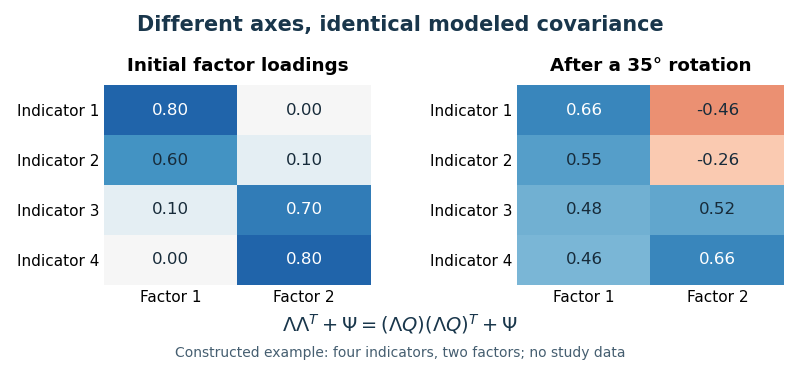

<h1 id="5/solution">Solution</h1>

↑ **Parent:** [5](../5.md)

**There is evidence for particular structures of [social intelligence](../../../social-intelligence.md), but no single established factor structure independent of definition, measurement method and population.** “Not known” should therefore be interpreted as unresolved construct organization, not an absence of factor analyses or proof that [social understanding](../../../social-understanding.md) cannot be measured. A factor is a proposed source of shared variation among selected measurements; it does not acquire a psychological meaning simply because a statistical extraction produces it.

The first difficulty is defining what belongs in the construct. Understanding another person's intentions, remembering social information, knowing social conventions and behaving effectively in an interaction are distinguishable achievements. They may draw on partly different abilities. A [questionnaire](../../../questionnaire.md) asking whether one feels socially competent also measures self-perception and typical behavior, whereas a scored performance task asks what one can do under specified conditions. Related constructs such as general [intelligence](../../../intelligence.md), [personality](../../../personality.md) and [theory of mind](../../../theory-of-mind.md) overlap with some definitions but are not interchangeable with every proposed social ability. Different definitions therefore generate different item domains before [factor analysis](../../../factor-analysis.md) even begins.

Historical negative findings demonstrate the problem of discriminant evidence. [Daniel P. Keating](../../../daniel-p-keating.md) studied 117 college students using three academic-[intelligence](../../../intelligence.md) measures and three proposed social-[intelligence](../../../intelligence.md) measures. [Correlations](../../../pearson-correlation-coefficient.md) within the social set were not higher than [correlations](../../../pearson-correlation-coefficient.md) across the social and academic sets, and [factor analysis](../../../factor-analysis.md) did not identify a separate social factor. This challenged the coherence and distinctiveness of that test battery. It did not logically refute every possible social-[intelligence](../../../intelligence.md) construct: the chosen measures, restricted student sample and criteria determine what the negative result can exclude.[1978, test battery, intercorrelations and factor analyses](../../../a-search-for-social-intelligence-by-daniel-p-keating.md)

Conversely, a positive structure within one instrument does not settle the whole domain. [David H. Silvera](../../../david-h-silvera.md) and colleagues developed the [Tromsø Social Intelligence Scale](../../../tromso-social-intelligence-scale.md) through studies of expert interpretations, item selection and stability, obtaining a 21-item [self-report](../../../self-report.md) instrument with three dimensions: social information processing, [social skills](../../../social-skills.md) and [social awareness](../../../social-awareness.md). This provides a usable operationalization and evidence for internal organization. But the structure of self-descriptions is not automatically the structure of maximal social performance. Shared response style, self-esteem, item wording and perceived competence may generate covariation that a [performance test](../../../performance-test.md) would not reproduce.[2001, three development studies and three-factor 21-item self-report scale](../../../the-tromso-social-intelligence-scale-by-david-h-silvera-and-others.md)

A different strategy separates content from method. [Susanne Weis](../../../susanne-weis.md) and colleagues tested a performance model distinguishing [social understanding](../../../social-understanding.md), memory and knowledge using verbal, pictorial and video-based tasks in a [multitrait-multimethod design](../../../multitrait-multimethod-design.md). In 118 students, confirmatory analyses supported multidimensional organization and provided evidence of differentiation from academic [intelligence](../../../intelligence.md), although social-memory measures showed overlap. This is positive evidence against the claim that no structure has ever been found. The factor labels differ from the [self-report](../../../self-report.md) scale because the proposed processes and tasks differ; the fact that both studies obtained three dimensions does not make the dimensions equivalent.[2007, performance-task MTMM design, CFA and discriminant analyses](../../../reviving-the-search-for-social-intelligence-by-susanne-weis-and-others.md)

These studies expose the need to distinguish [construct validity](../../../construct-validity.md) from attractive factor labels. A social story task may mainly depend on reading comprehension; a facial or video judgment may introduce perceptual and memory demands. If all putative measures of one trait use the same format, a “trait factor” can actually be a [method factor](../../../method-factor.md). Multiple methods for each proposed trait allow stronger tests of [convergent validity](../../../convergent-validity.md) and [discriminant validity](../../../discriminant-validity.md), although even an MTMM model depends on identifying restrictions and adequate indicators. A good model should explain cross-method [covariance](../../../covariance.md) as well as within-format similarity.

Measurement quality also changes the observed structure. Unreliable tasks attenuate [correlations](../../../pearson-correlation-coefficient.md), potentially hiding a shared ability; overlapping items or shared response biases can inflate them. Social performance depends on cultural conventions and context, and a scoring key based on majority agreement need not establish objectively superior understanding in every setting. Small or homogeneous samples can produce unstable loadings or restrict ability [variance](../../../variance-split.md). Evidence for [measurement invariance](../../../measurement-invariance.md) across groups and contexts is therefore needed before interpreting different scores or factor solutions as differences in the same underlying construct.

Statistical choices contribute additional uncertainty. [Exploratory factor analysis](../../../exploratory-factor-analysis.md) models common variation, whereas [principal component analysis](../../../principal-component-analysis.md) summarizes total [variance](../../../variance-split.md); their dimensions answer different questions. Factor retention, residual [correlations](../../../pearson-correlation-coefficient.md) and [oblique factor rotation](../../../oblique-factor-rotation.md) affect interpretation. In a general factor model,

$$
\Sigma=\Lambda\Phi\Lambda^T+\Psi,
$$

where $\Phi$ is factor [covariance](../../../covariance.md) and $\Psi$ residual [covariance](../../../covariance.md). For invertible $T$, replacing $\Lambda$ with $\Lambda T$ and $\Phi$ with $T^{-1}\Phi T^{-T}$ leaves $\Sigma$ unchanged. Hence [covariance](../../../covariance.md) fit alone cannot uniquely name unrestricted factors. Identifying restrictions and substantive predictions are needed. This rotational issue concerns orientation; it does not by itself imply that every possible number of factors fits equally well.

**[Figure 1](#5/image-different-factor-loadings-can-reproduce-exactly-the-same-modeled-covariance). Different factor loadings can reproduce exactly the same modeled covariance**. Original numerical illustration with four artificial indicators and two factors, before and after a 35-degree orthogonal rotation. These are constructed loadings, not social-intelligence data. The factor count and reproduced covariance are unchanged; the example isolates ambiguity of factor orientation.

A stronger research program would specify the proposed abilities before choosing indicators, obtain multiple reliable measures across methods and social contexts, and measure competing general-[intelligence](../../../intelligence.md) and [personality](../../../personality.md) constructs. Exploratory work and [parallel analysis](../../../parallel-analysis.md) can guide model development; a prespecified [confirmatory factor analysis](../../../confirmatory-factor-analysis.md) in an independent, adequately varied sample provides a separate test. Competing correlated-factor, hierarchical and method-factor models should be compared, with appropriate [attention](../../../attention.md) to identification and out-of-sample performance. Predicting consequential social outcomes beyond competing constructs adds evidence that [internal consistency](../../../internal-consistency.md) alone cannot supply.

**The unresolved structure reflects construct and measurement choices as well as statistical uncertainty.** Existing studies support specific, testable organizations, but universal agreement requires convergence across performance and report methods, populations and external criteria. The productive conclusion is to improve competing models and their tests, rather than treating one [questionnaire](../../../questionnaire.md)'s factors as a final inventory of [social intelligence](../../../social-intelligence.md) or interpreting an early null result as proof of impossibility.

## ↑ Ancestors (11)

1. [5](../5.md)
2. [2022](../../2022-split.md)
3. [Past exam of the individual differences and clinical psychology course of the year 2 of the psychology (experimental) course of the University of Oxford](../../split.md)
4. [Individual differences and clinical psychology course of the year 2 of the psychology (experimental) course of the University of Oxford](../../../individual-differences-and-clinical-psychology-course-of-the-year-2-of-the-psychology-experimental-course-of-the-university-of-oxford.md)
5. [Year 2 of the psychology (experimental) course of the University of Oxford](../../../year-2-of-the-psychology-experimental-course-of-the-university-of-oxford.md)
6. [Psychology (experimental) course of the University of Oxford](../../../psychology-experimental-course-of-the-university-of-oxford.md)
7. [Undergraduate course of the University of Oxford](../../../undergraduate-course-of-the-university-of-oxford.md)
8. [Course of the University of Oxford](../../../course-of-the-university-of-oxford.md)
9. [University of Oxford](../../../university-of-oxford-split.md)
10. [List of universities](../../../list-of-universities.md)
11. [Codex Wiki](../../../split.md)
