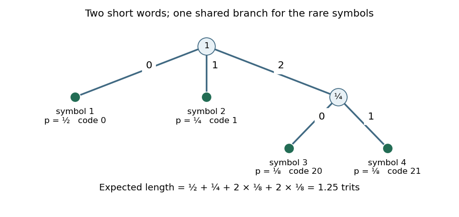
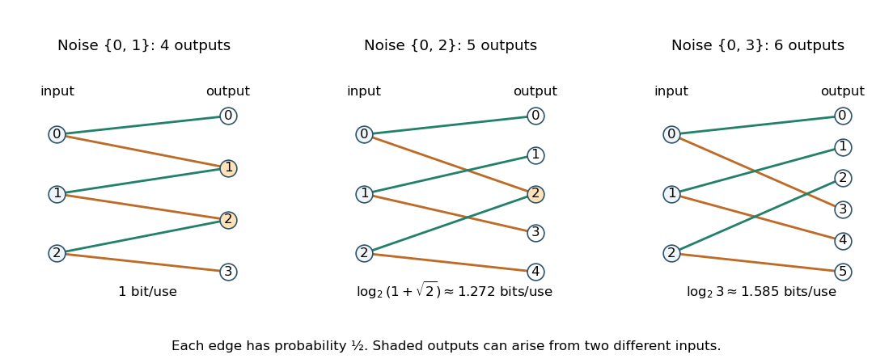

# 2021

↑ **Parent:** [Past exam of the information theory course of the University of Oxford](../past-exam-of-the-information-theory-course-of-the-university-of-oxford.md)

Source paper: [released examination archive](https://www.whatdotheyknow.com/request/ba_computer_science_past_papers/response/2577745/attach/2/202402%20183%20CS%20Papers.zip?cookie_passthrough=1).

**Table of contents**

- [1](#1)
  - [a](#1/a)
    - [i](#1/a/i)
      - [Solution](#1/a/i/solution)
    - [ii](#1/a/ii)
      - [Solution](#1/a/ii/solution)
    - [iii](#1/a/iii)
      - [Solution](#1/a/iii/solution)
    - [iv](#1/a/iv)
      - [Solution](#1/a/iv/solution)
  - [b](#1/b)
    - [i](#1/b/i)
      - [Solution](#1/b/i/solution)
    - [ii](#1/b/ii)
      - [Solution](#1/b/ii/solution)
    - [iii](#1/b/iii)
      - [Solution](#1/b/iii/solution)
  - [c](#1/c)
    - [Solution](#1/c/solution)
- [2](#2)
  - [a](#2/a)
    - [Solution](#2/a/solution)
  - [b](#2/b)
    - [i](#2/b/i)
      - [Solution](#2/b/i/solution)
    - [ii](#2/b/ii)
      - [Solution](#2/b/ii/solution)
    - [iii](#2/b/iii)
      - [Solution](#2/b/iii/solution)
    - [iv](#2/b/iv)
      - [Solution](#2/b/iv/solution)
    - [v](#2/b/v)
      - [Solution](#2/b/v/solution)
    - [vi](#2/b/vi)
      - [Solution](#2/b/vi/solution)
  - [c](#2/c)
    - [Solution](#2/c/solution)
  - [d](#2/d)
    - [Solution](#2/d/solution)
- [3](#3)
  - [a](#3/a)
    - [Solution](#3/a/solution)
  - [b](#3/b)
    - [Solution](#3/b/solution)
  - [c](#3/c)
    - [i](#3/c/i)
      - [Solution](#3/c/i/solution)
    - [ii](#3/c/ii)
      - [Solution](#3/c/ii/solution)
    - [iii](#3/c/iii)
      - [Solution](#3/c/iii/solution)
  - [d](#3/d)
    - [Solution](#3/d/solution)
  - [e](#3/e)
    - [Solution](#3/e/solution)

## 1

↑ **Parent:** [2021](2021.md)

All [logarithms](../calculus.md#logarithm) have base two. In part a the [information entropy](../information-entropy.md) differences and information expressions are interpreted where they are well defined; finite [joint entropy](../information-entropy.md#joint-entropy) is a sufficient hypothesis. This avoids undefined expressions such as infinity minus infinity.

<h3 id="1/a">a</h3>

↑ **Parent:** [1](#1)

<h4 id="1/a/i">i</h4>

↑ **Parent:** [A](#1/a)

<h5 id="1/a/i/solution">Solution</h5>

↑ **Parent:** [I](#1/a/i)

The [chain rule for conditional entropy](../information-theory.md#chain-rule-for-conditional-entropy) gives

$$
H(X,Y\mid Z)-H(X\mid Z)=H(Y\mid X,Z)\geq0.
$$

Indeed, for every conditioning value $(x,z)$ of positive [probability](../probability-theory.md#probability), each summand $-p(y\mid x,z)\log_2p(y\mid x,z)$ is nonnegative. Its sum is zero exactly when the [conditional probability mass function](../probability-theory.md#conditional-probability-mass-function) is concentrated at one value. Averaging over $(X,Z)$ therefore proves both the inequality and its equality criterion: **equality holds exactly when $Y=f(X,Z)$ [almost surely](../convergence-of-random-variables.md#almost-sure-convergence) for some function $f$.** Conditioning values of [probability](../probability-theory.md#probability) zero impose no restriction. This is a statement about [discrete random variables](../random-variable.md#discrete-random-variable); a [differential entropy](../information-entropy.md#differential-entropy) need not be nonnegative.

<h4 id="1/a/ii">ii</h4>

↑ **Parent:** [A](#1/a)

<h5 id="1/a/ii/solution">Solution</h5>

↑ **Parent:** [Ii](#1/a/ii)

Expand the two observations in order using the [chain rule for mutual information](../information-theory.md#chain-rule-for-mutual-information):

$$
I(X,Y;Z)=I(X;Z)+I(Y;Z\mid X).
$$

The remaining [conditional mutual information](../information-theory.md#conditional-mutual-information) is

$$
I(Y;Z\mid X)=\sum_xp_X(x)D\!\left(p_{Y,Z\mid x}\,\middle\|\,p_{Y\mid x}p_{Z\mid x}\right)\geq0.
$$

[Relative entropy nonnegativity](../f-divergence.md#relative-entropy-nonnegativity) proves the inequality. Equality requires every positive-weight [relative entropy](../f-divergence.md#kullback-leibler-divergence) to vanish, which is equivalent to $p(y,z\mid x)=p(y\mid x)p(z\mid x)$ for every $x$ of positive [probability](../probability-theory.md#probability). Thus **equality holds exactly when $Y$ and $Z$ have [conditional independence](../random-variable.md#conditional-independence) given $X$.** No unconditional [independence](../random-variable.md#independent-random-variables) is required.

<h4 id="1/a/iii">iii</h4>

↑ **Parent:** [A](#1/a)

<h5 id="1/a/iii/solution">Solution</h5>

↑ **Parent:** [Iii](#1/a/iii)

The [chain rule for information entropy](../information-entropy.md#chain-rule-for-information-entropy) converts the two differences into [conditional entropies](../information-theory.md#conditional-entropy). Their gap, in the order right minus left, is

$$
\begin{aligned}
&\bigl[H(X,Z)-H(X)\bigr]-\bigl[H(X,Y,Z)-H(X,Y)\bigr]\\
&\qquad=H(Z\mid X)-H(Z\mid X,Y)=I(Y;Z\mid X)\geq0.
\end{aligned}
$$

This is [additional conditioning reduces entropy](../information-theory.md#additional-conditioning-reduces-entropy). The [relative entropy](../f-divergence.md#kullback-leibler-divergence) representation of [conditional mutual information](../information-theory.md#conditional-mutual-information) identifies exactly when that gap vanishes: **equality holds if and only if $Y$ and $Z$ have [conditional independence](../random-variable.md#conditional-independence) given $X$.** Knowledge of $Y$ then changes no [conditional probability](../probability-theory.md#conditional-probability) of $Z$ after $X$ is known.

<h4 id="1/a/iv">iv</h4>

↑ **Parent:** [A](#1/a)

<h5 id="1/a/iv/solution">Solution</h5>

↑ **Parent:** [Iv](#1/a/iv)

Here the asserted bound is actually **an identity, so equality always holds** whenever the displayed quantities are defined. Expand the same [mutual information](../information-theory.md#mutual-information) in two orders:

$$
\begin{aligned}
I(X,Y;Z)&=I(Y;Z)+I(X;Z\mid Y),\\
I(X,Y;Z)&=I(X;Z)+I(Y;Z\mid X).
\end{aligned}
$$

Equating these expressions and using [symmetry](../physics.md#symmetry-physics) of [mutual information](../information-theory.md#mutual-information) and [conditional mutual information](../information-theory.md#conditional-mutual-information) gives

$$
\boxed{I(X;Z\mid Y)=I(Z;Y\mid X)-I(Z;Y)+I(X;Z).}
$$

There is no further [independence](../random-variable.md#independent-random-variables) condition. Treating this part as a strict inequality would obscure its cancellation.

<h3 id="1/b">b</h3>

↑ **Parent:** [1](#1)

<h4 id="1/b/i">i</h4>

↑ **Parent:** [B](#1/b)

<h5 id="1/b/i/solution">Solution</h5>

↑ **Parent:** [I](#1/b/i)

For [probability mass functions](../probability-distribution.md#probability-mass-function) on the [finite alphabet](../information-theory.md#finite-alphabet), take [logarithms](../calculus.md#logarithm) to base two and define the [relative entropy](../f-divergence.md#kullback-leibler-divergence) by

$$
\boxed{D(q\|p)=\sum_{i=1}^mq_i\log_2\frac{q_i}{p_i}.}
$$

A term with $q_i=0$ is zero, including $p_i=0$; a term with $q_i>0=p_i$ is $+\infty$. Fix $p_i>0$ and write $f_i(t)=t\log_2(t/p_i)$. For $t>0$,

$$
f_i''(t)=\frac1{t\ln2}>0,\qquad \lim_{t\downarrow0}f_i(t)=0.
$$

Thus $f_i$ is a [convex function](../real-analysis.md#convex-function) on $[0,\infty)$ by continuous extension to zero. For $0\leq\lambda\leq1$, applying this scalar [convexity](../real-analysis.md#convex-function) to each coordinate and summing proves

$$
D(\lambda q+(1-\lambda)r\|p)\leq\lambda D(q\|p)+(1-\lambda)D(r\|p).
$$

If $p$ has zero coordinates, the finite-valued domain consists of [probability mass functions](../probability-distribution.md#probability-mass-function) supported on $\{i:p_i>0\}$; it is convex and the same proof applies there. Outside that domain the right side is infinite whenever an offending [probability mass function](../probability-distribution.md#probability-mass-function) has a positive mixture weight, so the extended-valued [convexity](../real-analysis.md#convex-function) assertion still holds. At mixture weights zero or one the inequality is an identity, without needing the expression $0\cdot\infty$.

<h4 id="1/b/ii">ii</h4>

↑ **Parent:** [B](#1/b)

<h5 id="1/b/ii/solution">Solution</h5>

↑ **Parent:** [Ii](#1/b/ii)

**Index correction:** the printed definition only permits $i\leq n$, although the required average includes $i=n+1$. Extend the same deletion formula to $1\leq i\leq n+1$. Without that extension the final summand is undefined; there is no new sample or different estimator to supply.

For a fixed outcome of the sample and a fixed symbol $x$, put $A_j=\mathbf1_{\{X_j=x\}}$. The leave-one-out [empirical distribution](../information-theory.md#type-information-theory) then satisfies

$$
\begin{aligned}
\sum_{i=1}^{n+1}\widehat q_{n,i}(x)
&=\frac1n\sum_{i=1}^{n+1}\left(\sum_{j=1}^{n+1}A_j-A_i\right)\\
&=\frac1n\left((n+1)\sum_{j=1}^{n+1}A_j-\sum_{i=1}^{n+1}A_i\right)
=\sum_{j=1}^{n+1}A_j.
\end{aligned}
$$

Dividing by $n+1$ gives **$\widehat p_{n+1}=(n+1)^{-1}\sum_{i=1}^{n+1}\widehat q_{n,i}$.** Each of the $n+1$ [indicator functions](../measure-theory.md#indicator-function) was counted exactly $n$ times before division by $n$. This [leave-one-out identity for empirical distributions](../information-theory.md#leave-one-out-identity-for-empirical-distributions) is deterministic; [independence](../random-variable.md#independent-random-variables) plays no part in this part.

<h4 id="1/b/iii">iii</h4>

↑ **Parent:** [B](#1/b)

<h5 id="1/b/iii/solution">Solution</h5>

↑ **Parent:** [Iii](#1/b/iii)

**Reference-distribution ambiguity:** $\rho$ is not defined in the paper. If it is an arbitrary [probability mass function](../probability-distribution.md#probability-mass-function), the printed inequality is false. For instance, choose $p=(1,0)$ and $\rho=(1/2,1/2)$. Every [empirical distribution](../information-theory.md#type-information-theory) equals $p$, making the printed left side one [bit](../information-theory.md#bit) and its right side zero. This is a counterexample for every $n\geq1$.

Under the consistent interpretation **$\rho=p$**, the preceding [leave-one-out identity for empirical distributions](../information-theory.md#leave-one-out-identity-for-empirical-distributions) and [convexity of relative entropy in its first argument](../f-divergence.md#convexity-of-relative-entropy-in-its-first-argument) give, for every sample,

$$
D(\widehat p_{n+1}\|p)
\leq\frac1{n+1}\sum_{i=1}^{n+1}D(\widehat q_{n,i}\|p).
$$

Deleting any one observation from $n+1$ [independent and identically distributed random variables](../random-variable.md#independent-and-identically-distributed-random-variables) leaves $n$ [independent](../random-variable.md#independent-random-variables) observations with [probability mass function](../probability-distribution.md#probability-mass-function) $p$. Consequently each $\widehat q_{n,i}$ has the same distribution as $\widehat p_n$. They need not be [independent](../random-variable.md#independent-random-variables) of one another. Taking [expected values](../expected-value.md) and using [linearity of expectation](../expected-value.md#linearity-of-expectation) therefore proves

$$
\boxed{\mathbb E D(\widehat p_{n+1}\|p)\leq\mathbb E D(\widehat p_n\|p).}
$$

Zero coordinates of $p$ are never sampled, [almost surely](../convergence-of-random-variables.md#almost-sure-convergence), so the calculation can be restricted to its [probability support](../probability-distribution.md#support-of-a-probability-distribution). In particular the [expected values](../expected-value.md) are finite on this [finite alphabet](../information-theory.md#finite-alphabet).

The discrepancy cannot be removed by silently choosing any fixed reference. Whenever $\rho$ is positive on the [probability support](../probability-distribution.md#support-of-a-probability-distribution) of $p$, direct subtraction and $\mathbb E\widehat p_n=p$ give the [expected relative entropy decomposition](../f-divergence.md#expected-relative-entropy-decomposition)

$$
\mathbb E D(\widehat p_n\|\rho)=\mathbb E D(\widehat p_n\|p)+D(p\|\rho).
$$

Thus the valid arbitrary-reference version has $\rho$ on _both_ sides; the printed mixed-reference version has an additional term whose sign prevents the proposed conclusion.

<h3 id="1/c">c</h3>

↑ **Parent:** [1](#1)

<h4 id="1/c/solution">Solution</h4>

↑ **Parent:** [C](#1/c)

For the [maximum entropy distribution on the nonnegative integers](../information-entropy.md#maximum-entropy-distribution-on-the-nonnegative-integers), use the [geometric distribution](../discrete-probability-distribution.md#geometric-distribution) counting failures before the first success. Write $r=a/(a+1)$ and define

$$
\boxed{g_i=(1-r)r^i=\frac1{a+1}\left(\frac a{a+1}\right)^i,\qquad i=0,1,\ldots.}
$$

The [geometric series](../sequence-and-series.md#geometric-series) gives $\sum_i g_i=1$. [Termwise differentiation of a power series](../sequence-and-series.md#termwise-differentiation-of-a-power-series) applied to that [geometric series](../sequence-and-series.md#geometric-series) for $0<r<1$ gives $\sum_iir^i=r/(1-r)^2$, hence $\sum_iig_i=r/(1-r)=a$.

For any competing [probability mass function](../probability-distribution.md#probability-mass-function) $p$ of mean $a$, its [cross-entropy](../information-entropy.md#cross-entropy) against $g$ is

$$
-\sum_{i\geq0}p_i\log_2g_i
=\log_2(a+1)+a\log_2\frac{a+1}{a}
=(a+1)\log_2(a+1)-a\log_2a.
$$

This is finite. The fact that [finite cross entropy bounds countable information entropy](../information-entropy.md#finite-cross-entropy-bounds-countable-information-entropy) must be justified without assuming in advance that $H(p)$ is finite. Use $\ln u\leq u-1$ with $u=g_i/p_i$ when $p_i>0$. Including zero terms by their limiting convention yields, for every finite $N$,

$$
\sum_{i=0}^N-p_i\log_2p_i\leq\sum_{i=0}^N-p_i\log_2g_i+\frac1{\ln2}\sum_{i=0}^N(g_i-p_i).
$$

Let $N\to\infty$. The [information entropy](../information-entropy.md) partial sums increase, the [cross-entropy](../information-entropy.md#cross-entropy) partial sums converge to the finite value above, and the final mass difference tends to zero. This proves finiteness and the upper bound. We may now write

$$
D(p\|g)=H(g)-H(p)\geq0.
$$

[Relative entropy nonnegativity](../f-divergence.md#relative-entropy-nonnegativity) has equality exactly when $p=g$. Therefore the displayed geometric [probability mass function](../probability-distribution.md#probability-mass-function) is the **unique maximizer**, and

$$
\boxed{H_{\max}=(a+1)\log_2(a+1)-a\log_2a\ \text{bits}.}
$$

The mean constraint is essential: without it, [uniform distributions](../continuous-probability-distribution.md#continuous-uniform-distribution) on longer initial intervals have unbounded [information entropy](../information-entropy.md).

## 2

↑ **Parent:** [2021](2021.md)

<h3 id="2/a">a</h3>

↑ **Parent:** [2](#2)

<h4 id="2/a/solution">Solution</h4>

↑ **Parent:** [A](#2/a)

The displayed [prefix code](../coding-theory.md#prefix-code) has [expected codeword length](../information-theory.md#expected-codeword-length) $3/2$ ternary digits per source symbol. Instead assign

$$
\boxed{c(1)=0,\qquad c(2)=1,\qquad c(3)=20,\qquad c(4)=21.}
$$

This is a [ternary prefix code](../coding-theory.md#ternary-prefix-code): the first two [codewords](../coding-theory.md#codeword) end at distinct [tree children](../tree-graph-theory.md#child-in-a-rooted-tree) of the [tree root](../tree-graph-theory.md#root-of-a-tree), and the other two start with $2$ and end at distinct [tree children](../tree-graph-theory.md#child-in-a-rooted-tree) below it. No [codeword](../coding-theory.md#codeword) is a prefix of another. Its [expected codeword length](../information-theory.md#expected-codeword-length) is

$$
\frac12\cdot1+\frac14\cdot1+\frac18\cdot2+\frac18\cdot2=\frac54<\frac32.
$$

The reduction is **$1/4$ [trit](../information-theory.md#trit) per source symbol**, which already disproves optimality of the displayed code. The [ternary Huffman coding](../information-theory.md#ternary-huffman-coding) construction below will produce this same improved [code tree](../coding-theory.md#prefix-tree-of-a-code).

**[Figure 1](#2/a/image-an-original-ternary-prefix-tree-with-expected-length-1-25-ternary-digits-per-source-symbol). An original ternary prefix tree with expected length 1.25 ternary digits per source symbol**.

<h3 id="2/b">b</h3>

↑ **Parent:** [2](#2)

The [shape of minimum-cost positive-weight ternary prefix trees](../coding-theory.md#shape-of-minimum-cost-positive-weight-ternary-prefix-trees) arguments in ii–vi assume a [full-support finite distribution](../probability-distribution.md#full-support-probability-distribution-on-a-finite-alphabet): $p_i>0$ for every retained source symbol. The printed setup does not state this globally. Each affected solution gives the proof with that qualification and a counterexample when zero-probability symbols are allowed in arbitrary redundant [code trees](../coding-theory.md#prefix-tree-of-a-code). Part i needs no such qualification.

<h4 id="2/b/i">i</h4>

↑ **Parent:** [B](#2/b)

<h5 id="2/b/i/solution">Solution</h5>

↑ **Parent:** [I](#2/b/i)

Exchange the two complete [codewords](../coding-theory.md#codeword) while leaving the [code tree](../coding-theory.md#prefix-tree-of-a-code) unchanged. The [prefix code](../coding-theory.md#prefix-code) property is preserved because the set of [codewords](../coding-theory.md#codeword) is unchanged. If $p_i>p_j$ but $l_i>l_j$, the change in [expected codeword length](../information-theory.md#expected-codeword-length) is

$$
(p_il_j+p_jl_i)-(p_il_i+p_jl_j)=(p_i-p_j)(l_j-l_i)<0,
$$

contradicting optimality. Hence **$p_i>p_j$ implies $l_i\leq l_j$**. This [probability monotonicity of optimal prefix-code lengths](../information-theory.md#probability-monotonicity-of-optimal-prefix-code-lengths) is valid even if some [probabilities](../probability-theory.md#probability) are zero; equal [probabilities](../probability-theory.md#probability) impose no order.[p. 1099, Derived Coding Requirements: probability ordering and permissible exchange of equal-probability messages](../mathematics-bibliography.md#a-method-for-the-construction-of-minimum-redundancy-codes-by-david-a-huffman)

<h4 id="2/b/ii">ii</h4>

↑ **Parent:** [B](#2/b)

<h5 id="2/b/ii/solution">Solution</h5>

↑ **Parent:** [Ii](#2/b/ii)

First assume a [full-support finite distribution](../probability-distribution.md#full-support-probability-distribution-on-a-finite-alphabet), as stated above. Let $L$ be the largest [codeword length](../coding-theory.md#codeword-length) and take a [tree leaf](../tree-graph-theory.md#leaf-of-a-tree) at depth $L$. Every existing [tree child](../tree-graph-theory.md#child-in-a-rooted-tree) of its [tree parent](../tree-graph-theory.md#parent-in-a-rooted-tree) must also be a [tree leaf](../tree-graph-theory.md#leaf-of-a-tree): an internal [tree child](../tree-graph-theory.md#child-in-a-rooted-tree) would have a descendant deeper than $L$. If the chosen [tree leaf](../tree-graph-theory.md#leaf-of-a-tree) were its [tree parent](../tree-graph-theory.md#parent-in-a-rooted-tree)'s only [tree child](../tree-graph-theory.md#child-in-a-rooted-tree), moving its symbol to that [tree parent](../tree-graph-theory.md#parent-in-a-rooted-tree) would shorten its [codeword](../coding-theory.md#codeword) by one, preserve the [prefix code](../coding-theory.md#prefix-code) property, and reduce [expected codeword length](../information-theory.md#expected-codeword-length) by its positive [probability](../probability-theory.md#probability). That contradicts optimality. The [tree parent](../tree-graph-theory.md#parent-in-a-rooted-tree) therefore has at least two [tree children](../tree-graph-theory.md#child-in-a-rooted-tree), both [tree leaves](../tree-graph-theory.md#leaf-of-a-tree). A second [codeword](../coding-theory.md#codeword) has the same first $L-1$ digits and a different last digit, proving the required **deepest [sibling codeword](../information-theory.md#sibling-leaves-in-a-code-tree) property** for a [ternary prefix code](../coding-theory.md#ternary-prefix-code).

For the literal wording allowing zero [probabilities](../probability-theory.md#probability), take $p=(1,0,0)$ and the [prefix code](../coding-theory.md#prefix-code) $(0,10,110)$. Its [expected codeword length](../information-theory.md#expected-codeword-length) is one, which is minimal: with more than one message an empty [codeword](../coding-theory.md#codeword) is impossible, so the positive-probability message must have length at least one. Yet the deepest [tree leaf](../tree-graph-theory.md#leaf-of-a-tree) $110$ has no [sibling codeword](../information-theory.md#sibling-leaves-in-a-code-tree). **Thus positivity or an additional convention removing redundant zero-weight branches is needed.**

<h4 id="2/b/iii">iii</h4>

↑ **Parent:** [B](#2/b)

<h5 id="2/b/iii/solution">Solution</h5>

↑ **Parent:** [Iii](#2/b/iii)

Suppose a [tree parent](../tree-graph-theory.md#parent-in-a-rooted-tree) at depth $n-1$, with $n<L$, has an unused outgoing digit. The missing [tree child](../tree-graph-theory.md#child-in-a-rooted-tree) gives an empty [code tree](../coding-theory.md#prefix-tree-of-a-code) branch at depth $n$. Move any deepest [tree leaf](../tree-graph-theory.md#leaf-of-a-tree) into that position, retaining all other [codewords](../coding-theory.md#codeword) and deleting the abandoned empty branch. The new word has no old word as a prefix, because it lies in an unused branch, and it is not a prefix of any retained word. Its length decreases from $L$ to $n$. With a [full-support finite distribution](../probability-distribution.md#full-support-probability-distribution-on-a-finite-alphabet) this reduces [expected codeword length](../information-theory.md#expected-codeword-length) by $p_i(L-n)>0$, contradicting optimality. Hence all three [tree children](../tree-graph-theory.md#child-in-a-rooted-tree) exist, and each has a descendant [codeword](../coding-theory.md#codeword). In fact **every internal [vertex](../graph.md#vertex-graph-theory) above depth $L-1$ has all three [tree children](../tree-graph-theory.md#child-in-a-rooted-tree)**. Applying this to the [tree parent](../tree-graph-theory.md#parent-in-a-rooted-tree) of the specified prefix gives the claimed three extensions.

The positive-probability qualification attached only to the specified prefix does not by itself suffice. In the zero-weight example $(p,c)=((1,0,0),(0,10,110))$, choose the positive-probability word $0$, so $n=1<L=3$. There is no word starting with $2$. The deepest [tree leaf](../tree-graph-theory.md#leaf-of-a-tree) available for relocation has [probability](../probability-theory.md#probability) zero, so the strict-improvement argument fails. This is why the [full-support finite distribution](../probability-distribution.md#full-support-probability-distribution-on-a-finite-alphabet) assumption is used for the structural conclusions.

<h4 id="2/b/iv">iv</h4>

↑ **Parent:** [B](#2/b)

<h5 id="2/b/iv/solution">Solution</h5>

↑ **Parent:** [Iv](#2/b/iv)

With a [full-support finite distribution](../probability-distribution.md#full-support-probability-distribution-on-a-finite-alphabet), suppose two distinct [tree parents](../tree-graph-theory.md#parent-in-a-rooted-tree) at depth $L-1$ each have exactly two [tree children](../tree-graph-theory.md#child-in-a-rooted-tree), both [tree leaves](../tree-graph-theory.md#leaf-of-a-tree). Move one [tree leaf](../tree-graph-theory.md#leaf-of-a-tree) from the second pair into the vacant third [tree child](../tree-graph-theory.md#child-in-a-rooted-tree) slot of the first [tree parent](../tree-graph-theory.md#parent-in-a-rooted-tree). Its length remains $L$, so this relocation does not change [expected codeword length](../information-theory.md#expected-codeword-length). The second [tree parent](../tree-graph-theory.md#parent-in-a-rooted-tree) now has a single [tree child](../tree-graph-theory.md#child-in-a-rooted-tree), which is a [tree leaf](../tree-graph-theory.md#leaf-of-a-tree). Replace that remaining [tree child](../tree-graph-theory.md#child-in-a-rooted-tree)'s [codeword](../coding-theory.md#codeword) by the [tree parent](../tree-graph-theory.md#parent-in-a-rooted-tree)'s word. This preserves the [prefix code](../coding-theory.md#prefix-code) property and shortens a positive-probability [codeword](../coding-theory.md#codeword) by one. [Expected codeword length](../information-theory.md#expected-codeword-length) strictly decreases, a contradiction. Thus **there is at most one deepest pair with exactly two [sibling codewords](../information-theory.md#sibling-leaves-in-a-code-tree)**.

If zero-probability symbols are retained without a reduction convention, the claim can fail. The [probability mass function](../probability-distribution.md#probability-mass-function) $(1,0,0,0,0)$ with [prefix code](../coding-theory.md#prefix-code) $(0,100,101,110,111)$ has the optimal [expected codeword length](../information-theory.md#expected-codeword-length) one, yet contains the two deepest pairs $(100,101)$ and $(110,111)$. The contraction would only shorten a zero-probability word.

<h4 id="2/b/v">v</h4>

↑ **Parent:** [B](#2/b)

<h5 id="2/b/v/solution">Solution</h5>

↑ **Parent:** [V](#2/b/v)

Let $L$ again denote the largest [codeword length](../coding-theory.md#codeword-length), and assume a [full-support finite distribution](../probability-distribution.md#full-support-probability-distribution-on-a-finite-alphabet). The missing-branch exchange from part iii forces every internal [vertex](../graph.md#vertex-graph-theory) at depth at most $L-2$ to have three [tree children](../tree-graph-theory.md#child-in-a-rooted-tree). At depth $L-1$, all [tree children](../tree-graph-theory.md#child-in-a-rooted-tree) are [tree leaves](../tree-graph-theory.md#leaf-of-a-tree). Part ii rules out one [tree child](../tree-graph-theory.md#child-in-a-rooted-tree) there; the hypothesis that there is no pair of two deepest [sibling codewords](../information-theory.md#sibling-leaves-in-a-code-tree) rules out two [tree children](../tree-graph-theory.md#child-in-a-rooted-tree). Thus each such [tree parent](../tree-graph-theory.md#parent-in-a-rooted-tree) also has three [tree children](../tree-graph-theory.md#child-in-a-rooted-tree). **Every internal [vertex](../graph.md#vertex-graph-theory) has exactly three [tree children](../tree-graph-theory.md#child-in-a-rooted-tree)**, which is a [full ternary tree](../tree-graph-theory.md#full-ternary-tree), called semi-complete in this paper. The same last-level argument covers $L=1$.

Without the assumption of a [full-support finite distribution](../probability-distribution.md#full-support-probability-distribution-on-a-finite-alphabet) the implication is false: for $p=(1,0,0)$, the optimal [prefix code](../coding-theory.md#prefix-code) $(0,10,110)$ has no deepest pair of two [sibling codewords](../information-theory.md#sibling-leaves-in-a-code-tree), but its [code tree](../coding-theory.md#prefix-tree-of-a-code) contains [vertices](../graph.md#vertex-graph-theory) with a single [tree child](../tree-graph-theory.md#child-in-a-rooted-tree). Empty unused [tree children](../tree-graph-theory.md#child-in-a-rooted-tree) are not [vertices](../graph.md#vertex-graph-theory) of the [code tree](../coding-theory.md#prefix-tree-of-a-code).

<h4 id="2/b/vi">vi</h4>

↑ **Parent:** [B](#2/b)

<h5 id="2/b/vi/solution">Solution</h5>

↑ **Parent:** [Vi](#2/b/vi)

Assume a [full-support finite distribution](../probability-distribution.md#full-support-probability-distribution-on-a-finite-alphabet). The preceding structural arguments show that every internal [vertex](../graph.md#vertex-graph-theory) has three [tree children](../tree-graph-theory.md#child-in-a-rooted-tree), except possibly one [tree parent](../tree-graph-theory.md#parent-in-a-rooted-tree) at depth $L-1$ with two [tree children](../tree-graph-theory.md#child-in-a-rooted-tree). Let $N_3$ and $N_2$ count these two kinds of internal [vertex](../graph.md#vertex-graph-theory). Part iv gives $N_2\in\{0,1\}$; no [vertex](../graph.md#vertex-graph-theory) has one [tree child](../tree-graph-theory.md#child-in-a-rooted-tree).

A finite [rooted tree](../tree-graph-theory.md#rooted-tree) with $m$ [tree leaves](../tree-graph-theory.md#leaf-of-a-tree) has $m+N_2+N_3-1$ [edges](../graph-theory.md#edge-of-a-graph), while counting outgoing [edges](../graph-theory.md#edge-of-a-graph) gives $2N_2+3N_3$. Equating the counts yields

$$
m=1+N_2+2N_3.
$$

For an [odd integer](../integer.md#odd-integer) $m$, the right side forces $N_2$ to be an [even integer](../integer.md#even-number). Since it is at most one, **$N_2=0$**. Thus no deepest pair has only two [sibling codewords](../information-theory.md#sibling-leaves-in-a-code-tree), and the optimal [code tree](../coding-theory.md#prefix-tree-of-a-code) is a [full ternary tree](../tree-graph-theory.md#full-ternary-tree). This leaf-count identity also directly proves that a [full ternary tree](../tree-graph-theory.md#full-ternary-tree) has an [odd number](../integer.md#odd-number) of [tree leaves](../tree-graph-theory.md#leaf-of-a-tree).

Again the unrestricted zero-weight version is false: $(0,10,11)$ is an optimal [prefix code](../coding-theory.md#prefix-code) for $p=(1,0,0)$, with [odd integer](../integer.md#odd-integer) $m=3$, but its two deepest [tree leaves](../tree-graph-theory.md#leaf-of-a-tree) form a two-sibling pair. There is no contradiction with the proof because its [tree root](../tree-graph-theory.md#root-of-a-tree) has only two [tree children](../tree-graph-theory.md#child-in-a-rooted-tree), which the [full-support finite distribution](../probability-distribution.md#full-support-probability-distribution-on-a-finite-alphabet) assumption would forbid above the deepest level.

<h3 id="2/c">c</h3>

↑ **Parent:** [2](#2)

<h4 id="2/c/solution">Solution</h4>

↑ **Parent:** [C](#2/c)

For an [odd integer](../integer.md#odd-integer) $m\geq3$, [ternary Huffman coding](../information-theory.md#ternary-huffman-coding) repeatedly merges **three** smallest weights.

Start with one [tree leaf](../tree-graph-theory.md#leaf-of-a-tree) for each source symbol, weighted by its [probability](../probability-theory.md#probability). While more than one weighted object remains, choose the three objects with least weights, create their common [tree parent](../tree-graph-theory.md#parent-in-a-rooted-tree) with weight equal to their sum, and replace the three by that [tree parent](../tree-graph-theory.md#parent-in-a-rooted-tree). Newly created [tree parents](../tree-graph-theory.md#parent-in-a-rooted-tree) participate in subsequent choices. Each merge reduces the number of objects by two; an [odd number](../integer.md#odd-number) of objects therefore reaches three and then one, never an unmergeable pair. The final object is the [tree root](../tree-graph-theory.md#root-of-a-tree) of the [code tree](../coding-theory.md#prefix-tree-of-a-code).

Label the three outgoing [edges](../graph-theory.md#edge-of-a-graph) at each internal [vertex](../graph.md#vertex-graph-theory) by $0,1,2$ in any order. The digits along the root-to-leaf [graph path](../graph-theory.md#path-in-a-graph) give each symbol's [codeword](../coding-theory.md#codeword). [Tree leaves](../tree-graph-theory.md#leaf-of-a-tree) cannot be ancestors of other [tree leaves](../tree-graph-theory.md#leaf-of-a-tree), so this is a [prefix code](../coding-theory.md#prefix-code). Ties can be resolved arbitrarily. The [expected codeword length](../information-theory.md#expected-codeword-length) is measured in [trits](../information-theory.md#trit), and equals the sum of all merge weights, because each merge adds one digit to every [codeword](../coding-theory.md#codeword) below it.

The structural reason for merging three is that the positive-weight, odd-leaf case has a [full ternary tree](../tree-graph-theory.md#full-ternary-tree). Its deepest [sibling codeword](../information-theory.md#sibling-leaves-in-a-code-tree) triple can receive the three least weights by exchanging [tree leaf](../tree-graph-theory.md#leaf-of-a-tree) labels, and contracting that triple reduces the problem by two symbols. This explains the recursive construction; a separate optimality proof is not required here.

<h3 id="2/d">d</h3>

↑ **Parent:** [2](#2)

<h4 id="2/d/solution">Solution</h4>

↑ **Parent:** [D](#2/d)

For an [even integer](../integer.md#even-number) $m\geq2$, **merge the two least weights once, then repeatedly merge three least weights** until only the [tree root](../tree-graph-theory.md#root-of-a-tree) remains. The initial binary merge leaves an [odd number](../integer.md#odd-number) of weighted objects, so the preceding algorithm applies. The initial merged [tree parent](../tree-graph-theory.md#parent-in-a-rooted-tree) has two [tree children](../tree-graph-theory.md#child-in-a-rooted-tree); subsequent [tree parents](../tree-graph-theory.md#parent-in-a-rooted-tree) have three. Equivalently, add one zero-weight dummy symbol, run the odd-leaf [ternary Huffman coding](../information-theory.md#ternary-huffman-coding) algorithm, and remove its [codeword](../coding-theory.md#codeword) afterwards. The dummy contributes nothing to [expected codeword length](../information-theory.md#expected-codeword-length).

Here the first merge joins the two weights $1/8$, producing $1/4$. The three remaining weights are $1/2,1/4,1/4$, and merge directly into the [tree root](../tree-graph-theory.md#root-of-a-tree). Assigning the first two [tree root](../tree-graph-theory.md#root-of-a-tree) branches to the original symbols of weights $1/2$ and $1/4$ gives

$$
\boxed{c(1)=0,\quad c(2)=1,\quad c(3)=20,\quad c(4)=21,\qquad L(c)=\frac54\ \text{trits}.}
$$

The merge-weight check gives $1/4+1=5/4$ as well. For $m=2$, the first merge is already the [tree root](../tree-graph-theory.md#root-of-a-tree); for $m=1$, outside this case with an [even number](../integer.md#even-number) of symbols, the usual temporary reduced-problem convention would permit an [empty word](../foundations-of-mathematics.md#empty-word).

## 3

↑ **Parent:** [2021](2021.md)

<h3 id="3/a">a</h3>

↑ **Parent:** [3](#3)

<h4 id="3/a/solution">Solution</h4>

↑ **Parent:** [A](#3/a)

For a [discrete memoryless channel](../coding-theory.md#discrete-memoryless-channel) with [transition probabilities](../markov-chain.md#transition-probability) $M(y\mid x)$, the [conditional probability](../probability-theory.md#conditional-probability) of a length-$n$ output given a length-$n$ input factors as

$$
\mathbb P(Y_1=y_1,\ldots,Y_n=y_n\mid X_1=x_1,\ldots,X_n=x_n)=\prod_{j=1}^n M(y_j\mid x_j).
$$

The same [transition probabilities](../markov-chain.md#transition-probability) apply at each use. Its [channel capacity](../information-theory.md#channel-capacity) is

$$
\boxed{C=\max_{p_X}I(X;Y)=\max_{p_X}\sum_{x,y}p_X(x)M(y\mid x)\log_2\frac{M(y\mid x)}{\sum_{x'}p_X(x')M(y\mid x')} .}
$$

The unit is [bits](../information-theory.md#bit) per channel use. For [finite alphabets](../information-theory.md#finite-alphabet) the maximum exists by [continuity](../calculus.md#continuous-function) on the [probability simplex](../algebraic-topology.md#probability-simplex); with more general [alphabets](../information-theory.md#alphabet) one uses a [supremum](../real-analysis.md#supremum) when appropriate.

An $(m,n)$ [channel code](../coding-theory.md#channel-code) consists of an [encoder](../coding-theory.md#channel-encoder) $c:\mathcal V_m\to\mathcal X^n$ and a [decoder](../coding-theory.md#channel-decoder) $d:\mathcal Y^n\to\mathcal V_m$. It represents each of $m$ messages by $n$ input symbols and recovers a message from the $n$ observed output symbols. Its [code rate](../coding-theory.md#code-rate) is **$R=(\log_2m)/n$ [bits](../information-theory.md#bit) per use**. For each message $w$, its conditional error [probability](../probability-theory.md#probability) is $\mathbb P(d(Y^n)\ne w\mid W=w)$; an average error also specifies the message [probability distribution](../probability-distribution.md), while the maximum error takes the largest conditional error.

<h3 id="3/b">b</h3>

↑ **Parent:** [3](#3)

<h4 id="3/b/solution">Solution</h4>

↑ **Parent:** [B](#3/b)

Write $T=g(Y)$. Because $T$ is determined by $Y$, the [chain rule for mutual information](../information-theory.md#chain-rule-for-mutual-information) gives

$$
I(X;Y)=I(X;Y,T)=I(X;T)+I(X;Y\mid T)\geq I(X;T).
$$

This is the [data processing inequality](../information-theory.md#data-processing-inequality). It holds for every input [probability distribution](../probability-distribution.md). Maximizing each side over that same set of input [probability distributions](../probability-distribution.md) gives **$C_{g(Y)}\leq C_Y$**; processing cannot increase [channel capacity](../information-theory.md#channel-capacity).

A simple sufficient condition for equality is that **$g$ be [injective](../algebra.md#injective-function) on the reachable output [alphabet](../information-theory.md#alphabet)**. Then $Y$ can be recovered from $T$, giving $H(Y\mid T)=0$ and hence $I(X;Y\mid T)=0$ for every input law. The input that achieves the original [channel capacity](../information-theory.md#channel-capacity) therefore achieves it after processing as well. Values of $g$ outside reachable outputs are irrelevant.

[Injectivity](../algebra.md#injective-function) is sufficient rather than necessary. More precisely, for [finite alphabets](../information-theory.md#finite-alphabet) [equality in capacity data processing](../information-theory.md#equality-in-capacity-data-processing) holds exactly when there is an original capacity-achieving input law for which $X$ and $Y$ have [conditional independence](../random-variable.md#conditional-independence) given $T$. Sufficiency follows from the displayed gap identity. For necessity, maximize $I(X;T)$ at an input law $p_*$; if its maximum equals $C_Y$, then $C_Y=I_{p_*}(X;T)\leq I_{p_*}(X;Y)\leq C_Y$, so both inequalities are equalities. Processing may discard output details unrelated to the input without losing [channel capacity](../information-theory.md#channel-capacity).

<h3 id="3/c">c</h3>

↑ **Parent:** [3](#3)

Interpret additive noise in the standard channel sense: $Z$ is [independent](../random-variable.md#independent-random-variables) of the chosen input $X$ and its law is fixed as the input law is varied. A uniform marginal law for $Z$ alone, without this [independence](../random-variable.md#independent-random-variables) assumption, would not specify the [transition matrix](../markov-chain.md#stochastic-matrix). Only reachable output symbols are counted.

<h4 id="3/c/i">i</h4>

↑ **Parent:** [C](#3/c)

<h5 id="3/c/i/solution">Solution</h5>

↑ **Parent:** [I](#3/c/i)

Translate the output [alphabet](../information-theory.md#alphabet) by $-\min(z_1,z_2)$ and put $d=|z_2-z_1|\geq1$. The reachable outputs become

$$
\{0,1,2\}\cup\{d,d+1,d+2\},\qquad |\mathcal Y|=3+\min(d,3).
$$

For $d=1$ the two sets overlap in two points; for $d=2$ in one; for $d\geq3$ they are disjoint. In particular **$|\mathcal Y|\geq4$**, and choosing noise values $0,1$ attains four.

With rows indexed by inputs $0,1,2$ and columns by outputs $0,1,2,3$, [independence](../random-variable.md#independent-random-variables) and uniform two-point noise give

$$
M=\begin{pmatrix}
1/2&1/2&0&0\\
0&1/2&1/2&0\\
0&0&1/2&1/2
\end{pmatrix}.
$$

Every conditional output distribution has [information entropy](../information-entropy.md) one [bit](../information-theory.md#bit), so $I(X;Y)=H(Y)-1\leq\log_2 4-1=1$. The input [probability mass function](../probability-distribution.md#probability-mass-function) $(1/2,0,1/2)$ makes all four outputs equiprobable, attaining that bound. Thus

$$
\boxed{C=1\ \text{bit per use},\qquad p_X=(1/2,0,1/2).}
$$

Using a zero-probability _input_ in a channel-capacity maximization is legitimate; it is unrelated to the strictly positive source weights needed for the tree-shape claims in Question 2.

<h4 id="3/c/ii">ii</h4>

↑ **Parent:** [C](#3/c)

<h5 id="3/c/ii/solution">Solution</h5>

↑ **Parent:** [Ii](#3/c/ii)

Each of the three input values has two possible outputs, so their union has at most six elements. The preceding union formula also gives this bound. Choose noise values $0,3$, whose two translated input [alphabets](../information-theory.md#alphabet) are disjoint. With columns ordered $0,1,2,3,4,5$ the [transition matrix](../markov-chain.md#stochastic-matrix) is

$$
M=\begin{pmatrix}
1/2&0&0&1/2&0&0\\
0&1/2&0&0&1/2&0\\
0&0&1/2&0&0&1/2
\end{pmatrix}.
$$

Thus **$|\mathcal Y|=6$**. Every output determines its input, explicitly $X=Y\bmod3$, so $H(X\mid Y)=0$. Consequently $I(X;Y)=H(X)\leq\log_2 3$, with equality for a uniform input. Therefore

$$
\boxed{C=\log_2 3\ \text{bits per use},\qquad p_X=(1/3,1/3,1/3).}
$$

The extra uncertainty of which noise value occurred does not reduce information about the input: the two possible outputs for each input remain distinguishable from those of every other input.

<h4 id="3/c/iii">iii</h4>

↑ **Parent:** [C](#3/c)

<h5 id="3/c/iii/solution">Solution</h5>

↑ **Parent:** [Iii](#3/c/iii)

Choose noise values $0,2$, giving exactly the outputs $0,1,2,3,4$. The [transition matrix](../markov-chain.md#stochastic-matrix), in that column order, is

$$
M=\begin{pmatrix}
1/2&0&1/2&0&0\\
0&1/2&0&1/2&0\\
0&0&1/2&0&1/2
\end{pmatrix}.
$$

An input [probability mass function](../probability-distribution.md#probability-mass-function) $(1/2,1/2,0)$ makes outputs $0,1,2,3$ equiprobable, so $H(Y)=2$ and $H(Y\mid X)=1$. Hence **$C\geq1$ [bit](../information-theory.md#bit) per use**, as required for comparison with the four-output case.

There is a strict improvement, which can also be computed exactly. [Reflection](../linear-algebra.md#reflection-mathematics) of the input labels $0\leftrightarrow2$, accompanied by output [reflection](../linear-algebra.md#reflection-mathematics) $y\leftrightarrow4-y$, leaves [mutual information](../information-theory.md#mutual-information) unchanged. [Concavity of information entropy](../information-entropy.md#concavity-of-information-entropy) makes [mutual information](../information-theory.md#mutual-information) a concave function of the input [probability mass function](../probability-distribution.md#probability-mass-function) for a fixed [transition matrix](../markov-chain.md#stochastic-matrix). Averaging an input law with its [reflection](../linear-algebra.md#reflection-mathematics) therefore cannot decrease it. It suffices to consider

$$
p_X=(s/2,1-s,s/2),\qquad 0\leq s\leq1.
$$

The outputs whose labels are [even integers](../integer.md#even-number) have total mass $s$ and [conditional probability mass function](../probability-theory.md#conditional-probability-mass-function) $(1/4,1/2,1/4)$, with [information entropy](../information-entropy.md) $3/2$. The outputs whose labels are [odd integers](../integer.md#odd-integer) have mass $1-s$ and [conditional probability mass function](../probability-theory.md#conditional-probability-mass-function) $(1/2,1/2)$, with [information entropy](../information-entropy.md) one. Splitting first by output [parity](../quantum-mechanics.md#parity) using the [chain rule for information entropy](../information-entropy.md#chain-rule-for-information-entropy) yields

$$
H(Y)=h_2(s)+\tfrac32s+(1-s),\qquad I(X;Y)=h_2(s)+\frac s2.
$$

Its [derivative](../calculus.md#derivative) is $\log_2((1-s)/s)+1/2$, and its [second derivative](../calculus.md#second-derivative) is negative. The unique maximum occurs at $s=\sqrt2/(1+\sqrt2)$, giving

$$
\boxed{C=\log_2(1+\sqrt2)\approx1.271553,\qquad p_X=\left(\frac1{2+\sqrt2},\frac1{1+\sqrt2},\frac1{2+\sqrt2}\right).}
$$

This additional optimization explains the collision pattern: outputs $1,3$ identify input $1$, outputs $0,4$ identify the two extreme inputs, and only output $2$ is ambiguous.

**[Figure 2](#3/c/iii/image-three-original-additive-noise-channel-diagrams-increasing-noise-separation-changes-output-collisions-and-channel-capacity). Three original additive-noise channel diagrams: increasing noise separation changes output collisions and channel capacity**.

<h3 id="3/d">d</h3>

↑ **Parent:** [3](#3)

<h4 id="3/d/solution">Solution</h4>

↑ **Parent:** [D](#3/d)

For every input [probability mass function](../probability-distribution.md#probability-mass-function), [conditional entropy](../information-theory.md#conditional-entropy) is nonnegative, so

$$
I(X;Y)=H(X)-H(X\mid Y)\leq H(X)\leq\log_2|\mathcal X|=1.
$$

Taking the maximum over input laws proves **$C\leq1$ [bit](../information-theory.md#bit) per channel use**. This bound comes from the binary input [alphabet](../information-theory.md#alphabet) itself; no specific [transition probabilities](../markov-chain.md#transition-probability) or [decoder](../coding-theory.md#channel-decoder) are needed.

<h3 id="3/e">e</h3>

↑ **Parent:** [3](#3)

<h4 id="3/e/solution">Solution</h4>

↑ **Parent:** [E](#3/e)

There are two possible messages and three channel uses, giving

$$
\boxed{R=\frac{\log_2 2}{3}=\frac13\ \text{bit per use}.}
$$

Conditional on either transmitted message, a decoding error occurs exactly when at least two of the three [bits](../information-theory.md#bit) are flipped. The [discrete memoryless channel](../coding-theory.md#discrete-memoryless-channel) makes these flips [independent](../random-variable.md#independent-random-variables), each with [probability](../probability-theory.md#probability) $\varepsilon=1/10$. Their count therefore has a [binomial distribution](../discrete-probability-distribution.md#binomial-distribution) with parameters $3,\varepsilon$. [Majority-vote decoding of a repetition code](../quantum-error-correction.md#majority-vote-decoding-of-a-repetition-code) gives

$$
\begin{aligned}
\mathbb P(\text{error}\mid W=a)
&=\binom32\varepsilon^2(1-\varepsilon)+\varepsilon^3\\
&=3\left(\frac1{10}\right)^2\frac9{10}+\left(\frac1{10}\right)^3
=\frac7{250}=0.028.
\end{aligned}
$$

Interchanging the two [bit](../information-theory.md#bit) values leaves the [binary symmetric channel](../coding-theory.md#binary-symmetric-channel) and majority decision unchanged, so **$\mathbb P(\text{error}\mid W=b)=7/250$ as well**. Both the maximum conditional error and the average error, for any message prior, are therefore $0.028$. The [probability](../probability-theory.md#probability) of correct decoding for each message is $243/250=0.972$. These are finite-block error [probabilities](../probability-theory.md#probability); a channel-capacity statement alone would not determine them.

## ↑ Ancestors (9)

1. [Past exam of the information theory course of the University of Oxford](../past-exam-of-the-information-theory-course-of-the-university-of-oxford.md)
2. [Information theory course of the University of Oxford](../university-of-oxford.md#information-theory-course-of-the-university-of-oxford)
3. [Year 3 of the mathematics course of the University of Oxford](../university-of-oxford.md#year-3-of-the-mathematics-course-of-the-university-of-oxford)
4. [Mathematics course of the University of Oxford](../university-of-oxford.md#mathematics-course-of-the-university-of-oxford)
5. [Undergraduate course of the University of Oxford](../university-of-oxford.md#undergraduate-course-of-the-university-of-oxford)
6. [Course of the University of Oxford](../university-of-oxford.md#course-of-the-university-of-oxford)
7. [University of Oxford](../university-of-oxford.md)
8. [List of universities](../README.md#list-of-universities)
9. [Codex Wiki](../README.md)
