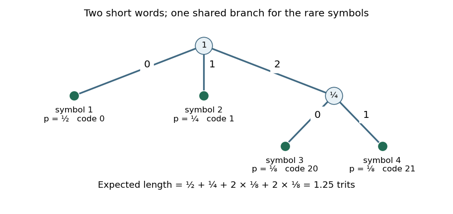

<h1 id="2/a/solution">Solution</h1>

↑ **Parent:** [A](../a.md)

The displayed [prefix code](../../../../prefix-code.md) has [expected codeword length](../../../../expected-codeword-length.md) $3/2$ ternary digits per source symbol. Instead assign

$$
\boxed{c(1)=0,\qquad c(2)=1,\qquad c(3)=20,\qquad c(4)=21.}
$$

This is a [ternary prefix code](../../../../ternary-prefix-code.md): the first two [codewords](../../../../codeword.md) end at distinct [tree children](../../../../child-in-a-rooted-tree.md) of the [tree root](../../../../root-of-a-tree.md), and the other two start with $2$ and end at distinct [tree children](../../../../child-in-a-rooted-tree.md) below it. No [codeword](../../../../codeword.md) is a prefix of another. Its [expected codeword length](../../../../expected-codeword-length.md) is

$$
\frac12\cdot1+\frac14\cdot1+\frac18\cdot2+\frac18\cdot2=\frac54<\frac32.
$$

The reduction is **$1/4$ [trit](../../../../trit.md) per source symbol**, which already disproves optimality of the displayed code. The [ternary Huffman coding](../../../../ternary-huffman-coding.md) construction below will produce this same improved [code tree](../../../../prefix-tree-of-a-code.md).

**[Figure 1](#2/a/image-an-original-ternary-prefix-tree-with-expected-length-1-25-ternary-digits-per-source-symbol). An original ternary prefix tree with expected length 1.25 ternary digits per source symbol**.

## ↑ Ancestors (12)

1. [A](../a.md)
2. [2](../../2.md)
3. [2021](../../../2021-split.md)
4. [Past exam of the information theory course of the University of Oxford](../../../split.md)
5. [Information theory course of the University of Oxford](../../../../information-theory-course-of-the-university-of-oxford.md)
6. [Year 3 of the mathematics course of the University of Oxford](../../../../year-3-of-the-mathematics-course-of-the-university-of-oxford.md)
7. [Mathematics course of the University of Oxford](../../../../mathematics-course-of-the-university-of-oxford.md)
8. [Undergraduate course of the University of Oxford](../../../../undergraduate-course-of-the-university-of-oxford.md)
9. [Course of the University of Oxford](../../../../course-of-the-university-of-oxford.md)
10. [University of Oxford](../../../../university-of-oxford-split.md)
11. [List of universities](../../../../list-of-universities.md)
12. [Codex Wiki](../../../../split.md)
