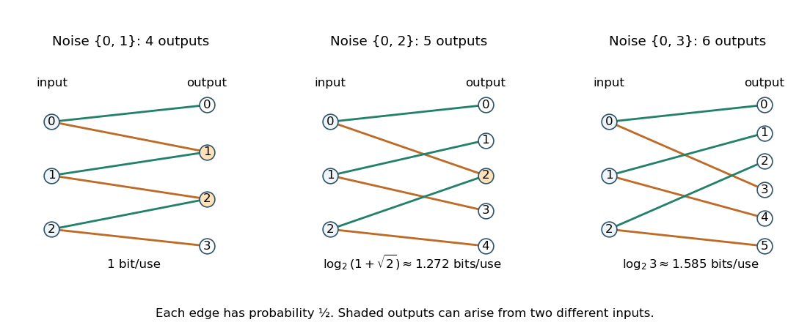

<h1 id="3/c/iii/solution">Solution</h1>

↑ **Parent:** [Iii](../iii.md)

Choose noise values $0,2$, giving exactly the outputs $0,1,2,3,4$. The [transition matrix](../../../../../stochastic-matrix.md), in that column order, is

$$
M=\begin{pmatrix}
1/2&0&1/2&0&0\\
0&1/2&0&1/2&0\\
0&0&1/2&0&1/2
\end{pmatrix}.
$$

An input [probability mass function](../../../../../probability-mass-function.md) $(1/2,1/2,0)$ makes outputs $0,1,2,3$ equiprobable, so $H(Y)=2$ and $H(Y\mid X)=1$. Hence **$C\geq1$ [bit](../../../../../bit.md) per use**, as required for comparison with the four-output case.

There is a strict improvement, which can also be computed exactly. [Reflection](../../../../../reflection-mathematics.md) of the input labels $0\leftrightarrow2$, accompanied by output [reflection](../../../../../reflection-mathematics.md) $y\leftrightarrow4-y$, leaves [mutual information](../../../../../mutual-information.md) unchanged. [Concavity of information entropy](../../../../../concavity-of-information-entropy.md) makes [mutual information](../../../../../mutual-information.md) a concave function of the input [probability mass function](../../../../../probability-mass-function.md) for a fixed [transition matrix](../../../../../stochastic-matrix.md). Averaging an input law with its [reflection](../../../../../reflection-mathematics.md) therefore cannot decrease it. It suffices to consider

$$
p_X=(s/2,1-s,s/2),\qquad 0\leq s\leq1.
$$

The outputs whose labels are [even integers](../../../../../even-number.md) have total mass $s$ and [conditional probability mass function](../../../../../conditional-probability-mass-function.md) $(1/4,1/2,1/4)$, with [information entropy](../../../../../information-entropy-split.md) $3/2$. The outputs whose labels are [odd integers](../../../../../odd-integer.md) have mass $1-s$ and [conditional probability mass function](../../../../../conditional-probability-mass-function.md) $(1/2,1/2)$, with [information entropy](../../../../../information-entropy-split.md) one. Splitting first by output [parity](../../../../../parity.md) using the [chain rule for information entropy](../../../../../chain-rule-for-information-entropy.md) yields

$$
H(Y)=h_2(s)+\tfrac32s+(1-s),\qquad I(X;Y)=h_2(s)+\frac s2.
$$

Its [derivative](../../../../../derivative.md) is $\log_2((1-s)/s)+1/2$, and its [second derivative](../../../../../second-derivative.md) is negative. The unique maximum occurs at $s=\sqrt2/(1+\sqrt2)$, giving

$$
\boxed{C=\log_2(1+\sqrt2)\approx1.271553,\qquad p_X=\left(\frac1{2+\sqrt2},\frac1{1+\sqrt2},\frac1{2+\sqrt2}\right).}
$$

This additional optimization explains the collision pattern: outputs $1,3$ identify input $1$, outputs $0,4$ identify the two extreme inputs, and only output $2$ is ambiguous.

**[Figure 2](#3/c/iii/image-three-original-additive-noise-channel-diagrams-increasing-noise-separation-changes-output-collisions-and-channel-capacity). Three original additive-noise channel diagrams: increasing noise separation changes output collisions and channel capacity**.

## ↑ Ancestors (13)

1. [Iii](../iii.md)
2. [C](../../c.md)
3. [3](../../../3.md)
4. [2021](../../../../2021-split.md)
5. [Past exam of the information theory course of the University of Oxford](../../../../split.md)
6. [Information theory course of the University of Oxford](../../../../../information-theory-course-of-the-university-of-oxford.md)
7. [Year 3 of the mathematics course of the University of Oxford](../../../../../year-3-of-the-mathematics-course-of-the-university-of-oxford.md)
8. [Mathematics course of the University of Oxford](../../../../../mathematics-course-of-the-university-of-oxford.md)
9. [Undergraduate course of the University of Oxford](../../../../../undergraduate-course-of-the-university-of-oxford.md)
10. [Course of the University of Oxford](../../../../../course-of-the-university-of-oxford.md)
11. [University of Oxford](../../../../../university-of-oxford-split.md)
12. [List of universities](../../../../../list-of-universities.md)
13. [Codex Wiki](../../../../../split.md)
