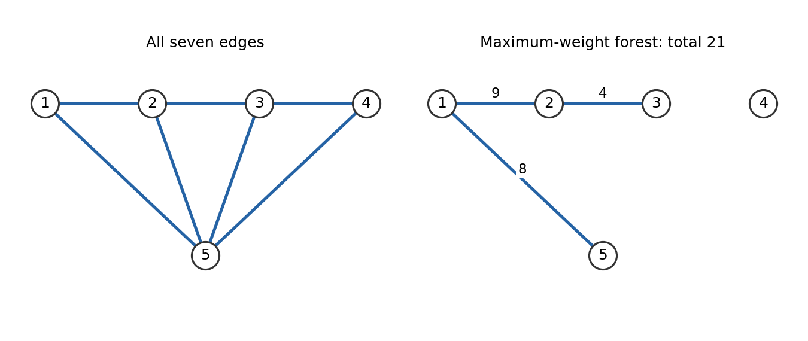

<h1 id="1/a/solution">Solution</h1>

↑ **Parent:** [A](../a.md)

Use [vertices](../../../../vertex-graph-theory.md) $1,2,3,4,5$. Reading each symmetric off-diagonal pair once gives the [edge set](../../../../edge-set.md)

$$
\boxed{E=\{12,15,23,25,34,35,45\}.}
$$

Here $ij$ abbreviates the undirected [edge](../../../../edge-of-a-graph.md) $\{i,j\}$. The diagram displays these seven [edges](../../../../edge-of-a-graph.md) and no loops. The displayed square [matrix](../../../../matrix.md) is an [adjacency matrix](../../../../adjacency-matrix.md) in the usual terminology: its two indices both label vertices. A vertex-edge [incidence matrix](../../../../incidence-matrix.md) would instead have one index for vertices and one for [edges](../../../../edge-of-a-graph.md). This explains how the source's node-node terminology is being read.

**[Figure 1](#1/a/image-the-graph-and-its-maximum-weight-forest-including-the-isolated-fourth-vertex). The graph and its maximum-weight forest, including the isolated fourth vertex**. Original drawing. The left panel shows all seven edges. The right panel shows only the three edges selected for the maximum-weight forest, with their weights; vertex four remains isolated.

## ↑ Ancestors (12)

1. [A](../a.md)
2. [1](../../1.md)
3. [2011](../../../2011-split.md)
4. [Past exam of the integer programming course of the University of Oxford](../../../split.md)
5. [Integer programming course of the University of Oxford](../../../../integer-programming-course-of-the-university-of-oxford.md)
6. [Year 3 of the mathematics course of the University of Oxford](../../../../year-3-of-the-mathematics-course-of-the-university-of-oxford.md)
7. [Mathematics course of the University of Oxford](../../../../mathematics-course-of-the-university-of-oxford.md)
8. [Undergraduate course of the University of Oxford](../../../../undergraduate-course-of-the-university-of-oxford.md)
9. [Course of the University of Oxford](../../../../course-of-the-university-of-oxford.md)
10. [University of Oxford](../../../../university-of-oxford-split.md)
11. [List of universities](../../../../list-of-universities.md)
12. [Codex Wiki](../../../../split.md)
