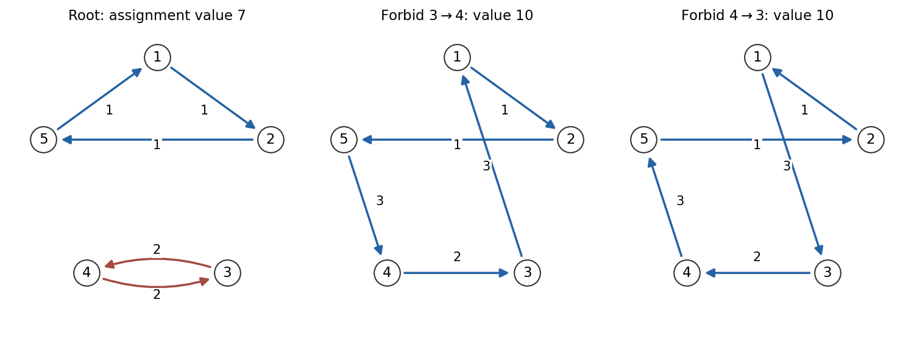

<h1 id="3/d/solution">Solution</h1>

↑ **Parent:** [D](../d.md)

Use the minimization form in this part. Treat every diagonal arc as forbidden, not as a zero-cost loop. The [assignment relaxation of the travelling salesman problem](../../../../assignment-relaxation-of-the-travelling-salesman-problem.md) requires one incoming and one outgoing arc at each city but permits several disjoint directed cycles. Its optimum is a lower bound on the tour optimum.

At the root choose

$$
u=v=(\tfrac12,\tfrac12,1,1,\tfrac12).
$$

For every allowed arc, $u_i+v_j\leq c_{ij}$. Their total is seven. The assignment

$$
(1\to2\to5\to1)\quad\text{and}\quad(3\to4\to3)
$$

uses only tight arcs and has cost $1+1+1+2+2=7$. The minimization certificate from part (c) therefore proves

$$
\boxed{z_{\mathrm{AP,root}}=7.}
$$

It is not a tour, because it has a three-cycle and a two-cycle.

Branch on the two-cycle. Every five-city tour omits at least one of $3\to4$ and $4\to3$, so the children $x_{34}=0$ and $x_{43}=0$ cover every possible tour. They may overlap, which does not invalidate the bounds.

For the child $x_{34}=0$, use

$$
u=(\tfrac12,\tfrac12,\tfrac52,1,\tfrac12),\qquad
v=(\tfrac12,\tfrac12,1,\tfrac52,\tfrac12).
$$

These satisfy $u_i+v_j\leq c_{ij}$ on every allowed arc of that child and sum to ten. The tour

$$
\boxed{1\to2\to5\to4\to3\to1}
$$

has cost $1+1+3+2+3=10$ and uses tight arcs, certifying that the child assignment bound is exactly ten.

For the child $x_{43}=0$, interchange the roles of cities three and four in those potentials. Its lower bound is again ten, attained by

$$
\boxed{1\to3\to4\to5\to2\to1}
$$

with cost $3+2+3+1+1=10$. Thus both first-level assignment optima are already tours.

There is a useful direct interpretation of the improved bound. Split the cities into $A=\{1,2,5\}$ and $B=\{3,4\}$. A forbidden arc of the two-cycle forces an assignment arc from $B$ to $A$, and balance forces at least one from $A$ to $B$. Relative to the root potentials, each crossing arc has reduced cost $3-3/2=3/2$, so any child assignment costs at least $7+2(3/2)=10$.

The first branching therefore completes the search: each child's lower bound equals a feasible tour value. Hence

$$
\boxed{z_{\mathrm{TSP}}=10.}
$$

**[Figure 2](#3/d/image-the-root-cycle-cover-and-the-two-tours-that-certify-the-first-branching-bounds). The root cycle cover and the two tours that certify the first branching bounds**. Original directed-cycle diagrams. The root assignment consists of the 1-2-5 cycle and the 3-4 cycle and has cost seven. Forbidding either orientation of the latter cycle gives a child assignment bound of ten, attained by a five-city tour.

## ↑ Ancestors (12)

1. [D](../d.md)
2. [3](../../3.md)
3. [2011](../../../2011-split.md)
4. [Past exam of the integer programming course of the University of Oxford](../../../split.md)
5. [Integer programming course of the University of Oxford](../../../../integer-programming-course-of-the-university-of-oxford.md)
6. [Year 3 of the mathematics course of the University of Oxford](../../../../year-3-of-the-mathematics-course-of-the-university-of-oxford.md)
7. [Mathematics course of the University of Oxford](../../../../mathematics-course-of-the-university-of-oxford.md)
8. [Undergraduate course of the University of Oxford](../../../../undergraduate-course-of-the-university-of-oxford.md)
9. [Course of the University of Oxford](../../../../course-of-the-university-of-oxford.md)
10. [University of Oxford](../../../../university-of-oxford-split.md)
11. [List of universities](../../../../list-of-universities.md)
12. [Codex Wiki](../../../../split.md)
