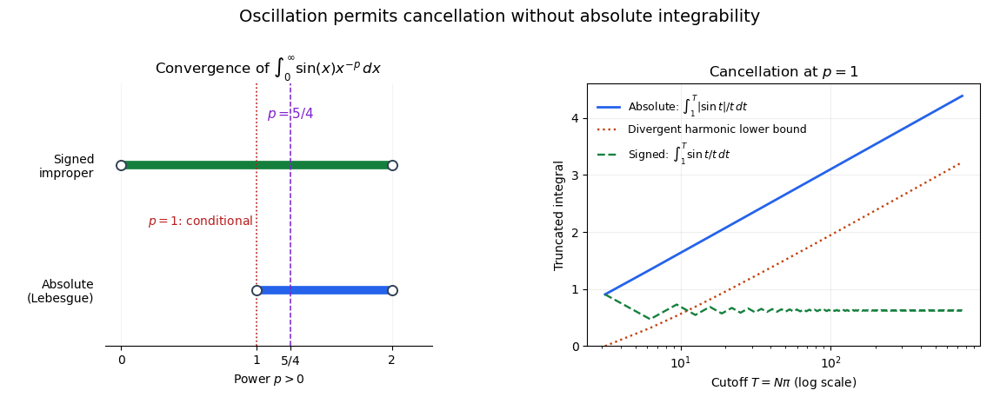
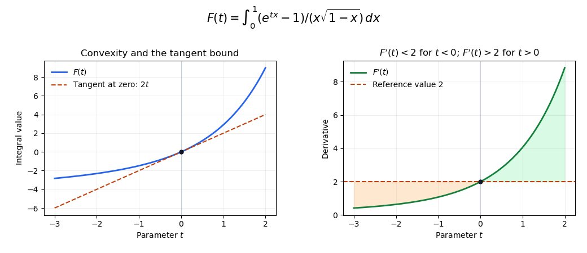

# 2017

↑ **Parent:** [Past exam of the integration course of the University of Oxford](../past-exam-of-the-integration-course-of-the-university-of-oxford.md)

Source paper: [released examination archive](https://www.whatdotheyknow.com/request/ba_computer_science_past_papers/response/2577745/attach/2/202402%20183%20CS%20Papers.zip?cookie_passthrough=1), member `2016/T/a13756w1.pdf`. The printed cover dates the examination to 20 June 2017.

**Table of contents**

- [1](#1)
  - [a](#1/a)
    - [i](#1/a/i)
      - [Solution](#1/a/i/solution)
    - [ii](#1/a/ii)
      - [Solution](#1/a/ii/solution)
  - [b](#1/b)
    - [Solution](#1/b/solution)
  - [c](#1/c)
    - [i](#1/c/i)
      - [Solution](#1/c/i/solution)
    - [ii](#1/c/ii)
      - [Solution](#1/c/ii/solution)
- [2](#2)
  - [a](#2/a)
    - [i](#2/a/i)
      - [Solution](#2/a/i/solution)
    - [ii](#2/a/ii)
      - [Solution](#2/a/ii/solution)
  - [b](#2/b)
    - [i](#2/b/i)
      - [Solution](#2/b/i/solution)
    - [ii](#2/b/ii)
      - [A](#2/b/ii/a)
        - [Solution](#2/b/ii/a/solution)
      - [B](#2/b/ii/b)
        - [Solution](#2/b/ii/b/solution)
      - [C](#2/b/ii/c)
        - [Solution](#2/b/ii/c/solution)
    - [iii](#2/b/iii)
      - [Solution](#2/b/iii/solution)
- [3](#3)
  - [a](#3/a)
    - [i](#3/a/i)
      - [Solution](#3/a/i/solution)
    - [ii](#3/a/ii)
      - [Solution](#3/a/ii/solution)
    - [iii](#3/a/iii)
      - [Solution](#3/a/iii/solution)
  - [b](#3/b)
    - [i](#3/b/i)
      - [Solution](#3/b/i/solution)
    - [ii](#3/b/ii)
      - [Solution](#3/b/ii/solution)

## 1

↑ **Parent:** [2017](2017.md)

<h3 id="1/a">a</h3>

↑ **Parent:** [1](#1)

<h4 id="1/a/i">i</h4>

↑ **Parent:** [A](#1/a)

<h5 id="1/a/i/solution">Solution</h5>

↑ **Parent:** [I](#1/a/i)

If $\sum_nm^*(A_n)=\infty$, the required inequality is automatic. Otherwise each $A_n$ has finite [Lebesgue outer measure](../measure-theory.md#lebesgue-outer-measure). Fix $\varepsilon>0$. By the defining [infimum](../real-analysis.md#infimum), for each $n\geq1$ choose a countable [interval](../real-analysis.md#interval-mathematics) cover $\{J_{n,k}:k\geq1\}$ with

$$
\sum_{k\geq1}|J_{n,k}|<m^*(A_n)+\varepsilon2^{-n}.
$$

The family indexed by $(n,k)\in\mathbb N^2$ is countable and covers $\bigcup_nA_n$. Since all lengths are nonnegative, its total length is at most $\sum_nm^*(A_n)+\varepsilon$. Taking the infimum over covers of the union and then letting $\varepsilon\downarrow0$ gives

$$
\boxed{m^*\!\left(\bigcup_{n\geq1}A_n\right)\leq\sum_{n\geq1}m^*(A_n).}
$$

This proves [countable subadditivity of Lebesgue outer measure](../measure-theory.md#countable-subadditivity-of-lebesgue-outer-measure) directly from interval covers, without assuming that any $A_n$ is measurable.

<h4 id="1/a/ii">ii</h4>

↑ **Parent:** [A](#1/a)

<h5 id="1/a/ii/solution">Solution</h5>

↑ **Parent:** [Ii](#1/a/ii)

If the [intervals](../real-analysis.md#interval-mathematics) $J_k$ cover $A$, their translates $J_k+a$ cover $A+a$ and have the same lengths. Every candidate total length in the definition of $m^*(A)$ is therefore also a candidate for $m^*(A+a)$. Taking [infima](../real-analysis.md#infimum) gives $m^*(A+a)\leq m^*(A)$. Apply the same argument to $A+a$ and the translation $-a$ to obtain the reverse inequality. Hence

$$
\boxed{m^*(A+a)=m^*(A).}
$$

This [translation invariance of Lebesgue outer measure](../measure-theory.md#translation-invariance-of-lebesgue-outer-measure) holds for every [subset](../set.md#subset) $A$, including non-measurable sets and sets of infinite outer measure.

<h3 id="1/b">b</h3>

↑ **Parent:** [1](#1)

<h4 id="1/b/solution">Solution</h4>

↑ **Parent:** [B](#1/b)

A [subset](../set.md#subset) $E\subseteq\mathbb R$ is a [Lebesgue measurable set](../measure-theory.md#lebesgue-measurable-set) when it satisfies [Carathéodory's criterion](../measure-theory.md#caratheodory-s-criterion): for every $T\subseteq\mathbb R$,

$$
m^*(T)=m^*(T\cap E)+m^*(T\setminus E).
$$

Suppose $m^*(A)=0$ and let $B\subseteq A$, allowing $B=A$. The [monotonicity of Lebesgue outer measure](../measure-theory.md#monotonicity-of-lebesgue-outer-measure) follows directly from covers: every cover of a larger set covers a smaller set. Thus $m^*(B)=m^*(T\cap B)=0$, while $m^*(T\setminus B)\leq m^*(T)$. Consequently

$$
m^*(T\cap B)+m^*(T\setminus B)\leq m^*(T).
$$

The reverse inequality is [countable subadditivity of Lebesgue outer measure](../measure-theory.md#countable-subadditivity-of-lebesgue-outer-measure) applied to $T=(T\cap B)\cup(T\setminus B)$. Equality follows, even if $m^*(T)=\infty$. Therefore **$A$ and every [subset](../set.md#subset) $B\subseteq A$ are [Lebesgue measurable sets](../measure-theory.md#lebesgue-measurable-set) of measure zero**. This is the [completeness of Lebesgue measure](../measure-theory.md#completeness-of-lebesgue-measure), obtained without presupposing measurability of the outer-null set.

<h3 id="1/c">c</h3>

↑ **Parent:** [1](#1)

<h4 id="1/c/i">i</h4>

↑ **Parent:** [C](#1/c)

<h5 id="1/c/i/solution">Solution</h5>

↑ **Parent:** [I](#1/c/i)

For a [Lebesgue measurable function](../measure-theory.md#lebesgue-measurable-function) $f:\mathbb R\to\mathbb R$, the [preimage](../set-theory.md#preimage) $f^{-1}(U)$ of every open [set](../set.md) $U$ is a [Lebesgue measurable set](../measure-theory.md#lebesgue-measurable-set). For a [Borel measurable function](../measure-theory.md#borel-measurable-function), each such preimage must instead be a [Borel set](../measure-theory.md#borel-set). Equivalently, both definitions can test all Borel target sets: the collection

$$
\mathcal C_f=\{B\subseteq\mathbb R:f^{-1}(B)\text{ belongs to the source sigma-algebra}\}
$$

is a [sigma-algebra](../measure-theory.md#sigma-algebra), since preimages preserve complements and countable unions. Containing all open sets therefore makes it contain the [Borel sigma-algebra](../measure-theory.md#borel-sigma-algebra).

Now let $U$ be open. Since $h$ is a [Borel measurable function](../measure-theory.md#borel-measurable-function), $h^{-1}(U)$ is Borel. Since $g$ is a [Lebesgue measurable function](../measure-theory.md#lebesgue-measurable-function), $g^{-1}(h^{-1}(U))$ is a Lebesgue measurable set. But

$$
(h\circ g)^{-1}(U)=g^{-1}(h^{-1}(U)).
$$

Thus **$h\circ g$ is a [Lebesgue measurable function](../measure-theory.md#lebesgue-measurable-function)**. The intermediate sigma-algebra is Borel; this is why [Borel postcomposition preserves Lebesgue measurability](../measure-theory.md#borel-postcomposition-preserves-lebesgue-measurability).

<h4 id="1/c/ii">ii</h4>

↑ **Parent:** [C](#1/c)

<h5 id="1/c/ii/solution">Solution</h5>

↑ **Parent:** [Ii](#1/c/ii)

The [dominated convergence theorem](../measure-theory.md#dominated-convergence-theorem) says that if measurable $f_n$ converge [almost everywhere](../measure-theory.md#almost-everywhere) to $f$ and $|f_n|\leq H$ almost everywhere for a single [Lebesgue integrable function](../measure-theory.md#lebesgue-integrable-function) $H\geq0$, then $f$ is integrable and

$$
\int|f_n-f|\longrightarrow0,\qquad \int f_n\longrightarrow\int f.
$$

Here, for $x>0$, put $H_0(x)=x^{-1/2}e^{-x}$ and $f_n(x)=H_0(x)(1-(-1)^ne^{-nx})$. The [exponential function](../calculus.md#exponential-function) gives $e^{-nx}\to0$ at every such $x$, so $f_n\to H_0$. Also $|f_n(x)|\leq2H_0(x)$. This dominator is integrable: on $(0,1)$, $H_0(x)\leq x^{-1/2}$, whose integral is two; on $[1,\infty)$, $H_0(x)\leq e^{-x}$, whose integral is finite. DCT therefore proves the required limit.

The limiting value can also be evaluated. Substitute $x=t^2$ and use the [Gaussian integral](../integral.md#gaussian-integral):

$$
\boxed{\lim_{n\to\infty}\int_0^\infty f_n(x)\,dx
=\int_0^\infty x^{-1/2}e^{-x}\,dx=\sqrt\pi.}
$$

In fact, scaling the second exponential term gives the exact integral $\sqrt\pi\,[1-(-1)^n/\sqrt{n+1}]$. The integral error decays as $n^{-1/2}$ despite exponential convergence at each fixed positive $x$; the slow part lies near the endpoint zero.

## 2

↑ **Parent:** [2017](2017.md)

<h3 id="2/a">a</h3>

↑ **Parent:** [2](#2)

<h4 id="2/a/i">i</h4>

↑ **Parent:** [A](#2/a)

<h5 id="2/a/i/solution">Solution</h5>

↑ **Parent:** [I](#2/a/i)

Let $\phi:I\to J$ be a $C^1$ [diffeomorphism](../geometry-and-topology.md#diffeomorphism) between [intervals](../real-analysis.md#interval-mathematics), which may be unbounded. For a nonnegative [Lebesgue measurable function](../measure-theory.md#lebesgue-measurable-function) $f$ on $J$, [Lebesgue substitution on an interval](../multivariable-calculus.md#lebesgue-substitution-on-an-interval) gives

$$
\boxed{\int_J f(y)\,dy=\int_I f(\phi(x))|\phi'(x)|\,dx,}
$$

allowing the value infinity. The same identity applied to $|f|$ shows that $f$ is [Lebesgue integrable](../measure-theory.md#lebesgue-integrable-function) exactly when the transformed integrand is integrable; in that case the displayed formula holds for signed or complex $f$ as well. The absolute value on the [derivative](../calculus.md#derivative) makes the formula valid for both increasing and decreasing substitutions. Finite endpoints can be omitted without changing a [Lebesgue integral](../measure-theory.md#lebesgue-integral), because individual points are [null sets](../measure-theory.md#null-set).

<h4 id="2/a/ii">ii</h4>

↑ **Parent:** [A](#2/a)

<h5 id="2/a/ii/solution">Solution</h5>

↑ **Parent:** [Ii](#2/a/ii)

Both functions are continuous on the positive domains in question, so they are measurable. For the first function, the decreasing substitution $t=1/x$ and $|dx/dt|=t^{-2}$ give

$$
\int_0^1\left|\frac{\sin(1/x)}x\right|\,dx
=\int_1^\infty\frac{|\sin t|}{t}\,dt.
$$

For every integer $k\geq1$,

$$
\int_{k\pi}^{(k+1)\pi}\frac{|\sin t|}{t}\,dt
\geq\frac1{(k+1)\pi}\int_{k\pi}^{(k+1)\pi}|\sin t|\,dt
=\frac{2}{(k+1)\pi}.
$$

Summing this lower bound gives a divergent [harmonic series](../sequence-and-series.md#harmonic-series). Thus **$f$ is not [Lebesgue integrable](../measure-theory.md#lebesgue-integrable-function) on $(0,1)$**.

For the second function, $|\sin x|\leq x$ on $(0,1)$ and $|\sin x|\leq1$ everywhere give

$$
\int_0^\infty\frac{|\sin x|}{x^{5/4}}\,dx
\leq\int_0^1x^{-1/4}\,dx+\int_1^\infty x^{-5/4}\,dx
=\frac43+4<\infty.
$$

Therefore **$g$ is [Lebesgue integrable](../measure-theory.md#lebesgue-integrable-function) on $(0,\infty)$**. The [sine power kernel integrability](../real-analysis.md#sine-power-kernel-integrability) threshold is $1<p<2$: one endpoint requires $p<2$, and the other requires $p>1$. The signed improper integral for $f$ does converge by the [Dirichlet test for improper integrals](../real-analysis.md#dirichlet-test-for-improper-integrals), but conditional improper convergence does not give a finite integral of $|f|$.

**[Figure 1](#2/a/ii/image-the-integrability-threshold-for-a-sine-power-kernel-and-the-divergent-absolute-tail-at-p-1). The integrability threshold for a sine power kernel and the divergent absolute tail at $p=1$**. The right panel uses $t=1/x$ for the first function. Its signed truncated integrals settle to a limit while the absolute integrals grow without bound, above a harmonic lower bound.

<h3 id="2/b">b</h3>

↑ **Parent:** [2](#2)

<h4 id="2/b/i">i</h4>

↑ **Parent:** [B](#2/b)

<h5 id="2/b/i/solution">Solution</h5>

↑ **Parent:** [I](#2/b/i)

The [monotone convergence theorem](../measure-theory.md#monotone-convergence-theorem) states that, for nonnegative measurable $f_n$ on a [Lebesgue measurable set](../measure-theory.md#lebesgue-measurable-set) $E$ with $f_n\uparrow f$ [almost everywhere](../measure-theory.md#almost-everywhere),

$$
\int_Ef_n\uparrow\int_Ef,
$$

allowing infinity. [Fatou's lemma](../measure-theory.md#fatou-s-lemma) states that, for nonnegative measurable $f_n$,

$$
\int_E\liminf_nf_n\leq\liminf_n\int_Ef_n.
$$

Now write $C=\sup_n\int_E|g_n|<\infty$. A pointwise [limit superior](../sequence-and-series.md#limit-superior) of measurable functions is measurable, and it agrees with $g$ off the exceptional [null set](../measure-theory.md#null-set). By [completeness of Lebesgue measure](../measure-theory.md#completeness-of-lebesgue-measure), assigning any values on that null set preserves measurability. Therefore $g$ is measurable. Since $|g_n|\to|g|$ almost everywhere, Fatou's lemma gives

$$
\boxed{\int_E|g|\leq\liminf_n\int_E|g_n|\leq C<\infty.}
$$

Thus $g$ is finite almost everywhere and is a [Lebesgue integrable function](../measure-theory.md#lebesgue-integrable-function). This is an [almost-everywhere limit under a uniform L1 bound](../measure-theory.md#almost-everywhere-limit-under-a-uniform-l1-bound). The argument proves integrability of the limit, not convergence in [L1 space](../measure-theory.md#l1-space).

<h4 id="2/b/ii">ii</h4>

↑ **Parent:** [B](#2/b)

<h5 id="2/b/ii/a">A</h5>

↑ **Parent:** [Ii](#2/b/ii)

<h6 id="2/b/ii/a/solution">Solution</h6>

↑ **Parent:** [A](#2/b/ii/a)

Let $S_N=\sum_{n=1}^N|a_n|$. These are nonnegative measurable functions with $S_N\uparrow S=\sum_{n\geq1}|a_n|$. The [monotone convergence theorem](../measure-theory.md#monotone-convergence-theorem) and linearity of the finite sum give

$$
\int_ES=\lim_{N\to\infty}\int_ES_N
=\sum_{n\geq1}\int_E|a_n|<\infty.
$$

Hence $S<\infty$ [almost everywhere](../measure-theory.md#almost-everywhere): if $S=\infty$ on a set of positive measure, the integral would exceed every finite constant. Also each $a_n$ is finite almost everywhere, since its absolute integral is finite. Outside the union of these countably many [null sets](../measure-theory.md#null-set), all terms are real and

$$
\boxed{\sum_{n=1}^\infty|a_n(x)|<\infty.}
$$

Thus the signed series converges absolutely almost everywhere, as asserted by [summable L1 norms imply almost-everywhere absolute convergence](../measure-theory.md#summable-l1-norms-imply-almost-everywhere-absolute-convergence). Removing the common null set avoids any undefined $+\infty-\infty$ in signed partial sums.

<h5 id="2/b/ii/b">B</h5>

↑ **Parent:** [Ii](#2/b/ii)

<h6 id="2/b/ii/b/solution">Solution</h6>

↑ **Parent:** [B](#2/b/ii/b)

Let $A(x)=\sum_{n\geq1}a_n(x)$ on the full-measure set where part (A) gives absolute convergence, and set $A=0$ on its null complement. After similarly replacing the individual terms by zero on that common [null set](../measure-theory.md#null-set), the partial sums are finite measurable functions and converge to $A$. Hence $A$ is a [Lebesgue measurable function](../measure-theory.md#lebesgue-measurable-function). The [triangle inequality](../topological-analysis.md#triangle-inequality) gives

$$
|A(x)|\leq\sum_{n\geq1}|a_n(x)|=S(x)
$$

almost everywhere. Part (A) proved $S$ integrable, so

$$
\boxed{\int_E|A|\leq\sum_{n\geq1}\int_E|a_n|<\infty.}
$$

Therefore the summed function is [Lebesgue integrable](../measure-theory.md#lebesgue-integrable-function). Its values on the exceptional null set do not affect the integral. This is the integrability step in [integration of a series with summable L1 norms](../measure-theory.md#integration-of-a-series-with-summable-l1-norms).

<h5 id="2/b/ii/c">C</h5>

↑ **Parent:** [Ii](#2/b/ii)

<h6 id="2/b/ii/c/solution">Solution</h6>

↑ **Parent:** [C](#2/b/ii/c)

Let $A_N=\sum_{n=1}^Na_n$, using the finite representatives from part (B). Then $A_N\to A$ [almost everywhere](../measure-theory.md#almost-everywhere), and $|A_N|\leq S=\sum_n|a_n|$, where $S$ is integrable by part (A). The [dominated convergence theorem](../measure-theory.md#dominated-convergence-theorem) gives

$$
\boxed{\int_E\sum_{n=1}^\infty a_n(x)\,dx
=\lim_{N\to\infty}\int_EA_N
=\sum_{n=1}^\infty\int_Ea_n(x)\,dx.}
$$

The numerical series on the right converges absolutely because $|\int_Ea_n|\leq\int_E|a_n|$ and the sum of these bounds is finite. Moreover,

$$
\|A-A_N\|_1\leq\sum_{n>N}\int_E|a_n|\longrightarrow0.
$$

Thus [integration of a series with summable L1 norms](../measure-theory.md#integration-of-a-series-with-summable-l1-norms) also yields convergence of the partial sums in [L1 norm](../normed-vector-space.md#l1-norm).

<h4 id="2/b/iii">iii</h4>

↑ **Parent:** [B](#2/b)

<h5 id="2/b/iii/solution">Solution</h5>

↑ **Parent:** [Iii](#2/b/iii)

Use the [power series](../sequence-and-series.md#power-series) of the [exponential function](../calculus.md#exponential-function):

$$
\frac{e^{-x^2}}{\sqrt x}=\sum_{n=0}^\infty a_n(x),\qquad
a_n(x)=\frac{(-1)^n x^{2n-1/2}}{n!},\quad0<x<1.
$$

Each term is a [Lebesgue integrable function](../measure-theory.md#lebesgue-integrable-function), and

$$
\int_0^1|a_n(x)|\,dx
=\frac{1}{n!(2n+1/2)}=\frac{2}{(4n+1)n!}.
$$

The sum of these nonnegative integrals is at most $2\sum_{n\geq0}1/n!=2e<\infty$. Applying [integration of a series with summable L1 norms](../measure-theory.md#integration-of-a-series-with-summable-l1-norms), just proved in part (ii), therefore justifies exchanging the series and the integral:

$$
\boxed{\int_0^1\frac{e^{-x^2}}{\sqrt x}\,dx
=2\sum_{n=0}^\infty\frac{(-1)^n}{(4n+1)n!}.}
$$

The absolute-integral bound is the justification; pointwise convergence of the exponential series alone would not suffice.

## 3

↑ **Parent:** [2017](2017.md)

<h3 id="3/a">a</h3>

↑ **Parent:** [3](#3)

<h4 id="3/a/i">i</h4>

↑ **Parent:** [A](#3/a)

<h5 id="3/a/i/solution">Solution</h5>

↑ **Parent:** [I](#3/a/i)

A sufficient theorem is [dominated differentiation under the integral sign](../analysis.md#dominated-differentiation-under-the-integral-sign). Let $t_0$ be interior to a parameter interval, suppose $u(\cdot,t)$ is measurable for each $t$, and suppose $u(\cdot,t_0)$ is integrable. Assume $u(x,\cdot)$ is differentiable near $t_0$ for $x$ outside one fixed [null set](../measure-theory.md#null-set), and that throughout this neighborhood

$$
|\partial_tu(x,t)|\leq H(x)
$$

for one nonnegative [Lebesgue integrable function](../measure-theory.md#lebesgue-integrable-function) $H$. Then $F(t)=\int_Eu(x,t)\,dx$ is defined near $t_0$, is differentiable at $t_0$, and

$$
\boxed{F'(t_0)=\int_E\partial_tu(x,t_0)\,dx.}
$$

Indeed the [mean value theorem](../calculus.md#mean-value-theorem) bounds both $|u(x,t)-u(x,t_0)|$ by $|t-t_0|H(x)$ and the difference quotient by $H(x)$. The first bound proves local integrability; the second lets the [dominated convergence theorem](../measure-theory.md#dominated-convergence-theorem) pass the limit of difference quotients through the integral.

<h4 id="3/a/ii">ii</h4>

↑ **Parent:** [A](#3/a)

<h5 id="3/a/ii/solution">Solution</h5>

↑ **Parent:** [Ii](#3/a/ii)

Fix $t\in\mathbb R$. The [mean value theorem](../calculus.md#mean-value-theorem) for the exponential gives

$$
|e^{tx}-1|\leq |t|x e^{|t|},\qquad0<x<1.
$$

Consequently

$$
|u(x,t)|\leq\frac{|t|e^{|t|}}{\sqrt{1-x}},\qquad
\int_0^1\frac{|t|e^{|t|}}{\sqrt{1-x}}\,dx=2|t|e^{|t|}<\infty.
$$

The function is continuous on $(0,1)$ and hence measurable, so **$u(\cdot,t)$ is [Lebesgue integrable](../measure-theory.md#lebesgue-integrable-function) for every real $t$**. In particular, the numerator cancels the apparent $1/x$ singularity at zero: $u(x,t)\to t$ as $x\downarrow0$. Only the integrable square-root singularity at one remains. At $t=0$ the function is identically zero.

<h4 id="3/a/iii">iii</h4>

↑ **Parent:** [A](#3/a)

<h5 id="3/a/iii/solution">Solution</h5>

↑ **Parent:** [Iii](#3/a/iii)

Fix any real $t_0$ and restrict $t$ to $|t-t_0|<1$. The parameter derivative is

$$
\partial_tu(x,t)=\frac{e^{tx}}{\sqrt{1-x}},\qquad
|\partial_tu(x,t)|\leq\frac{e^{|t_0|+1}}{\sqrt{1-x}}.
$$

This bound is integrable on $(0,1)$ and is uniform throughout the parameter neighborhood. Part (ii) supplied integrability at $t_0$, so [dominated differentiation under the integral sign](../analysis.md#dominated-differentiation-under-the-integral-sign) proves differentiability there. As $t_0$ was arbitrary,

$$
\boxed{F'(t)=\int_0^1\frac{e^{tx}}{\sqrt{1-x}}\,dx\quad(t\in\mathbb R).}
$$

For $t>0$, $e^{tx}\geq1$; for $t<0$, $e^{tx}\leq1$. Since $\int_0^1(1-x)^{-1/2}\,dx=2$, these comparisons give

$$
\boxed{F'(t)\geq2\ (t>0),\qquad F'(t)\leq2\ (t<0),\qquad F'(0)=2.}
$$

The first two inequalities are actually strict, because the exponential differs strictly from one throughout $(0,1)$. Differentiating once more under the same type of bound gives $F''(t)=\int_0^1xe^{tx}/\sqrt{1-x}\,dx>0$. Hence $F$ is [strictly convex](../real-analysis.md#strictly-convex-function) and lies above its tangent $2t$ at zero. These properties are collected in [exponential integral with a square-root endpoint singularity](../analysis.md#exponential-integral-with-a-square-root-endpoint-singularity).

**[Figure 2](#3/a/iii/image-the-parameter-integral-is-convex-and-its-derivative-crosses-two-at-zero). The parameter integral is convex, and its derivative crosses two at zero**. The endpoint singularity is removed numerically using $x=1-s^2$. The left panel compares $F$ with its tangent $2t$; the right panel displays the derivative inequalities proved in the solution.

<h3 id="3/b">b</h3>

↑ **Parent:** [3](#3)

<h4 id="3/b/i">i</h4>

↑ **Parent:** [B](#3/b)

<h5 id="3/b/i/solution">Solution</h5>

↑ **Parent:** [I](#3/b/i)

On [sigma-finite measure](../measure.md#sigma-finite-measure) spaces, including the real line with [Lebesgue measure](../measure-theory.md#lebesgue-measure), [Tonelli's theorem](../measure-theory.md#tonelli-theorem) says that a nonnegative measurable function $H$ has equal product and iterated integrals:

$$
\int_{X\times Y}H\,d(\mu\times\nu)
=\int_X\left(\int_YH(x,y)\,d\nu(y)\right)d\mu(x)
=\int_Y\left(\int_XH(x,y)\,d\mu(x)\right)d\nu(y),
$$

with infinity allowed. Finiteness is not a prerequisite.

[Fubini's theorem](../measure-theory.md#fubini-s-theorem) says that if a measurable signed or complex $H$ is absolutely integrable on the product, then its sections are integrable for [almost every](../measure-theory.md#almost-everywhere) value of the other variable, the iterated integral functions are integrable, and the same equalities hold with finite values. For completed Lebesgue measure, exceptional sections need not themselves be measurable; the integrals use the almost-everywhere defined sections. Thus Tonelli can first establish absolute integrability using $|H|$, after which Fubini permits changing the order for $H$.

<h4 id="3/b/ii">ii</h4>

↑ **Parent:** [B](#3/b)

<h5 id="3/b/ii/solution">Solution</h5>

↑ **Parent:** [Ii](#3/b/ii)

Because $f$ is [continuous](../calculus.md#continuous-function), $g(x,y)=e^{-x^2}f(e^{-x^2/2}y)$ is continuous on $\mathbb R^2$, so $|g|$ is a nonnegative measurable function. Apply [Tonelli's theorem](../measure-theory.md#tonelli-theorem) before assuming integrability. For each fixed $x$, set $z=e^{-x^2/2}y$, so $dy=e^{x^2/2}\,dz$. [Lebesgue substitution on an interval](../multivariable-calculus.md#lebesgue-substitution-on-an-interval) gives

$$
\int_{\mathbb R}|g(x,y)|\,dy
=e^{-x^2/2}\int_{\mathbb R}|f(z)|\,dz.
$$

Therefore the [Gaussian integral](../integral.md#gaussian-integral) yields

$$
\boxed{\iint_{\mathbb R^2}|g(x,y)|\,dx\,dy
=\sqrt{2\pi}\int_{\mathbb R}|f(z)|\,dz<\infty.}
$$

This proves that $g$ is [Lebesgue integrable](../measure-theory.md#lebesgue-integrable-function) on $\mathbb R^2$. [Fubini's theorem](../measure-theory.md#fubini-s-theorem) now permits changing the order for $g$ itself. The same substitution without absolute values gives the stronger exact identity

$$
\int_{\mathbb R}\int_{\mathbb R}g(x,y)\,dx\,dy
=\sqrt{2\pi}\int_{\mathbb R}f(z)\,dz.
$$

Taking absolute values and using the [triangle inequality for an integral](../topological-analysis.md#integral-triangle-inequality) proves

$$
\boxed{\left|\int_{\mathbb R}\int_{\mathbb R}g(x,y)\,dx\,dy\right|
\leq\sqrt{2\pi}\int_{\mathbb R}|f(z)|\,dz.}
$$

The constant is sharp: any nonzero nonnegative continuous integrable $f$ gives equality. This is a [weighted dilation kernel](../measure-theory.md#weighted-dilation-kernel) with $a(x)=e^{-x^2}$ and $b(x)=e^{-x^2/2}$. The inner $x$ integral in the requested order is guaranteed to be integrable for almost every $y$, which is all the iterated integral requires.

## ↑ Ancestors (9)

1. [Past exam of the integration course of the University of Oxford](../past-exam-of-the-integration-course-of-the-university-of-oxford.md)
2. [Integration course of the University of Oxford](../university-of-oxford.md#integration-course-of-the-university-of-oxford)
3. [Year 2 of the mathematics course of the University of Oxford](../university-of-oxford.md#year-2-of-the-mathematics-course-of-the-university-of-oxford)
4. [Mathematics course of the University of Oxford](../university-of-oxford.md#mathematics-course-of-the-university-of-oxford)
5. [Undergraduate course of the University of Oxford](../university-of-oxford.md#undergraduate-course-of-the-university-of-oxford)
6. [Course of the University of Oxford](../university-of-oxford.md#course-of-the-university-of-oxford)
7. [University of Oxford](../university-of-oxford.md)
8. [List of universities](../README.md#list-of-universities)
9. [Codex Wiki](../README.md)
