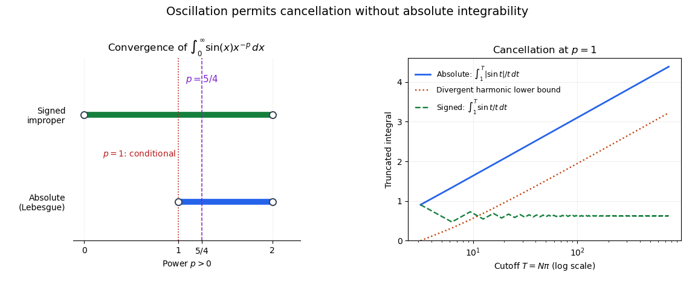

<h1 id="2/a/ii/solution">Solution</h1>

↑ **Parent:** [Ii](../ii.md)

Both functions are continuous on the positive domains in question, so they are measurable. For the first function, the decreasing substitution $t=1/x$ and $|dx/dt|=t^{-2}$ give

$$
\int_0^1\left|\frac{\sin(1/x)}x\right|\,dx
=\int_1^\infty\frac{|\sin t|}{t}\,dt.
$$

For every integer $k\geq1$,

$$
\int_{k\pi}^{(k+1)\pi}\frac{|\sin t|}{t}\,dt
\geq\frac1{(k+1)\pi}\int_{k\pi}^{(k+1)\pi}|\sin t|\,dt
=\frac{2}{(k+1)\pi}.
$$

Summing this lower bound gives a divergent [harmonic series](../../../../../harmonic-series.md). Thus **$f$ is not [Lebesgue integrable](../../../../../lebesgue-integrable-function.md) on $(0,1)$**.

For the second function, $|\sin x|\leq x$ on $(0,1)$ and $|\sin x|\leq1$ everywhere give

$$
\int_0^\infty\frac{|\sin x|}{x^{5/4}}\,dx
\leq\int_0^1x^{-1/4}\,dx+\int_1^\infty x^{-5/4}\,dx
=\frac43+4<\infty.
$$

Therefore **$g$ is [Lebesgue integrable](../../../../../lebesgue-integrable-function.md) on $(0,\infty)$**. The [sine power kernel integrability](../../../../../sine-power-kernel-integrability.md) threshold is $1<p<2$: one endpoint requires $p<2$, and the other requires $p>1$. The signed improper integral for $f$ does converge by the [Dirichlet test for improper integrals](../../../../../dirichlet-test-for-improper-integrals.md), but conditional improper convergence does not give a finite integral of $|f|$.

**[Figure 1](#2/a/ii/image-the-integrability-threshold-for-a-sine-power-kernel-and-the-divergent-absolute-tail-at-p-1). The integrability threshold for a sine power kernel and the divergent absolute tail at $p=1$**. The right panel uses $t=1/x$ for the first function. Its signed truncated integrals settle to a limit while the absolute integrals grow without bound, above a harmonic lower bound.

## ↑ Ancestors (13)

1. [Ii](../ii.md)
2. [A](../../a.md)
3. [2](../../../2.md)
4. [2017](../../../../2017-split.md)
5. [Past exam of the integration course of the University of Oxford](../../../../split.md)
6. [Integration course of the University of Oxford](../../../../../integration-course-of-the-university-of-oxford.md)
7. [Year 2 of the mathematics course of the University of Oxford](../../../../../year-2-of-the-mathematics-course-of-the-university-of-oxford.md)
8. [Mathematics course of the University of Oxford](../../../../../mathematics-course-of-the-university-of-oxford.md)
9. [Undergraduate course of the University of Oxford](../../../../../undergraduate-course-of-the-university-of-oxford.md)
10. [Course of the University of Oxford](../../../../../course-of-the-university-of-oxford.md)
11. [University of Oxford](../../../../../university-of-oxford-split.md)
12. [List of universities](../../../../../list-of-universities.md)
13. [Codex Wiki](../../../../../split.md)
