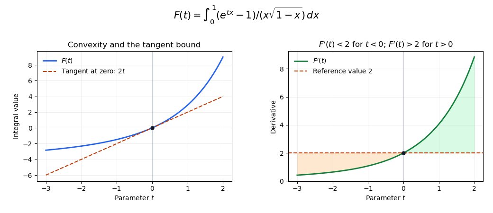

<h1 id="3/a/iii/solution">Solution</h1>

↑ **Parent:** [Iii](../iii.md)

Fix any real $t_0$ and restrict $t$ to $|t-t_0|<1$. The parameter derivative is

$$
\partial_tu(x,t)=\frac{e^{tx}}{\sqrt{1-x}},\qquad
|\partial_tu(x,t)|\leq\frac{e^{|t_0|+1}}{\sqrt{1-x}}.
$$

This bound is integrable on $(0,1)$ and is uniform throughout the parameter neighborhood. Part (ii) supplied integrability at $t_0$, so [dominated differentiation under the integral sign](../../../../../dominated-differentiation-under-the-integral-sign.md) proves differentiability there. As $t_0$ was arbitrary,

$$
\boxed{F'(t)=\int_0^1\frac{e^{tx}}{\sqrt{1-x}}\,dx\quad(t\in\mathbb R).}
$$

For $t>0$, $e^{tx}\geq1$; for $t<0$, $e^{tx}\leq1$. Since $\int_0^1(1-x)^{-1/2}\,dx=2$, these comparisons give

$$
\boxed{F'(t)\geq2\ (t>0),\qquad F'(t)\leq2\ (t<0),\qquad F'(0)=2.}
$$

The first two inequalities are actually strict, because the exponential differs strictly from one throughout $(0,1)$. Differentiating once more under the same type of bound gives $F''(t)=\int_0^1xe^{tx}/\sqrt{1-x}\,dx>0$. Hence $F$ is [strictly convex](../../../../../strictly-convex-function.md) and lies above its tangent $2t$ at zero. These properties are collected in [exponential integral with a square-root endpoint singularity](../../../../../exponential-integral-with-a-square-root-endpoint-singularity.md).

**[Figure 2](#3/a/iii/image-the-parameter-integral-is-convex-and-its-derivative-crosses-two-at-zero). The parameter integral is convex, and its derivative crosses two at zero**. The endpoint singularity is removed numerically using $x=1-s^2$. The left panel compares $F$ with its tangent $2t$; the right panel displays the derivative inequalities proved in the solution.

## ↑ Ancestors (13)

1. [Iii](../iii.md)
2. [A](../../a.md)
3. [3](../../../3.md)
4. [2017](../../../../2017-split.md)
5. [Past exam of the integration course of the University of Oxford](../../../../split.md)
6. [Integration course of the University of Oxford](../../../../../integration-course-of-the-university-of-oxford.md)
7. [Year 2 of the mathematics course of the University of Oxford](../../../../../year-2-of-the-mathematics-course-of-the-university-of-oxford.md)
8. [Mathematics course of the University of Oxford](../../../../../mathematics-course-of-the-university-of-oxford.md)
9. [Undergraduate course of the University of Oxford](../../../../../undergraduate-course-of-the-university-of-oxford.md)
10. [Course of the University of Oxford](../../../../../course-of-the-university-of-oxford.md)
11. [University of Oxford](../../../../../university-of-oxford-split.md)
12. [List of universities](../../../../../list-of-universities.md)
13. [Codex Wiki](../../../../../split.md)
