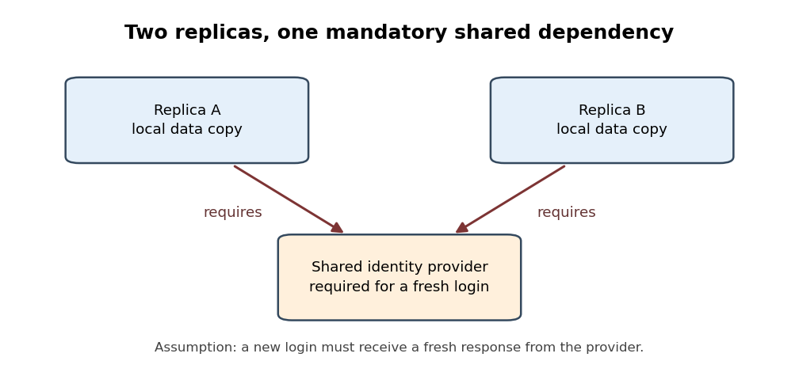

# 2019

↑ **Parent:** [Past exam of the internet technologies and regulation course of the University of Oxford](../past-exam-of-the-internet-technologies-and-regulation-course-of-the-university-of-oxford.md)

**Technical coverage only: this article answers question 1 of the eight-question paper dated 11 January 2019. Questions 2–8 are outside the present STEM scope; they are not missing-input TODOs.**

Source paper: [Oxford examination release ZIP](https://www.whatdotheyknow.com/request/admission_statistics_and_past_pa/response/2722250/attach/2/Exam%20papers.zip?cookie_passthrough=1), member `Internet Technologies and Regulation/2018 Hilary a11572w1.pdf`. The original cover identifies Hilary Term 2019 despite the archive member's 2018 label. The discussion uses information available by the examination date.

**Table of contents**

- [1](#1)
  - [Solution](#1/solution)

## 1

↑ **Parent:** [2019](2019.md)

<h3 id="1/solution">Solution</h3>

↑ **Parent:** [1](#1)

The [Internet](../computer-network.md#internet) still reflects the original principles strongly in its common communication substrate, while many applications concentrate decisions and essential services in fewer hands. It is therefore necessary to distinguish the location of machines, the authority to control a service, and the placement of the checks that establish its correctness. A geographically extensive service can remain centrally controlled; a service with independently operated participants still needs to establish its promised result at the relevant [endpoints](../computer-network.md#communication-endpoint).

The [end-to-end principle](../computer-network.md#end-to-end-principle) is a test of function placement. If an application's required property depends on what happens at its [endpoints](../computer-network.md#communication-endpoint), placing a partial implementation in the intervening network cannot establish the whole property. A receiver can accept bytes and then fail before storing the requested file correctly. The sender therefore needs the appropriate [application-layer acknowledgement](../computer-network.md#application-layer-acknowledgement), rather than treating a transport acknowledgement as proof of durable storage. In this sense, [application correctness is not determined by a network trace](../computer-network.md#application-correctness-is-not-determined-by-a-network-trace). Local recovery can still improve performance; it complements the application check rather than replacing it.[Printed pp. 1–3 and 7: function placement, careful file transfer and application acknowledgements](../computer-science-bibliography.md#end-to-end-arguments-in-system-design-by-jerome-h-saltzer-and-others)

This principle does not imply that [routers](../computer-network.md#router) must be devoid of useful functions, nor that every mechanism belongs at precisely one layer. Its benefit is a clear account of which component supplies a promised result. [Internet Protocol](../computer-network.md#internet-protocol) offers a common interface across different underlying networks. The [IP hourglass](../computer-network.md#ip-hourglass) permits different applications above that interface and different transmission technologies below it. New application behaviour need not require every intermediate network to be redesigned.[§§2.2–2.4: internetworking, end-to-end responsibility and concentrating application intelligence at endpoints](../computer-science-bibliography.md#architectural-principles-of-the-internet-rfc-1958)

There is nevertheless a real departure from a simple picture of directly communicating hosts. [Middleboxes](../computer-network.md#middlebox) can inspect, alter or constrain traffic in ways that ordinary packet forwarding does not. A [firewall](../computer-network.md#firewall) makes a decision about permitted communication; a [proxy server](../computer-network.md#proxy-server) can become a separate application participant. Such mechanisms may address legitimate local needs, but an application's assumptions about what the path will carry now require additional justification. A new [transport protocol](../computer-network.md#transport-protocol) cannot infer successful deployment merely from the existence of compatible host implementations.[§1.2 and §2: the hourglass model and the catalogue of intermediary functions](../computer-science-bibliography.md#middleboxes-taxonomy-and-issues-rfc-3234)

[Network address translation](../computer-network.md#network-address-translation) gives a concrete state-management example. With [network address and port translation](../computer-network.md#network-address-and-port-translation), several private hosts can share an externally visible address through mappings in an intermediary. A particular active connection can depend on the continued presence of its mapping, not just on the two host implementations. Loss of that mapping can interrupt the connection even when those hosts remain operational. This qualifies the [fate-sharing](../computer-network.md#fate-sharing) goal of keeping indispensable communication state with the participants that depend on it. It does not mean every translation failure is permanent or that a service cannot establish a new connection; the interrupted operation and its recovery behaviour must be specified.[§§2–3: traditional NAT/NAPT mappings, session state and routing constraints](../computer-science-bibliography.md#traditional-ip-network-address-translator-traditional-nat-rfc-3022)

Concentration at the application layer is a separate issue. A [content delivery network](../computer-network.md#content-delivery-network) can place copies close to demand and direct requests to suitable delivery [endpoints](../computer-network.md#communication-endpoint). This can reduce [network latency](../computer-network.md#network-latency) and avoid repeatedly transferring the same content from its origin. Those are useful engineering results. However, [geographical replication does not imply decentralised control](../computer-network.md#geographical-replication-does-not-imply-decentralised-control): many delivery sites can still answer to one authority or depend on the same origin. Interconnection between delivery networks also requires explicit arrangements for request routing and metadata, rather than arising automatically from their physical distribution.[§§1.2–3.1: actors, request redirection, content acquisition and interconnection interfaces](../computer-science-bibliography.md#framework-for-content-distribution-network-interconnection-rfc-7336)

Users consequently need to ask which operations remain possible when a provider or shared component is unavailable. Two service replicas might hold the same data in different regions yet both require one [identity provider](../computer-science.md#identity-provider) for each new [authentication](../computer-science.md#authentication). That provider is then a [mandatory service dependency](../computer-science.md#mandatory-service-dependency) for the new-user operation. More replicas of the data do not remove the dependency. Already admitted users might continue to work under a different design, so the conclusion concerns the declared operation rather than every possible use of the service. This is why [failure domains](../computer-science.md#failure-domain) and [service availability](../computer-science.md#service-availability) must be analysed through dependencies as well as geography.

**[Figure 1](#1/image-two-service-replicas-with-one-mandatory-identity-dependency). Two service replicas with one mandatory identity dependency**. Original schematic for an operation that requires a fresh identity check. An arrow points from a replica to a component whose response it requires. Loss of the shared identity provider can block that operation at both replicas even while their data remains intact; the diagram makes no claim about operations that do not require a new [authentication](../computer-science.md#authentication) response.

The [endpoint](../computer-network.md#communication-endpoint) boundary also determines what a security promise means. [Transport Layer Security](../computer-science.md#transport-layer-security) protects communication to the actual [TLS](../computer-science.md#transport-layer-security) peer. Version 1.3 had been standardised in August 2018, before this sitting. If an authorised [CDN edge](../computer-network.md#cdn-edge) terminates that connection, it is a participant in the protected communication and can obtain the application plaintext. That can be an intentional delegation, but it cannot simultaneously promise secrecy from that same participant merely because the connection carries an [encryption](../computer-science.md#encryption) label. A promise of secrecy from the intermediary requires suitable [end-to-end encryption](../computer-science.md#end-to-end-encryption) with the relevant decryption capability at the intended application [endpoints](../computer-network.md#communication-endpoint).[August 2018, §1 and §2: goals and the authenticated, confidential channel between TLS peers](../computer-science-bibliography.md#the-transport-layer-security-protocol-version-1-3-rfc-8446)

Not every delegated function requires that stronger secrecy promise. A [client](../computer-science.md#network-client) might instead need to check that an object came from an identified publisher while permitting any suitable [cache](../computer-memory.md#cache-computing) to deliver it. A [digital signature](../computer-science.md#digital-signature), verified against the intended publisher's authenticated [public key](../computer-science.md#public-key), can separate the delivery source from the authority for the content. It does not establish that the publisher's statements are true or make the object reachable. The useful design step is to state the promised property before deciding which component must be trusted to establish it.

For future services, one option is [internet service federation](../computer-network.md#internet-service-federation): independently operated services exchange requests through compatible [communication protocols](../computer-network.md#communication-protocol).[§2.1 and §5: exchange between independently addressed mail systems and domain-based routing](../computer-science-bibliography.md#simple-mail-transfer-protocol-rfc-5321) This can permit a choice of provider, but it does not by itself eliminate shared naming dependencies or guarantee that all participants apply compatible policies. [Data portability](../computer-science.md#data-portability) is a distinct requirement: users may need to take their state to another provider. A nominally open [protocol](../computer-network.md#communication-protocol) is insufficient if the application's useful state cannot move with them.

The engineering response is therefore selective. Retain [endpoint](../computer-network.md#communication-endpoint) checks for the promised application result, identify every [mandatory service dependency](../computer-science.md#mandatory-service-dependency), and decide explicitly where control and state should reside. Use [caching](../computer-memory.md#caching), [data replication](../computer-science.md#data-replication) and authorised intermediaries when they improve the intended service, while testing whether common dependencies defeat the expected [fault tolerance](../computer-science.md#fault-tolerance). Where independent operation is a requirement, test that requirement directly rather than counting machines. This preserves the adaptable part of the original architecture without pretending that every application must have the same trust boundary or administrative arrangement.[§1 and §§2.3–3.1: architectural evolution, application responsibility and design choices](../computer-science-bibliography.md#architectural-principles-of-the-internet-rfc-1958)

## ↑ Ancestors (8)

1. [Past exam of the internet technologies and regulation course of the University of Oxford](../past-exam-of-the-internet-technologies-and-regulation-course-of-the-university-of-oxford.md)
2. [Internet technologies and regulation course of the University of Oxford](../university-of-oxford.md#internet-technologies-and-regulation-course-of-the-university-of-oxford)
3. [MSc in social science of the internet course of the University of Oxford](../university-of-oxford.md#msc-in-social-science-of-the-internet-course-of-the-university-of-oxford)
4. [Master's course of the University of Oxford](../university-of-oxford.md#master-s-course-of-the-university-of-oxford)
5. [Course of the University of Oxford](../university-of-oxford.md#course-of-the-university-of-oxford)
6. [University of Oxford](../university-of-oxford.md)
7. [List of universities](../README.md#list-of-universities)
8. [Codex Wiki](../README.md)
