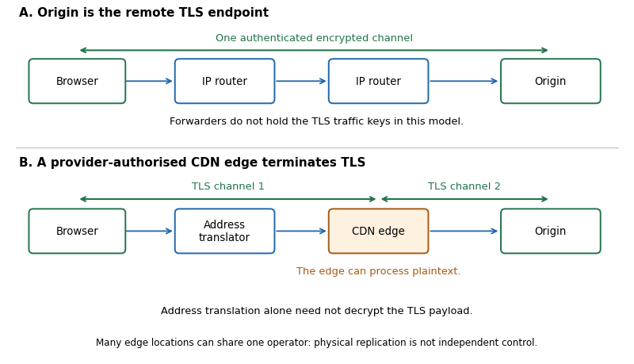

# 2020

↑ **Parent:** [Past exam of the internet technologies and regulation course of the University of Oxford](../past-exam-of-the-internet-technologies-and-regulation-course-of-the-university-of-oxford.md)

**Technical coverage only: this article solves question 1 of the eight-question paper dated 17 January 2020. Questions 2–8 are intentionally outside the present STEM scope. They are not unavailable-input gaps, and this article does not claim complete-paper coverage.**

[Oxford examination release ZIP](https://www.whatdotheyknow.com/request/admission_statistics_and_past_pa/response/2722250/attach/2/Exam%20papers.zip?cookie_passthrough=1). Exact held member: `Internet Technologies and Regulation/2019- Hilary a11572w1.pdf`. Its archive filename says 2019-, but the original cover identifies Hilary Term 2020, JSSI A11572W1, Friday 17 January, 09:30–12:30.

The technical discussion uses information available by 17 January 2020.

**Table of contents**

- [1](#1)
  - [Solution](#1/solution)

## 1

↑ **Parent:** [2020](2020.md)

<h3 id="1/solution">Solution</h3>

↑ **Parent:** [1](#1)

**By January 2020, the [Internet](../computer-network.md#internet) had retained a broadly interoperable packet-delivery substrate while acquiring substantial centralisation of services and more functionality inside communication paths. The departure is real but uneven: independent network operation, physical replication, application control and placement of security functions are different architectural dimensions. Future service design should preserve [endpoint](../computer-network.md#communication-endpoint) responsibility for application correctness and make any delegation of control, state or trust explicit.**

[Network decentralisation](../computer-network.md#network-decentralisation) means that important decisions and dependencies are spread across independently controlled participants, rather than being concentrated in one indispensable operator. It is not established merely by counting machines. A [distributed system](../computer-science.md#distributed-system) can run in many locations under one administrative authority. The [end-to-end principle](../computer-network.md#end-to-end-principle) addresses a different question: where should a function be implemented? If fully satisfying an application requirement needs knowledge available at the communicating applications, an implementation confined to the intervening network cannot replace that application-level responsibility. The two ideas often reinforce one another, because a general communication service leaves applications free to evolve, but they are not equivalent.

The original argument by [Jerome H. Saltzer](../computer-science.md#jerry-saltzer), [David P. Reed](../computer-science.md#david-p-reed) and [David D. Clark](../computer-science.md#david-d-clark) is about completeness of a system function, not a blanket prohibition on intelligent [routers](../computer-network.md#router). Consider transferring a file whose correctness includes the bytes eventually stored at the destination. Perfect link checks do not exclude a subsequent storage error. The application still needs a check at the relevant [endpoint](../computer-network.md#communication-endpoint). Local error recovery may improve efficiency, while the end-to-end check establishes the requested property over the complete path through the system. The reusable argument is that [application correctness is not determined by a network trace](../computer-network.md#application-correctness-is-not-determined-by-a-network-trace) whenever two executions can have identical network behaviour but different [endpoint](../computer-network.md#communication-endpoint) outcomes.[Author-hosted reprint, pp. 1–3: function placement and the careful-file-transfer example](../computer-science-bibliography.md#end-to-end-arguments-in-system-design-by-jerome-h-saltzer-and-others)

This division also explains the [Internet](../computer-network.md#internet)'s [layered network architecture](../computer-network.md#layered-network-architecture). [Internet Protocol](../computer-network.md#internet-protocol) provides a common packet-delivery interface across different underlying networks; it does not promise reliable, ordered application completion. [Transmission Control Protocol](../computer-network.md#transmission-control-protocol) implements a reliable ordered byte stream between its transport [endpoints](../computer-network.md#communication-endpoint), but receiving bytes is still different from completing the application's intended operation. [Fate-sharing](../computer-network.md#fate-sharing) places essential communication state with the hosts that depend on it, reducing the need to preserve that state in every intermediate forwarding device. A route change can then leave the [endpoint](../computer-network.md#communication-endpoint) state intact, provided connectivity returns and the [protocol](../computer-network.md#communication-protocol) can recover before it gives up. This does not mean [routers](../computer-network.md#router) contain no state: forwarding tables are different from indispensable per-connection state.[§§2–4, goals, survivability and fate-sharing](../computer-science-bibliography.md#the-design-philosophy-of-the-darpa-internet-protocols-by-david-d-clark)

The [IP hourglass](../computer-network.md#ip-hourglass) gives this separation an evolutionary advantage. Many applications can use the same narrow inter-network interface, while many transmission technologies can support it. An application need not redesign every intermediate network before it can introduce a new service. However, the early architecture was not an entirely flat collection of equal peers. The [Domain Name System](../computer-network.md#domain-name-system) is both hierarchical and distributed, with delegated authority and replicated information. Its design replaced a centrally distributed host-name file, so some architectural developments increased distribution. A common [protocol](../computer-network.md#communication-protocol) or a logically coordinated namespace is compatible with independently administered components. The relevant baseline is a set of design goals and compromises, not an earlier [Internet](../computer-network.md#internet) with no [servers](../computer-science.md#network-server), hierarchy or coordination.[§§2.1–2.4: common internetwork layer, end-to-end functions and distributed responsibility](../computer-science-bibliography.md#architectural-principles-of-the-internet-rfc-1958)[§§2.1–2.2 and 4.2: host-file scaling, distributed maintenance and zones](../computer-science-bibliography.md#domain-names-concepts-and-facilities-rfc-1034)

A clear departure from direct [endpoint](../computer-network.md#communication-endpoint) reachability is [network address translation](../computer-network.md#network-address-translation), particularly [network address and port translation](../computer-network.md#network-address-and-port-translation). A translator can let several privately addressed hosts share an externally usable address by maintaining mappings for their traffic. This helped accommodate address scarcity and could be introduced incrementally. It also made the path depend on an additional stateful intermediary: incoming traffic generally needs an appropriate mapping or explicit configuration, mappings can expire, and moving a flow to a different translator can break it unless the necessary state is available there. Two applications being willing to communicate is consequently not sufficient for connectivity. Application-specific gateways and relays may become necessary. The benefit is practical deployment; the cost is reduced address transparency and extra recovery and deployment constraints.[§§1–2 and 6: address/port mapping, state, route changes and limitations](../computer-science-bibliography.md#traditional-ip-network-address-translator-traditional-nat-rfc-3022)

[Firewalls](../computer-network.md#firewall) and [application proxies](../computer-network.md#proxy-server) make another important qualification to the ideal of an unrestricted path. A [firewall](../computer-network.md#firewall) deliberately restricts traffic according to a security policy. An [application proxy](../computer-network.md#proxy-server) can perform a function on behalf of an [endpoint](../computer-network.md#communication-endpoint), sometimes with information and permissions beyond ordinary [packet](../computer-network.md#network-packet) forwarding. Such arrangements can protect vulnerable systems or provide a useful service; treating every intervention as an architectural mistake would ignore actual security and operational requirements. The cost must nevertheless be recognised: an intermediary can become an additional failure point, a source of incompatible assumptions or an authority whose permission is needed to deploy a new application. Different [endpoint](../computer-network.md#communication-endpoint) operators may have conflicting objectives, so assuming universally cooperative, trustworthy hosts is insufficient as a design method.[§1.1, §§2.9–2.15 and §4.1: forwarding versus middlebox functions, firewalls, proxies and architectural consequences](../computer-science-bibliography.md#middleboxes-taxonomy-and-issues-rfc-3234)[§§3.1–3.3: changing trust relationships and service demands](../computer-science-bibliography.md#the-rise-of-the-middle-and-the-future-of-end-to-end-rfc-3724)

One consequence is [protocol ossification](../computer-network.md#protocol-ossification). If devices along a path recognise only familiar [packet](../computer-network.md#network-packet) formats or alter fields in undocumented ways, changing the transport [endpoints](../computer-network.md#communication-endpoint) alone may not be enough to deploy a new [transport protocol](../computer-network.md#transport-protocol). An extension can fail even when the two hosts support it. This is a loss of the original freedom to innovate at the edges, rather than simply an increase in the number of network devices. By 2015 an architectural workshop had explicitly examined [middlebox](../computer-network.md#middlebox) and interface constraints on transport evolution. A new service therefore needs a deployment strategy that accounts for real paths, including appropriate negotiation, measurement and fallback, rather than assuming every syntactically valid [packet](../computer-network.md#network-packet) will pass.[§§2–5 and §6.1: ossification, incentives and encapsulated transports](../computer-science-bibliography.md#report-from-the-iab-workshop-on-stack-evolution-in-a-middlebox-internet-rfc-7663)

Application architecture has also become less decentralised in a way that is not reducible to [middleboxes](../computer-network.md#middlebox). A service can concentrate user accounts, authoritative data and [protocol](../computer-network.md#communication-protocol) decisions in a provider while running many geographically separated [servers](../computer-science.md#network-server). [Cloud computing](../computer-science.md#cloud-computing) and a [content delivery network](../computer-network.md#content-delivery-network) can reduce the effort needed to deploy a service, improve [network latency](../computer-network.md#network-latency) by placing content closer to users, and spread load across sites. A [content delivery network](../computer-network.md#content-delivery-network) can direct requests to delivery [servers](../computer-science.md#network-server) and use [caching](../computer-memory.md#caching) to keep copies near demand; the origin provider can authorise this arrangement. These are substantial engineering gains. Yet losing access to a provider's identity, configuration or authoritative data service can disable an application even while [IP](../computer-network.md#internet-protocol) forwarding remains available. [Geographical replication does not imply decentralised control](../computer-network.md#geographical-replication-does-not-imply-decentralised-control).[§1.2 and §§2.1–3.1: content providers, delivery networks, request redirection and content acquisition](../computer-science-bibliography.md#framework-for-content-distribution-network-interconnection-rfc-7336)

A browser communicating with a central application [server](../computer-science.md#network-server) is not, merely for being [client-server model](../computer-science.md#client-server-model), a violation of the [end-to-end principle](../computer-network.md#end-to-end-principle). The [server](../computer-science.md#network-server) may be exactly the application [endpoint](../computer-network.md#communication-endpoint) that has the necessary knowledge. The architectural concern is whether users can choose or replace that [endpoint](../computer-network.md#communication-endpoint), whether independent implementations can interoperate, and what additional parties must be trusted. [Internet service federation](../computer-network.md#internet-service-federation) addresses the administrative dimension: independent providers communicate using an agreed [protocol](../computer-network.md#communication-protocol) instead of every participant needing an account at one authority. [Internet](../computer-network.md#internet) mail supplies an established example of communication across separately operated domains, even though individual organisations may use large central [servers](../computer-science.md#network-server). Federation does not itself guarantee [cryptographic confidentiality](../computer-science.md#cryptographic-confidentiality), [fault tolerance](../computer-science.md#fault-tolerance) or choice among many operators; it changes who can participate and which dependencies are mandatory.[§§2.1–2.3: basic model, relays and destination-domain mail delivery](../computer-science-bibliography.md#simple-mail-transfer-protocol-rfc-5321)

The distinction is especially clear for [encryption](../computer-science.md#encryption). [Transport Layer Security](../computer-science.md#transport-layer-security) protects a channel between its cryptographic [endpoints](../computer-network.md#communication-endpoint); it does not define those [endpoints](../computer-network.md#communication-endpoint) as the two ultimate human users. In one design, a browser's [TLS](../computer-science.md#transport-layer-security) peer is the origin [server](../computer-science.md#network-server) and intermediate [routers](../computer-network.md#router) lack the channel keys. In another, the origin authorises a [CDN edge](../computer-network.md#cdn-edge) to terminate [TLS](../computer-science.md#transport-layer-security) and the [CDN edge](../computer-network.md#cdn-edge) uses a second protected channel to the origin. Both links can be encrypted while the [CDN edge](../computer-network.md#cdn-edge) processes plaintext. [TLS termination moves the confidentiality boundary](../computer-science.md#tls-termination-moves-the-confidentiality-boundary). This is not automatically an unauthorised interception, but it is a different trust arrangement that should be documented. [Network address translation](../computer-network.md#network-address-translation) alone does not require decrypting a [TLS](../computer-science.md#transport-layer-security) payload.[§1: channel properties between peers and dependence on application interpretation of authentication](../computer-science-bibliography.md#the-transport-layer-security-protocol-version-1-3-rfc-8446)

**[Figure 1](#1/image-forwarding-and-address-translation-differ-from-authorised-tls-termination-two-protected-channels-can-expose-plaintext-at-their-shared-endpoint). Forwarding and address translation differ from authorised TLS termination: two protected channels can expose plaintext at their shared endpoint**.

If a service promises secrecy from its own relay or storage provider, transport [encryption](../computer-science.md#encryption) to that provider is insufficient. [End-to-end encryption](../computer-science.md#end-to-end-encryption) must keep the relevant plaintext and decryption capability at the intended application [endpoints](../computer-network.md#communication-endpoint). Similarly, a [client](../computer-science.md#network-client) can verify a publisher's [digital signature](../computer-science.md#digital-signature) on an object obtained through a [cache](../computer-memory.md#cache-computing), separating the source of delivery from the authority for content. Neither mechanism alone hides all communication metadata, solves [endpoint](../computer-network.md#communication-endpoint) compromise, or ensures the service is reachable. The design question is which party needs which information, and what property the user is actually promised, rather than whether every segment has an [encryption](../computer-science.md#encryption) label.

These changes therefore call for selective preservation of the original principles. At the network layer, favour general interfaces and independently deployable extensions rather than unnecessary application-specific assumptions. [IPv6](../computer-network.md#ipv6) expands the address space and can remove a reason for address sharing; it does not compel operators to permit incoming connections, remove [firewalls](../computer-network.md#firewall) or decentralise application ownership. It would be unjustified to expect a larger address alone to restore the whole earlier architectural ideal. Address transparency, security policy and application control require separate choices.[§1: expanded addressing and other changes from IPv4](../computer-science-bibliography.md#internet-protocol-version-6-ipv6-specification-rfc-8200)[§§2.1–2.3, §§3.3–3.6 and §5.1: distinct end-to-end properties, intermediaries and limits of address-space remedies](../computer-science-bibliography.md#internet-transparency-rfc-2775)

At the transport layer, the November 2019 [QUIC](../computer-network.md#quic) Internet-Draft provides a timely example of trying to evolve functionality at the [endpoints](../computer-network.md#communication-endpoint) over the widely deployed [User Datagram Protocol](../computer-network.md#user-datagram-protocol). It includes encrypted transport machinery, connection identifiers and support for changes of network path. As of this examination it is work in progress, not a completed [Internet](../computer-network.md#internet) standard. Its approach shows how deployment constraints can stimulate a new [endpoint](../computer-network.md#communication-endpoint) implementation, but it is not proof that every network will carry [UDP](../computer-network.md#user-datagram-protocol) or that encapsulation abolishes all [middlebox](../computer-network.md#middlebox) dependencies. Designers must preserve [congestion control](../queueing-theory.md#congestion-control) and explicitly assess the tradeoff between encrypted [protocol](../computer-network.md#communication-protocol) details and information needed for network operation.[4 November 2019 version, §1, §§5–6, §9 and §12: endpoint transport, negotiation, migration and UDP packets; Status of This Memo identifies work in progress](../computer-science-bibliography.md#quic-a-udp-based-multiplexed-and-secure-transport-internet-draft-24)

At the application layer, put the final checks for the promised result at the [endpoints](../computer-network.md#communication-endpoint) that can actually observe it. An intermediate acknowledgement should not be confused with successful storage or completion of a user operation. When an intermediary is useful, specify its authority, its failure behaviour and the state it holds; make security-sensitive delegation visible rather than silently expanding trust. Separate this from the performance decision to use [data replication](../computer-science.md#data-replication) or [caching](../computer-memory.md#caching). Those optimisations may be valuable even when [endpoint](../computer-network.md#communication-endpoint) verification remains indispensable.

Resilience likewise requires examining dependencies across operators and components, not just counting replicas. Identify which failures can be tolerated while an application still makes progress, including failure of a naming, identity or configuration service. Where appropriate, use independently operated services, interoperable [protocols](../computer-network.md#communication-protocol) and [data portability](../computer-science.md#data-portability) so that users can move state or change providers. These options have costs: federation requires compatibility between implementations, while replicas need coherent handling of updates. A centrally operated component can be a reasonable choice when its benefits justify a clearly identified dependency. It should not acquire the label decentralised simply because it is replicated.

A useful evaluation would test the service from independently administered networks, including one with address translation, and distinguish connection establishment, [endpoint](../computer-network.md#communication-endpoint) correctness and recovery after an intermediary restart. For a delegated delivery service, separately test what an authorised [CDN edge](../computer-network.md#cdn-edge) can observe and what an application-level authenticity check validates. Such tests make the architectural claims concrete; a successful throughput measurement alone cannot establish freedom from mandatory intermediaries or secrecy from a delivery provider.

**The strongest January 2020 assessment is that end-to-end function placement remains a valuable criterion, while universal reachability and independent control have been constrained at several layers. The design goal for subsequent services is a clear allocation of correctness, trust and failure responsibility, with the benefits and dependencies of intermediaries exposed rather than hidden behind a simple centralised/decentralised label.**

## ↑ Ancestors (8)

1. [Past exam of the internet technologies and regulation course of the University of Oxford](../past-exam-of-the-internet-technologies-and-regulation-course-of-the-university-of-oxford.md)
2. [Internet technologies and regulation course of the University of Oxford](../university-of-oxford.md#internet-technologies-and-regulation-course-of-the-university-of-oxford)
3. [MSc in social science of the internet course of the University of Oxford](../university-of-oxford.md#msc-in-social-science-of-the-internet-course-of-the-university-of-oxford)
4. [Master's course of the University of Oxford](../university-of-oxford.md#master-s-course-of-the-university-of-oxford)
5. [Course of the University of Oxford](../university-of-oxford.md#course-of-the-university-of-oxford)
6. [University of Oxford](../university-of-oxford.md)
7. [List of universities](../README.md#list-of-universities)
8. [Codex Wiki](../README.md)
