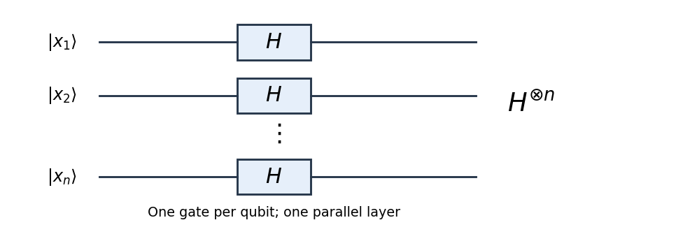

# 2015

↑ **Parent:** [Past exam of the introduction to quantum information course of the University of Oxford](../past-exam-of-the-introduction-to-quantum-information-course-of-the-university-of-oxford.md)

Source: [released examination PDF, bundle pages 110–113](https://www.whatdotheyknow.com/request/oxford_physics_past_papers_2/response/2340696/attach/3/Physics%20Papers%202014.pdf?cookie_passthrough=1#page=110).

**Table of contents**

- [1](#1)
  - [a](#1/a)
    - [Solution](#1/a/solution)
  - [b](#1/b)
    - [Solution](#1/b/solution)
  - [c](#1/c)
    - [Solution](#1/c/solution)
  - [d](#1/d)
    - [Solution](#1/d/solution)
  - [e](#1/e)
    - [Solution](#1/e/solution)
- [2](#2)
  - [a](#2/a)
    - [Solution](#2/a/solution)
  - [b](#2/b)
    - [Solution](#2/b/solution)
  - [c](#2/c)
    - [Solution](#2/c/solution)
  - [d](#2/d)
    - [Solution](#2/d/solution)
  - [e](#2/e)
    - [Solution](#2/e/solution)
- [3](#3)
  - [a](#3/a)
    - [Solution](#3/a/solution)
  - [b](#3/b)
    - [Solution](#3/b/solution)
  - [c](#3/c)
    - [Solution](#3/c/solution)

## 1

↑ **Parent:** [2015](2015.md)

<h3 id="1/a">a</h3>

↑ **Parent:** [1](#1)

<h4 id="1/a/solution">Solution</h4>

↑ **Parent:** [A](#1/a)

Apply one [Hadamard gate](../quantum-theory.md#hadamard-gate) to each of the $n$ [qubits](../quantum-system.md#qubit), with all gates acting in parallel. This [quantum circuit](../quantum-circuit.md) implements the [tensor product](../multilinear-algebra.md#tensor-product) $H^{\otimes n}$; it needs $n$ single-qubit gates and one layer. For one [qubit](../quantum-system.md#qubit),

$$
H|x_j\rangle=\frac1{\sqrt2}\sum_{y_j=0}^1(-1)^{x_jy_j}|y_j\rangle.
$$

Taking the [tensor product](../multilinear-algebra.md#tensor-product) of these expressions multiplies the [probability amplitudes](../wave-function.md#probability-amplitude) and adds their exponents, giving

$$
\boxed{H^{\otimes n}|x\rangle=2^{-n/2}\sum_{y\in\{0,1\}^n}(-1)^{x\cdot y}|y\rangle.}
$$

Here the [dot product](../inner-product.md#dot-product) is evaluated using [modular arithmetic](../modular-arithmetic.md) modulo two.

**[Figure 1](#1/a/image-the-hadamard-transform-applies-one-hadamard-gate-to-each-qubit-in-a-parallel-layer). The Hadamard transform applies one Hadamard gate to each qubit in a parallel layer**.

In particular, an initially zero [quantum register](../quantum-circuit.md#quantum-register) becomes the [uniform quantum superposition](../quantum-theory.md#uniform-quantum-superposition)

$$
\boxed{H^{\otimes n}|0^n\rangle=2^{-n/2}\sum_x|x\rangle.}
$$

This is useful at the start of a [quantum algorithm](../algorithm.md#quantum-algorithm) because a subsequent [quantum oracle](../theoretical-computer-science.md#quantum-oracle) acts on all these components coherently. Later [quantum interference](../quantum-system.md#quantum-interference) can reveal a global property of the function. Measuring immediately would merely produce a uniformly random [binary string](../theoretical-computer-science.md#binary-string); the useful resource is the preserved [quantum coherence](../density-matrix.md#quantum-coherence-in-a-specified-basis), rather than the ability to read every function value in one run.

<h3 id="1/b">b</h3>

↑ **Parent:** [1](#1)

<h4 id="1/b/solution">Solution</h4>

↑ **Parent:** [B](#1/b)

Write $\oplus$ for bitwise [exclusive or](../theoretical-computer-science.md#exclusive-or). Both [quantum registers](../quantum-circuit.md#quantum-register) begin in $|0^n\rangle$. After the first [Hadamard transform](../quantum-theory.md#hadamard-transform) their joint [quantum state](../quantum-system.md#quantum-state) is

$$
2^{-n/2}\sum_{x\in\{0,1\}^n}|x\rangle|0^n\rangle.
$$

The [quantum oracle](../theoretical-computer-science.md#quantum-oracle) $U_f$ maps each component $|x\rangle|0^n\rangle$ to $|x\rangle|f(x)\rangle$. By [linearity](../vector-space.md#linearity), the required [quantum state](../quantum-system.md#quantum-state) is therefore

$$
\boxed{|\Psi\rangle=2^{-n/2}\sum_{x\in\{0,1\}^n}|x\rangle|f(x)\rangle.}
$$

The different first-register [computational-basis states](../quantum-theory.md#computational-basis-state) are [orthogonal](../inner-product.md#orthogonal-vectors), so there are $2^n$ orthogonal joint components of squared [probability amplitude](../wave-function.md#probability-amplitude) $2^{-n}$, even though some second-register values coincide. Thus the displayed [quantum state](../quantum-system.md#quantum-state) is normalized.

<h3 id="1/c">c</h3>

↑ **Parent:** [1](#1)

<h4 id="1/c/solution">Solution</h4>

↑ **Parent:** [C](#1/c)

An observed value $k$ must lie in the [image](../set-theory.md#image-of-a-function) of $f$. Choose either [preimage](../set-theory.md#preimage) $x_k$. The [two-to-one function](../algebra.md#two-to-one-function) promise and $s\ne0^n$ imply that its [preimages](../set-theory.md#preimage) are exactly $x_k$ and $x_k\oplus s$. A [computational-basis measurement](../quantum-theory.md#quantum-measurement-in-the-computational-basis) of the second [quantum register](../quantum-circuit.md#quantum-register) projects the joint [quantum state](../quantum-system.md#quantum-state) onto the unnormalized vector

$$
2^{-n/2}\bigl(|x_k\rangle+|x_k\oplus s\rangle\bigr)|k\rangle.
$$

By the [Born rule](../wave-function.md#born-rule), $\Pr(k)=2^{1-n}$. Dividing by its square root gives the conditional first-register [pure state](../quantum-theory.md#pure-state)

$$
\boxed{|\psi_k\rangle=\frac{|x_k\rangle+|x_k\oplus s\rangle}{\sqrt2}.}
$$

Choosing the other [preimage](../set-theory.md#preimage) merely interchanges the two summands. The result is a [Simon coset state](../quantum-fourier-transform.md#simon-coset-state), retaining [quantum coherence](../density-matrix.md#quantum-coherence-in-a-specified-basis) between the two inputs that share the measured function value. Outcomes outside the [image](../set-theory.md#image-of-a-function) have [probability](../probability-theory.md#probability) zero and hence no conditional state to normalize.

<h3 id="1/d">d</h3>

↑ **Parent:** [1](#1)

<h4 id="1/d/solution">Solution</h4>

↑ **Parent:** [D](#1/d)

Apply the [Hadamard transform](../quantum-theory.md#hadamard-transform) to the conditional [quantum state](../quantum-system.md#quantum-state) from [c](#1/c). Since $(x_k\oplus s)\cdot z=x_k\cdot z+s\cdot z$ modulo two, its output is

$$
H^{\otimes n}|\psi_k\rangle
=\frac1{\sqrt{2^{n+1}}}\sum_z(-1)^{x_k\cdot z}\bigl[1+(-1)^{s\cdot z}\bigr]|z\rangle.
$$

If $s\cdot z=1$, the two [probability amplitudes](../wave-function.md#probability-amplitude) cancel by destructive [quantum interference](../quantum-system.md#quantum-interference). If $s\cdot z=0$, they add, giving

$$
\boxed{\Pr(z\mid k)=
\begin{cases}
2^{1-n},&z\cdot s=0,\\
0,&z\cdot s=1.
\end{cases}}
$$

Thus **every observed string obeys** $\boxed{z\cdot s=0}$. This [Simon Fourier sampling](../quantum-fourier-transform.md#simon-fourier-sampling) is uniform on the $(n-1)$-dimensional [vector subspace](../vector-space.md#vector-subspace) $s^\perp$ over the two-element [field](../algebra.md#field). Indeed, the nonzero [linear functional](../dual-space.md#linear-functional) $z\mapsto z\cdot s$ has a [kernel](../kernel-of-a-linear-map.md) of dimension $n-1$ by the [rank-nullity theorem](../kernel-of-a-linear-map.md#rank-nullity-theorem). The distribution does not depend on $k$, so measuring or discarding the second [quantum register](../quantum-circuit.md#quantum-register) gives the same statistics for the first.

<h3 id="1/e">e</h3>

↑ **Parent:** [1](#1)

<h4 id="1/e/solution">Solution</h4>

↑ **Parent:** [E](#1/e)

Each run of [Simon's algorithm](../quantum-fourier-transform.md#simon-s-algorithm) uses **one oracle call** and returns one uniform sample from $s^\perp$. Collect samples as rows of a [matrix](../vector-space.md#matrix) $Z$ and solve $Zs=0$ over the two-element [field](../algebra.md#field) using [Gaussian elimination](../numerical-linear-algebra.md#gaussian-elimination). Once the rows have [matrix rank](../vector-space.md#matrix-rank) $n-1$, the [kernel](../kernel-of-a-linear-map.md) is $\{0,s\}$, so the promised nonzero vector is uniquely determined. Dependent samples, including $z=0$, must be allowed for; exactly $n-1$ runs need not suffice.

For a rough quantitative estimate, put $d=n-1$. When the existing samples span an $r$-dimensional [vector subspace](../vector-space.md#vector-subspace) of $s^\perp$, the next sample increases the [matrix rank](../vector-space.md#matrix-rank) with [probability](../probability-theory.md#probability) $1-2^{r-d}$. The [random spanning of a binary vector space](../vector-space.md#random-spanning-of-a-binary-vector-space) estimate gives

$$
\mathbb E Q=\sum_{r=0}^{d-1}\frac1{1-2^{r-d}}
=d+\sum_{j=1}^d\frac1{2^j-1}<d+2=n+1.
$$

Alternatively, $m=d+t$ samples fail to span with [probability](../probability-theory.md#probability) less than $2^{-t}$: failure means some nonzero [linear functional](../dual-space.md#linear-functional) on the $d$-dimensional space vanishes on every sample, and a [union bound](../probability-inequality.md#boole-s-inequality) gives $(2^d-1)2^{-m}$. Consequently

$$
\boxed{Q_{\rm quantum}=O(n)\text{ for fixed error},\qquad
Q_{\rm quantum}=O\bigl(n+\log(1/\varepsilon)\bigr)\text{ for error }\varepsilon.}
$$

The [Gaussian elimination](../numerical-linear-algebra.md#gaussian-elimination) requires only a polynomial amount of classical work, for example $O(n^3)$ bit operations for $O(n)$ samples. The degenerate case $n=1$ needs no calls because the promise already specifies $s=1$.

Classically, distinct inputs with equal function values reveal $s=x\oplus x'$. Uniformly sampling distinct inputs finds such a [function collision](../function.md#function-collision) after roughly $\sqrt{2^n}$ calls, by the [birthday square-root scale](../probability-and-statistics.md#birthday-square-root-scale). For $q$ sampled inputs, the expected number of colliding pairs is $\binom q2/(2^n-1)$. The usual randomized classical [query complexity](../theoretical-computer-science.md#query-complexity) of [Simon's problem](../quantum-fourier-transform.md#simon-s-problem) is therefore exponential in $n$, on the scale

$$
\boxed{Q_{\rm classical}=\Theta(2^{n/2})\text{ for bounded error},\qquad
Q_{\rm quantum}=O(n).}
$$

A straightforward exhaustive classical search instead uses $O(2^n)$ calls. The square-root collision estimate is the sharper classical comparison; the quantum advantage concerns access to the promised [quantum oracle](../theoretical-computer-science.md#quantum-oracle), rather than an explicit table of all function values.

## 2

↑ **Parent:** [2015](2015.md)

<h3 id="2/a">a</h3>

↑ **Parent:** [2](#2)

<h4 id="2/a/solution">Solution</h4>

↑ **Parent:** [A](#2/a)

For any normalized vector $|u\rangle$, the [Born rule](../wave-function.md#born-rule) assigns the [probability](../probability-theory.md#probability) $\langle u|\rho|u\rangle$ to the corresponding rank-one [orthogonal projection](../hilbert-space.md#orthogonal-projection). This must be nonnegative for every $u$, which is exactly [positive semidefiniteness](../quadratic-form.md#positive-semidefinite-matrix). For any complete [orthonormal basis](../inner-product.md#orthonormal-basis) $\{|j\rangle\}$, the outcome [probabilities](../probability-theory.md#probability) must sum to one:

$$
\sum_j\langle j|\rho|j\rangle=\operatorname{Tr}\rho=1.
$$

Thus a [Hermitian matrix](../hilbert-space.md#hermitian-operator) represents a physical [density matrix](../density-matrix.md) only if

$$
\boxed{\rho\geq0,\qquad\operatorname{Tr}\rho=1.}
$$

These conditions are also sufficient in finite dimension. The [spectral theorem](../hilbert-space.md#spectral-theorem) writes $\rho=\sum_jp_j|u_j\rangle\langle u_j|$ with $p_j\geq0$ and $\sum_jp_j=1$, describing a [quantum state ensemble](../density-matrix.md#quantum-state-ensemble) of [pure states](../quantum-theory.md#pure-state) with valid mixing [probabilities](../probability-theory.md#probability). A [Hermitian matrix](../hilbert-space.md#hermitian-operator) alone could have negative [eigenvalues](../linear-operator-theory.md#eigenvalue), hence negative measurement [probabilities](../probability-theory.md#probability).

<h3 id="2/b">b</h3>

↑ **Parent:** [2](#2)

<h4 id="2/b/solution">Solution</h4>

↑ **Parent:** [B](#2/b)

Expand the given [pure state](../quantum-theory.md#pure-state) in the ordered [computational basis](../quantum-theory.md#computational-basis) $00,01,10,11$:

$$
|\psi\rangle=\frac1{\sqrt3}|00\rangle-\frac1{\sqrt6}|01\rangle
+\frac1{\sqrt3}|10\rangle+\frac1{\sqrt6}|11\rangle,
\qquad
v=\frac1{\sqrt6}\begin{pmatrix}\sqrt2\\-1\\\sqrt2\\1\end{pmatrix}.
$$

The coefficients have squared magnitudes $1/3,1/6,1/3,1/6$, summing to one. The [density matrix](../density-matrix.md) is the [outer product](../vector-space.md#outer-product) $vv^\dagger$, not the diagonal matrix of these four [probabilities](../probability-theory.md#probability): its off-diagonal entries retain [quantum coherence](../density-matrix.md#quantum-coherence-in-a-specified-basis). Therefore

$$
\boxed{\rho=|\psi\rangle\langle\psi|
=\frac16\begin{pmatrix}
2&-\sqrt2&2&\sqrt2\\
-\sqrt2&1&-\sqrt2&-1\\
2&-\sqrt2&2&\sqrt2\\
\sqrt2&-1&\sqrt2&1
\end{pmatrix}.}
$$

The [outer product](../vector-space.md#outer-product) is a [Hermitian matrix](../hilbert-space.md#hermitian-operator) and is [positive semidefinite](../quadratic-form.md#positive-semidefinite-matrix): $u^\dagger\rho u=|v^\dagger u|^2\geq0$. Its [trace](../linear-algebra.md#matrix-trace) is one, and $\rho^2=\rho$, as required for a [pure state](../quantum-theory.md#pure-state).

<h3 id="2/c">c</h3>

↑ **Parent:** [2](#2)

<h4 id="2/c/solution">Solution</h4>

↑ **Parent:** [C](#2/c)

Let $a_{ij}$ be the coefficient of $|ij\rangle$. The [partial trace](../quantum-theory.md#partial-trace) contracts the repeated index of the discarded [qubit](../quantum-system.md#qubit):

$$
(\rho_1)_{ii'}=\sum_{j=0}^1a_{ij}\overline{a_{i'j}},
\qquad
(\rho_2)_{jj'}=\sum_{i=0}^1a_{ij}\overline{a_{ij'}}.
$$

For the first [qubit](../quantum-system.md#qubit), each diagonal entry is $1/3+1/6=1/2$ and the upper off-diagonal entry is $1/3-1/6=1/6$. For the second [qubit](../quantum-system.md#qubit), the diagonal entries are $2/3$ and $1/3$, while the upper off-diagonal entry is $-1/\sqrt{18}+1/\sqrt{18}=0$. Thus the two [reduced density matrices](../bell-state.md#reduced-density-matrix), each in [computational basis](../quantum-theory.md#computational-basis) order $0,1$, are

$$
\boxed{\rho_1=\operatorname{Tr}_2\rho=\begin{pmatrix}1/2&1/6\\1/6&1/2\end{pmatrix},\qquad
\rho_2=\operatorname{Tr}_1\rho=\begin{pmatrix}2/3&0\\0&1/3\end{pmatrix}.}
$$

Both have [eigenvalues](../linear-operator-theory.md#eigenvalue) $2/3,1/3$ and [trace](../linear-algebra.md#matrix-trace) one, so both are [mixed states](../density-matrix.md#mixed-state) even though the joint [quantum state](../quantum-system.md#quantum-state) is pure. Their different [eigenvectors](../linear-operator-theory.md#eigenvector) are visible in the useful rewrite

$$
|\psi\rangle=\sqrt{\frac23}|+\rangle|0\rangle-\sqrt{\frac13}|-\rangle|1\rangle,
\qquad |\pm\rangle=\frac{|0\rangle\pm|1\rangle}{\sqrt2}.
$$

Absorbing the minus sign into one local basis vector makes this a [Schmidt decomposition](../von-neumann-entropy.md#schmidt-decomposition) with nonnegative coefficients. It also checks both [partial traces](../quantum-theory.md#partial-trace) and exhibits the [entanglement](../bell-state.md#entangled-state) responsible for the mixed local descriptions.

<h3 id="2/d">d</h3>

↑ **Parent:** [2](#2)

<h4 id="2/d/solution">Solution</h4>

↑ **Parent:** [D](#2/d)

For a [Hermitian matrix](../hilbert-space.md#hermitian-operator) $A$, the [spectral theorem](../hilbert-space.md#spectral-theorem) gives $A=U\operatorname{diag}(\lambda_1,\ldots,\lambda_d)U^\dagger$, with real [eigenvalues](../linear-operator-theory.md#eigenvalue) and a [unitary matrix](../linear-operator-theory.md#unitary-matrix) $U$. Hence

$$
A^\dagger A=A^2=U\operatorname{diag}(\lambda_1^2,\ldots,\lambda_d^2)U^\dagger,
\qquad
\sqrt{A^\dagger A}=U\operatorname{diag}(|\lambda_1|,\ldots,|\lambda_d|)U^\dagger.
$$

The square root here is the unique [positive square root of an operator](../hilbert-space.md#positive-square-root-of-an-operator). Taking the [trace](../linear-algebra.md#matrix-trace), which is unchanged by [unitary similarity](../linear-algebra.md#unitary-similarity), proves

$$
\boxed{\|A\|_{\rm tr}=\sum_{j=1}^d|\lambda_j|.}
$$

For a [density matrix](../density-matrix.md), all [eigenvalues](../linear-operator-theory.md#eigenvalue) are nonnegative and sum to one. Its [trace norm](../normed-vector-space.md#trace-norm) is therefore

$$
\boxed{\|\rho\|_{\rm tr}=\operatorname{Tr}\rho=1.}
$$

The absolute values cannot be omitted for a general [Hermitian matrix](../hilbert-space.md#hermitian-operator), since positive and negative [eigenvalues](../linear-operator-theory.md#eigenvalue) can cancel in its [trace](../linear-algebra.md#matrix-trace) but never in its [trace norm](../normed-vector-space.md#trace-norm).

<h3 id="2/e">e</h3>

↑ **Parent:** [2](#2)

<h4 id="2/e/solution">Solution</h4>

↑ **Parent:** [E](#2/e)

With no access to the discarded [qubit](../quantum-system.md#qubit), the two preparations are exactly the [reduced density matrices](../bell-state.md#reduced-density-matrix) in [c](#2/c), with equal prior [probabilities](../probability-theory.md#probability). Their difference is

$$
\Delta=\rho_1-\rho_2=\frac16\begin{pmatrix}-1&1\\1&1\end{pmatrix},
\qquad \Delta^2=\frac1{18}I.
$$

Since $\operatorname{Tr}\Delta=0$, its [eigenvalues](../linear-operator-theory.md#eigenvalue) are $\pm\sqrt2/6$. The [trace norm](../normed-vector-space.md#trace-norm) and [trace distance](../density-matrix.md#trace-distance) are consequently

$$
\|\Delta\|_{\rm tr}=\frac{\sqrt2}{3},
\qquad
\boxed{T(\rho_1,\rho_2)=\frac{\sqrt2}{6}.}
$$

The [Holevo–Helstrom theorem](../quantum-information-theory.md#holevo-helstrom-theorem) gives the optimum

$$
\boxed{P_{\rm success}^{\rm max}=\frac12\left(1+\frac{\sqrt2}{6}\right)
=\frac12+\frac{\sqrt2}{12}\simeq0.617851.}
$$

To establish attainability, rather than only an upper bound, measure the [Hermitian operator](../hilbert-space.md#hermitian-operator)

$$
B=\frac{X-Z}{\sqrt2},\qquad
X=\begin{pmatrix}0&1\\1&0\end{pmatrix},\quad
Z=\begin{pmatrix}1&0\\0&-1\end{pmatrix},
$$

where $X,Z$ are [Pauli matrices](../algebra.md#pauli-matrices). Since $\Delta=(\sqrt2/6)B$, report **first qubit for the positive outcome; second qubit for the negative outcome**. The corresponding [orthogonal projections](../hilbert-space.md#orthogonal-projection) are $E_\pm=(I\pm B)/2$. Their success [probability](../probability-theory.md#probability) is

$$
\frac12\operatorname{Tr}(E_+\rho_1)+\frac12\operatorname{Tr}(E_-\rho_2)
=\frac12+\frac12\operatorname{Tr}(E_+\Delta)
=\frac12+\frac{\sqrt2}{12},
$$

which reaches the bound. Identical [eigenvalues](../linear-operator-theory.md#eigenvalue) of the two [density matrices](../density-matrix.md) do not make them indistinguishable: their eigenvectors differ, and this [quantum measurement](../quantum-measurement.md) detects that difference.

## 3

↑ **Parent:** [2015](2015.md)

<h3 id="3/a">a</h3>

↑ **Parent:** [3](#3)

<h4 id="3/a/solution">Solution</h4>

↑ **Parent:** [A](#3/a)

Use the conventional [phase gate](../quantum-theory.md#phase-gate) $P_\varphi=\operatorname{diag}(1,e^{i\varphi})$ in [computational basis](../quantum-theory.md#computational-basis) order $0,1$. The single-qubit [Hadamard gate](../quantum-theory.md#hadamard-gate) and the successive [quantum states](../quantum-system.md#quantum-state) are

$$
\boxed{H=\frac1{\sqrt2}\begin{pmatrix}1&1\\1&-1\end{pmatrix},}
\qquad
|0\rangle\xrightarrow{H}\frac{|0\rangle+|1\rangle}{\sqrt2}
\xrightarrow{P_\varphi}\frac{|0\rangle+e^{i\varphi}|1\rangle}{\sqrt2}.
$$

The final [Hadamard gate](../quantum-theory.md#hadamard-gate) recombines the two components, giving

$$
\boxed{|\psi_{\rm out}\rangle=
\frac{1+e^{i\varphi}}2|0\rangle+\frac{1-e^{i\varphi}}2|1\rangle
=e^{i\varphi/2}\left(\cos\frac\varphi2|0\rangle-i\sin\frac\varphi2|1\rangle\right).}
$$

The leading factor in the last expression is a [global phase](../quantum-system.md#global-phase). The [Born rule](../wave-function.md#born-rule) therefore yields

$$
\boxed{P_0(\varphi)=\left|\frac{1+e^{i\varphi}}2\right|^2
=\frac{1+\cos\varphi}{2}=\cos^2\frac\varphi2.}
$$

At $\varphi=0$ the output is certainly zero, whereas at $\varphi=\pi$ it is certainly one. The [phase gate](../quantum-theory.md#phase-gate) changes no intermediate outcome [probabilities](../probability-theory.md#probability); the final [Hadamard gate](../quantum-theory.md#hadamard-gate) converts a relative [quantum phase](../quantum-system.md#quantum-phase) into an observable [quantum interference](../quantum-system.md#quantum-interference) fringe.

<h3 id="3/b">b</h3>

↑ **Parent:** [3](#3)

<h4 id="3/b/solution">Solution</h4>

↑ **Parent:** [B](#3/b)

Write $c=\langle e_0|e_1\rangle=ve^{i\alpha}$. The [Cauchy-Schwarz inequality](../probability-and-statistics.md#cauchy-schwarz-inequality) gives $0\leq v\leq1$ because the two environment states are normalized. Immediately after the interaction, the joint [quantum state](../quantum-system.md#quantum-state) is

$$
|\Psi\rangle=\frac{|0\rangle|e_0\rangle+e^{i\varphi}|1\rangle|e_1\rangle}{\sqrt2}.
$$

Applying the last [Hadamard gate](../quantum-theory.md#hadamard-gate) gives

$$
|\Psi_{\rm out}\rangle=\frac12\left[
|0\rangle\bigl(|e_0\rangle+e^{i\varphi}|e_1\rangle\bigr)
+|1\rangle\bigl(|e_0\rangle-e^{i\varphi}|e_1\rangle\bigr)\right].
$$

Since the environment is unobserved, the [Born rule](../wave-function.md#born-rule) uses the squared [norm](../normed-vector-space.md#norm) of the environment-valued coefficient of $|0\rangle$:

$$
P_0=\frac14\left[2+e^{i\varphi}\langle e_0|e_1\rangle
+e^{-i\varphi}\langle e_1|e_0\rangle\right].
$$

Thus the [Hadamard interference with environment overlap](../quantum-information-theory.md#hadamard-interference-with-environment-overlap) formula is

$$
\boxed{P_0(\varphi,v,\alpha)=\frac{1+v\cos(\varphi+\alpha)}2.}
$$

The plus sign follows from the explicitly chosen [phase gate](../quantum-theory.md#phase-gate) and the order $\langle e_0|e_1\rangle$ of the [inner product](../inner-product.md). Equivalently, before the last [Hadamard gate](../quantum-theory.md#hadamard-gate) the [partial trace](../quantum-theory.md#partial-trace) over the environment gives

$$
\rho=\frac12\begin{pmatrix}
1&v e^{-i(\varphi+\alpha)}\\
v e^{i(\varphi+\alpha)}&1
\end{pmatrix}.
$$

The [complex environment overlap in qubit dephasing](../quantum-information-theory.md#complex-environment-overlap-in-qubit-dephasing) both reduces the [quantum coherence](../density-matrix.md#quantum-coherence-in-a-specified-basis) by $v$ and adds a relative [quantum phase](../quantum-system.md#quantum-phase) $\alpha$. Orthogonal environment states have $v=0$ and give $P_0=1/2$ for every $\varphi$. If $v=1$, the [quantum interference](../quantum-system.md#quantum-interference) fringe has full contrast and is only shifted; the [qubit](../quantum-system.md#qubit) has not become mixed. For $v=0$, $\alpha$ is immaterial.

Moving the interaction to between the first [Hadamard gate](../quantum-theory.md#hadamard-gate) and the [phase gate](../quantum-theory.md#phase-gate) gives

$$
\frac{|0\rangle|e_0\rangle+|1\rangle|e_1\rangle}{\sqrt2}
\xrightarrow{P_\varphi\otimes I}
\frac{|0\rangle|e_0\rangle+e^{i\varphi}|1\rangle|e_1\rangle}{\sqrt2},
$$

the identical joint [quantum state](../quantum-system.md#quantum-state). Therefore **the expression is unchanged**. This is the [commutation of computational-basis dephasing and phase gates](../quantum-information-theory.md#commutation-of-computational-basis-dephasing-and-phase-gates); it uses the specified population-preserving interaction with the same environment states, rather than an arbitrary model of [quantum decoherence](../quantum-theory.md#quantum-decoherence).

<h3 id="3/c">c</h3>

↑ **Parent:** [3](#3)

<h4 id="3/c/solution">Solution</h4>

↑ **Parent:** [C](#3/c)

Normalize the second [qubit](../quantum-system.md#qubit) as $|-\rangle=(|0\rangle-|1\rangle)/\sqrt2$. Since a [Pauli X gate](../quantum-theory.md#pauli-x-gate) changes $|-\rangle$ to $-|-\rangle$, the [Boolean quantum oracle](../quantum-theory.md#boolean-quantum-oracle) acts as

$$
U_f|x\rangle|-\rangle=(-1)^{f(x)}|x\rangle|-\rangle.
$$

This [quantum phase kickback](../quantum-theory.md#phase-kickback) leaves the second [qubit](../quantum-system.md#qubit) uncorrelated with the first. Put $b=f(0)\oplus f(1)$: $b=0$ for a [constant function](../function.md#constant-function) and $b=1$ for a [balanced Boolean function](../analysis-of-boolean-functions.md#balanced-boolean-function). Apart from the irrelevant [global phase](../quantum-system.md#global-phase) $(-1)^{f(0)}$, the first [qubit](../quantum-system.md#qubit) and environment reach

$$
\frac{|0\rangle|e_0\rangle+(-1)^b|1\rangle|e_1\rangle}{\sqrt2}.
$$

The population-preserving interaction commutes with the [quantum oracle](../theoretical-computer-science.md#quantum-oracle) on this answer-register input, so its placement before or after the oracle, between the two [Hadamard gates](../quantum-theory.md#hadamard-gate), gives the same result. Substitute $\varphi=\pi b$ into [b](#3/b):

$$
\boxed{P(0\mid b)=\frac{1+(-1)^b v\cos\alpha}{2},\qquad
P(1\mid b)=\frac{1-(-1)^b v\cos\alpha}{2}.}
$$

The printed [Deutsch algorithm](../quantum-theory.md#deutsch-algorithm) uses the rule **zero means [constant function](../function.md#constant-function); one means [balanced Boolean function](../analysis-of-boolean-functions.md#balanced-boolean-function)**. With that rule, the [Deutsch algorithm with pure dephasing](../quantum-theory.md#deutsch-algorithm-with-pure-dephasing) succeeds for either class with

$$
\boxed{P_{\rm correct}^{\rm printed}=\frac{1+v\cos\alpha}{2}.}
$$

For real nonnegative environment overlap this is $(1+v)/2$, ranging from certainty at $v=1$ to random guessing at $v=0$. For general complex overlap, a coherent shift can invert the printed answer: for example $v=1,\alpha=\pi$ makes the printed rule always wrong. If the overlap is known but the printed [quantum measurement](../quantum-measurement.md) is retained, choose the better labeling of its outcomes; this gives

$$
\boxed{P_{\rm correct}^{\rm relabeled}=\frac{1+|v\cos\alpha|}{2}.}
$$

There is a further improvement if a known $\alpha$ can be compensated by the [phase gate](../quantum-theory.md#phase-gate) $P_{-\alpha}$ before the final [Hadamard gate](../quantum-theory.md#hadamard-gate). It removes the coherent shift without reversing any actual [quantum decoherence](../quantum-theory.md#quantum-decoherence), and yields

$$
\boxed{P_{\rm correct}^{\rm compensated}=\frac{1+v}{2}.}
$$

This is optimal when only the first [qubit](../quantum-system.md#qubit) is accessible, with equal prior [probabilities](../probability-theory.md#probability) for the two classes. Before the final [Hadamard gate](../quantum-theory.md#hadamard-gate), their [reduced density matrices](../bell-state.md#reduced-density-matrix) are

$$
\rho_b=\frac12\begin{pmatrix}1&(-1)^b\overline c\\(-1)^bc&1\end{pmatrix}.
$$

The difference $\rho_0-\rho_1$ has [eigenvalues](../linear-operator-theory.md#eigenvalue) $\pm v$, giving [trace distance](../density-matrix.md#trace-distance) $v$. The [Holevo–Helstrom theorem](../quantum-information-theory.md#holevo-helstrom-theorem) therefore bounds the success [probability](../probability-theory.md#probability) by $(1+v)/2$, exactly attained by the compensated procedure. A known phase shift and loss of coherence have different effects: at $v=0$ the two [density matrices](../density-matrix.md) coincide and no measurement on the available [qubit](../quantum-system.md#qubit) can reveal the answer.

## ↑ Ancestors (9)

1. [Past exam of the introduction to quantum information course of the University of Oxford](../past-exam-of-the-introduction-to-quantum-information-course-of-the-university-of-oxford.md)
2. [Introduction to quantum information course of the University of Oxford](../university-of-oxford.md#introduction-to-quantum-information-course-of-the-university-of-oxford)
3. [Year 4 of the mathematics course of the University of Oxford](../university-of-oxford.md#year-4-of-the-mathematics-course-of-the-university-of-oxford)
4. [Mathematics course of the University of Oxford](../university-of-oxford.md#mathematics-course-of-the-university-of-oxford)
5. [Undergraduate course of the University of Oxford](../university-of-oxford.md#undergraduate-course-of-the-university-of-oxford)
6. [Course of the University of Oxford](../university-of-oxford.md#course-of-the-university-of-oxford)
7. [University of Oxford](../university-of-oxford.md)
8. [List of universities](../README.md#list-of-universities)
9. [Codex Wiki](../README.md)
