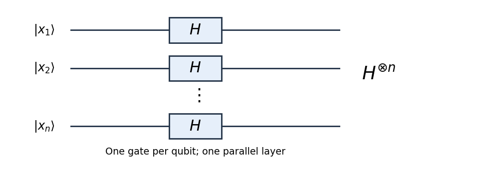

<h1 id="1/a/solution">Solution</h1>

↑ **Parent:** [A](../a.md)

Apply one [Hadamard gate](../../../../hadamard-gate.md) to each of the $n$ [qubits](../../../../qubit.md), with all gates acting in parallel. This [quantum circuit](../../../../quantum-circuit-split.md) implements the [tensor product](../../../../tensor-product.md) $H^{\otimes n}$; it needs $n$ single-qubit gates and one layer. For one [qubit](../../../../qubit.md),

$$
H|x_j\rangle=\frac1{\sqrt2}\sum_{y_j=0}^1(-1)^{x_jy_j}|y_j\rangle.
$$

Taking the [tensor product](../../../../tensor-product.md) of these expressions multiplies the [probability amplitudes](../../../../probability-amplitude.md) and adds their exponents, giving

$$
\boxed{H^{\otimes n}|x\rangle=2^{-n/2}\sum_{y\in\{0,1\}^n}(-1)^{x\cdot y}|y\rangle.}
$$

Here the [dot product](../../../../dot-product.md) is evaluated using [modular arithmetic](../../../../modular-arithmetic-split.md) modulo two.

**[Figure 1](#1/a/image-the-hadamard-transform-applies-one-hadamard-gate-to-each-qubit-in-a-parallel-layer). The Hadamard transform applies one Hadamard gate to each qubit in a parallel layer**.

In particular, an initially zero [quantum register](../../../../quantum-register.md) becomes the [uniform quantum superposition](../../../../uniform-quantum-superposition.md)

$$
\boxed{H^{\otimes n}|0^n\rangle=2^{-n/2}\sum_x|x\rangle.}
$$

This is useful at the start of a [quantum algorithm](../../../../quantum-algorithm.md) because a subsequent [quantum oracle](../../../../quantum-oracle.md) acts on all these components coherently. Later [quantum interference](../../../../quantum-interference.md) can reveal a global property of the function. Measuring immediately would merely produce a uniformly random [binary string](../../../../binary-string.md); the useful resource is the preserved [quantum coherence](../../../../quantum-coherence-in-a-specified-basis.md), rather than the ability to read every function value in one run.

## ↑ Ancestors (12)

1. [A](../a.md)
2. [1](../../1.md)
3. [2015](../../../2015-split.md)
4. [Past exam of the introduction to quantum information course of the University of Oxford](../../../split.md)
5. [Introduction to quantum information course of the University of Oxford](../../../../introduction-to-quantum-information-course-of-the-university-of-oxford.md)
6. [Year 4 of the mathematics course of the University of Oxford](../../../../year-4-of-the-mathematics-course-of-the-university-of-oxford.md)
7. [Mathematics course of the University of Oxford](../../../../mathematics-course-of-the-university-of-oxford.md)
8. [Undergraduate course of the University of Oxford](../../../../undergraduate-course-of-the-university-of-oxford.md)
9. [Course of the University of Oxford](../../../../course-of-the-university-of-oxford.md)
10. [University of Oxford](../../../../university-of-oxford-split.md)
11. [List of universities](../../../../list-of-universities.md)
12. [Codex Wiki](../../../../split.md)
