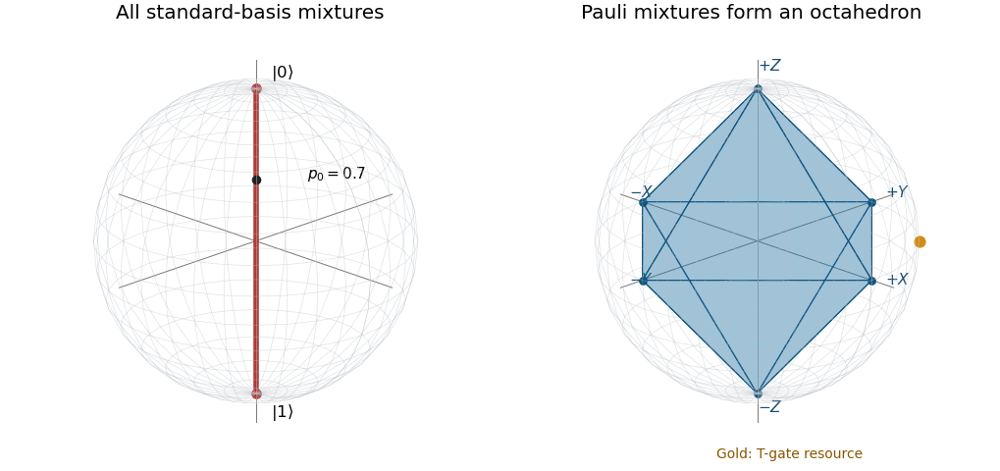

# 2021

↑ **Parent:** [Past exam of the introduction to quantum information course of the University of Oxford](../past-exam-of-the-introduction-to-quantum-information-course-of-the-university-of-oxford.md)

Source: [original released examination PDF, bundle pages 93–96; paper pages 1–4](https://www.whatdotheyknow.com/request/oxford_physics_past_papers_2/response/2340696/attach/9/Physics%20Papers%202020.pdf?cookie_passthrough=1#page=93). The printed sitting is 7 June 2021 despite the bundle filename.

Solutions to all three questions. We use the usual [Pauli matrices](../algebra.md#pauli-matrices), column [state vectors](../dynamical-systems.md#state-vector), and the [density operator](../density-matrix.md) convention $\rho\mapsto U\rho U^\dagger$ for a gate. The CHSH conclusions require independent, uniformly chosen settings and no communication between the devices during a run. In Question 3, a reliable unknown-basis transformation means one deterministic operation that works for every common input basis.

**Table of contents**

- [1](#1)
  - [a](#1/a)
    - [Solution](#1/a/solution)
  - [b](#1/b)
    - [Solution](#1/b/solution)
  - [c](#1/c)
    - [Solution](#1/c/solution)
  - [d](#1/d)
    - [Solution](#1/d/solution)
  - [e](#1/e)
    - [Solution](#1/e/solution)
  - [f](#1/f)
    - [Solution](#1/f/solution)
- [2](#2)
  - [a](#2/a)
    - [Solution](#2/a/solution)
  - [b](#2/b)
    - [Solution](#2/b/solution)
  - [c](#2/c)
    - [Solution](#2/c/solution)
  - [d](#2/d)
    - [Solution](#2/d/solution)
  - [e](#2/e)
    - [Solution](#2/e/solution)
  - [f](#2/f)
    - [Solution](#2/f/solution)
- [3](#3)
  - [a](#3/a)
    - [Solution](#3/a/solution)
  - [b](#3/b)
    - [Solution](#3/b/solution)
  - [c](#3/c)
    - [i](#3/c/i)
      - [Solution](#3/c/i/solution)
    - [ii](#3/c/ii)
      - [Solution](#3/c/ii/solution)
    - [iii](#3/c/iii)
      - [Solution](#3/c/iii/solution)
    - [iv](#3/c/iv)
      - [Solution](#3/c/iv/solution)
  - [d](#3/d)
    - [Solution](#3/d/solution)
  - [e](#3/e)
    - [Solution](#3/e/solution)

## 1

↑ **Parent:** [2021](2021.md)

<h3 id="1/a">a</h3>

↑ **Parent:** [1](#1)

<h4 id="1/a/solution">Solution</h4>

↑ **Parent:** [A](#1/a)

The [Pauli multiplication identity](../algebra.md#pauli-multiplication-identity) gives $(\mathbf s\cdot\boldsymbol\sigma)^2=|\mathbf s|^2I$. Its [eigenvalues](../linear-operator-theory.md#eigenvalue) are therefore $\pm|\mathbf s|$, and those of the [density matrix](../density-matrix.md) are

$$
\lambda_\pm=\frac{1\pm|\mathbf s|}{2}.
$$

Hermiticity and trace one are automatic; [positive semidefiniteness](../quadratic-form.md#positive-semidefinite-matrix) holds exactly for $|\mathbf s|\leq1$. Thus physical qubit states form the [Bloch ball](../density-matrix.md#bloch-ball), with [pure states](../quantum-theory.md#pure-state) on the [Bloch sphere](../density-matrix.md#bloch-sphere) and mixed states inside.

For the mixture of the two standard-basis states,

$$
\boxed{\rho=\begin{pmatrix}p_0&0\\0&p_1\end{pmatrix},\qquad
\mathbf s=(0,0,p_0-p_1),\quad p_0+p_1=1.}
$$

These form the entire $z$-axis diameter, shown in the left panel of the diagram in part [b](#1/b). Generate the state by selecting $|0\rangle$ with classical [probability](../probability-theory.md#probability) $p_0$ and $|1\rangle$ with probability $p_1$, then discarding the classical selection record. A coherent [superposition](../vector-space.md#superposition-principle) is generally a different state: the forgotten classical record removes off-diagonal coherence.

<h3 id="1/b">b</h3>

↑ **Parent:** [1](#1)

<h4 id="1/b/solution">Solution</h4>

↑ **Parent:** [B](#1/b)

The six [Pauli eigenstates](../quantum-circuit.md#pauli-eigenstate) have [Bloch vectors](../density-matrix.md#bloch-vector) $\pm\mathbf e_x$, $\pm\mathbf e_y$, $\pm\mathbf e_z$:

$$
\begin{aligned}
X:&\quad |\pm\rangle=(|0\rangle\pm|1\rangle)/\sqrt2,\\
Y:&\quad |\pm i\rangle=(|0\rangle\pm i|1\rangle)/\sqrt2,\\
Z:&\quad |0\rangle,\ |1\rangle.
\end{aligned}
$$

Classical [convex combinations](../convex-set.md#convex-combination) of [density operators](../density-matrix.md) produce the corresponding [convex combinations](../convex-set.md#convex-combination) of their [Bloch vectors](../density-matrix.md#bloch-vector). Their [convex hull](../convex-set.md#convex-hull) is the [stabilizer octahedron](../density-matrix.md#stabilizer-octahedron):

$$
\boxed{|s_x|+|s_y|+|s_z|\leq1.}
$$

The six vertices are pure Pauli states; the faces and interior represent their mixtures. To verify the reverse inclusion, give the vertex in the sign of each coordinate weight $|s_j|$ and use the leftover weight at the origin, itself the equal mixture of either opposite pair.

**[Figure 1](#1/b/image-the-standard-basis-mixture-diameter-and-the-stabilizer-octahedron-inside-the-bloch-ball). The standard-basis mixture diameter and the stabilizer octahedron inside the Bloch ball**. The red diameter shows all mixtures of $|0\rangle$ and $|1\rangle$. The six Pauli vertices generate the blue octahedron. The gold point is the T-gate resource state: it lies on the Bloch sphere but outside this octahedron.

<h3 id="1/c">c</h3>

↑ **Parent:** [1](#1)

<h4 id="1/c/solution">Solution</h4>

↑ **Parent:** [C](#1/c)

Conjugation by the [Hadamard gate](../quantum-theory.md#hadamard-gate) sends $(X,Y,Z)$ to $(Z,-Y,X)$. Therefore its [Bloch vector](../density-matrix.md#bloch-vector) action is

$$
\boxed{H:\ (s_x,s_y,s_z)\longmapsto(s_z,-s_y,s_x).}
$$

It is a rotation through $\pi$ about $(\mathbf e_x+\mathbf e_z)/\sqrt2$: $H=(X+Z)/\sqrt2$ differs by a [global phase](../quantum-system.md#global-phase) from the corresponding spin rotation.

The [S gate](../quantum-theory.md#s-gate) and [T gate](../quantum-theory.md#t-gate) differ by global phases from $z$-axis rotations:

$$
\boxed{S:\ R_z(\pi/2),\qquad T:\ R_z(\pi/4).}
$$

Indeed $\operatorname{diag}(1,e^{i\theta})=e^{i\theta/2}e^{-i\theta Z/2}$, which sends $(s_x,s_y,s_z)$ to $(s_x\cos\theta-s_y\sin\theta,s_x\sin\theta+s_y\cos\theta,s_z)$.

<h3 id="1/d">d</h3>

↑ **Parent:** [1](#1)

<h4 id="1/d/solution">Solution</h4>

↑ **Parent:** [D](#1/d)

Direct [matrix multiplication](../vector-space.md#matrix-multiplication) gives

$$
\begin{array}{c|ccc}
 &X&Y&Z\\\hline
HPH^\dagger&Z&-Y&X\\
SPS^\dagger&Y&-X&Z.
\end{array}
$$

Thus each generating [Clifford gate](../quantum-circuit.md#clifford-gate) conjugates every [Pauli operator](../quantum-circuit.md#pauli-operator) to another Pauli operator up to sign. Repeated conjugation proves the same for every product of generators and their inverses, hence for the [Clifford group](../quantum-circuit.md#clifford-group-quantum-computing). For Hermitian Pauli observables the possible phases here are signs; arbitrary Pauli-group elements also include their conventional phases.

If $P|\psi\rangle=\lambda|\psi\rangle$, then $(CPC^\dagger)C|\psi\rangle=\lambda C|\psi\rangle$. Therefore $C|\psi\rangle$ is another [Pauli eigenstate](../quantum-circuit.md#pauli-eigenstate). Every single-qubit Clifford circuit consequently permutes the six Pauli vertices of the [stabilizer octahedron](../density-matrix.md#stabilizer-octahedron).

<h3 id="1/e">e</h3>

↑ **Parent:** [1](#1)

<h4 id="1/e/solution">Solution</h4>

↑ **Parent:** [E](#1/e)

While the sequence is remembered, the conditional [quantum state](../quantum-system.md#quantum-state) is the known pure endpoint $C|0\rangle$, so its [Bloch vector](../density-matrix.md#bloch-vector) is one of the six Pauli vertices. Partial forgetting leaves a probability distribution $p_j$ over possible endpoints, giving

$$
\rho=\sum_{j=1}^6p_j|v_j\rangle\langle v_j|,\qquad
\mathbf s=\sum_jp_j\mathbf v_j.
$$

Hence the vector lies in the [stabilizer octahedron](../density-matrix.md#stabilizer-octahedron). The mixing describes lost classical information, not a different unitary evolution of the physical qubit.

Under complete unbiased uncertainty over the six endpoints, $p_j=1/6$, the opposite vectors cancel and

$$
\boxed{\mathbf s=0,\qquad\rho=I/2.}
$$

This is the [maximally mixed state](../density-matrix.md#maximally-mixed-state) at the center. Mere loss of the particular sequence does not mathematically force uniform probabilities: a known biased distribution of endpoint states would leave its corresponding noncentral mixture. The central conclusion uses the unbiased randomization implicit in complete forgetting in this setting.

<h3 id="1/f">f</h3>

↑ **Parent:** [1](#1)

<h4 id="1/f/solution">Solution</h4>

↑ **Parent:** [F](#1/f)

Write $|\psi\rangle=a|0\rangle+b|1\rangle$ and $\omega=e^{i\pi/4}$. After the [controlled-NOT gate](../quantum-theory.md#controlled-not-gate), the joint state is

$$
\frac1{\sqrt2}\left[a|0\rangle(|0\rangle+\omega|1\rangle)
+b|1\rangle(\omega|0\rangle+|1\rangle)\right].
$$

An ancilla measurement outcome zero leaves the unnormalized data state $(a|0\rangle+\omega b|1\rangle)/\sqrt2=T|\psi\rangle/\sqrt2$. Outcome one leaves $(\omega a|0\rangle+b|1\rangle)/\sqrt2=\omega T^\dagger|\psi\rangle/\sqrt2$. Both outcomes have [probability](../probability-theory.md#probability) $1/2$. The correction for outcome one is $S$, and $ST^\dagger=T$, so after correction the data is always $T|\psi\rangle$, up to an irrelevant [global phase](../quantum-system.md#global-phase). This proves [magic-state injection of a T gate](../quantum-circuit.md#magic-state-injection-of-a-t-gate).

The resource state's [Bloch vector](../density-matrix.md#bloch-vector) is $(1/\sqrt2,1/\sqrt2,0)$, outside the [stabilizer octahedron](../density-matrix.md#stabilizer-octahedron). Clifford gates alone preserve stabilizer structure and, with standard-basis preparation and measurement, admit efficient classical simulation by the [Gottesman--Knill theorem](../quantum-circuit.md#gottesman-knill-theorem). Adding the non-Clifford [T gate](../quantum-theory.md#t-gate) supplies a [universal quantum gate set](../quantum-circuit.md#universal-quantum-gate-set) together with Clifford gates: arbitrary finite-qubit unitaries can be approximated to arbitrary precision. The assertion is approximate universality, not exact representation of every unitary by a finite circuit.

## 2

↑ **Parent:** [2021](2021.md)

<h3 id="2/a">a</h3>

↑ **Parent:** [2](#2)

<h4 id="2/a/solution">Solution</h4>

↑ **Parent:** [A](#2/a)

Each local [reduced density operator](../bell-state.md#reduced-density-matrix) of the [Bell state](../bell-state.md) is $I/2$. Alice's unrecorded local measurement leaves Bob's reduced state unchanged: he still sees a fair random bit. Only after learning her outcome through a classical channel can he identify the corresponding conditional state. Alice cannot choose the random outcome to encode a bit, so the correlations obey the [no-signalling theorem](../quantum-theory.md#quantum-no-signalling).

If the shared state is the trusted pure Bell state, measuring both sides in the $Z$ basis gives identical, uniformly random raw bits. A pure joint state of Alice and Bob has no correlations with an external system, so these bits can form a shared secret. In an actual [quantum key distribution](../computer-science.md#quantum-key-distribution) protocol, the parties must verify the necessary state/device assumptions and authenticate their classical communication; correlation alone, without a security test, does not certify secrecy against an untrusted source.

<h3 id="2/b">b</h3>

↑ **Parent:** [2](#2)

<h4 id="2/b/solution">Solution</h4>

↑ **Parent:** [B](#2/b)

Expand the [Bell state](../bell-state.md) in the standard basis:

$$
\begin{aligned}
\langle\Omega|A\otimes B|\Omega\rangle
&=\frac12\sum_{j,k=0}^1\langle j|A|k\rangle\langle j|B|k\rangle\\
&=\frac12\sum_{j,k}A_{jk}B_{jk}
=\boxed{\frac12\operatorname{tr}(A^TB).}
\end{aligned}
$$

The transpose is not an adjoint: the formula is complex-linear in both operators. The equality follows since $(A^T)_{kj}=A_{jk}$.

<h3 id="2/c">c</h3>

↑ **Parent:** [2](#2)

<h4 id="2/c/solution">Solution</h4>

↑ **Parent:** [C](#2/c)

The matrices $X,Z$ are real symmetric, $\operatorname{tr}(X^2)=\operatorname{tr}(Z^2)=2$, and $\operatorname{tr}(XZ)=0$. Part [b](#2/b) therefore gives

$$
\boxed{\langle\Omega|A\otimes B|\Omega\rangle
=\cos\alpha\cos\beta+\sin\alpha\sin\beta=\cos(\alpha-\beta).}
$$

Since the local measurement outcomes are $\pm1$, their product is one exactly on agreement. Thus $E[ab]=2\mathbb P(a=b)-1$, and

$$
\boxed{\mathbb P(a=b)=\frac{1+\cos(\alpha-\beta)}2
=\cos^2\!\left(\frac{\alpha-\beta}{2}\right).}
$$

<h3 id="2/d">d</h3>

↑ **Parent:** [2](#2)

<h4 id="2/d/solution">Solution</h4>

↑ **Parent:** [D](#2/d)

The first three angle differences have cosine $1/\sqrt2$, while the fourth has cosine $-1/\sqrt2$. The first three winning conditions require agreement and the fourth requires disagreement. Each consequently succeeds with the same probability

$$
\boxed{P_s=\frac{1+1/\sqrt2}{2}=\cos^2(\pi/8).}
$$

Uniform independent selection of the four setting pairs gives this same average. Equivalently the [CHSH inequality](../foundations-of-quantum-mechanics.md#chsh-inequality) expression is $E_{11}+E_{12}+E_{21}-E_{22}=2\sqrt2$, attaining the [CHSH Tsirelson bound](../foundations-of-quantum-mechanics.md#chsh-tsirelson-bound).

<h3 id="2/e">e</h3>

↑ **Parent:** [2](#2)

<h4 id="2/e/solution">Solution</h4>

↑ **Parent:** [E](#2/e)

For predetermined outcomes, the four products multiply to one:

$$
(A_1B_1)(A_1B_2)(A_2B_1)(A_2B_2)=A_1^2A_2^2B_1^2B_2^2=1.
$$

The four desired signs are $(+1,+1,+1,-1)$, whose product is minus one. Thus at least one winning condition must fail for every deterministic assignment. Uniform independent settings give success at most $3/4$ per assignment, and averaging over hidden assignments preserves the bound.

An observed rate near $0.85$, with enough trials to exclude statistical fluctuation, therefore **contradicts Eve's predetermined-local-outcome claim**, provided the settings are independent of her devices and the devices cannot communicate during a run. It violates the local bound of the [CHSH inequality](../foundations-of-quantum-mechanics.md#chsh-inequality) while remaining consistent with the quantum optimum $\cos^2(\pi/8)\approx0.853553$.

The observation is not by itself exact certification of a perfect two-qubit state. Maximal quantum CHSH correlations support [CHSH self-testing](../foundations-of-quantum-mechanics.md#chsh-self-testing) only with the appropriate quantum/locality assumptions and up to local changes of representation and unused ancillary systems; a near-maximal finite data set requires a quantitative error analysis. An unrestricted communicating pair of black boxes can instead win every run, so the quantum bound is not a bound on arbitrary devices without these assumptions.

<h3 id="2/f">f</h3>

↑ **Parent:** [2](#2)

<h4 id="2/f/solution">Solution</h4>

↑ **Parent:** [F](#2/f)

**No.** The independent-setting assumption can fail if Eve controls the random-number generators. Her hidden information can then include the settings that will be selected, and the outcome assignment can depend on that information. For each known setting pair she can prearrange its one tested winning relation, without having to satisfy all four counterfactual relations at once.

For example, arrange equal outputs for the first three setting pairs and opposite outputs for the fourth, conditioning the programmed outputs on the known pair. This can give success one with predetermined records. It does not contradict the $3/4$ proof, which assumes the same hidden-assignment distribution for every independently selected pair. This is the [measurement-independence loophole](../foundations-of-quantum-mechanics.md#measurement-independence-loophole), so the claimed security conclusion is not established by such a compromised test.

## 3

↑ **Parent:** [2021](2021.md)

<h3 id="3/a">a</h3>

↑ **Parent:** [3](#3)

<h4 id="3/a/solution">Solution</h4>

↑ **Parent:** [A](#3/a)

The [partial trace](../quantum-theory.md#partial-trace) removes the other orthonormal factor in the [Schmidt decomposition](../von-neumann-entropy.md#schmidt-decomposition):

$$
\boxed{\rho_A=\sum_kp_k|a_k\rangle\langle a_k|,\qquad
\rho_B=\sum_kp_k|b_k\rangle\langle b_k|.}
$$

For instance, tracing $|a_kb_k\rangle\langle a_\ell b_\ell|$ over $B$ gives $\langle b_\ell|b_k\rangle|a_k\rangle\langle a_\ell|$, which vanishes unless $k=\ell$. Consequently the nonzero [eigenvalues](../linear-operator-theory.md#eigenvalue) of the two [reduced density operators](../bell-state.md#reduced-density-matrix) agree, with multiplicity. If the subsystem dimensions differ, the orthonormal Schmidt families can be completed to full bases and the extra eigenvalues are zero.

<h3 id="3/b">b</h3>

↑ **Parent:** [3](#3)

<h4 id="3/b/solution">Solution</h4>

↑ **Parent:** [B](#3/b)

**No: the advertised pure joint state is incompatible with these marginals.** Their eigenvalue multisets are $\{0.9,0.1\}$ and $\{0.7,0.3\}$, which differ. Part [a](#3/a) shows that a bipartite pure state must give the same nonzero [Schmidt spectrum](../von-neumann-entropy.md#schmidt-spectrum) on both sides.

This excludes Eve's purity claim, not every possible joint state or every possibility of entanglement. A mixed state can have unequal marginal spectra; the product $\rho_A\otimes\rho_B$, for example, has exactly the stated marginals.

<h3 id="3/c">c</h3>

↑ **Parent:** [3](#3)

<h4 id="3/c/i">i</h4>

↑ **Parent:** [C](#3/c)

<h5 id="3/c/i/solution">Solution</h5>

↑ **Parent:** [I](#3/c/i)

By linearity, the [isotropic qubit map](../quantum-information-theory.md#isotropic-qubit-map) acts as

$$
\boxed{\mathcal E_r(\rho)=\frac12(I+r\mathbf s\cdot\boldsymbol\sigma),\qquad
\mathbf s\longmapsto r\mathbf s.}
$$

It contracts or expands every direction by the same factor and reverses the vector when $r<0$. More generally $\mathcal E_r(A)=rA+(1-r)\operatorname{tr}(A)I/2$, so the map preserves trace and Hermiticity for every real $r$.

<h4 id="3/c/ii">ii</h4>

↑ **Parent:** [C](#3/c)

<h5 id="3/c/ii/solution">Solution</h5>

↑ **Parent:** [Ii](#3/c/ii)

The output of a state of Bloch radius $u$ has [eigenvalues](../linear-operator-theory.md#eigenvalue) $(1\pm ru)/2$. These are nonnegative for every $0\leq u\leq1$ exactly when

$$
\boxed{-1\leq r\leq1.}
$$

If $|r|>1$, a pure input already gives a negative eigenvalue. Conversely, $|r|\leq1$ preserves the [Bloch ball](../density-matrix.md#bloch-ball), hence positivity for states and, by positive scaling, for all positive operators. This is positivity of the map alone; physical implementation on part of an entangled system needs [complete positivity](../quantum-information-theory.md#completely-positive-map).

<h4 id="3/c/iii">iii</h4>

↑ **Parent:** [C](#3/c)

<h5 id="3/c/iii/solution">Solution</h5>

↑ **Parent:** [Iii](#3/c/iii)

Use the unnormalized [Choi matrix](../quantum-information-theory.md#choi-matrix) convention $J_r=\sum_{j,k=0}^1|j\rangle\langle k|\otimes\mathcal E_r(|j\rangle\langle k|)$, which has trace two. In the ordered basis $|00\rangle,|01\rangle,|10\rangle,|11\rangle$,

$$
\boxed{J_r=\frac12\begin{pmatrix}
1+r&0&0&2r\\
0&1-r&0&0\\
0&0&1-r&0\\
2r&0&0&1+r
\end{pmatrix}.}
$$

Equivalently $J_r=2r|\Omega\rangle\langle\Omega|+(1-r)I_4/2$. The convention obtained by applying the channel to one half of the normalized Bell state gives $J_r/2$; its positivity criterion is the same.

<h4 id="3/c/iv">iv</h4>

↑ **Parent:** [C](#3/c)

<h5 id="3/c/iv/solution">Solution</h5>

↑ **Parent:** [Iv](#3/c/iv)

The [Bell state](../bell-state.md) $|\Omega\rangle$ is an eigenvector of $J_r$ with eigenvalue $(1+3r)/2$. Its three-dimensional orthogonal complement has eigenvalue $(1-r)/2$. The [Choi criterion for complete positivity](../quantum-information-theory.md#choi-s-theorem-on-completely-positive-maps) therefore gives

$$
\boxed{-\frac13\leq r\leq1.}
$$

For sufficiency one can also write a [Kraus representation](../quantum-information-theory.md#kraus-representation) explicitly:

$$
\mathcal E_r(\rho)=\frac{1+3r}{4}\rho+
\frac{1-r}{4}(X\rho X+Y\rho Y+Z\rho Z).
$$

In this range the four coefficients are nonnegative and sum to one, giving a physical mixture of Pauli conjugations. This is the complete positivity range of the [depolarizing channel](../quantum-information-theory.md#quantum-depolarizing-channel) in the Bloch-scaling parameterization.

<h3 id="3/d">d</h3>

↑ **Parent:** [3](#3)

<h4 id="3/d/solution">Solution</h4>

↑ **Parent:** [D](#3/d)

Write the unknown common eigenbasis as an unknown unit [Bloch vector](../density-matrix.md#bloch-vector) $\mathbf n$. Then $\rho_A$ has vector $0.8\mathbf n$, while $\rho_B$ has vector $-0.4\mathbf n$. A single deterministic channel working for every possible basis must therefore map $0.8\mathbf n$ to $-0.4\mathbf n$ for every unit $\mathbf n$.

By the [basis-independent conversion of qubit Bloch radii](../quantum-information-theory.md#basis-independent-conversion-of-qubit-bloch-radii), linearity forces that channel to be $\mathcal E_{-1/2}$. Explicitly, add the conditions for $\mathbf n$ and $-\mathbf n$ to get $\mathcal E(I)=I$, then use the three coordinate directions to fix its action on every Pauli matrix. But $-1/2<-1/3$, so part [iv](#3/c/iv) excludes complete positivity. Thus **the forward conversion cannot be implemented reliably without knowing the basis**.

The reverse conversion would require $\mathcal E_{-2}$, which is not even positive by part [ii](#3/c/ii). Therefore **the reverse conversion is also impossible**. Unitary operations interspersed with physically allowed depolarizing maps cannot evade these restrictions: their composition remains a physical [quantum channel](../quantum-information-theory.md#quantum-channel). The question concerns one basis-independent operation on the supplied qubit, not an additional resource of many copies for learning its basis.

<h3 id="3/e">e</h3>

↑ **Parent:** [3](#3)

<h4 id="3/e/solution">Solution</h4>

↑ **Parent:** [E](#3/e)

With the basis known, choose a [unitary operator](../vector-space.md#unitary-operator) that interchanges its two basis states. On the Bloch sphere this is a rotation by $\pi$ about an axis perpendicular to $\mathbf n$, sending $\mathbf n$ to $-\mathbf n$. Follow it by $\mathcal E_{1/2}$, which is completely positive. Then

$$
0.8\mathbf n\longmapsto-0.8\mathbf n\longmapsto-0.4\mathbf n.
$$

Thus **$\rho_A$ can be converted to $\rho_B$** using the allowed operations and a suitable physically available depolarizing parameter.

The reverse direction would have to increase Bloch radius from $0.4$ to $0.8$. Unitaries preserve radius, and every completely positive $\mathcal E_r$ has $|r|\leq1$, so any composition of the allowed operations cannot increase it. Hence **$\rho_B$ still cannot be converted to $\rho_A$ using these resources**. This conclusion uses the stated unitary/depolarizing resources; an unrestricted state-preparation channel would be a different allowance.

## ↑ Ancestors (9)

1. [Past exam of the introduction to quantum information course of the University of Oxford](../past-exam-of-the-introduction-to-quantum-information-course-of-the-university-of-oxford.md)
2. [Introduction to quantum information course of the University of Oxford](../university-of-oxford.md#introduction-to-quantum-information-course-of-the-university-of-oxford)
3. [Year 4 of the mathematics course of the University of Oxford](../university-of-oxford.md#year-4-of-the-mathematics-course-of-the-university-of-oxford)
4. [Mathematics course of the University of Oxford](../university-of-oxford.md#mathematics-course-of-the-university-of-oxford)
5. [Undergraduate course of the University of Oxford](../university-of-oxford.md#undergraduate-course-of-the-university-of-oxford)
6. [Course of the University of Oxford](../university-of-oxford.md#course-of-the-university-of-oxford)
7. [University of Oxford](../university-of-oxford.md)
8. [List of universities](../README.md#list-of-universities)
9. [Codex Wiki](../README.md)
