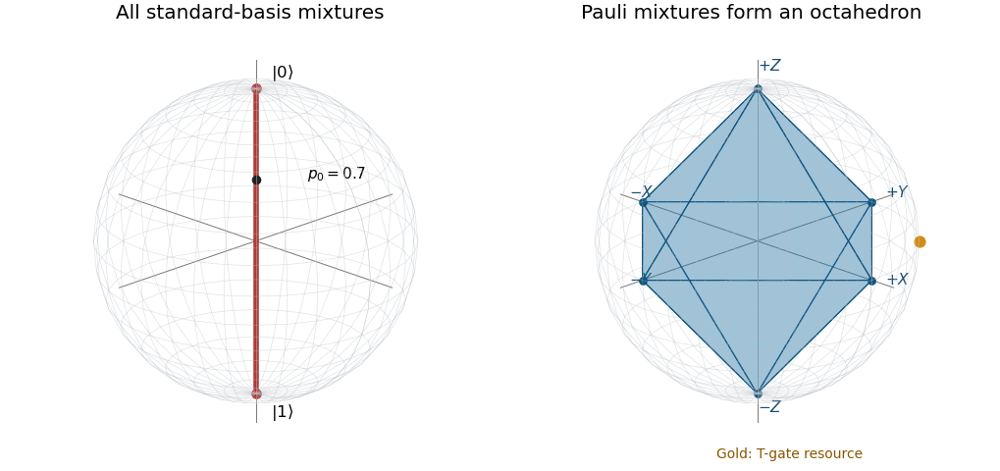

<h1 id="1/b/solution">Solution</h1>

↑ **Parent:** [B](../b.md)

The six [Pauli eigenstates](../../../../pauli-eigenstate.md) have [Bloch vectors](../../../../bloch-vector.md) $\pm\mathbf e_x$, $\pm\mathbf e_y$, $\pm\mathbf e_z$:

$$
\begin{aligned}
X:&\quad |\pm\rangle=(|0\rangle\pm|1\rangle)/\sqrt2,\\
Y:&\quad |\pm i\rangle=(|0\rangle\pm i|1\rangle)/\sqrt2,\\
Z:&\quad |0\rangle,\ |1\rangle.
\end{aligned}
$$

Classical [convex combinations](../../../../convex-combination.md) of [density operators](../../../../density-matrix-split.md) produce the corresponding [convex combinations](../../../../convex-combination.md) of their [Bloch vectors](../../../../bloch-vector.md). Their [convex hull](../../../../convex-hull.md) is the [stabilizer octahedron](../../../../stabilizer-octahedron.md):

$$
\boxed{|s_x|+|s_y|+|s_z|\leq1.}
$$

The six vertices are pure Pauli states; the faces and interior represent their mixtures. To verify the reverse inclusion, give the vertex in the sign of each coordinate weight $|s_j|$ and use the leftover weight at the origin, itself the equal mixture of either opposite pair.

**[Figure 1](#1/b/image-the-standard-basis-mixture-diameter-and-the-stabilizer-octahedron-inside-the-bloch-ball). The standard-basis mixture diameter and the stabilizer octahedron inside the Bloch ball**. The red diameter shows all mixtures of $|0\rangle$ and $|1\rangle$. The six Pauli vertices generate the blue octahedron. The gold point is the T-gate resource state: it lies on the Bloch sphere but outside this octahedron.

## ↑ Ancestors (12)

1. [B](../b.md)
2. [1](../../1.md)
3. [2021](../../../2021-split.md)
4. [Past exam of the introduction to quantum information course of the University of Oxford](../../../split.md)
5. [Introduction to quantum information course of the University of Oxford](../../../../introduction-to-quantum-information-course-of-the-university-of-oxford.md)
6. [Year 4 of the mathematics course of the University of Oxford](../../../../year-4-of-the-mathematics-course-of-the-university-of-oxford.md)
7. [Mathematics course of the University of Oxford](../../../../mathematics-course-of-the-university-of-oxford.md)
8. [Undergraduate course of the University of Oxford](../../../../undergraduate-course-of-the-university-of-oxford.md)
9. [Course of the University of Oxford](../../../../course-of-the-university-of-oxford.md)
10. [University of Oxford](../../../../university-of-oxford-split.md)
11. [List of universities](../../../../list-of-universities.md)
12. [Codex Wiki](../../../../split.md)
