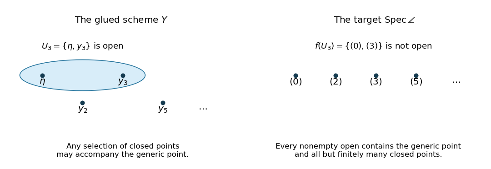

# 2021

↑ **Parent:** [Past exam of the introduction to schemes course of the University of Oxford](../past-exam-of-the-introduction-to-schemes-course-of-the-university-of-oxford.md)

Solutions to all three questions of the [Introduction to schemes course of the University of Oxford](../university-of-oxford.md#introduction-to-schemes-course-of-the-university-of-oxford), Part C, sat on 1 June 2021. Source: [Oxford's released examination PDF, compilation pages 103–106; paper pages 1–4](https://www.whatdotheyknow.com/request/oxford_physics_past_papers_2/response/2340696/attach/9/Physics%20Papers%202020.pdf?cookie_passthrough=1#page=103). The original question and letter labels are retained; the paper has no Roman subparts. The correction to the printed closed-subset description in 1(b), and the meaning of the comparison of [structure sheaves](../locally-ringed-space.md#structure-sheaf-of-a-scheme) in 1(c), are explained where they arise.

**Table of contents**

- [1](#1)
  - [a](#1/a)
    - [Solution](#1/a/solution)
  - [b](#1/b)
    - [Solution](#1/b/solution)
  - [c](#1/c)
    - [Solution](#1/c/solution)
- [2](#2)
  - [a](#2/a)
    - [Solution](#2/a/solution)
  - [b](#2/b)
    - [Solution](#2/b/solution)
  - [c](#2/c)
    - [Solution](#2/c/solution)
- [3](#3)
  - [a](#3/a)
    - [Solution](#3/a/solution)
  - [b](#3/b)
    - [Solution](#3/b/solution)
  - [c](#3/c)
    - [Solution](#3/c/solution)

## 1

↑ **Parent:** [2021](2021.md)

<h3 id="1/a">a</h3>

↑ **Parent:** [1](#1)

<h4 id="1/a/solution">Solution</h4>

↑ **Parent:** [A](#1/a)

Let $X=\operatorname{Spec}R$ be an [affine scheme](../locally-ringed-space.md#affine-scheme), and let $(U_\lambda)_{\lambda\in\Lambda}$ be an [open cover](../topology.md#open-cover). Write each complement as a [Zariski closed](../algebraic-geometry.md#zariski-closed-set) subset $X\setminus U_\lambda=V(I_\lambda)$ for an [ideal](../commutative-algebra.md#ideal) $I_\lambda\subseteq R$. The intersection rule for [Zariski closed](../algebraic-geometry.md#zariski-closed-set) subsets gives

$$
\varnothing=\bigcap_{\lambda\in\Lambda}V(I_\lambda)
=V\!\left(\sum_{\lambda\in\Lambda}I_\lambda\right).
$$

A proper [ideal](../commutative-algebra.md#ideal) lies in a [maximal ideal](../commutative-algebra.md#maximal-ideal), which is a [prime ideal](../commutative-algebra.md#prime-ideal); consequently $V(J)=\varnothing$ forces $J=R$. Thus $1\in\sum_\lambda I_\lambda$. By the definition of a sum of [ideals](../commutative-algebra.md#ideal), this membership is witnessed by finitely many elements:

$$
1=a_1+\cdots+a_r,\qquad a_j\in I_{\lambda_j}.
$$

Hence $\sum_{j=1}^r I_{\lambda_j}=R$, so $\bigcap_{j=1}^r V(I_{\lambda_j})=\varnothing$, and therefore $X=\bigcup_{j=1}^r U_{\lambda_j}$. If $R$ is the [zero ring](../commutative-algebra.md#zero-ring), $X$ is empty and the empty subcover suffices. This proves

$$
\boxed{\text{Every affine scheme is quasi-compact}.}
$$

The proof uses only complements, the intersection rule for [Zariski closed](../algebraic-geometry.md#zariski-closed-set) subsets, and the finite expression of an element in a sum of [ideals](../commutative-algebra.md#ideal).

<h3 id="1/b">b</h3>

↑ **Parent:** [1](#1)

<h4 id="1/b/solution">Solution</h4>

↑ **Parent:** [B](#1/b)

**The quotient.** Evaluation $\mathbb Z[t]\to\mathbb Z[i]$, $t\mapsto i$, is a surjective [ring homomorphism](../commutative-algebra.md#ring-homomorphism) whose [kernel of a ring homomorphism](../commutative-algebra.md#kernel-of-a-ring-homomorphism) is $(t^2+1)$. Indeed, division by this [monic polynomial](../polynomial.md#monic-polynomial) leaves a remainder $a+bt$, and $a+bi=0$ for $a,b\in\mathbb Z$ forces $a=b=0$. Taking the further [quotient ring](../commutative-algebra.md#quotient-ring) modulo $p$ gives the explicit [isomorphism](../algebra.md#isomorphism)

$$
\boxed{\mathbb F_p[t]/(t^2+1)\xrightarrow{\ \sim\ }\mathbb Z[i]/(p),\qquad \overline t\longmapsto\overline i.}
$$

**All fibers, including the generic fiber.** For a point $s\in\operatorname{Spec}\mathbb Z$ with [residue field](../commutative-algebra.md#residue-field) $\kappa(s)$, its [scheme-theoretic fiber](../algebraic-variety.md#scheme-theoretic-fiber) is

$$
X_s=\operatorname{Spec}\bigl(\mathbb Z[i]\otimes_{\mathbb Z}\kappa(s)\bigr).
$$

At the [generic point](../algebraic-geometry.md#generic-point) $s=(0)$, the [residue field](../commutative-algebra.md#residue-field) is $\mathbb Q$, and $t^2+1$ is an [irreducible polynomial](../polynomial.md#irreducible-polynomial) over $\mathbb Q$, so $X_{(0)}=\operatorname{Spec}\mathbb Q(i)$. For a [closed point](../topology.md#closed-point) $(p)$ the [residue field](../commutative-algebra.md#residue-field) is $\mathbb F_p$. The permitted criterion for a square root of $-1$ gives three cases. If $p\equiv1\pmod4$, choose $a\in\mathbb F_p$ with $a^2=-1$; the two roots $a,-a$ are distinct, so the [Chinese remainder theorem](../mathematics.md#chinese-remainder-theorem) gives $\mathbb F_p[t]/(t^2+1)\cong\mathbb F_p\times\mathbb F_p$. If $p\equiv3\pmod4$, the quadratic has no root and is an [irreducible polynomial](../polynomial.md#irreducible-polynomial), giving the [finite field](../algebra.md#finite-field) $\mathbb F_{p^2}$. Finally, in [characteristic](../algebra.md#characteristic-of-a-field) two, $t^2+1=(t+1)^2$; setting $\epsilon=t+1$ gives the [dual numbers](../commutative-algebra.md#dual-number). Thus

$$
\boxed{X_s\cong\begin{cases}
\operatorname{Spec}\mathbb Q(i),&s=(0),\\
\operatorname{Spec}\mathbb F_p\ \amalg\ \operatorname{Spec}\mathbb F_p,&s=(p),\ p\equiv1\pmod4,\\
\operatorname{Spec}\mathbb F_{p^2},&s=(p),\ p\equiv3\pmod4,\\
\operatorname{Spec}\bigl(\mathbb F_2[\epsilon]/(\epsilon^2)\bigr),&s=(2).
\end{cases}}
$$

The split [scheme-theoretic fiber](../algebraic-variety.md#scheme-theoretic-fiber) has two [closed points](../topology.md#closed-point), represented by $(p,i-a)$ and $(p,i+a)$. The inert [scheme-theoretic fiber](../algebraic-variety.md#scheme-theoretic-fiber) has one [closed point](../topology.md#closed-point), represented by $(p)$. The [scheme-theoretic fiber](../algebraic-variety.md#scheme-theoretic-fiber) over $(2)$ has one [closed point](../topology.md#closed-point), represented by $(1+i)$, but is a [nonreduced scheme](../locally-ringed-space.md#nonreduced-scheme): its nonzero element $\epsilon$ is [nilpotent](../commutative-algebra.md#nilpotent). These descriptions retain the [residue fields](../commutative-algebra.md#residue-field) and the [nilpotent](../commutative-algebra.md#nilpotent) structure, which a count of points alone would lose.

**The topology.** The printed PDF says that the nonempty proper [Zariski closed](../algebraic-geometry.md#zariski-closed-set) subsets are finite subsets of $\mathbb Z[i]\setminus\{0\}$. Its points are [prime ideals](../commutative-algebra.md#prime-ideal), so the intended set is $\operatorname{Spec}\mathbb Z[i]\setminus\{(0)\}$.

Put $R=\mathbb Z[i]$. Since $R$ is a [principal ideal domain](../commutative-algebra.md#principal-ideal-domain), every nonzero [prime ideal](../commutative-algebra.md#prime-ideal) is a [maximal ideal](../commutative-algebra.md#maximal-ideal). Each such [prime ideal](../commutative-algebra.md#prime-ideal) contains a nonzero [Gaussian integer](../commutative-algebra.md#gaussian-integer) $z$, and therefore contains the positive integer $z\overline z$. Its contraction to $\mathbb Z$ is consequently a nonzero [prime ideal](../commutative-algebra.md#prime-ideal) $(p)$, so the [scheme-theoretic fibers](../algebraic-variety.md#scheme-theoretic-fiber) just computed list all the [closed points](../topology.md#closed-point) of $X$. The sole remaining point is the [generic point](../algebraic-geometry.md#generic-point) $(0)$.

Every proper [Zariski closed](../algebraic-geometry.md#zariski-closed-set) subset is $V((a))$ with $a\ne0$: if its defining [ideal](../commutative-algebra.md#ideal) were zero, it would be all of $X$. A nonzero nonunit $a$ has a finite [unique factorization](../algebra.md#unique-factorization-in-an-integral-domain)

$$
a=u\pi_1^{e_1}\cdots\pi_r^{e_r},\qquad
V((a))=\{(\pi_1),\ldots,(\pi_r)\}.
$$

Here the $\pi_j$ are pairwise nonassociate [prime elements](../commutative-algebra.md#prime-element). Conversely, any finite set of nonzero [prime ideals](../commutative-algebra.md#prime-ideal) $\{(\pi_1),\ldots,(\pi_r)\}$ equals $V((\pi_1\cdots\pi_r))$; the empty set is $V((1))$. Therefore

$$
\boxed{\begin{gathered}
X=\{(0)\}\ \cup\ \{\text{nonzero prime ideals of }\mathbb Z[i]\},\\
\text{proper closed subsets of }X=\text{finite subsets of its closed points}.
\end{gathered}}
$$

In particular, the closure of the [generic point](../algebraic-geometry.md#generic-point) is $X$, and every nonempty [open subset](../topology.md#open-set) contains that [generic point](../algebraic-geometry.md#generic-point) and all but finitely many [closed points](../topology.md#closed-point).

**A nonidentity automorphism.** [Complex conjugation](../complex-analysis.md#complex-conjugation)

$$
c:R\longrightarrow R,\qquad a+bi\longmapsto a-bi,
$$

is a [ring automorphism](../commutative-algebra.md#ring-automorphism) fixing $\mathbb Z$. It induces the [automorphism](../algebra.md#automorphism) $\sigma=\operatorname{Spec}(c)$ over $\operatorname{Spec}\mathbb Z$. Since $c(i)=-i\ne i$, this is not the identity [morphism of schemes](../locally-ringed-space.md#morphism-of-schemes). On the [generic fiber](../locally-ringed-space.md#generic-fiber) it is the nontrivial [field automorphism](../galois-theory.md#field-automorphism) of $\mathbb Q(i)/\mathbb Q$. On a split [scheme-theoretic fiber](../algebraic-variety.md#scheme-theoretic-fiber) it swaps the two [closed points](../topology.md#closed-point), since $i-a$ maps to $-(i+a)$. On an inert [scheme-theoretic fiber](../algebraic-variety.md#scheme-theoretic-fiber) it fixes the only point but induces the nonidentity [finite-field Frobenius automorphism](../algebra.md#finite-field-frobenius-automorphism) $z\mapsto z^p$ on its [residue field](../commutative-algebra.md#residue-field), because $i^p=-i$. On the [scheme-theoretic fiber](../algebraic-variety.md#scheme-theoretic-fiber) over $(2)$ it is the identity on the entire [scheme](../locally-ringed-space.md#scheme): $-i=i$ in $R/(2)$, so $\epsilon=i+1$ is fixed. Thus

$$
\boxed{\sigma:\quad\text{generic conjugation; split points exchanged; inert Frobenius; identity over }2.}
$$

<h3 id="1/c">c</h3>

↑ **Parent:** [1](#1)

<h4 id="1/c/solution">Solution</h4>

↑ **Parent:** [C](#1/c)

**The immersions and gluing.** For $p>0$, the [prime ideals](../commutative-algebra.md#prime-ideal) of the [localization](../commutative-algebra.md#localization-of-a-ring) $\mathbb Z_{(p)}$ are $(0)$ and $(p)\mathbb Z_{(p)}$. Inverting $p$ gives $\mathbb Z_{(p)}[1/p]=\mathbb Q$, so

$$
\boxed{\psi_p:\operatorname{Spec}\mathbb Q\xrightarrow{\ \sim\ }D(p)\hookrightarrow U_p}
$$

is an [open immersion](../locally-ringed-space.md#open-immersion) sending the [generic point](../algebraic-geometry.md#generic-point) to the [generic point](../algebraic-geometry.md#generic-point). For $p=0$, $\mathbb Z_{(0)}=\mathbb Q$, and take $\psi_0$ to be the identity. Identify each pair of these [open subschemes](../locally-ringed-space.md#open-subscheme) using the identity of $\operatorname{Spec}\mathbb Q$. The identities compose to the identity on every triple overlap, so [gluing of schemes along open subschemes](../locally-ringed-space.md#gluing-of-schemes-along-open-subschemes) applies. No finiteness of the family is required.

The resulting [scheme](../locally-ringed-space.md#scheme) $Y$ has one common [generic point](../algebraic-geometry.md#generic-point) $\eta$ and a distinct [closed point](../topology.md#closed-point) $y_p$ for every positive [prime number](../prime-number.md) $p$. Its [affine open subschemes](../locally-ringed-space.md#affine-open-subscheme) $U_p=\{\eta,y_p\}$, for $p>0$, intersect pairwise in $U_0=\{\eta\}$. A subset $W\subseteq Y$ is open precisely when its intersection with every $U_p$ is open. In the two-point [topological space](../topology.md#topological-space) $U_p$, the open subsets are $\varnothing$, $\{\eta\}$ and $U_p$. Consequently

$$
\boxed{\text{The nonempty opens of }Y\text{ are exactly }W_S=\{\eta\}\cup\{y_p:p\in S\},}
$$

where $S$ is any subset of the positive [prime numbers](../prime-number.md), including the empty subset.

**The canonical morphism.** The [ring homomorphisms](../commutative-algebra.md#ring-homomorphism) $\mathbb Z\to\mathbb Z_{(p)}$ give [morphisms of schemes](../locally-ringed-space.md#morphism-of-schemes) $U_p\to\operatorname{Spec}\mathbb Z$ agreeing on the overlaps, hence a [morphism of schemes](../locally-ringed-space.md#morphism-of-schemes) $f:Y\to\operatorname{Spec}\mathbb Z$. By uniqueness of the [structure morphism](../locally-ringed-space.md#structure-morphism), this is the required map. Contraction of [prime ideals](../commutative-algebra.md#prime-ideal) gives

$$
\boxed{f(\eta)=(0),\qquad f(y_p)=(p).}
$$

These are all points of $\operatorname{Spec}\mathbb Z$, each exactly once, so $f$ is a [bijection](../function.md#bijection). It is continuous because its restrictions to the [open cover](../topology.md#open-cover) $(U_p)$ are continuous; explicitly, every nonempty [open subset](../topology.md#open-set) of $\operatorname{Spec}\mathbb Z$ is the complement of a finite collection of [closed points](../topology.md#closed-point), whose inverse image is one of the $W_S$.

**Sections on every open.** For any $S$, the [sheaf gluing axiom](../algebraic-geometry.md#sheaf-gluing-axiom) on the cover of $W_S$ by $U_0$ and the $U_p$ with $p\in S$ identifies

$$
\boxed{\Gamma(W_S,\mathcal O_Y)=\bigcap_{p\in S}\mathbb Z_{(p)}\ \subseteq\mathbb Q,}
$$

where the intersection over the empty set is $\mathbb Q$. Indeed, a section on $U_p$ is an element of $\mathbb Z_{(p)}$; restrictions to every overlap are its inclusion into $\mathbb Q$. Compatibility means that all these elements are the same rational number. In lowest terms $a/b$, this rational number lies in the intersection exactly when no [prime number](../prime-number.md) in $S$ divides $b$. Equivalently, this is the [integer localization at a set of primes](../commutative-algebra.md#integer-localization-at-a-set-of-primes) obtained by inverting all positive [prime numbers](../prime-number.md) outside $S$.

Now let $V\subseteq\operatorname{Spec}\mathbb Z$ be nonempty and open. Its finite complement consists of $(p_1),\ldots,(p_r)$; put $N=p_1\cdots p_r$, with $N=1$ for an empty complement. Then $V=D(N)$ and

$$
\Gamma(V,\mathcal O_{\operatorname{Spec}\mathbb Z})=\mathbb Z[1/N]
=\bigcap_{p\nmid N}\mathbb Z_{(p)}
=\Gamma(f^{-1}V,\mathcal O_Y).
$$

The equality follows by the denominator criterion above. The map $f^\#$ is this same equality of subrings of $\mathbb Q$, so it is a [ring isomorphism](../algebra.md#ring-isomorphism). Over the empty [open subset](../topology.md#open-set) both rings of sections are the [zero ring](../commutative-algebra.md#zero-ring). These identifications respect every restriction map. Thus the precise comparison of [structure sheaves](../locally-ringed-space.md#structure-sheaf-of-a-scheme) is

$$
\boxed{\mathcal O_{\operatorname{Spec}\mathbb Z}\xrightarrow{\ \sim\ }f_*\mathcal O_Y.}
$$

Here “over every open set” refers to an [open subset](../topology.md#open-set) $V$ of the target and its inverse image. The preceding intersection formula additionally describes the sections on every [open subset](../topology.md#open-set) of $Y$, including ones whose images are not open in the target.

**Topology and finiteness.** The singleton $\{\eta\}=U_0$ is open in $Y$, but $\{(0)\}$ is not open in $\operatorname{Spec}\mathbb Z$: a nonempty [open subset](../topology.md#open-set) there contains all but finitely many of the infinitely many [closed points](../topology.md#closed-point). Therefore $f$ is not a [homeomorphism](../topology.md#homeomorphism), despite being a continuous [bijection](../function.md#bijection) and giving the indicated [isomorphism](../algebra.md#isomorphism) of [structure sheaves](../locally-ringed-space.md#structure-sheaf-of-a-scheme) after [direct image](../sheaf-of-modules.md#direct-image-sheaf).

The [open cover](../topology.md#open-cover) $(U_p)_{p>0}$ of $Y$ has no finite subcover, because $y_q$ belongs only to $U_q$. Thus $Y$ is not a [quasi-compact scheme](../locally-ringed-space.md#quasi-compact-scheme), and part (a) rules out an [affine scheme](../locally-ringed-space.md#affine-scheme). Each $\mathbb Z_{(p)}$ is a [Noetherian ring](../algebra.md#noetherian-ring), being a [localization](../commutative-algebra.md#localization-of-a-ring) of the [Noetherian ring](../algebra.md#noetherian-ring) $\mathbb Z$. Hence the $U_p$ form an [affine open cover](../topology.md#affine-open-cover) by spectra of [Noetherian rings](../algebra.md#noetherian-ring), proving that $Y$ is a [locally Noetherian scheme](../locally-ringed-space.md#locally-noetherian-scheme). A [Noetherian scheme](../locally-ringed-space.md#noetherian-scheme) is a [quasi-compact scheme](../locally-ringed-space.md#quasi-compact-scheme), so

$$
\boxed{Y\text{ is locally Noetherian, not quasi-compact, not affine, and not Noetherian}.}
$$

**[Figure 1](#1/c/image-gluing-the-local-spectra-retains-every-closed-point-but-permits-more-open-subsets). Gluing the local spectra retains every closed point but permits more open subsets**.

## 2

↑ **Parent:** [2021](2021.md)

<h3 id="2/a">a</h3>

↑ **Parent:** [2](#2)

<h4 id="2/a/solution">Solution</h4>

↑ **Parent:** [A](#2/a)

**Constructing the subsheaf.** On an [integral scheme](../locally-ringed-space.md#integral-scheme), every nonempty [open subset](../topology.md#open-set) is an [irreducible topological space](../algebraic-geometry.md#irreducible-topological-space) and hence a [connected space](../geometry-and-topology.md#connected-space). A [locally constant function](../calculus.md#locally-constant-function) from such an [open subset](../topology.md#open-set) to $F$ is constant. Thus the [constant sheaf](../algebraic-geometry.md#constant-sheaf) $\underline F$ has sections $F$ on every nonempty [open subset](../topology.md#open-set), and the [structure sheaf](../locally-ringed-space.md#structure-sheaf-of-a-scheme) embeds in it by restriction to the [generic point](../algebraic-geometry.md#generic-point). Empty members of the given [open cover](../topology.md#open-cover) may be discarded.

For every [open subset](../topology.md#open-set) $W\subseteq X$, define

$$
\mathcal L(W)=\{s\in\underline F(W):\ f_i s|_{W\cap U_i}\in\mathcal O_X(W\cap U_i)\text{ for every }i\}.
$$

This is a subsheaf of the [sheaf of modules](../sheaf-of-modules.md) $\underline F$: its condition is local, and compatible sections glue in $\underline F$, with the regularity conditions gluing in $\mathcal O_X$. On $U_i\cap U_j$, the hypothesis says that $f_j/f_i$ is a section of the [sheaf of units of the structure sheaf](../locally-ringed-space.md#sheaf-of-units-of-the-structure-sheaf). Therefore multiplication by it preserves $\mathcal O_X$, and

$$
f_i^{-1}\mathcal O_X|_{U_i\cap U_j}=f_j^{-1}\mathcal O_X|_{U_i\cap U_j}.
$$

It follows that $\mathcal L|_{U_i}=f_i^{-1}\mathcal O_{U_i}$: the condition with index $i$ implies every other condition on an overlap, and the converse is part of the definition. Multiplication by $1/f_i$ is an [isomorphism](../algebra.md#isomorphism) $\mathcal O_{U_i}\to\mathcal L|_{U_i}$, with inverse multiplication by $f_i$. Hence $\mathcal L$ is an [invertible sheaf](../sheaf-of-modules.md#line-bundle), or equivalently a [line bundle](../sheaf-of-modules.md#line-bundle), and

$$
\boxed{\mathcal L(U_i)=\mathcal O_X(U_i)\cdot\frac1{f_i}\subseteq F.}
$$

These local descriptions also give uniqueness as a subsheaf of $\underline F$. This construction is the [divisor line bundle](../cartier-divisor.md#divisor-line-bundle) for the local rational equations $f_i$.

**The tensor product.** Refine the two [open covers](../topology.md#open-cover) to $W_{ij}=U_i\cap V_j$. The ratios

$$
\frac{f_i g_j}{f_{i'}g_{j'}}=\frac{f_i}{f_{i'}}\frac{g_j}{g_{j'}}
$$

are sections of the [sheaf of units of the structure sheaf](../locally-ringed-space.md#sheaf-of-units-of-the-structure-sheaf) on the corresponding overlaps, so the products give a [line bundle](../sheaf-of-modules.md#line-bundle) $\mathcal M\subseteq\underline F$ by the construction just proved. Multiplication in $F$ defines a [sheaf morphism](../algebraic-geometry.md#morphism-of-sheaves)

$$
\mathcal L\otimes_{\mathcal O_X}\mathcal L'\longrightarrow\mathcal M.
$$

On each $W_{ij}$ it sends the local generator $(1/f_i)\otimes(1/g_j)$ to the local generator $1/(f_i g_j)$. It is thus an [isomorphism](../algebra.md#isomorphism) on an [open cover](../topology.md#open-cover), and hence an [isomorphism](../algebra.md#isomorphism) globally. In particular,

$$
\boxed{(U_i\cap V_j,f_i g_j)\text{ represents }\mathcal L\otimes_{\mathcal O_X}\mathcal L'.}
$$

**The sign for projective twists.** Write [homogeneous coordinates](../projective-space.md#homogeneous-coordinate) $[x_0:\cdots:x_n]$ on [projective space](../projective-space.md) $\mathbb P^n_{\mathbb Z}$, and let $U_i=D_+(x_i)$ be its standard [affine open cover](../topology.md#affine-open-cover). For any [integer](../integer.md) $m$, take the nonzero elements of the [function field](../algebraic-variety.md#function-field-of-an-algebraic-variety)

$$
\boxed{f_i=\left(\frac{x_0}{x_i}\right)^m\in\mathbb Q(x_1/x_0,\ldots,x_n/x_0)^*,\qquad 0\leq i\leq n.}
$$

Their ratios are $f_i/f_j=(x_j/x_i)^m$, which are sections of the [sheaf of units of the structure sheaf](../locally-ringed-space.md#sheaf-of-units-of-the-structure-sheaf) on $U_i\cap U_j$, including when $m<0$. The [twisting sheaf on projective space](../sheaf-of-modules.md#twisting-sheaf-on-projective-space) $\mathcal O(m)$ has local generator $x_i^m$ on $U_i$. Divide a rational section of $\mathcal O(m)$ by $x_0^m$ to embed it in the [constant sheaf](../algebraic-geometry.md#constant-sheaf) of the [function field](../algebraic-variety.md#function-field-of-an-algebraic-variety); the local generator becomes $(x_i/x_0)^m=1/f_i$. This identifies the constructed [line bundle](../sheaf-of-modules.md#line-bundle) with $\mathcal O(m)$ and fixes the sign explicitly.

For $n\geq1$, $\operatorname{Pic}(\mathbb P^n_{\mathbb Z})\cong\mathbb Z$, with generator $[\mathcal O(1)]$; the displayed data gives all its powers, with $\mathcal O(m)\otimes\mathcal O(r)\cong\mathcal O(m+r)$ by the product rule above. If $n=0$, [projective space](../projective-space.md) is $\operatorname{Spec}\mathbb Z$, its [Picard group](../sheaf-of-modules.md#picard-group) is zero, and the same formula gives only the trivial [line bundle](../sheaf-of-modules.md#line-bundle).

<h3 id="2/b">b</h3>

↑ **Parent:** [2](#2)

<h4 id="2/b/solution">Solution</h4>

↑ **Parent:** [B](#2/b)

Discard empty members of the [open cover](../topology.md#open-cover): every [Čech cochain group](../sheaf-of-modules.md#cech-cochain-group) factor supported on an empty intersection is the zero [abelian group](../group.md#abelian-group), so this changes no [Čech cohomology](../sheaf-of-modules.md#cech-cohomology). Every remaining member is the one-point space $X$; the index set is nonempty even if the same [open subset](../topology.md#open-set) is listed repeatedly. Choose a [well-order](../set.md#well-order) with least index $\alpha$. Use the [ordered Čech cochain complex](../sheaf-of-modules.md#ordered-cech-cochain-complex) permitted in the question:

$$
C^q=\prod_{i_0<\cdots<i_q} A,\qquad
(\delta s)_{i_0\cdots i_{q+1}}=\sum_{r=0}^{q+1}(-1)^r s_{i_0\cdots\widehat{i_r}\cdots i_{q+1}}.
$$

All restriction maps are identities. For $q\geq1$ define a [cochain homotopy](../homology.md#cochain-homotopy) $h_q:C^q\to C^{q-1}$ by

$$
(h_qs)_{i_0\cdots i_{q-1}}=
\begin{cases}
0,&i_0=\alpha,\\
s_{\alpha i_0\cdots i_{q-1}},&i_0>\alpha.
\end{cases}
$$

We verify $\delta h_q+h_{q+1}\delta=\operatorname{id}_{C^q}$ for every $q\geq1$. Fix $I=(i_0<\cdots<i_q)$. If $i_0=\alpha$, then $(h_{q+1}\delta s)_I=0$. In $(\delta h_qs)_I$, the term deleting $i_0$ is $s_I$ and every other term is zero because its retained first index is $\alpha$. Thus the identity holds on $I$.

If $i_0>\alpha$, then

$$
(\delta h_qs)_I=\sum_{r=0}^q(-1)^r s_{\alpha,I\setminus i_r},\qquad
(h_{q+1}\delta s)_I=(\delta s)_{\alpha,I}
=s_I-\sum_{r=0}^q(-1)^r s_{\alpha,I\setminus i_r}.
$$

Adding proves the identity in this case also. Each formula uses only finitely many terms on each component, so it remains valid for an infinite [open cover](../topology.md#open-cover) and arbitrary [abelian group](../group.md#abelian-group) $A$.

If $s\in C^q$ is a [Čech cocycle](../sheaf-of-modules.md#cech-cocycle-condition), then $\delta s=0$, and the identity gives $s=\delta(h_qs)$: every [Čech cocycle](../sheaf-of-modules.md#cech-cocycle-condition) in positive degree is a [Čech coboundary](../sheaf-of-modules.md#cech-coboundary). Therefore, using the permitted comparison with ordered [Čech cohomology](../sheaf-of-modules.md#cech-cohomology),

$$
\boxed{\check H^q_{\mathcal U}(X,\underline A)=0\qquad(q\geq1).}
$$

The identity is asserted in positive degrees; degree zero has $H^0\cong A$, so an unaugmented contraction to zero in every degree would be incorrect.

<h3 id="2/c">c</h3>

↑ **Parent:** [2](#2)

<h4 id="2/c/solution">Solution</h4>

↑ **Parent:** [C](#2/c)

In an [irreducible topological space](../algebraic-geometry.md#irreducible-topological-space), any two nonempty [open subsets](../topology.md#open-set) intersect. Let $W\subseteq X$ be a nonempty [open subset](../topology.md#open-set). Two nonempty subsets open in $W$ are also open in $X$, and hence intersect; thus $W$ is itself an [irreducible topological space](../algebraic-geometry.md#irreducible-topological-space). If $W$ were disconnected, a separation into two disjoint nonempty [open subsets](../topology.md#open-set) would contradict this intersection property. Hence $W$ is a [connected space](../geometry-and-topology.md#connected-space). The empty [open subset](../topology.md#open-set) is connected as well under the usual convention.

Discard empty members of $\mathcal U$ as in (b). Every finite intersection $U_{i_0}\cap\cdots\cap U_{i_q}$ is nonempty by repeated use of the intersection property and is an [open subset](../topology.md#open-set), hence a [connected space](../geometry-and-topology.md#connected-space). A [locally constant function](../calculus.md#locally-constant-function) on this intersection is constant. It follows that the [constant sheaf](../algebraic-geometry.md#constant-sheaf) has

$$
\underline A(U_{i_0}\cap\cdots\cap U_{i_q})\cong A,
$$

and every restriction map between these nonempty intersections is the identity on $A$. The whole [Čech cochain complex](../sheaf-of-modules.md#cech-cochain-complex) is therefore the same as for the indexed [open cover](../topology.md#open-cover) of a point having the same index set. The [cochain homotopy](../homology.md#cochain-homotopy) constructed in (b) applies component by component and proves

$$
\boxed{\text{Every open subset of }X\text{ is connected},\qquad
\check H^q_{\mathcal U}(X,\underline A)=0\quad(q\geq1).}
$$

The argument concerns the [constant sheaf](../algebraic-geometry.md#constant-sheaf) of [locally constant functions](../calculus.md#locally-constant-function); arbitrary coefficient sheaves on an [irreducible topological space](../algebraic-geometry.md#irreducible-topological-space) need not have the same [Čech cohomology](../sheaf-of-modules.md#cech-cohomology).

## 3

↑ **Parent:** [2021](2021.md)

<h3 id="3/a">a</h3>

↑ **Parent:** [3](#3)

<h4 id="3/a/solution">Solution</h4>

↑ **Parent:** [A](#3/a)

Choose an [affine open subscheme](../locally-ringed-space.md#affine-open-subscheme) $V=\operatorname{Spec}A\subseteq Y$ containing $y$. Since $f$ is an [affine morphism](../locally-ringed-space.md#affine-morphism), $f^{-1}V=\operatorname{Spec}B$; by hypothesis $B$ is a [finitely generated module](../module-theory.md#finitely-generated-module) over $A$. If $\mathfrak m\subset A$ corresponds to the [closed point](../topology.md#closed-point) $y$, then $\kappa(y)=A/\mathfrak m$. The [scheme-theoretic fiber](../algebraic-variety.md#scheme-theoretic-fiber) is

$$
X_y=X\times_Y\operatorname{Spec}\kappa(y)
\cong\operatorname{Spec}\bigl(B\otimes_A\kappa(y)\bigr)
=\operatorname{Spec}(B/\mathfrak mB).
$$

If $b_1,\ldots,b_r$ generate the $A$-[module](../module-theory.md#module-mathematics) $B$, their images span the [algebra](../algebra.md) $B/\mathfrak mB$ as a [vector space](../vector-space.md) over $\kappa(y)$. It is therefore finite-dimensional. By the allowed fact about the [spectrum of a finite-dimensional commutative algebra](../algebra.md#spectrum-of-a-finite-dimensional-commutative-algebra), it has only finitely many [prime ideals](../commutative-algebra.md#prime-ideal). These are exactly the points of $X_y$, so

$$
\boxed{|f^{-1}(y)|=|\operatorname{Spec}(B/\mathfrak mB)|<\infty.}
$$

The points of the [scheme-theoretic fiber](../algebraic-variety.md#scheme-theoretic-fiber) correspond to the [prime ideals](../commutative-algebra.md#prime-ideal) of $B$ contracting to $\mathfrak m$, which explains the equality with the underlying set-theoretic [fiber](../function.md#fiber-of-a-function). An empty [fiber](../function.md#fiber-of-a-function) is allowed. In fact, replacing $A/\mathfrak m$ by $\kappa(y)$ gives the same finite-dimensional argument for every point, without requiring it to be a [closed point](../topology.md#closed-point).

<h3 id="3/b">b</h3>

↑ **Parent:** [3](#3)

<h4 id="3/b/solution">Solution</h4>

↑ **Parent:** [B](#3/b)

**Failure in general.** Let $f:\mathbb A^1_k=\operatorname{Spec}k[t]\to\operatorname{Spec}k$ be the [structure morphism](../locally-ringed-space.md#structure-morphism) and take the trivial [line bundle](../sheaf-of-modules.md#line-bundle) $\mathcal L=\mathcal O_{\mathbb A^1_k}$. The [polynomial ring](../commutative-algebra.md#polynomial-ring) $k[t]$ is a [Noetherian ring](../algebra.md#noetherian-ring), so this is a [coherent sheaf](../sheaf-of-modules.md#coherent-sheaf). Its [direct image](../sheaf-of-modules.md#direct-image-sheaf) on the one-point target has sections

$$
\Gamma(\operatorname{Spec}k,f_*\mathcal L)=k[t].
$$

A [coherent sheaf](../sheaf-of-modules.md#coherent-sheaf) on $\operatorname{Spec}k$ corresponds to a finite-dimensional [vector space](../vector-space.md) over $k$, whereas $1,t,t^2,\ldots$ are [linearly independent](../vector-space.md#linear-independence). Thus

$$
\boxed{f_*\mathcal O_{\mathbb A^1_k}\text{ is not coherent}.}
$$

**Quasi-coherence for the stated morphism.** Now let $f$ satisfy (a), and let $\mathcal F$ be a [quasi-coherent sheaf](../sheaf-of-modules.md#quasi-coherent-sheaf) on $X$. Over any [affine open subscheme](../locally-ringed-space.md#affine-open-subscheme) $V=\operatorname{Spec}A$ of $Y$, write $f^{-1}V=\operatorname{Spec}B$ and $\mathcal F|_{f^{-1}V}=\widetilde M$ for a $B$-[module](../module-theory.md#module-mathematics) $M$. Regard $M$ as an $A$-[module](../module-theory.md#module-mathematics) through the [ring homomorphism](../commutative-algebra.md#ring-homomorphism) $A\to B$. For $a\in A$,

$$
\Gamma(D(a),f_*\mathcal F)
=\Gamma\bigl(D(\varphi(a)),\widetilde M\bigr)
=M_{\varphi(a)}=M_a.
$$

The last two [localizations](../commutative-algebra.md#localization-of-a-ring) are identical: both invert the action of the same element on $M$. These identifications commute with restrictions, so on the basis of [principal open subsets](../locally-ringed-space.md#principal-open-subscheme) they identify $(f_*\mathcal F)|_V$ with the [affine module sheaf](../sheaf-of-modules.md#affine-module-sheaf) $\widetilde{{}_AM}$. Hence this [direct image](../sheaf-of-modules.md#direct-image-sheaf) is a [quasi-coherent sheaf](../sheaf-of-modules.md#quasi-coherent-sheaf) on each $V$, and therefore on $Y$. This part uses only that $f$ is an [affine morphism](../locally-ringed-space.md#affine-morphism).

**Coherence under the Noetherian hypotheses.** If $X,Y$ are [Noetherian schemes](../locally-ringed-space.md#noetherian-scheme) and $\mathcal F$ is a [coherent sheaf](../sheaf-of-modules.md#coherent-sheaf), then $M$ is a [finitely generated module](../module-theory.md#finitely-generated-module) over $B$. Choose generators $m_1,\ldots,m_s$ of $M$ over $B$, and generators $b_1,\ldots,b_r$ of $B$ over $A$, supplied by (a). Then the finite family

$$
\{b_jm_\ell:1\leq j\leq r,\ 1\leq\ell\leq s\}
$$

generates $M$ as an $A$-[module](../module-theory.md#module-mathematics): expand each coefficient of an expression $m=\sum_\ell c_\ell m_\ell$ in the $b_j$. Since $A$ is a [Noetherian ring](../algebra.md#noetherian-ring), the [affine module sheaf](../sheaf-of-modules.md#affine-module-sheaf) $\widetilde{{}_AM}$ is a [coherent sheaf](../sheaf-of-modules.md#coherent-sheaf). This holds on an [affine open cover](../topology.md#affine-open-cover) of $Y$, proving

$$
\boxed{f_*:\operatorname{QCoh}(X)\to\operatorname{QCoh}(Y),\qquad
f_*:\operatorname{Coh}(X)\to\operatorname{Coh}(Y)\text{ if }X,Y\text{ are Noetherian}.}
$$

<h3 id="3/c">c</h3>

↑ **Parent:** [3](#3)

<h4 id="3/c/solution">Solution</h4>

↑ **Parent:** [C](#3/c)

**The exact sequence and associated modules.** Put $A=k[x]$ and $\mathfrak m=(x)$. Evaluation at zero gives the [short exact sequence](../module-theory.md#short-exact-sequence) of $A$-[modules](../module-theory.md#module-mathematics)

$$
0\longrightarrow(x)\xrightarrow{\ j\ }A\xrightarrow{\ \operatorname{ev}_0\ }A/(x)=k\longrightarrow0.
$$

The [affine module sheaf](../sheaf-of-modules.md#affine-module-sheaf) associated to $(x)$ is the [ideal sheaf](../locally-ringed-space.md#ideal-sheaf-of-a-closed-subscheme) $\mathcal J$ of the [closed point](../topology.md#closed-point) $p$, and the one associated to $A$ is the [structure sheaf](../locally-ringed-space.md#structure-sheaf-of-a-scheme) $\mathcal O_{\mathbb A^1_k}$. To identify the third term, on a [principal open subset](../locally-ringed-space.md#principal-open-subscheme) $D(g)$,

$$
\Gamma(D(g),\widetilde k)=k_g
=\begin{cases}k,&g(0)\ne0,\\0,&g(0)=0,\end{cases}
$$

which equals $\Gamma(i^{-1}D(g),\mathcal O_p)$. The restrictions also agree, so $\widetilde k\cong i_*\mathcal O_p$. [Exactness of localization](../commutative-algebra.md#exactness-of-localization) proves that applying the [affine module sheaf](../sheaf-of-modules.md#affine-module-sheaf) construction to the module sequence remains exact: on every [stalk](../sheaf-of-modules.md#stalk-of-a-sheaf) the sequence is its [localization](../commutative-algebra.md#localization-of-a-ring). Thus

$$
\boxed{0\longrightarrow\mathcal J\longrightarrow\mathcal O_{\mathbb A^1_k}\longrightarrow i_*\mathcal O_p\longrightarrow0.}
$$

Each term is an [affine module sheaf](../sheaf-of-modules.md#affine-module-sheaf), hence a [quasi-coherent sheaf](../sheaf-of-modules.md#quasi-coherent-sheaf). In this example each is also a [coherent sheaf](../sheaf-of-modules.md#coherent-sheaf), since its defining [module](../module-theory.md#module-mathematics) is finitely generated over the [Noetherian ring](../algebra.md#noetherian-ring) $k[x]$.

**The failure of left exactness.** For an [affine module sheaf](../sheaf-of-modules.md#affine-module-sheaf) $\widetilde M$, the [pullback of a sheaf of modules](../sheaf-of-modules.md#pullback-of-a-sheaf-of-modules) along $i$ corresponds to the [tensor product of modules](../module-theory.md#tensor-product-of-modules) $k\otimes_A M$. In particular,

$$
i^*\mathcal J\ \leftrightarrow\ (x)\otimes_A A/(x)
\cong(x)/(x)^2\cong k,
\qquad
i^*\mathcal O_{\mathbb A^1_k}\ \leftrightarrow\ k.
$$

The first [vector space](../vector-space.md) is nonzero, with [basis](../vector-space.md#basis) the class of $x$. But $i^*j$ sends this class to the class of $x$ in $A/(x)$, which is zero. Thus $i^*j$ is the zero map $k\to k$, and is not injective. More explicitly, the pulled-back sequence is

$$
0\longrightarrow k\xrightarrow{\ 0\ }k\xrightarrow{\ \operatorname{id}\ }k\longrightarrow0,
$$

where exactness fails at its first copy of $k$. Thus $i^*$ is not a [left-exact functor](../functor.md#finite-limit-preserving-functor):

$$
\boxed{i^*\text{ is not a left-exact functor on sheaves of }\mathcal O_{\mathbb A^1_k}\text{-modules}.}
$$

Although $(x)$ is a [free module](../module-theory.md#free-module) over $A$ with one generator, its inclusion into $A$ becomes multiplication by $x$ after choosing its generator; the [tensor product of modules](../module-theory.md#tensor-product-of-modules) with $A/(x)$ kills that map. This makes explicit why local freeness of $\mathcal J$ does not preserve this injection under the given [pullback](../category.md#pullback-category-theory).

## ↑ Ancestors (9)

1. [Past exam of the introduction to schemes course of the University of Oxford](../past-exam-of-the-introduction-to-schemes-course-of-the-university-of-oxford.md)
2. [Introduction to schemes course of the University of Oxford](../university-of-oxford.md#introduction-to-schemes-course-of-the-university-of-oxford)
3. [Year 4 of the mathematics course of the University of Oxford](../university-of-oxford.md#year-4-of-the-mathematics-course-of-the-university-of-oxford)
4. [Mathematics course of the University of Oxford](../university-of-oxford.md#mathematics-course-of-the-university-of-oxford)
5. [Undergraduate course of the University of Oxford](../university-of-oxford.md#undergraduate-course-of-the-university-of-oxford)
6. [Course of the University of Oxford](../university-of-oxford.md#course-of-the-university-of-oxford)
7. [University of Oxford](../university-of-oxford.md)
8. [List of universities](../README.md#list-of-universities)
9. [Codex Wiki](../README.md)
