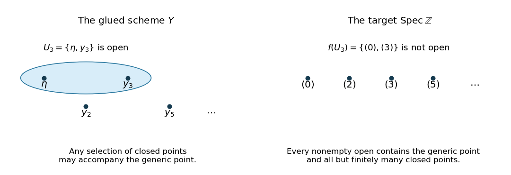

<h1 id="1/c/solution">Solution</h1>

↑ **Parent:** [C](../c.md)

**The immersions and gluing.** For $p>0$, the [prime ideals](../../../../prime-ideal.md) of the [localization](../../../../localization-of-a-ring.md) $\mathbb Z_{(p)}$ are $(0)$ and $(p)\mathbb Z_{(p)}$. Inverting $p$ gives $\mathbb Z_{(p)}[1/p]=\mathbb Q$, so

$$
\boxed{\psi_p:\operatorname{Spec}\mathbb Q\xrightarrow{\ \sim\ }D(p)\hookrightarrow U_p}
$$

is an [open immersion](../../../../open-immersion.md) sending the [generic point](../../../../generic-point.md) to the [generic point](../../../../generic-point.md). For $p=0$, $\mathbb Z_{(0)}=\mathbb Q$, and take $\psi_0$ to be the identity. Identify each pair of these [open subschemes](../../../../open-subscheme.md) using the identity of $\operatorname{Spec}\mathbb Q$. The identities compose to the identity on every triple overlap, so [gluing of schemes along open subschemes](../../../../gluing-of-schemes-along-open-subschemes.md) applies. No finiteness of the family is required.

The resulting [scheme](../../../../scheme.md) $Y$ has one common [generic point](../../../../generic-point.md) $\eta$ and a distinct [closed point](../../../../closed-point.md) $y_p$ for every positive [prime number](../../../../prime-number-split.md) $p$. Its [affine open subschemes](../../../../affine-open-subscheme.md) $U_p=\{\eta,y_p\}$, for $p>0$, intersect pairwise in $U_0=\{\eta\}$. A subset $W\subseteq Y$ is open precisely when its intersection with every $U_p$ is open. In the two-point [topological space](../../../../topological-space.md) $U_p$, the open subsets are $\varnothing$, $\{\eta\}$ and $U_p$. Consequently

$$
\boxed{\text{The nonempty opens of }Y\text{ are exactly }W_S=\{\eta\}\cup\{y_p:p\in S\},}
$$

where $S$ is any subset of the positive [prime numbers](../../../../prime-number-split.md), including the empty subset.

**The canonical morphism.** The [ring homomorphisms](../../../../ring-homomorphism.md) $\mathbb Z\to\mathbb Z_{(p)}$ give [morphisms of schemes](../../../../morphism-of-schemes.md) $U_p\to\operatorname{Spec}\mathbb Z$ agreeing on the overlaps, hence a [morphism of schemes](../../../../morphism-of-schemes.md) $f:Y\to\operatorname{Spec}\mathbb Z$. By uniqueness of the [structure morphism](../../../../structure-morphism.md), this is the required map. Contraction of [prime ideals](../../../../prime-ideal.md) gives

$$
\boxed{f(\eta)=(0),\qquad f(y_p)=(p).}
$$

These are all points of $\operatorname{Spec}\mathbb Z$, each exactly once, so $f$ is a [bijection](../../../../bijection.md). It is continuous because its restrictions to the [open cover](../../../../open-cover.md) $(U_p)$ are continuous; explicitly, every nonempty [open subset](../../../../open-set.md) of $\operatorname{Spec}\mathbb Z$ is the complement of a finite collection of [closed points](../../../../closed-point.md), whose inverse image is one of the $W_S$.

**Sections on every open.** For any $S$, the [sheaf gluing axiom](../../../../sheaf-gluing-axiom.md) on the cover of $W_S$ by $U_0$ and the $U_p$ with $p\in S$ identifies

$$
\boxed{\Gamma(W_S,\mathcal O_Y)=\bigcap_{p\in S}\mathbb Z_{(p)}\ \subseteq\mathbb Q,}
$$

where the intersection over the empty set is $\mathbb Q$. Indeed, a section on $U_p$ is an element of $\mathbb Z_{(p)}$; restrictions to every overlap are its inclusion into $\mathbb Q$. Compatibility means that all these elements are the same rational number. In lowest terms $a/b$, this rational number lies in the intersection exactly when no [prime number](../../../../prime-number-split.md) in $S$ divides $b$. Equivalently, this is the [integer localization at a set of primes](../../../../integer-localization-at-a-set-of-primes.md) obtained by inverting all positive [prime numbers](../../../../prime-number-split.md) outside $S$.

Now let $V\subseteq\operatorname{Spec}\mathbb Z$ be nonempty and open. Its finite complement consists of $(p_1),\ldots,(p_r)$; put $N=p_1\cdots p_r$, with $N=1$ for an empty complement. Then $V=D(N)$ and

$$
\Gamma(V,\mathcal O_{\operatorname{Spec}\mathbb Z})=\mathbb Z[1/N]
=\bigcap_{p\nmid N}\mathbb Z_{(p)}
=\Gamma(f^{-1}V,\mathcal O_Y).
$$

The equality follows by the denominator criterion above. The map $f^\#$ is this same equality of subrings of $\mathbb Q$, so it is a [ring isomorphism](../../../../ring-isomorphism.md). Over the empty [open subset](../../../../open-set.md) both rings of sections are the [zero ring](../../../../zero-ring.md). These identifications respect every restriction map. Thus the precise comparison of [structure sheaves](../../../../structure-sheaf-of-a-scheme.md) is

$$
\boxed{\mathcal O_{\operatorname{Spec}\mathbb Z}\xrightarrow{\ \sim\ }f_*\mathcal O_Y.}
$$

Here “over every open set” refers to an [open subset](../../../../open-set.md) $V$ of the target and its inverse image. The preceding intersection formula additionally describes the sections on every [open subset](../../../../open-set.md) of $Y$, including ones whose images are not open in the target.

**Topology and finiteness.** The singleton $\{\eta\}=U_0$ is open in $Y$, but $\{(0)\}$ is not open in $\operatorname{Spec}\mathbb Z$: a nonempty [open subset](../../../../open-set.md) there contains all but finitely many of the infinitely many [closed points](../../../../closed-point.md). Therefore $f$ is not a [homeomorphism](../../../../homeomorphism.md), despite being a continuous [bijection](../../../../bijection.md) and giving the indicated [isomorphism](../../../../isomorphism.md) of [structure sheaves](../../../../structure-sheaf-of-a-scheme.md) after [direct image](../../../../direct-image-sheaf.md).

The [open cover](../../../../open-cover.md) $(U_p)_{p>0}$ of $Y$ has no finite subcover, because $y_q$ belongs only to $U_q$. Thus $Y$ is not a [quasi-compact scheme](../../../../quasi-compact-scheme.md), and part (a) rules out an [affine scheme](../../../../affine-scheme.md). Each $\mathbb Z_{(p)}$ is a [Noetherian ring](../../../../noetherian-ring.md), being a [localization](../../../../localization-of-a-ring.md) of the [Noetherian ring](../../../../noetherian-ring.md) $\mathbb Z$. Hence the $U_p$ form an [affine open cover](../../../../affine-open-cover.md) by spectra of [Noetherian rings](../../../../noetherian-ring.md), proving that $Y$ is a [locally Noetherian scheme](../../../../locally-noetherian-scheme.md). A [Noetherian scheme](../../../../noetherian-scheme.md) is a [quasi-compact scheme](../../../../quasi-compact-scheme.md), so

$$
\boxed{Y\text{ is locally Noetherian, not quasi-compact, not affine, and not Noetherian}.}
$$

**[Figure 1](#1/c/image-gluing-the-local-spectra-retains-every-closed-point-but-permits-more-open-subsets). Gluing the local spectra retains every closed point but permits more open subsets**.

## ↑ Ancestors (12)

1. [C](../c.md)
2. [1](../../1.md)
3. [2021](../../../2021-split.md)
4. [Past exam of the introduction to schemes course of the University of Oxford](../../../split.md)
5. [Introduction to schemes course of the University of Oxford](../../../../introduction-to-schemes-course-of-the-university-of-oxford.md)
6. [Year 4 of the mathematics course of the University of Oxford](../../../../year-4-of-the-mathematics-course-of-the-university-of-oxford.md)
7. [Mathematics course of the University of Oxford](../../../../mathematics-course-of-the-university-of-oxford.md)
8. [Undergraduate course of the University of Oxford](../../../../undergraduate-course-of-the-university-of-oxford.md)
9. [Course of the University of Oxford](../../../../course-of-the-university-of-oxford.md)
10. [University of Oxford](../../../../university-of-oxford-split.md)
11. [List of universities](../../../../list-of-universities.md)
12. [Codex Wiki](../../../../split.md)
