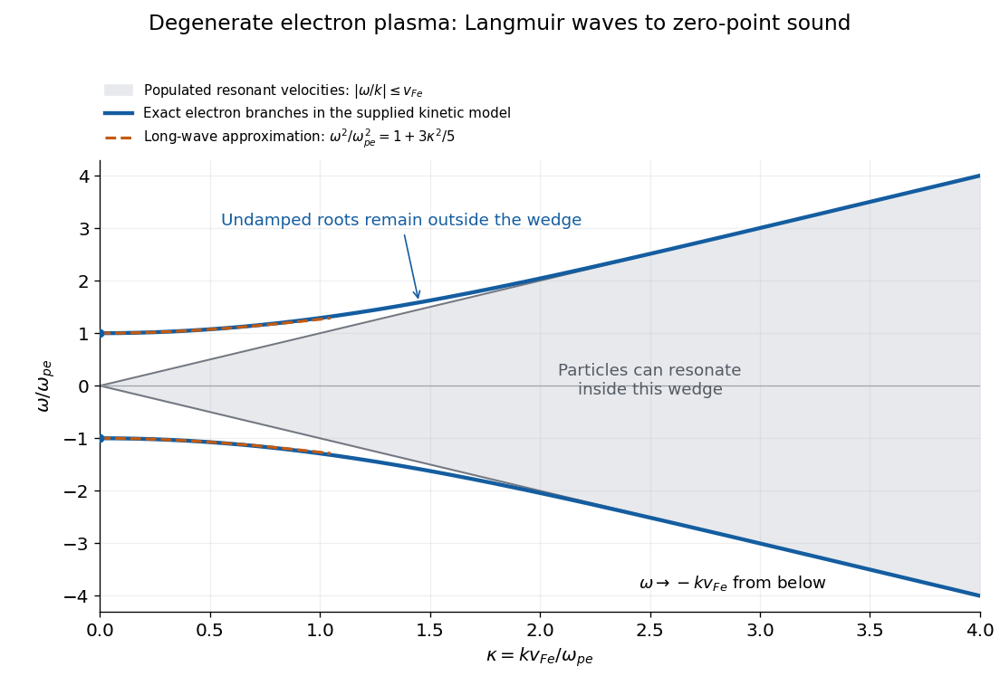

<h1 id="2/e/solution">Solution</h1>

↑ **Parent:** [E](../e.md)

The two real branches start at $\omega=\pm\omega_{\mathrm pe}$, have zero initial slope, and approach the lines $\omega=\pm kV_e$ from outside the populated parallel-[velocity](../../../../velocity.md) region. The original plot solves the [degenerate-plasma dielectric response](../../../../degenerate-plasma-dielectric-response.md) numerically; the shaded wedge shows where particles with resonant parallel [velocities](../../../../velocity.md) exist.

**[Figure 1](#2/e/image-degenerate-electron-plasma-branches-remain-outside-the-resonant-velocity-wedge). Degenerate electron-plasma branches remain outside the resonant-velocity wedge**. The [frequency](../../../../frequency.md) is scaled by the electron [plasma frequency](../../../../plasma-frequency.md) and the [wavenumber](../../../../wavenumber.md) by $\omega_{\mathrm pe}/V_e$. The dashed curves show the leading long-[wavelength](../../../../wavelength.md) approximation. At large [wavenumber](../../../../wavenumber.md) the exact branches are exponentially close to $\omega=\pm kV_e$; their visual overlap with those edges does not mean that a finite-$k$ root is inside the shaded region. Ion response, collisions and quantum recoil are omitted.

The distinction from a [nondegenerate gas](../../../../nondegenerate-gas.md) with a [Maxwellian](../../../../local-maxwellian.md) [Maxwell-Boltzmann velocity distribution](../../../../maxwell-boltzmann-velocity-distribution.md) is its tail. A [Maxwellian](../../../../local-maxwellian.md) has resonant particles at every finite [phase velocity](../../../../phase-velocity.md). Its long-[wavelength](../../../../wavelength.md) [Langmuir waves](../../../../langmuir-wave.md) have exponentially weak [Landau damping](../../../../landau-damping.md), but at shorter [wavelengths](../../../../wavelength.md) that [damping](../../../../damping.md) becomes strong. The ideal degenerate cutoff instead permits this undamped branch to persist continuously into [degenerate-plasma zero-point sound](../../../../degenerate-plasma-zero-point-sound.md). The coefficient $3V_e^2/5$ in [c](../c.md) is also different from the classical thermal dispersive coefficient.

A natural additional branch is a [degenerate ion-acoustic wave](../../../../degenerate-ion-acoustic-wave.md). For singly charged ions with equal electron and ion [number densities](../../../../number-density.md), degenerate electron [pressure](../../../../pressure-split.md) supplies a restoring force while ion [mass](../../../../mass.md) supplies inertia. The electron equation of state has $dP_e/dn_e=m_eV_e^2/3$, suggesting, at long [wavelengths](../../../../wavelength.md),

$$
\boxed{\omega\simeq\pm kc_s,\qquad c_s^2\simeq\frac{m_e}{3m_i}V_e^2.}
$$

Both species are degenerate here, so $V_i=(m_e/m_i)V_e$. The hierarchy $V_i\ll c_s\ll V_e$ explains the [damping](../../../../damping.md): there are no resonant ions, but there are resonant electrons inside their parallel [marginal distribution](../../../../marginal-distribution.md). That electron [marginal distribution](../../../../marginal-distribution.md) has a small nonzero slope at $u=c_s$, even though the full three-dimensional occupation is constant inside the [Fermi sphere](../../../../fermi-sphere.md). One therefore expects weak electron [Landau damping](../../../../landau-damping.md), of relative order $\sqrt{m_e/m_i}$, rather than exact absence of [damping](../../../../damping.md). Ion degeneracy [pressure](../../../../pressure-split.md) adds a relatively small correction to $c_s^2$. This reasoning concerns an electrostatic [ion-acoustic wave](../../../../ion-acoustic-wave.md); transverse or magnetized branches require additional field dynamics or a background [magnetic field](../../../../magnetic-field-split.md).

## ↑ Ancestors (12)

1. [E](../e.md)
2. [2](../../2.md)
3. [2023](../../../2023-split.md)
4. [Past exam of the kinetic theory course of the University of Oxford](../../../split.md)
5. [Kinetic theory course of the University of Oxford](../../../../kinetic-theory-course-of-the-university-of-oxford.md)
6. [Year 4 of the mathematical and theoretical physics course of the University of Oxford](../../../../year-4-of-the-mathematical-and-theoretical-physics-course-of-the-university-of-oxford.md)
7. [Mathematical and theoretical physics course of the University of Oxford](../../../../mathematical-and-theoretical-physics-course-of-the-university-of-oxford.md)
8. [Undergraduate course of the University of Oxford](../../../../undergraduate-course-of-the-university-of-oxford.md)
9. [Course of the University of Oxford](../../../../course-of-the-university-of-oxford.md)
10. [University of Oxford](../../../../university-of-oxford-split.md)
11. [List of universities](../../../../list-of-universities.md)
12. [Codex Wiki](../../../../split.md)
