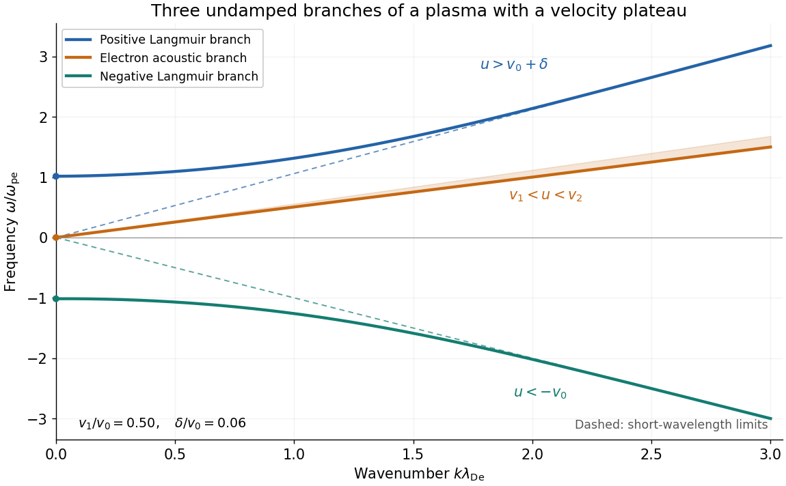

<h1 id="2/f/solution">Solution</h1>

↑ **Parent:** [F](../f.md)

For $k>0$, the upper [Langmuir wave](../../../../langmuir-wave.md) starts at $\omega\approx+\omega_{\mathrm{pe}}$ and approaches the line $\omega=kV$ from above. The lower [Langmuir wave](../../../../langmuir-wave.md) starts at $\omega\approx-\omega_{\mathrm{pe}}$ and approaches $\omega=-kv_0$ from below. The [electron acoustic wave](../../../../electron-acoustic-wave.md) starts at the origin with slope $v_1+\delta v_1^2/v_0^2$ and approaches $\omega=kv_1$ from above; it stays inside $kv_1<\omega<kv_2$. These are the only completely undamped branches, as shown by the [cubic equation](../../../../cubic-equation.md) in [b](../b.md).

**[Figure 1](#2/f/image-three-undamped-branches-for-a-narrow-electron-velocity-plateau). Three undamped branches for a narrow electron velocity plateau**. Exact roots of the cubic form of the dielectric response, with $v_0=1$, $v_1=0.5$ and $v_2=0.56$. Dashed lines show the three short-wavelength limits. The shaded band contains the electron acoustic branch. The exact outer cutoffs retain the small density-normalization correction explained in [d](../d.md).

The small asymmetry between the outer branches reflects the extra positive-[velocity](../../../../velocity.md) population introduced by the [velocity plateau](../../../../velocity-plateau.md). The negative-$k$ sketch follows by rotating the displayed branches through the origin, since $\epsilon(-\omega,-k)=\epsilon(\omega,k)$ on these undamped solutions. One should not impose symmetry about the $\omega=0$ axis at fixed positive $k$.

## ↑ Ancestors (12)

1. [F](../f.md)
2. [2](../../2.md)
3. [2025](../../../2025-split.md)
4. [Past exam of the kinetic theory course of the University of Oxford](../../../split.md)
5. [Kinetic theory course of the University of Oxford](../../../../kinetic-theory-course-of-the-university-of-oxford.md)
6. [Year 4 of the mathematical and theoretical physics course of the University of Oxford](../../../../year-4-of-the-mathematical-and-theoretical-physics-course-of-the-university-of-oxford.md)
7. [Mathematical and theoretical physics course of the University of Oxford](../../../../mathematical-and-theoretical-physics-course-of-the-university-of-oxford.md)
8. [Undergraduate course of the University of Oxford](../../../../undergraduate-course-of-the-university-of-oxford.md)
9. [Course of the University of Oxford](../../../../course-of-the-university-of-oxford.md)
10. [University of Oxford](../../../../university-of-oxford-split.md)
11. [List of universities](../../../../list-of-universities.md)
12. [Codex Wiki](../../../../split.md)
