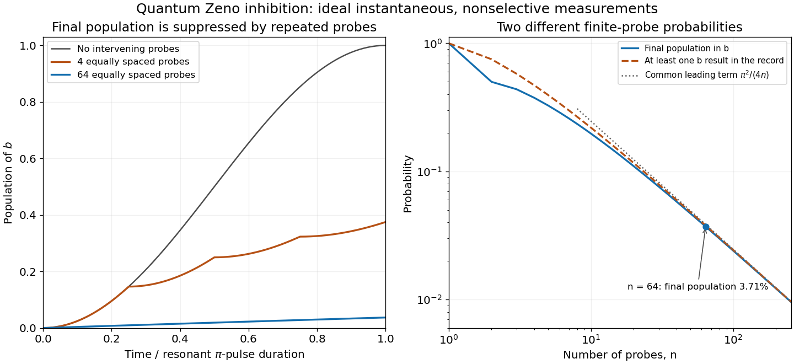

# 5

↑ **Parent:** [2005](../2005.md)

Source extract: [https://users.physics.ox.ac.uk/~Foot/C2/pdf/C22005Q5.pdf](https://users.physics.ox.ac.uk/~Foot/C2/pdf/C22005Q5.pdf)

The year is attributed from the preserved Oxford support-page record; it is not printed on the held page.

TODO: The remainder of this historical paper is not held. Only the supplied question material is covered.

**Table of contents**

- [1](#1)
  - [Solution](#1/solution)
- [2](#2)
  - [Solution](#2/solution)
- [3](#3)
  - [Solution](#3/solution)

## 1

↑ **Parent:** [5](5.md)

<h3 id="1/solution">Solution</h3>

↑ **Parent:** [1](#1)

Treat $|a\rangle=|0\rangle$ and $|b\rangle=|1\rangle$ as an isolated [ground-state hyperfine qubit](../../quantum-mechanics.md#ground-state-hyperfine-qubit). Their transition angular frequency is $\omega_0=2\pi\times320.7\,\mathrm{MHz}$. The radiofrequency [magnetic field](../../magnetic-field.md) couples them through an allowed [magnetic dipole transition](../../atomic-physics.md#magnetic-dipole-transition). After choosing its phase reference, take the two-level laboratory [Hamiltonian operator](../../quantum-system.md#hamiltonian-quantum-mechanics) to be

$$
H(t)=-\frac{\hbar\omega_0}{2}Z+\hbar\Omega\cos(\omega t)X,
$$

where $X,Z$ are [Pauli operators](../../quantum-circuit.md#pauli-operator). Here $\Omega$ is defined by the on-resonance rotating-frame off-diagonal matrix element $\hbar\Omega/2$.

Use a [quantum rotating frame](../../quantum-system.md#quantum-rotating-frame) and the [rotating-wave approximation](../../quantum-mechanics.md#rotating-wave-approximation), valid for $\Omega,|\delta|\ll\omega_0$, with [Rabi detuning](../../quantum-system.md#rabi-detuning) $\delta=\omega_0-\omega$. Ignoring off-resonant coupling to other levels gives

$$
H_R=\frac\hbar2(\Omega X-\delta Z).
$$

At resonance $\delta=0$, the [unitary time evolution](../../quantum-system.md#unitary-time-evolution) is

$$
U_R(t)=\cos\frac{\Omega t}{2}I-i\sin\frac{\Omega t}{2}X,
\qquad
|\psi_R(t)\rangle=\cos\frac{\Omega t}{2}|a\rangle-i\sin\frac{\Omega t}{2}|b\rangle.
$$

Thus the [Born rule](../../wave-function.md#born-rule) gives coherent [Rabi oscillations](../../quantum-system.md#rabi-cycle),

$$
\boxed{P_a(t)=\cos^2\frac{\Omega t}{2},\qquad P_b(t)=\sin^2\frac{\Omega t}{2}.}
$$

The stated amplitudes are in the rotating frame; the laboratory carrier phases are tracked by the drive reference.

These logical states are orthogonal, individually resolvable [hyperfine levels](../../quantum-mechanics.md#hyperfine-level) in the same electronic [ground state](../../quantum-mechanics.md#ground-state). They avoid fast optical decay, can be coherently coupled by radiofrequency control, and have a state-selective optical readout through $|c\rangle$. The excited level $|c\rangle$ is useful for [fluorescence](../../fluorescence.md) detection rather than for the storage superposition in this model. Long lifetimes alone do not guarantee a useful qubit: control isolation and adequate [quantum coherence](../../density-matrix.md#quantum-coherence-in-a-specified-basis) are also required.

## 2

↑ **Parent:** [5](5.md)

<h3 id="2/solution">Solution</h3>

↑ **Parent:** [2](#2)

A resonant [Rabi pi pulse](../../quantum-system.md#rabi-pi-pulse) satisfies $\Omega T_\pi=\pi$. The supplied $T_\pi=0.256\,\mathrm s$ therefore gives

$$
\boxed{\Omega=\frac\pi{0.256\,\mathrm s}\simeq12.27\,\mathrm{rad\,s^{-1}},\qquad
\frac\Omega{2\pi}=1.953125\,\mathrm{Hz}.}
$$

The ideal rotating-frame operation is $-iX$, a [Pauli X gate](../../quantum-theory.md#pauli-x-gate) up to [global phase](../../quantum-system.md#global-phase).

Both logical states belong to the electronic ground level. A fast [electric dipole transition](../../quantum-mechanics.md#electric-dipole-transition) between them is forbidden, and spontaneous radiative relaxation at a hyperfine radiofrequency is weak. The optical readout field is off during the coherent pulse. Neglecting relaxation is therefore consistent with a population lifetime much longer than $0.256\,\mathrm s$. Magnetic noise, collisions and technical dephasing are additional limitations; the ideal coherent calculation assumes their effects are small over this interval.

At detuning $\delta$, define $\Omega_{\rm eff}=\sqrt{\Omega^2+\delta^2}$. The same two-level [Hamiltonian operator](../../quantum-system.md#hamiltonian-quantum-mechanics) gives

$$
P_b(t)=\frac{\Omega^2}{\Omega^2+\delta^2}
\sin^2\left(\frac{t\sqrt{\Omega^2+\delta^2}}2\right).
$$

For an accurate fixed-duration $\pi$ rotation, the detuning must be small compared with the [Rabi angular frequency](../../quantum-system.md#rabi-angular-frequency). Writing $\delta\nu=\delta/(2\pi)$,

$$
\boxed{|\delta\nu|\ll\frac\Omega{2\pi}=1.95\,\mathrm{Hz},}
$$

a fractional mismatch much smaller than $6.1\times10^{-9}$ relative to the $320.7\,\mathrm{MHz}$ carrier. This is an accuracy scale, not an assertion that a particular nonzero detuning gives a perfect gate.

The [small-detuning error of a Rabi pi pulse](../../quantum-system.md#small-detuning-error-of-a-rabi-pi-pulse) quantifies a chosen tolerance. For an initial $|a\rangle$ and the resonant pulse duration,

$$
1-P_b(T_\pi)=\left(\frac\delta\Omega\right)^2+O\!\left((\delta/\Omega)^4\right).
$$

A population-transfer error at most $\epsilon$ consequently requires approximately **$|\delta\nu|\lesssim1.95\sqrt\epsilon\,\mathrm{Hz}$**; for example, **about $0.20\,\mathrm{Hz}$ for one percent error**. Full gate calibration also includes pulse area and drive phase, beyond this population-transfer criterion.

## 3

↑ **Parent:** [5](5.md)

<h3 id="3/solution">Solution</h3>

↑ **Parent:** [3](#3)

In the ideal [state-selective fluorescence detection](../../quantum-measurement.md#state-selective-fluorescence-detection) model, driving the $a\leftrightarrow c$ optical transition produces a bright record only for $a$, while $b$ is dark. A sufficiently discriminating pulse therefore measures the basis $\{|a\rangle,|b\rangle\}$. The optical cycle is assumed to return population to the appropriate logical state without leakage. Ignoring the recorded outcome removes the off-diagonal [quantum coherence](../../density-matrix.md#quantum-coherence-in-a-specified-basis) between $a$ and $b$.

Take $n$ equally spaced measurements at $t_j=jT_\pi/n$, including the final time. Between checks the resonant drive rotates through angle $\Omega T_\pi/n=\pi/n$. The probability of changing basis state in one interval is

$$
p=\sin^2\frac\pi{2n}.
$$

After each ideal [projective measurement](../../quantum-measurement.md#projective-measurement), the populations therefore follow the symmetric two-state [Markov chain](../../markov-chain.md)

$$
\begin{pmatrix}P_a'\\P_b'\end{pmatrix}
=\begin{pmatrix}1-p&p\\p&1-p\end{pmatrix}
\begin{pmatrix}P_a\\P_b\end{pmatrix}.
$$

The population difference is multiplied by $1-2p=\cos(\pi/n)$ at each step. Starting in $a$, the [nonselective two-level Zeno dynamics](../../quantum-measurement.md#nonselective-two-level-zeno-dynamics) gives

$$
\boxed{P_b(T_\pi)=\frac{1-\cos^n(\pi/n)}2
=\frac{\pi^2}{4n}+O(n^{-2})\longrightarrow0.}
$$

For $n=64$, the exact final population is **$P_b\simeq0.03712$**, while the requested large-$n$ estimate is **$\pi^2/256\simeq0.03855$**, about **four percent**. Thus the transition that an uninterrupted pi pulse would complete is strongly inhibited.

If “leaving” instead means departing from $a$ at least once in the complete measurement record, use the [repeated projective-measurement survival probability](../../quantum-measurement.md#repeated-projective-measurement-survival-probability). The probability that every check returns $a$ is

$$
P_{\rm all\,a}=\cos^{2n}\frac\pi{2n},\qquad
1-P_{\rm all\,a}\simeq0.03782\quad(n=64).
$$

It has the same leading estimate $\pi^2/(4n)$, but is not exactly the final $b$ population: a trajectory can leave $a$ and subsequently return. Keeping these events separate also distinguishes postselected records from an experiment that measures only final populations.

**[Figure 1](#3/image-rabi-transfer-inhibited-by-repeated-measurements-with-final-population-and-all-check-departure-distinguished). Rabi transfer inhibited by repeated measurements, with final population and all-check departure distinguished**. Original ideal two-level calculations, not historical data. Probe times include the end of the pi pulse. The first panel shows ensemble populations between nonselective probes; the second compares exact final population, departure at any recorded check, and their common large-n estimate.

The mechanism is the [quadratic short-time quantum survival probability](../../quantum-system.md#quadratic-short-time-quantum-survival-probability): each short interval has transition probability of order $(T_\pi/n)^2$, so $n$ checks leave only an order-$1/n$ total transition probability. The [quantum Zeno effect](../../quantum-measurement.md#quantum-zeno-effect) here requires effective, sufficiently fast measurements; a finite-duration optical probe is a physical interaction whose imperfections must be included when comparing with data.

The [beryllium-ion quantum Zeno experiment of 1990](../../quantum-measurement.md#beryllium-ion-quantum-zeno-experiment-of-1990) used the same ground-state transition and a finite-duration optical probing sequence, followed by a calibrated ensemble [fluorescence](../../fluorescence.md) readout. Its measured final populations motivate the nonselective model; the instantaneous projections here idealize those physical pulses.

## ↑ Ancestors (10)

1. [2005](../2005.md)
2. [Past exam of the laser science and quantum information processing course of the University of Oxford](../../past-exam-of-the-laser-science-and-quantum-information-processing-course-of-the-university-of-oxford.md)
3. [Laser science and quantum information processing course of the University of Oxford](../../university-of-oxford.md#laser-science-and-quantum-information-processing-course-of-the-university-of-oxford)
4. [Year 4 of the physics course of the University of Oxford](../../university-of-oxford.md#year-4-of-the-physics-course-of-the-university-of-oxford)
5. [Physics course of the University of Oxford](../../university-of-oxford.md#physics-course-of-the-university-of-oxford)
6. [Undergraduate course of the University of Oxford](../../university-of-oxford.md#undergraduate-course-of-the-university-of-oxford)
7. [Course of the University of Oxford](../../university-of-oxford.md#course-of-the-university-of-oxford)
8. [University of Oxford](../../university-of-oxford.md)
9. [List of universities](../../README.md#list-of-universities)
10. [Codex Wiki](../../README.md)
