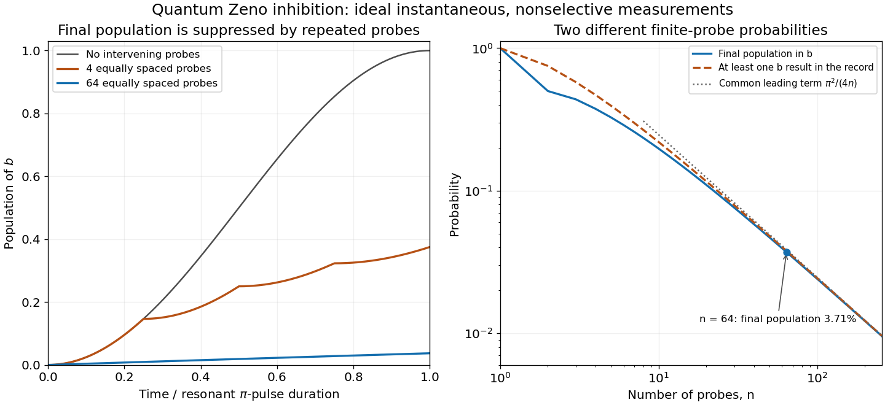

<h1 id="3/solution">Solution</h1>

↑ **Parent:** [3](../3.md)

In the ideal [state-selective fluorescence detection](../../../../state-selective-fluorescence-detection.md) model, driving the $a\leftrightarrow c$ optical transition produces a bright record only for $a$, while $b$ is dark. A sufficiently discriminating pulse therefore measures the basis $\{|a\rangle,|b\rangle\}$. The optical cycle is assumed to return population to the appropriate logical state without leakage. Ignoring the recorded outcome removes the off-diagonal [quantum coherence](../../../../quantum-coherence-in-a-specified-basis.md) between $a$ and $b$.

Take $n$ equally spaced measurements at $t_j=jT_\pi/n$, including the final time. Between checks the resonant drive rotates through angle $\Omega T_\pi/n=\pi/n$. The probability of changing basis state in one interval is

$$
p=\sin^2\frac\pi{2n}.
$$

After each ideal [projective measurement](../../../../projective-measurement.md), the populations therefore follow the symmetric two-state [Markov chain](../../../../markov-chain-split.md)

$$
\begin{pmatrix}P_a'\\P_b'\end{pmatrix}
=\begin{pmatrix}1-p&p\\p&1-p\end{pmatrix}
\begin{pmatrix}P_a\\P_b\end{pmatrix}.
$$

The population difference is multiplied by $1-2p=\cos(\pi/n)$ at each step. Starting in $a$, the [nonselective two-level Zeno dynamics](../../../../nonselective-two-level-zeno-dynamics.md) gives

$$
\boxed{P_b(T_\pi)=\frac{1-\cos^n(\pi/n)}2
=\frac{\pi^2}{4n}+O(n^{-2})\longrightarrow0.}
$$

For $n=64$, the exact final population is **$P_b\simeq0.03712$**, while the requested large-$n$ estimate is **$\pi^2/256\simeq0.03855$**, about **four percent**. Thus the transition that an uninterrupted pi pulse would complete is strongly inhibited.

If “leaving” instead means departing from $a$ at least once in the complete measurement record, use the [repeated projective-measurement survival probability](../../../../repeated-projective-measurement-survival-probability.md). The probability that every check returns $a$ is

$$
P_{\rm all\,a}=\cos^{2n}\frac\pi{2n},\qquad
1-P_{\rm all\,a}\simeq0.03782\quad(n=64).
$$

It has the same leading estimate $\pi^2/(4n)$, but is not exactly the final $b$ population: a trajectory can leave $a$ and subsequently return. Keeping these events separate also distinguishes postselected records from an experiment that measures only final populations.

**[Figure 1](#3/image-rabi-transfer-inhibited-by-repeated-measurements-with-final-population-and-all-check-departure-distinguished). Rabi transfer inhibited by repeated measurements, with final population and all-check departure distinguished**. Original ideal two-level calculations, not historical data. Probe times include the end of the pi pulse. The first panel shows ensemble populations between nonselective probes; the second compares exact final population, departure at any recorded check, and their common large-n estimate.

The mechanism is the [quadratic short-time quantum survival probability](../../../../quadratic-short-time-quantum-survival-probability.md): each short interval has transition probability of order $(T_\pi/n)^2$, so $n$ checks leave only an order-$1/n$ total transition probability. The [quantum Zeno effect](../../../../quantum-zeno-effect.md) here requires effective, sufficiently fast measurements; a finite-duration optical probe is a physical interaction whose imperfections must be included when comparing with data.

The [beryllium-ion quantum Zeno experiment of 1990](../../../../beryllium-ion-quantum-zeno-experiment-of-1990.md) used the same ground-state transition and a finite-duration optical probing sequence, followed by a calibrated ensemble [fluorescence](../../../../fluorescence-split.md) readout. Its measured final populations motivate the nonselective model; the instantaneous projections here idealize those physical pulses.

## ↑ Ancestors (12)

1. [3](../3.md)
2. [5](../../5-split.md)
3. [2005](../../split.md)
4. [Past exam of the laser science and quantum information processing course of the University of Oxford](../../../split.md)
5. [Laser science and quantum information processing course of the University of Oxford](../../../../laser-science-and-quantum-information-processing-course-of-the-university-of-oxford.md)
6. [Year 4 of the physics course of the University of Oxford](../../../../year-4-of-the-physics-course-of-the-university-of-oxford.md)
7. [Physics course of the University of Oxford](../../../../physics-course-of-the-university-of-oxford.md)
8. [Undergraduate course of the University of Oxford](../../../../undergraduate-course-of-the-university-of-oxford.md)
9. [Course of the University of Oxford](../../../../course-of-the-university-of-oxford.md)
10. [University of Oxford](../../../../university-of-oxford-split.md)
11. [List of universities](../../../../list-of-universities.md)
12. [Codex Wiki](../../../../split.md)
