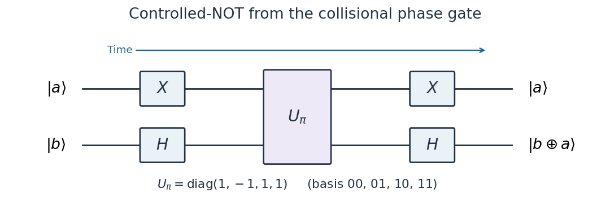

# 7 and 8

↑ **Parent:** [2005](../2005.md)

Source extract: [https://users.physics.ox.ac.uk/~Foot/C2/pdf/C22005Q7.pdf](https://users.physics.ox.ac.uk/~Foot/C2/pdf/C22005Q7.pdf)

This source extract contains questions 7 and 8.

The year is attributed from the preserved Oxford support-page record; it is not printed on the held page.

TODO: The remainder of this historical paper is not held. Only the supplied question material is covered.

**Table of contents**

- [7](#7)
  - [a](#7/a)
    - [Solution](#7/a/solution)
  - [b](#7/b)
    - [Solution](#7/b/solution)
  - [c](#7/c)
    - [Solution](#7/c/solution)
  - [1](#7/1)
    - [Solution](#7/1/solution)
  - [2](#7/2)
    - [Solution](#7/2/solution)
- [8](#8)
  - [1](#8/1)
    - [Solution](#8/1/solution)
  - [2](#8/2)
    - [Solution](#8/2/solution)
  - [3](#8/3)
    - [Solution](#8/3/solution)

## 7

↑ **Parent:** [7 and 8](7-and-8.md)

The printed opening block offers a choice of two protocols for 8 marks in total. All three choices are solved here. Sections 1 and 2 below identify the subsequent unlettered blocks, worth 10 and 7 marks respectively; these section numbers are navigation labels.

<h3 id="7/a">a</h3>

↑ **Parent:** [7](#7)

<h4 id="7/a/solution">Solution</h4>

↑ **Parent:** [A](#7/a)

In [quantum dense coding](../../bell-state.md#superdense-coding), a shared [Bell pair](../../bell-state.md#bell-pair) lets Alice send two classical [bits](../../information-theory.md#bit) by transmitting one [qubit](../../quantum-system.md#qubit). Use [photon polarization](../../quantum-mechanics.md#photon-polarization) as the [computational basis](../../quantum-theory.md#computational-basis), $|0\rangle=|H\rangle$, $|1\rangle=|V\rangle$, and define the [Bell states](../../bell-state.md)

$$
|\phi^\pm\rangle=\frac{|00\rangle\pm|11\rangle}{\sqrt2},\qquad
|\psi^\pm\rangle=\frac{|01\rangle\pm|10\rangle}{\sqrt2}.
$$

Alice and Bob initially share $|\phi^+\rangle_{AB}$. Alice encodes a two-[bit](../../information-theory.md#bit) message $(m,n)$ by applying the [Pauli operator](../../quantum-circuit.md#pauli-operator) $X^nZ^m$ to her [qubit](../../quantum-system.md#qubit):

$$
\begin{array}{c|c|c}
(m,n)&\text{Alice's operation}&\text{shared state}\\\hline
(0,0)&I&|\phi^+\rangle\\
(1,0)&Z&|\phi^-\rangle\\
(0,1)&X&|\psi^+\rangle\\
(1,1)&XZ&-|\psi^-\rangle
\end{array}
$$

The last minus sign is a [global phase](../../quantum-system.md#global-phase). Alice transmits her [photon](../../quantum-mechanics.md#photon) to Bob, who now holds both [qubits](../../quantum-system.md#qubit) and uses a [Bell-basis measurement](../../bell-state.md#bell-basis-measurement) to identify the message. The four [Bell states](../../bell-state.md) are [orthogonal](../../inner-product.md#orthogonal-vectors), so an ideal [Bell state analyzer](../../bell-state.md#bell-state-analyzer) decodes them without error. The resource cost is one previously shared [Bell pair](../../bell-state.md#bell-pair) and one transmitted [qubit](../../quantum-system.md#qubit) per two classical [bits](../../information-theory.md#bit); the shared [quantum entanglement](../../bell-state.md#entangled-state) is consumed. Before transmission Bob's [reduced density matrix](../../bell-state.md#reduced-density-matrix) is $I/2$ for every message, consistent with the [no-communication theorem](../../bell-state.md#no-communication-theorem).

The [BBO](../../chemical-substance.md#beta-barium-borate) crystal supplies the [polarization-entangled photon pair](../../bell-state.md#polarization-entangled-photon-pair). An ultraviolet [laser](../../laser.md) pumps this [nonlinear optical crystal](../../optics.md#nonlinear-optical-crystal); [spontaneous parametric down-conversion](../../optics.md#spontaneous-parametric-down-conversion) produces signal and idler [photons](../../quantum-mechanics.md#photon) with $\omega_p=\omega_s+\omega_i$ and [phase matching](../../physical-optics.md#phase-matching) $\mathbf k_p=\mathbf k_s+\mathbf k_i$. In a noncollinear [type-II phase matching](../../physical-optics.md#type-ii-phase-matching) arrangement, collect the intersections of the two emission cones. The alternatives $|H\rangle_A|V\rangle_B$ and $|V\rangle_A|H\rangle_B$ must be indistinguishable in arrival time, spectrum and spatial mode. Compensation of [birefringence](../../maxwell-equations.md#birefringence) and adjustment of the [relative quantum phase](../../quantum-system.md#relative-quantum-phase) then give $(|HV\rangle+|VH\rangle)/\sqrt2$; a local [Pauli X gate](../../quantum-theory.md#pauli-x-gate) converts it to $|\phi^+\rangle$. [Half-wave plates](../../maxwell-equations.md#half-wave-plate) and other [waveplates](../../maxwell-equations.md#waveplate) implement Alice's [Pauli gates](../../quantum-circuit.md#pauli-gate). The [BBO](../../chemical-substance.md#beta-barium-borate) is the pair source; the message is encoded subsequently by the local optical elements.[1995, Figures 1 and 2: intersecting type-II emission cones and compensation; Table I: four Bell states](../../physics-bibliography.md#new-high-intensity-source-of-polarization-entangled-photon-pairs-by-paul-g-kwiat-and-others)

A basic passive [linear optics](../../optics.md#linear-optics) [Bell state analyzer](../../bell-state.md#bell-state-analyzer) with no extra resources identifies only two of the four polarization [Bell states](../../bell-state.md) unambiguously. Thus the ideal two-[bit](../../information-theory.md#bit) capacity presupposes complete [Bell-basis measurement](../../bell-state.md#bell-basis-measurement); that basic optical implementation alone does not attain it deterministically.

<h3 id="7/b">b</h3>

↑ **Parent:** [7](#7)

<h4 id="7/b/solution">Solution</h4>

↑ **Parent:** [B](#7/b)

In [entanglement swapping](../../bell-state.md#entanglement-swapping), start with independent [Bell pairs](../../bell-state.md#bell-pair) $|\phi^+\rangle_{12}|\phi^+\rangle_{34}$. Send [qubits](../../quantum-system.md#qubit) 2 and 3 to a central [Bell state analyzer](../../bell-state.md#bell-state-analyzer), retaining 1 and 4 at separate endpoints. Reordering the [tensor product](../../multilinear-algebra.md#tensor-product) factors to group 23 and 14 gives the identity

$$
|\phi^+\rangle_{12}|\phi^+\rangle_{34}
=\frac12\left(
|\phi^+\rangle_{23}|\phi^+\rangle_{14}
+|\phi^-\rangle_{23}|\phi^-\rangle_{14}
+|\psi^+\rangle_{23}|\psi^+\rangle_{14}
+|\psi^-\rangle_{23}|\psi^-\rangle_{14}\right).
$$

Consequently each ideal [Bell-basis measurement](../../bell-state.md#bell-basis-measurement) outcome has [probability](../../probability-theory.md#probability) $1/4$ and projects 14 onto the corresponding [Bell state](../../bell-state.md), even though those two [photons](../../quantum-mechanics.md#photon) have never interacted. Communicating the two-[bit](../../information-theory.md#bit) result permits an endpoint [Pauli gate](../../quantum-circuit.md#pauli-gate) to convert every outcome into the same chosen [Bell pair](../../bell-state.md#bell-pair). Without that record, the endpoints have $\rho_{14}=I_4/4$, a [product state](../../bell-state.md#product-state), rather than a known [entangled state](../../bell-state.md#entangled-state).

The optical [Bell state analyzer](../../bell-state.md#bell-state-analyzer) overlaps [photons](../../quantum-mechanics.md#photon) 2 and 3 at a [balanced beam splitter](../../optical-instrument.md#balanced-beam-splitter), with matched spatial modes, spectra and arrival times, and resolves the output [photon polarizations](../../quantum-mechanics.md#photon-polarization) using [polarizing beam splitters](../../optical-instrument.md#polarizing-beam-splitter) and [single-photon detectors](../../optical-instrument.md#single-photon-detector). [Two-photon interference](../../quantum-optics.md#two-photon-interference) maps [Bell states](../../bell-state.md) to different output patterns. The antisymmetric $|\psi^-\rangle$ gives one [photon](../../quantum-mechanics.md#photon) in each output with opposite [polarizations](../../wave.md#polarization-waves). The symmetric $|\psi^+\rangle$ gives two opposite-polarization [photons](../../quantum-mechanics.md#photon) in the same output; the two polarization detectors there can resolve this pattern. The $|\phi^\pm\rangle$ states give same-polarization pairs and remain mutually ambiguous in this basic setup. The detected pattern therefore heralds a particular endpoint [Bell state](../../bell-state.md). With ideal detection this arrangement succeeds unambiguously on two of four equally likely inputs, with [probability](../../probability-theory.md#probability) $1/2$; the successful events can be selected. A complete analyzer would accept all four outcomes. The endpoint [quantum entanglement](../../bell-state.md#entangled-state) is conditional on the measurement record, so it enables no instantaneous signalling.[1998, experimental Bell projection and conditional endpoint correlations](../../physics-bibliography.md#experimental-entanglement-swapping-entangling-photons-that-never-interacted-by-jian-wei-pan-and-others)

<h3 id="7/c">c</h3>

↑ **Parent:** [7](#7)

<h4 id="7/c/solution">Solution</h4>

↑ **Parent:** [C](#7/c)

For [quantum key distribution](../../computer-science.md#quantum-key-distribution) with [Bell pairs](../../bell-state.md#bell-pair), a source distributes one [photon](../../quantum-mechanics.md#photon) to Alice and its partner to Bob. One implementation is the [Ekert protocol](../../computer-science.md#ekert-protocol), using the [spin singlet state](../../bell-state.md#spin-singlet-state) $|\psi^-\rangle=(|01\rangle-|10\rangle)/\sqrt2$. Each party independently chooses a [polarization](../../wave.md#polarization-waves) measurement setting after distribution. Equal settings give opposite outcomes; Bob reverses his outcome-to-[bit](../../information-theory.md#bit) assignment so these rounds give matching random [bits](../../information-theory.md#bit). Other setting pairs test a [Bell inequality](../../foundations-of-quantum-mechanics.md#bell-inequality), with ideal [spin singlet state](../../bell-state.md#spin-singlet-state) correlation $E(\mathbf a,\mathbf b)=-\mathbf a\cdot\mathbf b$ for the corresponding [Bloch sphere](../../density-matrix.md#bloch-sphere) axes. The optical [polarizer](../../electromagnetic-wave.md#polarizer) angles correspond to twice those angles on the appropriate [Bloch sphere](../../density-matrix.md#bloch-sphere) great circle.

Over an [authenticated public classical channel](../../computer-science.md#authenticated-public-classical-channel), Alice and Bob announce settings and detection times, select coincident detection rounds, and perform [key sifting](../../computer-science.md#key-sifting). They reveal a test sample to estimate the [quantum bit error rate](../../computer-science.md#quantum-bit-error-rate) and the chosen [Bell inequality](../../foundations-of-quantum-mechanics.md#bell-inequality) signal, discarding all revealed [bits](../../information-theory.md#bit). Excess disturbance causes an abort. Otherwise [information reconciliation](../../computer-science.md#information-reconciliation) makes the retained strings agree and [privacy amplification](../../computer-science.md#privacy-amplification) shortens them to remove an adversary's residual information, including information disclosed during reconciliation. The tested [quantum entanglement](../../bell-state.md#entangled-state) supplies correlations unavailable to an independently prepared classical mixture; a security claim also requires stated detector and sampling assumptions.[1991, entanglement-based key distribution and Bell-correlation test](../../physics-bibliography.md#quantum-cryptography-based-on-bell-s-theorem-by-artur-k-ekert)

Each [photon polarization](../../quantum-mechanics.md#photon-polarization) analyzer uses a setting-dependent [waveplate](../../maxwell-equations.md#waveplate) followed by a [polarizing beam splitter](../../optical-instrument.md#polarizing-beam-splitter). A [single-photon detector](../../optical-instrument.md#single-photon-detector) on each output converts the routed [photon](../../quantum-mechanics.md#photon) into an electrical click, recording the outcome and its time. For example, a [single-photon avalanche diode](../../optical-instrument.md#single-photon-avalanche-diode) is a reverse-biased [photodiode](../../optical-instrument.md#photodiode) operated above breakdown: absorption creates a charge carrier, [impact ionization](../../optical-instrument.md#impact-ionization) triggers an avalanche, and the resulting pulse is registered. A quenching circuit lowers the bias to stop the avalanche and then resets the device. The [detector dead time](../../particle-detection.md#detector-dead-time) during recovery limits the count rate; [dark counts](../../optical-instrument.md#dark-count) produce false clicks, and imperfect detection loses rounds. The [polarization](../../wave.md#polarization-waves) information comes from the preceding analyzer, while the detector registers which output fired. Coincidence timing associates Alice's and Bob's records with the same emitted pair. [Thorlabs, Light Analysis catalogue, Single Photon Counter Modules: Geiger-mode operation, active quenching, blind time and dark counts](https://www.thorlabs.co.jp/images/Catalog/V21/V21_7_LightAnalysis.pdf)

<h3 id="7/1">1</h3>

↑ **Parent:** [7](#7)

<h4 id="7/1/solution">Solution</h4>

↑ **Parent:** [1](#7/1)

Let the unknown input [qubit](../../quantum-system.md#qubit) be $|\psi\rangle_S=\alpha|0\rangle+\beta|1\rangle$, with $|\alpha|^2+|\beta|^2=1$. Alice holds $S,A$, Bob holds $B$, and the shared [Bell pair](../../bell-state.md#bell-pair) is $|\phi^+\rangle_{AB}$. All three-[qubit](../../quantum-system.md#qubit) strings below use the order $S,A,B$. Initially,

$$
|\Psi_0\rangle=|\psi\rangle_S|\phi^+\rangle_{AB}
=\frac{\alpha|000\rangle+\alpha|011\rangle+\beta|100\rangle+\beta|111\rangle}{\sqrt2}.
$$

The [Bell-basis teleportation identity](../../bell-state.md#bell-basis-teleportation-identity) gives

$$
|\Psi_0\rangle=\frac12\left[
|\phi^+\rangle_{SA}|\psi\rangle_B
+|\phi^-\rangle_{SA}Z|\psi\rangle_B
+|\psi^+\rangle_{SA}X|\psi\rangle_B
+|\psi^-\rangle_{SA}XZ|\psi\rangle_B\right].
$$

Thus a perfect [Bell state analyzer](../../bell-state.md#bell-state-analyzer) on Alice's two [qubits](../../quantum-system.md#qubit) identifies the [Pauli operator](../../quantum-circuit.md#pauli-operator) affecting Bob's [quantum state](../../quantum-system.md#quantum-state).

To display the intermediate three-[qubit](../../quantum-system.md#qubit) states explicitly, realize that [Bell-basis measurement](../../bell-state.md#bell-basis-measurement) by a [controlled-NOT gate](../../quantum-theory.md#controlled-not-gate) $S\to A$, a [Hadamard gate](../../quantum-theory.md#hadamard-gate) on $S$, and two [computational-basis measurements](../../quantum-theory.md#quantum-measurement-in-the-computational-basis). After the [controlled-NOT gate](../../quantum-theory.md#controlled-not-gate),

$$
|\Psi_1\rangle=\frac{\alpha|000\rangle+\alpha|011\rangle+\beta|110\rangle+\beta|101\rangle}{\sqrt2}.
$$

After the [Hadamard gate](../../quantum-theory.md#hadamard-gate),

$$
\begin{aligned}
|\Psi_2\rangle=\frac12\big[&\alpha(|000\rangle+|100\rangle+|011\rangle+|111\rangle)\\
&+\beta(|010\rangle-|110\rangle+|001\rangle-|101\rangle)\big]\\
=\frac12\big[&|00\rangle(\alpha|0\rangle+\beta|1\rangle)
+|01\rangle(\beta|0\rangle+\alpha|1\rangle)\\
&+|10\rangle(\alpha|0\rangle-\beta|1\rangle)
+|11\rangle(-\beta|0\rangle+\alpha|1\rangle)\big]_{SA,B}.
\end{aligned}
$$

Measuring $S,A$ gives $(m,n)$ with [probability](../../probability-theory.md#probability) $1/4$ for each outcome, independently of $\alpha,\beta$. Conditional on that result, the normalized three-[qubit](../../quantum-system.md#qubit) [post-measurement state](../../quantum-measurement.md#post-measurement-state) is

$$
|\Psi_{mn}\rangle=|mn\rangle_{SA}\otimes X^nZ^m|\psi\rangle_B.
$$

If the [Bell state analyzer](../../bell-state.md#bell-state-analyzer) is instead regarded as an ideal direct [projective measurement](../../quantum-measurement.md#projective-measurement) preserving the measured [qubits](../../quantum-system.md#qubit), replace $|mn\rangle_{SA}$ here by the corresponding [Bell state](../../bell-state.md); Bob's factor is identical. A destructive optical analyzer records the same label but absorbs Alice's [photons](../../quantum-mechanics.md#photon).

Alice sends the two classical [bits](../../information-theory.md#bit) $(m,n)$ to Bob. During transmission the above conditional three-[qubit](../../quantum-system.md#qubit) state is unchanged. Bob then applies the inverse [Pauli operator](../../quantum-circuit.md#pauli-operator) $Z^mX^n$:

$$
\begin{array}{c|c|c|c}
\text{Bell result}&(m,n)&\text{Bob's state before correction}&\text{correction}\\\hline
\phi^+&00&|\psi\rangle&I\\
\psi^+&01&X|\psi\rangle&X\\
\phi^-&10&Z|\psi\rangle&Z\\
\psi^-&11&XZ|\psi\rangle&ZX
\end{array}
$$

The final conditional three-[qubit](../../quantum-system.md#qubit) state is therefore $|mn\rangle_{SA}\otimes|\psi\rangle_B$. The protocol transmits **two classical bits per teleported qubit**, consuming one shared [Bell pair](../../bell-state.md#bell-pair). Without Alice's record Bob averages over four [Pauli operators](../../quantum-circuit.md#pauli-operator) and has [density matrix](../../density-matrix.md) $I/2$, so [quantum teleportation](../../bell-state.md#quantum-teleportation) respects the [no-communication theorem](../../bell-state.md#no-communication-theorem). Alice's input has been measured and is no longer an independent copy, consistent with the [no-cloning theorem](../../quantum-theory.md#no-cloning-theorem).

<h3 id="7/2">2</h3>

↑ **Parent:** [7](#7)

<h4 id="7/2/solution">Solution</h4>

↑ **Parent:** [2](#7/2)

For [teleportation with an ambiguous Bell-state phase label](../../bell-state.md#teleportation-with-an-ambiguous-bell-state-phase-label), write $\rho=|\psi\rangle\langle\psi|$. The [Bell-basis measurement](../../bell-state.md#bell-basis-measurement) outcomes $\phi^+$ and $\phi^-$ each occur with [probability](../../probability-theory.md#probability) $1/4$. In either case a correct guess gives Bob $\rho$, while the wrong guess differs by the [Pauli Z gate](../../quantum-theory.md#pauli-z-gate) and gives $Z\rho Z$. The other two [Bell states](../../bell-state.md) are identified correctly. Since Alice guesses each ambiguous label with [probability](../../probability-theory.md#probability) $1/2$, the overall wrong-correction [probability](../../probability-theory.md#probability) is $(1/2)(1/2)=1/4$. Averaging over the actual [quantum measurement](../../quantum-measurement.md) outcome and her guess gives the [phase-flip channel](../../quantum-information-theory.md#phase-flip-channel)

$$
\boxed{\rho_{\rm out}=\mathcal E(\rho)=\frac34\rho+\frac14Z\rho Z
=\begin{pmatrix}|\alpha|^2&\alpha\beta^*/2\\\alpha^*\beta/2&|\beta|^2\end{pmatrix}.}
$$

Conditional only on an ambiguous analyzer result, the output is $(\rho+Z\rho Z)/2$; that conditional channel has weight $1/2$ in the displayed unconditional result. There is no rejection of those rounds.

Use the [teleportation fidelity](../../bell-state.md#teleportation-fidelity) for a [pure state](../../quantum-theory.md#pure-state) target, namely the [squared quantum fidelity](../../quantum-information-theory.md#squared-quantum-fidelity)

$$
F_\psi=\langle\psi|\rho_{\rm out}|\psi\rangle.
$$

This compares the input with the resulting [mixed state](../../density-matrix.md#mixed-state); averaging state vectors before forming a [density matrix](../../density-matrix.md) would give a different, incorrect answer. Direct substitution gives

$$
\boxed{F_\psi=\frac34+\frac14|\langle\psi|Z|\psi\rangle|^2
=\frac34+\frac14(|\alpha|^2-|\beta|^2)^2
=1-|\alpha|^2|\beta|^2.}
$$

Thus **the maximum is $1$**, attained by $|0\rangle$ and $|1\rangle$ up to a [global phase](../../quantum-system.md#global-phase), because these are [eigenstates](../../energy-eigenvalue.md#eigenstate) of the [Pauli Z gate](../../quantum-theory.md#pauli-z-gate). **The minimum is $3/4$**, attained by every equal-weight [quantum superposition](../../quantum-system.md#quantum-superposition)

$$
|\psi\rangle=\frac{|0\rangle+e^{i\theta}|1\rangle}{\sqrt2},\qquad \theta\in\mathbb R,
$$

on the equator of the [Bloch sphere](../../density-matrix.md#bloch-sphere). The [unsquared quantum fidelity](../../quantum-information-theory.md#fidelity-of-quantum-states) is $\sqrt{F_\psi}$ if that alternative convention is used. No average over different input [quantum states](../../quantum-system.md#quantum-state) is needed for the requested state-dependent answer.

## 8

↑ **Parent:** [7 and 8](7-and-8.md)

The three printed unlettered blocks are identified below by navigation labels 1, 2 and 3. Their mark allocations are 10, 10 and 5 respectively.

<h3 id="8/1">1</h3>

↑ **Parent:** [8](#8)

<h4 id="8/1/solution">Solution</h4>

↑ **Parent:** [1](#8/1)

A [universal quantum gate set](../../quantum-circuit.md#universal-quantum-gate-set) can implement any [unitary operator](../../vector-space.md#unitary-operator) on any finite number of [qubits](../../quantum-system.md#qubit), exactly when arbitrary continuous gate parameters are allowed, or to arbitrary accuracy with a suitable finite gate alphabet. More precisely, for every target $V$ and $\epsilon>0$ there is a finite [quantum circuit](../../quantum-circuit.md) $W$ with $\min_\gamma\|W-e^{i\gamma}V\|<\epsilon$ in [operator norm](../../continuous-dual-space.md#operator-norm). This ignores only an overall [global phase](../../quantum-system.md#global-phase) of the complete operation. Universality lets a fixed collection of controllable elementary operations run arbitrary [quantum algorithms](../../algorithm.md#quantum-algorithm) rather than requiring a different physical interaction for each algorithm.

All single-[qubit](../../quantum-system.md#qubit) [unitary gates](../../quantum-circuit.md#quantum-logic-gate), together with the [controlled-NOT gate](../../quantum-theory.md#controlled-not-gate) between selectable pairs, form an exact [universal quantum gate set](../../quantum-circuit.md#universal-quantum-gate-set). One way to see sufficiency is to eliminate entries of a finite [unitary matrix](../../linear-operator-theory.md#unitary-matrix) by two-level rotations between [computational basis](../../quantum-theory.md#computational-basis) vectors; these rotations decompose into controlled single-[qubit](../../quantum-system.md#qubit) rotations, which in turn decompose into single-[qubit](../../quantum-system.md#qubit) gates and [controlled-NOT gates](../../quantum-theory.md#controlled-not-gate). Single-[qubit](../../quantum-system.md#qubit) gates alone preserve [product states](../../bell-state.md#product-state) and cannot supply general [quantum entanglement](../../bell-state.md#entangled-state). A finite approximate universal example is the [Hadamard gate](../../quantum-theory.md#hadamard-gate), the [T gate](../../quantum-theory.md#t-gate) $T=\operatorname{diag}(1,e^{i\pi/4})$, and the [controlled-NOT gate](../../quantum-theory.md#controlled-not-gate); finite exact words over a finite alphabet cannot represent every continuously parameterized [unitary operator](../../vector-space.md#unitary-operator) exactly.

Distinguish the [Hamiltonian operator](../../quantum-system.md#hamiltonian-quantum-mechanics) $H_{\rm int}$ from the [Hadamard gate](../../quantum-theory.md#hadamard-gate) $H_{\rm Had}$. For the printed [collisional phase gate](../../quantum-circuit.md#collisional-phase-gate),

$$
H_{\rm int}=\Omega|01\rangle\langle01|.
$$

As written, $\Omega$ has units of [energy](../../energy.md). The [Schrödinger equation](../../mathematical-physics.md#schrodinger-equation) gives

$$
\begin{array}{c|c}
\text{initial computational basis state}&\text{state after time }t\\\hline
|00\rangle&|00\rangle\\
|01\rangle&e^{-i\Omega t/\hbar}|01\rangle\\
|10\rangle&|10\rangle\\
|11\rangle&|11\rangle
\end{array}
$$

because only $|01\rangle$ has a nonzero [energy eigenvalue](../../energy-eigenvalue.md). In the ordered [computational basis](../../quantum-theory.md#computational-basis) $(00,01,10,11)$, define

$$
\boxed{U_\phi=e^{-iH_{\rm int}\tau/\hbar}
=I+(e^{-i\phi}-1)|01\rangle\langle01|
=\operatorname{diag}(1,e^{-i\phi},1,1),\qquad \phi=\frac{\Omega\tau}{\hbar}.}
$$

If an interaction strength is instead quoted as an [angular frequency](../../lagrangian-mechanics.md#angular-frequency) $\Omega_{\rm f}$, the [Hamiltonian operator](../../quantum-system.md#hamiltonian-quantum-mechanics) is $\hbar\Omega_{\rm f}|01\rangle\langle01|$ and $\phi=\Omega_{\rm f}\tau$. An alternative definition with $e^{+i\phi}$ would have $\phi=-\Omega\tau/\hbar$. The minus sign above follows the usual [time-evolution operator](../../quantum-system.md#time-evolution-operator) convention. At $\phi=\pi$ these conventions give the same $U_\pi$.

For the [quantum circuit](../../quantum-circuit.md), use $X$ on the first [qubit](../../quantum-system.md#qubit) to move the selective minus sign from $01$ to $11$:

$$
(X\otimes I)U_\pi(X\otimes I)=\operatorname{diag}(1,1,1,-1)=\mathrm{CZ}.
$$

Conjugating the target of this [Controlled-Z gate](../../quantum-theory.md#controlled-z-gate) by the [Hadamard gate](../../quantum-theory.md#hadamard-gate) gives the required [controlled-NOT gate](../../quantum-theory.md#controlled-not-gate):

$$
\boxed{\mathrm{CNOT}_{1\to2}
=(I\otimes H_{\rm Had})(X\otimes I)U_\pi(X\otimes I)(I\otimes H_{\rm Had})
=(X\otimes H_{\rm Had})U_\pi(X\otimes H_{\rm Had}).}
$$

The rightmost [matrix](../../vector-space.md#matrix) acts first. Thus the network applies $X_1,H_2$, then $U_\pi$, then $X_1,H_2$, and maps $|a,b\rangle$ to $|a,b\oplus a\rangle$, where $\oplus$ is [exclusive or](../../theoretical-computer-science.md#exclusive-or).

**[Figure 1](#8/1/image-controlled-not-from-the-printed-collisional-phase-gate). Controlled-NOT from the printed collisional phase gate**. Time runs from left to right. Pauli X gates act on the first wire and Hadamard gates on the second, before and after the selective phase gate. The phase gate changes the sign of 01 only.

<h3 id="8/2">2</h3>

↑ **Parent:** [8](#8)

<h4 id="8/2/solution">Solution</h4>

↑ **Parent:** [2](#8/2)

Define the [Hadamard basis](../../quantum-theory.md#hadamard-basis) $|\pm\rangle=(|0\rangle\pm|1\rangle)/\sqrt2$ and write $s=e^{-i\phi}$. After $U_\phi$ the two-[qubit](../../quantum-system.md#qubit) [quantum state](../../quantum-system.md#quantum-state) is

$$
U_\phi|++\rangle=\frac{|00\rangle+s|01\rangle+|10\rangle+|11\rangle}{2}.
$$

Applying the [Hadamard gate](../../quantum-theory.md#hadamard-gate) to the first [qubit](../../quantum-system.md#qubit) gives the normalized [quantum state](../../quantum-system.md#quantum-state)

$$
|\chi_2(\phi)\rangle
=\frac{2|00\rangle+(1+s)|01\rangle+(s-1)|11\rangle}{2\sqrt2}.
$$

For $\phi=n\pi$, $s=(-1)^n$, so

$$
\boxed{|\chi_2(n\pi)\rangle=
\begin{cases}
|0\rangle|+\rangle,&n\text{ even},\\
(|00\rangle-|11\rangle)/\sqrt2=|\phi^-\rangle,&n\text{ odd}.
\end{cases}}
$$

The first is a [product state](../../bell-state.md#product-state). The second is exactly the minus [Bell state](../../bell-state.md) in the printed [phase gate](../../quantum-theory.md#phase-gate) convention; its [reduced density matrices](../../bell-state.md#reduced-density-matrix) are $I/2$.

For three [qubits](../../quantum-system.md#qubit), let $U_{12}$ use the ordered pair $(1,2)$ and $U_{23}$ the ordered pair $(2,3)$. The two diagonal [quantum gates](../../quantum-circuit.md#quantum-logic-gate) commute. For $\phi=n\pi$ their action before the final [Hadamard gates](../../quantum-theory.md#hadamard-gate) is

$$
U_{23}U_{12}|+++\rangle
=\frac1{\sqrt8}\sum_{a,b,c=0}^1(-1)^{n[(1-a)b+(1-b)c]}|abc\rangle.
$$

If $n$ is even this is $|+++\rangle$, and $H_1H_3$ gives $|0\rangle|+\rangle|0\rangle$. If $n$ is odd, group the [quantum superposition](../../quantum-system.md#quantum-superposition) by the middle [qubit](../../quantum-system.md#qubit):

$$
U_{23}U_{12}|+++\rangle
=\frac{|+\rangle_1|0\rangle_2|-\rangle_3
-|-\rangle_1|1\rangle_2|+\rangle_3}{\sqrt2}.
$$

Since $H_{\rm Had}|+\rangle=|0\rangle$ and $H_{\rm Had}|-\rangle=|1\rangle$, the final states are

$$
\boxed{|\chi_3(n\pi)\rangle=
\begin{cases}
|0\rangle|+\rangle|0\rangle,&n\text{ even},\\
\displaystyle|G\rangle=\frac{|001\rangle-|110\rangle}{\sqrt2},&n\text{ odd}.
\end{cases}}
$$

The odd case is a [GHZ state](../../quantum-theory.md#greenberger-horne-zeilinger-state): each individual [qubit](../../quantum-system.md#qubit) has [reduced density matrix](../../bell-state.md#reduced-density-matrix) $I/2$, and it is related to $(|000\rangle+|111\rangle)/\sqrt2$ by the local [Pauli gates](../../quantum-circuit.md#pauli-gate) $Z_1X_3$. Conversely, applying those gates converts $|G\rangle$ to that standard form. They have not been applied in the printed network, so the actual output used in the next part is $|G\rangle=(|001\rangle-|110\rangle)/\sqrt2$.

<h3 id="8/3">3</h3>

↑ **Parent:** [8](#8)

<h4 id="8/3/solution">Solution</h4>

↑ **Parent:** [3](#8/3)

Keep the actual odd-$n$ [GHZ state](../../quantum-theory.md#greenberger-horne-zeilinger-state) from the preceding calculation. Resolving its first [qubit](../../quantum-system.md#qubit) in the [Hadamard basis](../../quantum-theory.md#hadamard-basis) gives

$$
|G\rangle=\frac{|+\rangle_1|\psi^-\rangle_{23}
+|-\rangle_1|\psi^+\rangle_{23}}{\sqrt2},\qquad
|\psi^\pm\rangle_{23}=\frac{|01\rangle\pm|10\rangle}{\sqrt2}.
$$

Thus the $+$ outcome leaves $|\psi^-\rangle_{23}$ and the $-$ outcome leaves $|\psi^+\rangle_{23}$, each with [probability](../../probability-theory.md#probability) $1/2$. Conditional on a known result the remaining [qubits](../../quantum-system.md#qubit) share a maximally [entangled state](../../bell-state.md#entangled-state).

When the result is not revealed, the appropriate [density matrix](../../density-matrix.md) is the [probability](../../probability-theory.md#probability)-weighted mixture from a [nonselective quantum measurement](../../quantum-measurement.md#nonselective-quantum-measurement):

$$
\begin{aligned}
\rho_{23}
&=\frac12|\psi^-\rangle\langle\psi^-|+\frac12|\psi^+\rangle\langle\psi^+|\\
&=\frac12|01\rangle\langle01|+\frac12|10\rangle\langle10|\\
&=\frac12\bigl(|0\rangle\langle0|\otimes|1\rangle\langle1|\bigr)
+\frac12\bigl(|1\rangle\langle1|\otimes|0\rangle\langle0|\bigr)\\
&=\operatorname{diag}(0,1/2,1/2,0).
\end{aligned}
$$

The cross terms cancel. The displayed convex combination of [product states](../../bell-state.md#product-state) proves directly that this is a [separable quantum state](../../quantum-information-theory.md#separable-quantum-state). It still has perfect [computational-basis measurement](../../quantum-theory.md#quantum-measurement-in-the-computational-basis) anticorrelation, so it is not itself a [product state](../../bell-state.md#product-state). It also equals the [partial trace](../../quantum-theory.md#partial-trace) $\operatorname{Tr}_1|G\rangle\langle G|$, as required by the [no-communication theorem](../../bell-state.md#no-communication-theorem): a local [quantum measurement](../../quantum-measurement.md) with an unobserved outcome cannot change the remote [reduced density matrix](../../bell-state.md#reduced-density-matrix).

## ↑ Ancestors (10)

1. [2005](../2005.md)
2. [Past exam of the laser science and quantum information processing course of the University of Oxford](../../past-exam-of-the-laser-science-and-quantum-information-processing-course-of-the-university-of-oxford.md)
3. [Laser science and quantum information processing course of the University of Oxford](../../university-of-oxford.md#laser-science-and-quantum-information-processing-course-of-the-university-of-oxford)
4. [Year 4 of the physics course of the University of Oxford](../../university-of-oxford.md#year-4-of-the-physics-course-of-the-university-of-oxford)
5. [Physics course of the University of Oxford](../../university-of-oxford.md#physics-course-of-the-university-of-oxford)
6. [Undergraduate course of the University of Oxford](../../university-of-oxford.md#undergraduate-course-of-the-university-of-oxford)
7. [Course of the University of Oxford](../../university-of-oxford.md#course-of-the-university-of-oxford)
8. [University of Oxford](../../university-of-oxford.md)
9. [List of universities](../../README.md#list-of-universities)
10. [Codex Wiki](../../README.md)
