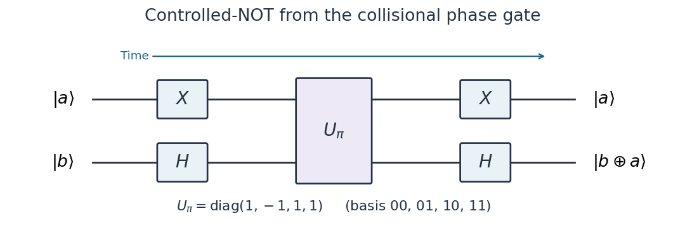

<h1 id="8/1/solution">Solution</h1>

↑ **Parent:** [1](../1.md)

A [universal quantum gate set](../../../../../universal-quantum-gate-set.md) can implement any [unitary operator](../../../../../unitary-operator.md) on any finite number of [qubits](../../../../../qubit.md), exactly when arbitrary continuous gate parameters are allowed, or to arbitrary accuracy with a suitable finite gate alphabet. More precisely, for every target $V$ and $\epsilon>0$ there is a finite [quantum circuit](../../../../../quantum-circuit-split.md) $W$ with $\min_\gamma\|W-e^{i\gamma}V\|<\epsilon$ in [operator norm](../../../../../operator-norm.md). This ignores only an overall [global phase](../../../../../global-phase.md) of the complete operation. Universality lets a fixed collection of controllable elementary operations run arbitrary [quantum algorithms](../../../../../quantum-algorithm.md) rather than requiring a different physical interaction for each algorithm.

All single-[qubit](../../../../../qubit.md) [unitary gates](../../../../../quantum-logic-gate.md), together with the [controlled-NOT gate](../../../../../controlled-not-gate.md) between selectable pairs, form an exact [universal quantum gate set](../../../../../universal-quantum-gate-set.md). One way to see sufficiency is to eliminate entries of a finite [unitary matrix](../../../../../unitary-matrix.md) by two-level rotations between [computational basis](../../../../../computational-basis.md) vectors; these rotations decompose into controlled single-[qubit](../../../../../qubit.md) rotations, which in turn decompose into single-[qubit](../../../../../qubit.md) gates and [controlled-NOT gates](../../../../../controlled-not-gate.md). Single-[qubit](../../../../../qubit.md) gates alone preserve [product states](../../../../../product-state.md) and cannot supply general [quantum entanglement](../../../../../entangled-state.md). A finite approximate universal example is the [Hadamard gate](../../../../../hadamard-gate.md), the [T gate](../../../../../t-gate.md) $T=\operatorname{diag}(1,e^{i\pi/4})$, and the [controlled-NOT gate](../../../../../controlled-not-gate.md); finite exact words over a finite alphabet cannot represent every continuously parameterized [unitary operator](../../../../../unitary-operator.md) exactly.

Distinguish the [Hamiltonian operator](../../../../../hamiltonian-quantum-mechanics.md) $H_{\rm int}$ from the [Hadamard gate](../../../../../hadamard-gate.md) $H_{\rm Had}$. For the printed [collisional phase gate](../../../../../collisional-phase-gate.md),

$$
H_{\rm int}=\Omega|01\rangle\langle01|.
$$

As written, $\Omega$ has units of [energy](../../../../../energy-split.md). The [Schrödinger equation](../../../../../schrodinger-equation.md) gives

$$
\begin{array}{c|c}
\text{initial computational basis state}&\text{state after time }t\\\hline
|00\rangle&|00\rangle\\
|01\rangle&e^{-i\Omega t/\hbar}|01\rangle\\
|10\rangle&|10\rangle\\
|11\rangle&|11\rangle
\end{array}
$$

because only $|01\rangle$ has a nonzero [energy eigenvalue](../../../../../energy-eigenvalue-split.md). In the ordered [computational basis](../../../../../computational-basis.md) $(00,01,10,11)$, define

$$
\boxed{U_\phi=e^{-iH_{\rm int}\tau/\hbar}
=I+(e^{-i\phi}-1)|01\rangle\langle01|
=\operatorname{diag}(1,e^{-i\phi},1,1),\qquad \phi=\frac{\Omega\tau}{\hbar}.}
$$

If an interaction strength is instead quoted as an [angular frequency](../../../../../angular-frequency.md) $\Omega_{\rm f}$, the [Hamiltonian operator](../../../../../hamiltonian-quantum-mechanics.md) is $\hbar\Omega_{\rm f}|01\rangle\langle01|$ and $\phi=\Omega_{\rm f}\tau$. An alternative definition with $e^{+i\phi}$ would have $\phi=-\Omega\tau/\hbar$. The minus sign above follows the usual [time-evolution operator](../../../../../time-evolution-operator.md) convention. At $\phi=\pi$ these conventions give the same $U_\pi$.

For the [quantum circuit](../../../../../quantum-circuit-split.md), use $X$ on the first [qubit](../../../../../qubit.md) to move the selective minus sign from $01$ to $11$:

$$
(X\otimes I)U_\pi(X\otimes I)=\operatorname{diag}(1,1,1,-1)=\mathrm{CZ}.
$$

Conjugating the target of this [Controlled-Z gate](../../../../../controlled-z-gate.md) by the [Hadamard gate](../../../../../hadamard-gate.md) gives the required [controlled-NOT gate](../../../../../controlled-not-gate.md):

$$
\boxed{\mathrm{CNOT}_{1\to2}
=(I\otimes H_{\rm Had})(X\otimes I)U_\pi(X\otimes I)(I\otimes H_{\rm Had})
=(X\otimes H_{\rm Had})U_\pi(X\otimes H_{\rm Had}).}
$$

The rightmost [matrix](../../../../../matrix.md) acts first. Thus the network applies $X_1,H_2$, then $U_\pi$, then $X_1,H_2$, and maps $|a,b\rangle$ to $|a,b\oplus a\rangle$, where $\oplus$ is [exclusive or](../../../../../exclusive-or.md).

**[Figure 1](#8/1/image-controlled-not-from-the-printed-collisional-phase-gate). Controlled-NOT from the printed collisional phase gate**. Time runs from left to right. Pauli X gates act on the first wire and Hadamard gates on the second, before and after the selective phase gate. The phase gate changes the sign of 01 only.

## ↑ Ancestors (13)

1. [1](../1.md)
2. [8](../../8.md)
3. [7 and 8](../../../7-and-8-split.md)
4. [2005](../../../split.md)
5. [Past exam of the laser science and quantum information processing course of the University of Oxford](../../../../split.md)
6. [Laser science and quantum information processing course of the University of Oxford](../../../../../laser-science-and-quantum-information-processing-course-of-the-university-of-oxford.md)
7. [Year 4 of the physics course of the University of Oxford](../../../../../year-4-of-the-physics-course-of-the-university-of-oxford.md)
8. [Physics course of the University of Oxford](../../../../../physics-course-of-the-university-of-oxford.md)
9. [Undergraduate course of the University of Oxford](../../../../../undergraduate-course-of-the-university-of-oxford.md)
10. [Course of the University of Oxford](../../../../../course-of-the-university-of-oxford.md)
11. [University of Oxford](../../../../../university-of-oxford-split.md)
12. [List of universities](../../../../../list-of-universities.md)
13. [Codex Wiki](../../../../../split.md)
