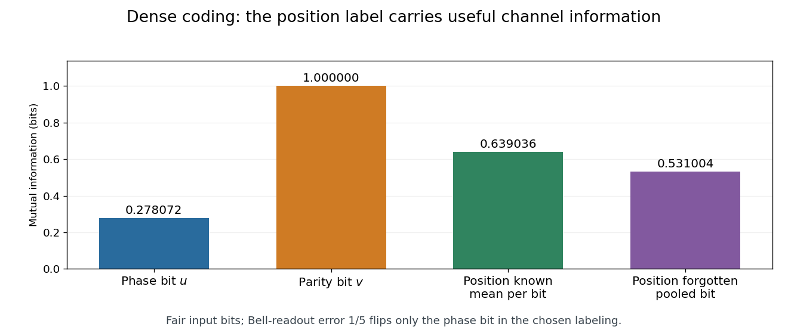

<h1 id="3/solution">Solution</h1>

↑ **Parent:** [3](../3.md)

The actual resource is a [two-component Bell resource in dense coding](../../../../two-component-bell-resource-in-dense-coding.md). Applying the same local encoder $X^vZ^u$ to

$$
|\chi\rangle=\frac{2|\Phi^+\rangle+|\Phi^-\rangle}{\sqrt5}
$$

gives a superposition of the intended [Bell state](../../../../bell-state-split.md) with amplitude magnitude $2/\sqrt5$ and its phase-label partner with amplitude magnitude $1/\sqrt5$. A [Bell-basis measurement](../../../../bell-basis-measurement.md) therefore reports **the wrong Bell state with probability $1/5$**, independently of $uv$. With our labeling, only the phase bit $u$ flips:

$$
(\widehat u,\widehat v)=(u\oplus N,v),\qquad
P(N=1)=\frac15.
$$

The first bit of each pair passes through a [binary symmetric channel](../../../../binary-symmetric-channel.md) with error $1/5$; the second bit is correct. A uniformly chosen bit from the full stream consequently has

$$
\boxed{P_{\rm bit\ error}=\frac12\cdot\frac15=\frac1{10}.}
$$

This bit error probability **depends on the Bell labeling**. The [Bell-label Hamming distance and bit errors](../../../../bell-label-hamming-distance-and-bit-errors.md) rule multiplies the wrong-symbol probability by the number of bit positions changed. For example, relabel $\Phi^+,\Phi^-,\Psi^+,\Psi^-$ as $00,11,01,10$. Both wrong-state partner pairs then differ in two bits, giving bit error probability **$1/5$** instead of $1/10$. The physical wrong-Bell-state probability remains $1/5$.

For the entropy-matched independent source in part 2, the transmitted bit stream is fair, and consecutive two-bit labels are uniform. Write the [binary entropy](../../../../binary-entropy.md) as $h_2(p)=-p\log_2p-(1-p)\log_2(1-p)$. If a bit position is chosen uniformly and its phase/parity position is forgotten, the pooled corresponding-bit pair is a [binary symmetric channel](../../../../binary-symmetric-channel.md) with error $1/10$. Its [mutual information](../../../../mutual-information.md) is

$$
\boxed{I(B;\widehat B)=1-h_2(1/10)\simeq0.531004\ \text{bits}.}
$$

The [bit-position information in a binary channel](../../../../bit-position-information-in-a-binary-channel.md) distinguishes this pooled quantity from the information in the decoded blocks. Alice and Bob know which bit is first in each Bell label. Conditioned on that position $J$, the first bit gives $1-h_2(1/5)$ bits and the second gives one bit. Thus

$$
\boxed{I(B;\widehat B\mid J)=1-\frac12h_2(1/5)\simeq0.639036\ \text{bits per bit}.}
$$

Equivalently, the joint [mutual information](../../../../mutual-information.md) between the two-bit input and output labels is **$2-h_2(1/5)\simeq1.278072$ bits per transmitted Bell label** for the prescribed Bell measurement. Pooling without the position loses usable side information; it is not interchangeable with this block rate. The stated fair-input values use the optimal source distribution above; biased source bits require their actual joint distribution.

**[Figure 1](#3/image-mutual-information-for-the-two-bell-label-positions-and-for-known-or-forgotten-bit-positions). Mutual information for the two Bell-label positions and for known or forgotten bit positions**. Original calculations for independent fair input bits, Bell-readout error $1/5$, and the labeling in the solution. The first bit may flip while the second is noiseless. Knowing which position a bit occupies retains more information than pooling the two channels and discarding that label.

## ↑ Ancestors (12)

1. [3](../3.md)
2. [7](../../7-split.md)
3. [2006](../../split.md)
4. [Past exam of the laser science and quantum information processing course of the University of Oxford](../../../split.md)
5. [Laser science and quantum information processing course of the University of Oxford](../../../../laser-science-and-quantum-information-processing-course-of-the-university-of-oxford.md)
6. [Year 4 of the physics course of the University of Oxford](../../../../year-4-of-the-physics-course-of-the-university-of-oxford.md)
7. [Physics course of the University of Oxford](../../../../physics-course-of-the-university-of-oxford.md)
8. [Undergraduate course of the University of Oxford](../../../../undergraduate-course-of-the-university-of-oxford.md)
9. [Course of the University of Oxford](../../../../course-of-the-university-of-oxford.md)
10. [University of Oxford](../../../../university-of-oxford-split.md)
11. [List of universities](../../../../list-of-universities.md)
12. [Codex Wiki](../../../../split.md)
