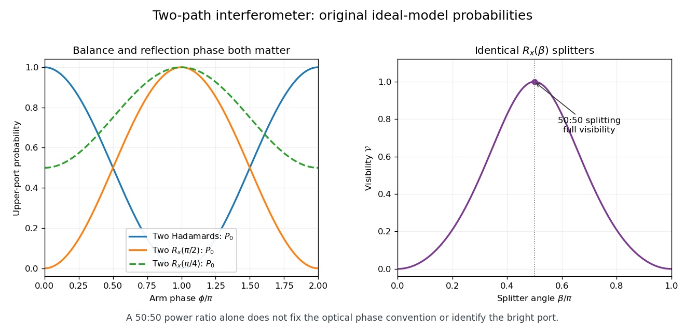

# 5

↑ **Parent:** [2007](../2007.md)

Source extract: [https://users.physics.ox.ac.uk/~Foot/C2/pdf/C22007Q5.pdf](https://users.physics.ox.ac.uk/~Foot/C2/pdf/C22007Q5.pdf)

The year is attributed from the preserved Oxford support-page record; it is not printed on the held page.

TODO: The remainder of this historical paper is not held. Only the supplied question is covered.

**Table of contents**

- [1](#1)
  - [Solution](#1/solution)
- [2](#2)
  - [Solution](#2/solution)
- [3](#3)
  - [Solution](#3/solution)

## 1

↑ **Parent:** [5](5.md)

<h3 id="1/solution">Solution</h3>

↑ **Parent:** [1](#1)

Represent the [single-photon state](../../quantum-mechanics.md#single-photon-state) by its two path [probability amplitudes](../../wave-function.md#probability-amplitude). The first [Hadamard gate](../../quantum-theory.md#hadamard-gate) sends $|0\rangle$ to $(|0\rangle+|1\rangle)/\sqrt2$. With $P(\phi)=\operatorname{diag}(1,e^{i\phi})$ for the lower-arm [phase shifter](../../optical-instrument.md#phase-shifter), the complete [Mach-Zehnder interferometer](../../optical-instrument.md#mach-zehnder-interferometer) gives

$$
H P(\phi)H|0\rangle
=\frac{1+e^{i\phi}}2|0\rangle+\frac{1-e^{i\phi}}2|1\rangle
=e^{i\phi/2}\left(\cos\frac\phi2|0\rangle-i\sin\frac\phi2|1\rangle\right).
$$

The [global phase](../../quantum-system.md#global-phase) has no effect on detection. By the [Born rule](../../wave-function.md#born-rule),

$$
\boxed{P_0(\phi)=\cos^2\frac\phi2,\qquad P_1(\phi)=\sin^2\frac\phi2.}
$$

They sum to one. At $\phi=0$, port 1 is a [dark port](../../optical-instrument.md#dark-port); at $\phi=\pi$, the roles reverse. The result uses coherent addition of the path amplitudes, rather than addition of separate path [probabilities](../../probability-theory.md#probability).

## 2

↑ **Parent:** [5](5.md)

<h3 id="2/solution">Solution</h3>

↑ **Parent:** [2](#2)

Write $R_z(\theta)=e^{-i\theta Z/2}$ and $R_x(\theta)=e^{-i\theta X/2}$, using the [Pauli operators](../../quantum-circuit.md#pauli-operator). The [Hadamard gate](../../quantum-theory.md#hadamard-gate) obeys $HZH=X$, so [unitary conjugation](../../vector-space.md#unitary-conjugation) of the [matrix exponential](../../linear-operator-theory.md#matrix-exponential) gives $H R_z(\beta)H=R_x(\beta)$. Therefore the [symmetric z-x-z beam splitter factorization](../../optical-instrument.md#symmetric-z-x-z-beam-splitter-factorization) is

$$
R_z(\alpha)H R_z(\beta)H R_z(\alpha)
=R_z(\alpha)R_x(\beta)R_z(\alpha)
=\begin{pmatrix}
e^{-i\alpha}\cos(\beta/2)&-i\sin(\beta/2)\\
-i\sin(\beta/2)&e^{i\alpha}\cos(\beta/2)
\end{pmatrix}.
$$

The rightmost operator acts first. Each factor is [unitary](../../vector-bundle.md#unitary-connection), which also proves the given matrix is unitary. Choosing

$$
\boxed{\alpha=\frac\pi2,\qquad\beta=\frac\pi2}
$$

gives $U_{\rm BS}=-iH$, so it is exactly a [Hadamard gate](../../quantum-theory.md#hadamard-gate) up to [global phase](../../quantum-system.md#global-phase).

For the specified identical splitters with $\alpha=0$, put $c=\cos(\beta/2)$ and $s=\sin(\beta/2)$. Here $U_{\rm BS}=R_x(\beta)$, and direct multiplication gives

$$
U_{\rm BS}P(\phi)U_{\rm BS}|0\rangle
=(c^2-e^{i\phi}s^2)|0\rangle-ics(1+e^{i\phi})|1\rangle.
$$

Thus the upper-port probability is

$$
\boxed{P_0=c^4+s^4-2c^2s^2\cos\phi
=1-\sin^2\beta\cos^2\frac\phi2,}
$$

with $P_1=\sin^2\beta\cos^2(\phi/2)$. These [identical beam splitters in a two-path interferometer](../../optical-instrument.md#identical-beam-splitters-in-a-two-path-interferometer) give a nonconstant [interference fringe](../../physical-optics.md#interference-fringe) whenever $\sin\beta\ne0$. With this matrix and port convention, two identical balanced splitters swap the bright and dark ports relative to the two-Hadamard model: at $\phi=0$, $R_x(\pi/2)^2=-iX$. The reflection phases must remain in the calculation.

The upper-port maximum and minimum are $1$ and $\cos^2\beta$. Hence the peak-to-peak modulation is $\sin^2\beta$ and its normalized [interferometric visibility](../../physical-optics.md#interferometric-visibility) is

$$
\mathcal V=\frac{P_{\max}-P_{\min}}{P_{\max}+P_{\min}}
=\frac{\sin^2\beta}{1+\cos^2\beta}.
$$

Both measures of contrast are maximal precisely for

$$
\boxed{\beta=\frac\pi2+k\pi,\qquad k\in\mathbb Z.}
$$

These are [balanced beam splitters](../../optical-instrument.md#balanced-beam-splitter), with equal single-input transmission and reflection probabilities. When $\beta\in\pi\mathbb Z$, only one route contributes to the output and the fringes disappear.

**[Figure 1](#2/image-interferometer-fringes-with-explicit-beam-splitter-phases-and-the-balance-condition-for-full-visibility). Interferometer fringes with explicit beam-splitter phases and the balance condition for full visibility**. Original ideal-model calculations, not measured data. The first panel compares the Hadamard convention with two identical $R_x$ splitters; the output-port phase shift remains visible even at 50:50 balance. The second panel shows the normalized upper-port visibility.

## 3

↑ **Parent:** [5](5.md)

<h3 id="3/solution">Solution</h3>

↑ **Parent:** [3](#3)

Calibrate the two-Hadamard [Mach-Zehnder interferometer](../../optical-instrument.md#mach-zehnder-interferometer) so that the passive box leaves no relative [wave phase](../../wave.md#phase-waves) or path disturbance. Then $H^2|0\rangle=|0\rangle$, and port 1 is dark. A photon at port 1 is therefore impossible for the passive box under these assumptions.

For an active ideal detector in arm 1, the first [Hadamard gate](../../quantum-theory.md#hadamard-gate) prepares $(|0\rangle+|1\rangle)/\sqrt2$. Absorption, which triggers the detector, has probability $1/2$. On a no-absorption outcome, the surviving unnormalized state is $|0\rangle/\sqrt2$. Applying the second Hadamard gives

$$
H\frac{|0\rangle}{\sqrt2}=\frac{|0\rangle+|1\rangle}{2}.
$$

Its squared norm is $1/2$, the survival probability; normalizing it earlier and forgetting that probability would overcount successful trials. The unconditional outcomes for an active detector are

$$
\boxed{P(\text{absorption})=\frac12,\quad
P(\text{port }0)=\frac14,\quad P(\text{port }1)=\frac14.}
$$

Thus **a port-1 click identifies an active detector without triggering it**, with **single-pass success probability $1/4$**, conditional on testing an active device. A port-0 click is inconclusive. Among trials in which the photon survives, half are successful, but that conditional fraction is not the single-pass success probability.

This is the [balanced Hadamard interaction-free measurement](../../quantum-measurement.md#balanced-hadamard-interaction-free-measurement) version of the [Elitzur-Vaidman bomb tester](../../quantum-measurement.md#elitzur-vaidman-bomb-tester). Conditioning on no absorption changes the [quantum coherence](../../density-matrix.md#quantum-coherence-in-a-specified-basis) available for recombination; a calibrated dark-port click reveals that change. An uncontrolled phase shift in the passive arm could also brighten the port, so the inference depends on the stated optical calibration. It does not assign an observed classical trajectory to the photon before detection. If the same active device is retested after inconclusive clicks, the [repeated weak-rotation bomb-test efficiency](../../quantum-measurement.md#repeated-weak-rotation-bomb-test-efficiency) gives eventual success $(1/4)/(1-1/4)=1/3$; the requested single pass remains $1/4$.

## ↑ Ancestors (10)

1. [2007](../2007.md)
2. [Past exam of the laser science and quantum information processing course of the University of Oxford](../../past-exam-of-the-laser-science-and-quantum-information-processing-course-of-the-university-of-oxford.md)
3. [Laser science and quantum information processing course of the University of Oxford](../../university-of-oxford.md#laser-science-and-quantum-information-processing-course-of-the-university-of-oxford)
4. [Year 4 of the physics course of the University of Oxford](../../university-of-oxford.md#year-4-of-the-physics-course-of-the-university-of-oxford)
5. [Physics course of the University of Oxford](../../university-of-oxford.md#physics-course-of-the-university-of-oxford)
6. [Undergraduate course of the University of Oxford](../../university-of-oxford.md#undergraduate-course-of-the-university-of-oxford)
7. [Course of the University of Oxford](../../university-of-oxford.md#course-of-the-university-of-oxford)
8. [University of Oxford](../../university-of-oxford.md)
9. [List of universities](../../README.md#list-of-universities)
10. [Codex Wiki](../../README.md)
