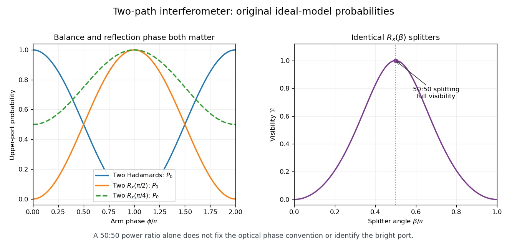

<h1 id="2/solution">Solution</h1>

↑ **Parent:** [2](../2.md)

Write $R_z(\theta)=e^{-i\theta Z/2}$ and $R_x(\theta)=e^{-i\theta X/2}$, using the [Pauli operators](../../../../pauli-operator.md). The [Hadamard gate](../../../../hadamard-gate.md) obeys $HZH=X$, so [unitary conjugation](../../../../unitary-conjugation.md) of the [matrix exponential](../../../../matrix-exponential.md) gives $H R_z(\beta)H=R_x(\beta)$. Therefore the [symmetric z-x-z beam splitter factorization](../../../../symmetric-z-x-z-beam-splitter-factorization.md) is

$$
R_z(\alpha)H R_z(\beta)H R_z(\alpha)
=R_z(\alpha)R_x(\beta)R_z(\alpha)
=\begin{pmatrix}
e^{-i\alpha}\cos(\beta/2)&-i\sin(\beta/2)\\
-i\sin(\beta/2)&e^{i\alpha}\cos(\beta/2)
\end{pmatrix}.
$$

The rightmost operator acts first. Each factor is [unitary](../../../../unitary-connection.md), which also proves the given matrix is unitary. Choosing

$$
\boxed{\alpha=\frac\pi2,\qquad\beta=\frac\pi2}
$$

gives $U_{\rm BS}=-iH$, so it is exactly a [Hadamard gate](../../../../hadamard-gate.md) up to [global phase](../../../../global-phase.md).

For the specified identical splitters with $\alpha=0$, put $c=\cos(\beta/2)$ and $s=\sin(\beta/2)$. Here $U_{\rm BS}=R_x(\beta)$, and direct multiplication gives

$$
U_{\rm BS}P(\phi)U_{\rm BS}|0\rangle
=(c^2-e^{i\phi}s^2)|0\rangle-ics(1+e^{i\phi})|1\rangle.
$$

Thus the upper-port probability is

$$
\boxed{P_0=c^4+s^4-2c^2s^2\cos\phi
=1-\sin^2\beta\cos^2\frac\phi2,}
$$

with $P_1=\sin^2\beta\cos^2(\phi/2)$. These [identical beam splitters in a two-path interferometer](../../../../identical-beam-splitters-in-a-two-path-interferometer.md) give a nonconstant [interference fringe](../../../../interference-fringe.md) whenever $\sin\beta\ne0$. With this matrix and port convention, two identical balanced splitters swap the bright and dark ports relative to the two-Hadamard model: at $\phi=0$, $R_x(\pi/2)^2=-iX$. The reflection phases must remain in the calculation.

The upper-port maximum and minimum are $1$ and $\cos^2\beta$. Hence the peak-to-peak modulation is $\sin^2\beta$ and its normalized [interferometric visibility](../../../../interferometric-visibility.md) is

$$
\mathcal V=\frac{P_{\max}-P_{\min}}{P_{\max}+P_{\min}}
=\frac{\sin^2\beta}{1+\cos^2\beta}.
$$

Both measures of contrast are maximal precisely for

$$
\boxed{\beta=\frac\pi2+k\pi,\qquad k\in\mathbb Z.}
$$

These are [balanced beam splitters](../../../../balanced-beam-splitter.md), with equal single-input transmission and reflection probabilities. When $\beta\in\pi\mathbb Z$, only one route contributes to the output and the fringes disappear.

**[Figure 1](#2/image-interferometer-fringes-with-explicit-beam-splitter-phases-and-the-balance-condition-for-full-visibility). Interferometer fringes with explicit beam-splitter phases and the balance condition for full visibility**. Original ideal-model calculations, not measured data. The first panel compares the Hadamard convention with two identical $R_x$ splitters; the output-port phase shift remains visible even at 50:50 balance. The second panel shows the normalized upper-port visibility.

## ↑ Ancestors (12)

1. [2](../2.md)
2. [5](../../5-split.md)
3. [2007](../../split.md)
4. [Past exam of the laser science and quantum information processing course of the University of Oxford](../../../split.md)
5. [Laser science and quantum information processing course of the University of Oxford](../../../../laser-science-and-quantum-information-processing-course-of-the-university-of-oxford.md)
6. [Year 4 of the physics course of the University of Oxford](../../../../year-4-of-the-physics-course-of-the-university-of-oxford.md)
7. [Physics course of the University of Oxford](../../../../physics-course-of-the-university-of-oxford.md)
8. [Undergraduate course of the University of Oxford](../../../../undergraduate-course-of-the-university-of-oxford.md)
9. [Course of the University of Oxford](../../../../course-of-the-university-of-oxford.md)
10. [University of Oxford](../../../../university-of-oxford-split.md)
11. [List of universities](../../../../list-of-universities.md)
12. [Codex Wiki](../../../../split.md)
