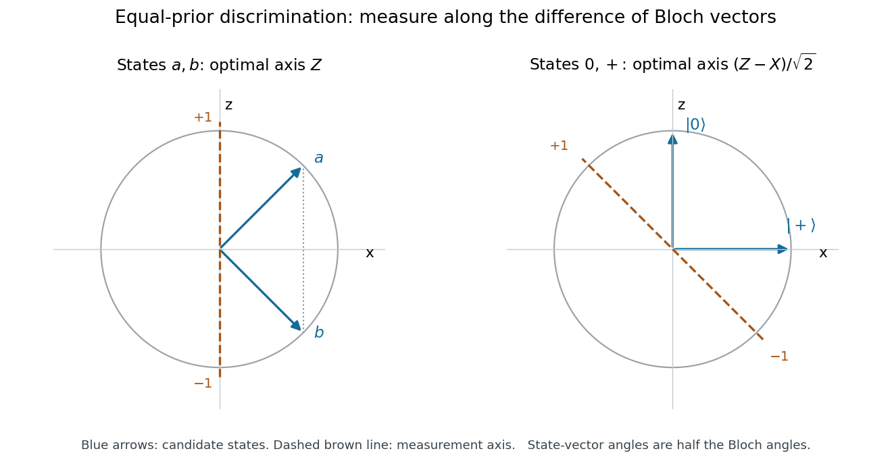

# 5

↑ **Parent:** [2008](../2008.md)

Source extract: [https://users.physics.ox.ac.uk/~Foot/C2/pdf/C22008Q5.pdf](https://users.physics.ox.ac.uk/~Foot/C2/pdf/C22008Q5.pdf)

The year is attributed from the preserved Oxford support-page record; it is not printed on the held page.

TODO: The remainder of this historical paper is not held. Only the supplied question is covered.

**Table of contents**

- [1](#1)
  - [Solution](#1/solution)
- [2](#2)
  - [Solution](#2/solution)
- [3](#3)
  - [Solution](#3/solution)
- [4](#4)
  - [Solution](#4/solution)

## 1

↑ **Parent:** [5](5.md)

<h3 id="1/solution">Solution</h3>

↑ **Parent:** [1](#1)

For a normalized [pure state](../../quantum-theory.md#pure-state), expand $|\psi\rangle=\sum_m c_m|m\rangle$ in an [orthonormal basis](../../inner-product.md#orthonormal-basis) of [eigenvectors](../../linear-operator-theory.md#eigenvector) of the measured [Hermitian operator](../../hilbert-space.md#hermitian-operator). The [Born rule](../../wave-function.md#born-rule) assigns outcome $m$ the [probability](../../probability-theory.md#probability) $p_m=|c_m|^2$. Under the ideal [projective measurement](../../quantum-measurement.md#projective-measurement) update, a nondegenerate outcome leaves $|m\rangle$, up to a [global phase](../../quantum-system.md#global-phase). The sum of the outcome probabilities is one, and the [expectation value](../../quantum-system.md#expectation-value) is $\sum_m m|c_m|^2$; a single trial reports one eigenvalue, not that average.

If $M|m\rangle=m|m\rangle$, then

$$
m\langle m|m\rangle=\langle m|M|m\rangle
=\overline{\langle m|M|m\rangle}
=\overline m\langle m|m\rangle,
$$

since $M=M^\dagger$. A nonzero [eigenvector](../../linear-operator-theory.md#eigenvector) has positive squared [norm](../../normed-vector-space.md#norm), so **$m$ is real**. For two eigenvectors,

$$
\langle n|M|m\rangle=m\langle n|m\rangle
=\langle Mn|m\rangle=n\langle n|m\rangle.
$$

Thus $(m-n)\langle n|m\rangle=0$: **distinct eigenvalues have orthogonal eigenvectors**.

## 2

↑ **Parent:** [5](5.md)

<h3 id="2/solution">Solution</h3>

↑ **Parent:** [2](#2)

The overlap $\langle0|+\rangle=1/\sqrt2$ is nonzero, whereas [perfect discrimination of pure states requires orthogonality](../../quantum-measurement.md#perfect-discrimination-of-pure-states-requires-orthogonality). Consequently no single-copy [quantum measurement](../../quantum-measurement.md) can identify both preparations with certainty. After a nondegenerate [projective measurement](../../quantum-measurement.md#projective-measurement), the [loss of preparation information after a nondegenerate projective measurement](../../quantum-measurement.md#loss-of-preparation-information-after-a-nondegenerate-projective-measurement) prevents further measurements from recovering the missing label: conditional on the first outcome, the post-measurement state is the same for every compatible initial hypothesis. Repeating the same basis gives that outcome again; changing basis probes the collapsed state. Fresh, independently prepared copies would be additional resources.

In the [computational basis](../../quantum-theory.md#computational-basis), input $|0\rangle$ always gives zero and remains $|0\rangle$. Input $|+\rangle$ gives zero or one with probability $1/2$, leaving the corresponding basis state. Combining these likelihoods with equal prior [probabilities](../../probability-theory.md#probability), the [Bayesian update after a projective measurement](../../quantum-information-theory.md#bayesian-update-after-a-projective-measurement) gives

$$
\begin{array}{c|c|cc}
\text{outcome}&P(\text{outcome})&P(\text{input }0\mid\text{outcome})&P(\text{input }+\mid\text{outcome})\\\hline
0&3/4&2/3&1/3\\
1&1/4&0&1
\end{array}.
$$

For example, [Bayes' theorem](../../probability-theory.md#bayes-theorem) gives $P(0\text{ input}\mid0\text{ outcome})=(1/2)/(3/4)=2/3$. **Outcome one certifies input $|+\rangle$; outcome zero is ambiguous.** Both inputs that give outcome zero leave exactly the same post-measurement state $|0\rangle$.

In the [Hadamard basis](../../quantum-theory.md#hadamard-basis), input $|+\rangle$ always gives $+$, while input $|0\rangle$ gives $+$ or $-$ equally. Therefore

$$
\begin{array}{c|c|cc}
\text{outcome}&P(\text{outcome})&P(\text{input }0\mid\text{outcome})&P(\text{input }+\mid\text{outcome})\\\hline
+&3/4&1/3&2/3\\
-&1/4&1&0
\end{array}.
$$

**Outcome minus certifies input $|0\rangle$; outcome plus is ambiguous.** Guessing the more likely input after the ambiguous outcome gives success probability **$3/4$** for either of these two fixed-basis measurements.

## 3

↑ **Parent:** [5](5.md)

<h3 id="3/solution">Solution</h3>

↑ **Parent:** [3](#3)

Put $q=\cos^2(\pi/8)=(2+\sqrt2)/4$ and $1-q=\sin^2(\pi/8)$. In the [computational basis](../../quantum-theory.md#computational-basis), input $|a\rangle$ has outcome probabilities $(q,1-q)$, while $|b\rangle$ has $(1-q,q)$. The marginal outcomes are equally likely; the [Bayesian posterior](../../bayesian-statistics.md#bayesian-posterior) probabilities are

$$
\begin{array}{c|c|cc}
\text{outcome}&P(\text{outcome})&P(a\mid\text{outcome})&P(b\mid\text{outcome})\\\hline
0&1/2&q&1-q\\
1&1/2&1-q&q
\end{array}.
$$

Guess $a$ after zero and $b$ after one. Each guess is correct with probability **$q\simeq0.853553$** and wrong with probability **$1-q\simeq0.146447$**. Neither outcome is certain evidence for one input.

For a real state $|\psi_\theta\rangle=\cos\theta|0\rangle+\sin\theta|1\rangle$, the [Born rule](../../wave-function.md#born-rule) in the [Hadamard basis](../../quantum-theory.md#hadamard-basis) gives $P(\pm\mid\theta)=(1\pm\sin2\theta)/2$. Both angles $\pi/8$ and $3\pi/8$ have $\sin2\theta=1/\sqrt2$. Thus both preparations give $P(+)=q$ and $P(-)=1-q$. By [Bayes' theorem](../../probability-theory.md#bayes-theorem), **either outcome leaves the two input hypotheses equally likely**. The biased outcome frequencies carry no information about which state was prepared; the best success probability with this measurement is **$1/2$**.

## 4

↑ **Parent:** [5](5.md)

<h3 id="4/solution">Solution</h3>

↑ **Parent:** [4](#4)

The [Bloch vectors](../../density-matrix.md#bloch-vector) of $|a\rangle$ and $|b\rangle$ are

$$
\mathbf r_a=(1/\sqrt2,0,1/\sqrt2),\qquad
\mathbf r_b=(1/\sqrt2,0,-1/\sqrt2).
$$

They share the same $x$ component and differ along $z$. The [equal-prior discrimination of qubit states](../../quantum-information-theory.md#equal-prior-discrimination-of-qubit-states) therefore selects the $Z$ axis: it maximizes the separation of their projected outcome probabilities. This also explains why the $X$ measurement in part 3 is uninformative.

For $|0\rangle$ and $|+\rangle$, the Bloch vectors are $(0,0,1)$ and $(1,0,0)$. Their difference points along $\mathbf n=(-1,0,1)/\sqrt2$. Hence [Carl W. Helstrom](../../electrical-engineering.md#carl-w-helstrom)'s [Helstrom measurement for the zero and plus states](../../quantum-theory.md#helstrom-measurement-for-the-zero-and-plus-states) measures

$$
\boxed{M_{\rm opt}=\frac{Z-X}{\sqrt2},\qquad
P_\pm=\frac{I\pm M_{\rm opt}}2.}
$$

Guess $|0\rangle$ after $P_+$ and $|+\rangle$ after $P_-$. An explicit [orthonormal basis](../../inner-product.md#orthonormal-basis) for these projectors is

$$
|h_+\rangle=\cos(\pi/8)|0\rangle-\sin(\pi/8)|1\rangle,\qquad
|h_-\rangle=\sin(\pi/8)|0\rangle+\cos(\pi/8)|1\rangle.
$$

The positive measurement axis is tilted by $\pi/4$ from $+z$ towards $-x$ on the [Bloch sphere](../../density-matrix.md#bloch-sphere); the corresponding state-vector rotation angle is $-\pi/8$.

**[Figure 1](#4/image-bloch-sphere-cross-sections-for-the-two-equal-prior-discrimination-problems). Bloch-sphere cross-sections for the two equal-prior discrimination problems**. Solid arrows are the candidate-state [Bloch vectors](../../density-matrix.md#bloch-vector). Dashed lines show the optimal measurement axes. The first pair has identical $x$ projections; the second is separated most strongly along $(z-x)/\sqrt2$.

For completeness, if a projective measurement guesses $0$ along a unit Bloch axis $\mathbf n$, its average success is $1/2+(n_z-n_x)/4$. The [Cauchy-Schwarz inequality](../../probability-and-statistics.md#cauchy-schwarz-inequality) bounds $n_z-n_x\le\sqrt2$, with equality at the axis above. The [Holevo–Helstrom theorem](../../quantum-information-theory.md#holevo-helstrom-theorem) shows this optimum also holds among general [POVMs](../../quantum-measurement.md#positive-operator-valued-measure). Thus

$$
\boxed{P_{\rm success}^{\rm opt}=\frac12\left(1+\frac1{\sqrt2}\right),\qquad
P_{\rm error}^{\rm opt}=\frac12\left(1-\frac1{\sqrt2}\right).}
$$

## ↑ Ancestors (10)

1. [2008](../2008.md)
2. [Past exam of the laser science and quantum information processing course of the University of Oxford](../../past-exam-of-the-laser-science-and-quantum-information-processing-course-of-the-university-of-oxford.md)
3. [Laser science and quantum information processing course of the University of Oxford](../../university-of-oxford.md#laser-science-and-quantum-information-processing-course-of-the-university-of-oxford)
4. [Year 4 of the physics course of the University of Oxford](../../university-of-oxford.md#year-4-of-the-physics-course-of-the-university-of-oxford)
5. [Physics course of the University of Oxford](../../university-of-oxford.md#physics-course-of-the-university-of-oxford)
6. [Undergraduate course of the University of Oxford](../../university-of-oxford.md#undergraduate-course-of-the-university-of-oxford)
7. [Course of the University of Oxford](../../university-of-oxford.md#course-of-the-university-of-oxford)
8. [University of Oxford](../../university-of-oxford.md)
9. [List of universities](../../README.md#list-of-universities)
10. [Codex Wiki](../../README.md)
