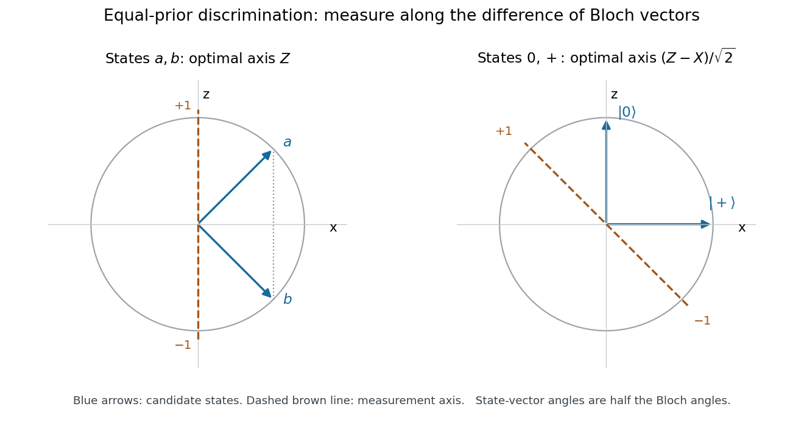

<h1 id="4/solution">Solution</h1>

↑ **Parent:** [4](../4.md)

The [Bloch vectors](../../../../bloch-vector.md) of $|a\rangle$ and $|b\rangle$ are

$$
\mathbf r_a=(1/\sqrt2,0,1/\sqrt2),\qquad
\mathbf r_b=(1/\sqrt2,0,-1/\sqrt2).
$$

They share the same $x$ component and differ along $z$. The [equal-prior discrimination of qubit states](../../../../equal-prior-discrimination-of-qubit-states.md) therefore selects the $Z$ axis: it maximizes the separation of their projected outcome probabilities. This also explains why the $X$ measurement in part 3 is uninformative.

For $|0\rangle$ and $|+\rangle$, the Bloch vectors are $(0,0,1)$ and $(1,0,0)$. Their difference points along $\mathbf n=(-1,0,1)/\sqrt2$. Hence [Carl W. Helstrom](../../../../carl-w-helstrom.md)'s [Helstrom measurement for the zero and plus states](../../../../helstrom-measurement-for-the-zero-and-plus-states.md) measures

$$
\boxed{M_{\rm opt}=\frac{Z-X}{\sqrt2},\qquad
P_\pm=\frac{I\pm M_{\rm opt}}2.}
$$

Guess $|0\rangle$ after $P_+$ and $|+\rangle$ after $P_-$. An explicit [orthonormal basis](../../../../orthonormal-basis.md) for these projectors is

$$
|h_+\rangle=\cos(\pi/8)|0\rangle-\sin(\pi/8)|1\rangle,\qquad
|h_-\rangle=\sin(\pi/8)|0\rangle+\cos(\pi/8)|1\rangle.
$$

The positive measurement axis is tilted by $\pi/4$ from $+z$ towards $-x$ on the [Bloch sphere](../../../../bloch-sphere.md); the corresponding state-vector rotation angle is $-\pi/8$.

**[Figure 1](#4/image-bloch-sphere-cross-sections-for-the-two-equal-prior-discrimination-problems). Bloch-sphere cross-sections for the two equal-prior discrimination problems**. Solid arrows are the candidate-state [Bloch vectors](../../../../bloch-vector.md). Dashed lines show the optimal measurement axes. The first pair has identical $x$ projections; the second is separated most strongly along $(z-x)/\sqrt2$.

For completeness, if a projective measurement guesses $0$ along a unit Bloch axis $\mathbf n$, its average success is $1/2+(n_z-n_x)/4$. The [Cauchy-Schwarz inequality](../../../../cauchy-schwarz-inequality.md) bounds $n_z-n_x\le\sqrt2$, with equality at the axis above. The [Holevo–Helstrom theorem](../../../../holevo-helstrom-theorem.md) shows this optimum also holds among general [POVMs](../../../../positive-operator-valued-measure.md). Thus

$$
\boxed{P_{\rm success}^{\rm opt}=\frac12\left(1+\frac1{\sqrt2}\right),\qquad
P_{\rm error}^{\rm opt}=\frac12\left(1-\frac1{\sqrt2}\right).}
$$

## ↑ Ancestors (12)

1. [4](../4.md)
2. [5](../../5-split.md)
3. [2008](../../split.md)
4. [Past exam of the laser science and quantum information processing course of the University of Oxford](../../../split.md)
5. [Laser science and quantum information processing course of the University of Oxford](../../../../laser-science-and-quantum-information-processing-course-of-the-university-of-oxford.md)
6. [Year 4 of the physics course of the University of Oxford](../../../../year-4-of-the-physics-course-of-the-university-of-oxford.md)
7. [Physics course of the University of Oxford](../../../../physics-course-of-the-university-of-oxford.md)
8. [Undergraduate course of the University of Oxford](../../../../undergraduate-course-of-the-university-of-oxford.md)
9. [Course of the University of Oxford](../../../../course-of-the-university-of-oxford.md)
10. [University of Oxford](../../../../university-of-oxford-split.md)
11. [List of universities](../../../../list-of-universities.md)
12. [Codex Wiki](../../../../split.md)
