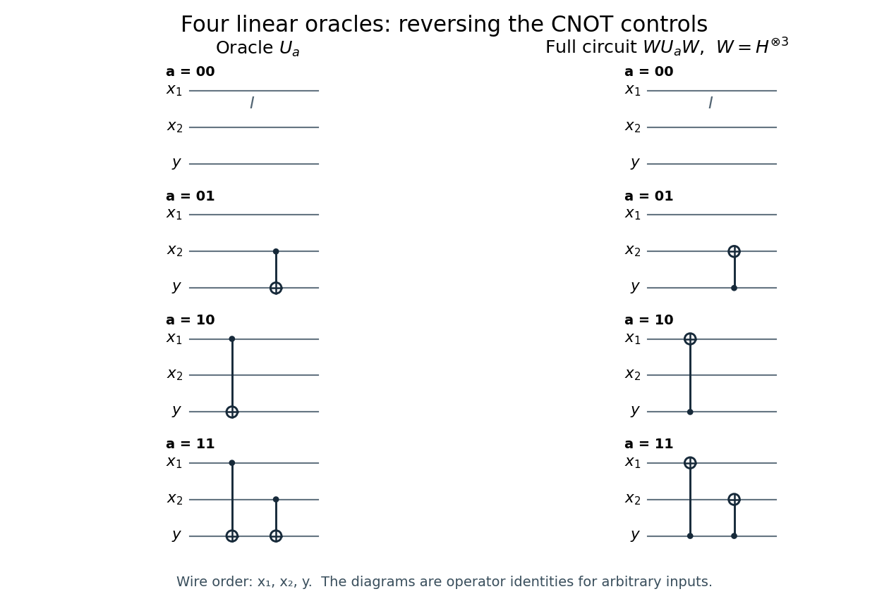

# 6

↑ **Parent:** [2010](../2010.md)

Source extract: [https://users.physics.ox.ac.uk/~Foot/C2/pdf/C22010Q6.pdf](https://users.physics.ox.ac.uk/~Foot/C2/pdf/C22010Q6.pdf)

The Oxford C2 support-page record attributes this extract to 2010. The held page prints the question number and identifiers above, but no year, examination stage or sitting date.

TODO: The remainder of the historical paper is not held; only this supplied question is covered.

**Table of contents**

- [1](#1)
  - [Solution](#1/solution)
- [2](#2)
  - [Solution](#2/solution)
- [3](#3)
  - [Solution](#3/solution)

## 1

↑ **Parent:** [6](6.md)

<h3 id="1/solution">Solution</h3>

↑ **Parent:** [1](#1)

Write $a=a_1a_2$ and $x=x_1x_2$, with the top wire carrying $x_1$, the middle wire $x_2$, and the bottom wire the [ancilla bit](../../quantum-information-theory.md#ancilla-bit) $y$. The [binary inner product](../../inner-product.md#binary-inner-product) is $a\cdot x=a_1x_1\oplus a_2x_2$, where $\oplus$ is [exclusive or](../../theoretical-computer-science.md#exclusive-or). Let $C_{j\to y}$ denote a [CNOT gate](../../quantum-theory.md#controlled-not-gate) controlled by wire $j$ and targeting $y$. The four [linear Boolean functions](../../analysis-of-boolean-functions.md#linear-boolean-function) and their [Boolean quantum oracles](../../quantum-theory.md#boolean-quantum-oracle) are:

| $a$ | $f_a(x)$ | [Reversible circuit](../../theoretical-computer-science.md#reversible-circuit) for $U_a$ | $00$ | $0$ | $I$: three unchanged wires | $01$ | $x_2$ | $C_{2\to y}$ | $10$ | $x_1$ | $C_{1\to y}$ | $11$ | $x_1\oplus x_2$ | $C_{2\to y}C_{1\to y}$ |
| --- | --- | --- | --- | --- | --- | --- | --- | --- | --- | --- | --- | --- | --- | --- |

The [CNOT gates](../../quantum-theory.md#controlled-not-gate) in the last row commute: their common target acquires the [exclusive or](../../theoretical-computer-science.md#exclusive-or) of the two controls. Each input wire is preserved, and applying any of these [reversible circuits](../../theoretical-computer-science.md#reversible-circuit) twice restores $y$.

**[Figure 1](#1/image-the-four-two-bit-linear-oracles-and-their-exact-simplifications-after-hadamard-gates-on-all-three-wires-a-filled-dot-is-a-control-and-a-circled-plus-is-a-target). The four two-bit linear oracles and their exact simplifications after Hadamard gates on all three wires; a filled dot is a control and a circled plus is a target**.

For classical [reversible computation](../../theoretical-computer-science.md#reversible-computation), call the unknown [function oracle](../../theoretical-computer-science.md#function-oracle) on $|10\rangle|0\rangle$ and $|01\rangle|0\rangle$. The resulting [ancilla bits](../../quantum-information-theory.md#ancilla-bit) are respectively $a_1$ and $a_2$:

$$
U_a|10\rangle|0\rangle=|10\rangle|a_1\rangle,
\qquad U_a|01\rangle|0\rangle=|01\rangle|a_2\rangle.
$$

Use a fresh zero [ancilla bit](../../quantum-information-theory.md#ancilla-bit) for each call, or preserve the first result in workspace before restoring the target to zero. Thus **two classical calls determine the two-bit string**.

For $n$ input [bits](../../information-theory.md#bit), query the [standard basis](../../vector-space.md#standard-basis) strings $e_j$, since $a\cdot e_j=a_j$. This gives an upper bound of $n$ calls. It is also optimal for exact identification: every classical query reveals at most one new [bit](../../information-theory.md#bit), since $x$ is unchanged and $y\oplus f_a(x)$ reveals just $f_a(x)$ when $y$ is known. A depth-$k$ [decision tree](../../theoretical-computer-science.md#decision-tree) has at most $2^k$ answer histories, but must distinguish $2^n$ possible hidden strings. Hence $k\ge n$, including adaptive strategies. The [classical query complexity of linear Boolean function identification](../../theoretical-computer-science.md#classical-query-complexity-of-linear-boolean-function-identification) is therefore

$$
\boxed{D(n)=n\quad(n\ge1).}
$$

## 2

↑ **Parent:** [6](6.md)

<h3 id="2/solution">Solution</h3>

↑ **Parent:** [2](#2)

Use the [Hadamard basis](../../quantum-theory.md#hadamard-basis) states $|\pm\rangle=(|0\rangle\pm|1\rangle)/\sqrt2$. The [Hadamard gate](../../quantum-theory.md#hadamard-gate) satisfies $H|0\rangle=|+\rangle$, $H|1\rangle=|-\rangle$, and $H^2=I$. After the first three [Hadamard gates](../../quantum-theory.md#hadamard-gate), the full [quantum state](../../quantum-system.md#quantum-state) is

$$
|\psi_1\rangle=|+\rangle|+\rangle|-\rangle
=\frac12\bigl(|00\rangle+|01\rangle+|10\rangle+|11\rangle\bigr)|-\rangle.
$$

The [Pauli X gate](../../quantum-theory.md#pauli-x-gate) obeys $X|-\rangle=-|-\rangle$. Consequently the [Boolean quantum oracle](../../quantum-theory.md#boolean-quantum-oracle) produces [phase kickback](../../quantum-theory.md#phase-kickback):

$$
U_a|x\rangle|-\rangle=(-1)^{a\cdot x}|x\rangle|-\rangle.
$$

Factoring out the [ancilla qubit](../../quantum-information-theory.md#ancilla-qubit), the four states immediately after the [function oracle](../../theoretical-computer-science.md#function-oracle) are

$$
\begin{aligned}
|\psi_{2,00}\rangle&=\tfrac12(|00\rangle+|01\rangle+|10\rangle+|11\rangle)|-\rangle=|++\rangle|-\rangle,\\
|\psi_{2,01}\rangle&=\tfrac12(|00\rangle-|01\rangle+|10\rangle-|11\rangle)|-\rangle=|+-\rangle|-\rangle,\\
|\psi_{2,10}\rangle&=\tfrac12(|00\rangle+|01\rangle-|10\rangle-|11\rangle)|-\rangle=|-+\rangle|-\rangle,\\
|\psi_{2,11}\rangle&=\tfrac12(|00\rangle-|01\rangle-|10\rangle+|11\rangle)|-\rangle=|--\rangle|-\rangle.
\end{aligned}
$$

The final [Hadamard gates](../../quantum-theory.md#hadamard-gate) send $|+\rangle$ to $|0\rangle$ and $|-\rangle$ to $|1\rangle$. In particular, the printed [quantum circuit](../../quantum-circuit.md) includes a final [Hadamard gate](../../quantum-theory.md#hadamard-gate) on the [ancilla qubit](../../quantum-information-theory.md#ancilla-qubit) too. Its full outputs, ordered as $x_1,x_2,y$, are

$$
\boxed{
\begin{array}{c|c}
a&|\psi_{\mathrm{out}}\rangle\\\hline
00&|001\rangle\\
01&|011\rangle\\
10&|101\rangle\\
11&|111\rangle
\end{array}}
$$

Thus **one oracle call identifies $a$ with certainty**: a [computational-basis measurement](../../quantum-theory.md#quantum-measurement-in-the-computational-basis) of the first two [qubits](../../quantum-system.md#qubit) returns $a_1a_2$. The [ancilla qubit](../../quantum-information-theory.md#ancilla-qubit) returns to $|1\rangle$ and carries no additional information about $a$. The [Bernstein-Vazirani algorithm](../../algorithm.md#bernstein-vazirani-algorithm) turns the pattern of relative [quantum phases](../../quantum-system.md#quantum-phase) into a definite [computational-basis state](../../quantum-theory.md#computational-basis-state).

## 3

↑ **Parent:** [6](6.md)

<h3 id="3/solution">Solution</h3>

↑ **Parent:** [3](#3)

The required identity is [CNOT control reversal in the Hadamard basis](../../quantum-theory.md#cnot-control-reversal-in-the-hadamard-basis). To derive it using standard [quantum circuit](../../quantum-circuit.md) identities, let $\mathrm{CZ}$ be the [Controlled-Z gate](../../quantum-theory.md#controlled-z-gate), which multiplies $|11\rangle$ by $-1$ and fixes the other [computational-basis states](../../quantum-theory.md#computational-basis-state). Since $HXH=Z$,

$$
C_{1\to2}=(I\otimes H)\,\mathrm{CZ}\,(I\otimes H).
$$

The [Controlled-Z gate](../../quantum-theory.md#controlled-z-gate) is symmetric in its two wires. Combining this symmetry with $H^2=I$ gives

$$
\begin{aligned}
(H\otimes H)C_{1\to2}(H\otimes H)
&=(H\otimes I)\,\mathrm{CZ}\,(H\otimes I)\\
&=\boxed{C_{2\to1}}.
\end{aligned}
$$

This is an **exact operator identity**, including its [global phase](../../quantum-system.md#global-phase), and applies to arbitrary inputs. One can also check it directly from the [orthogonal projectors](../../hilbert-space.md#orthogonal-projection) $P_b=|b\rangle\langle b|$: conjugating $C_{1\to2}=P_0\otimes I+P_1\otimes X$ by $H\otimes H$ gives

$$
\frac{I+X}{2}\otimes I+\frac{I-X}{2}\otimes Z
=I\otimes P_0+X\otimes P_1=C_{2\to1}.
$$

For the three-wire [quantum circuit](../../quantum-circuit.md), put $W=H^{\otimes3}$. Conjugation distributes over products because $W^2=I$: $WABW=(WAW)(WBW)$. Each [CNOT gate](../../quantum-theory.md#controlled-not-gate) in $U_a$ therefore reverses direction, while the [Hadamard gates](../../quantum-theory.md#hadamard-gate) on untouched wires cancel. The [Hadamard-conjugated linear oracle](../../algorithm.md#hadamard-conjugated-linear-oracle) is

$$
\boxed{WU_aW=C_{y\to2}^{\,a_2}C_{y\to1}^{\,a_1}.}
$$

These are the simplified [quantum circuits](../../quantum-circuit.md) in the figure: for $a=00$ there are no gates; for $a=01$ there is $C_{y\to2}$; for $a=10$ there is $C_{y\to1}$; and for $a=11$ there are both. The [ancilla qubit](../../quantum-information-theory.md#ancilla-qubit) becomes their common control. On every [computational-basis state](../../quantum-theory.md#computational-basis-state), the entire simplified circuit acts as

$$
|x_1x_2\rangle|b\rangle
\longmapsto
|x_1\oplus ba_1,\ x_2\oplus ba_2\rangle|b\rangle.
$$

Starting the data [qubits](../../quantum-system.md#qubit) at $|00\rangle$, the prescribed [computational basis](../../quantum-theory.md#computational-basis) preparation of the [ancilla qubit](../../quantum-information-theory.md#ancilla-qubit) must therefore be **$|1\rangle$**: it activates the required flips and gives $|a\rangle|1\rangle$. Starting it at $|0\rangle$ instead gives $|00\rangle|0\rangle$ for every $a$, so no information is obtained.

More generally, an initial [ancilla qubit](../../quantum-information-theory.md#ancilla-qubit) state $\alpha|0\rangle+\beta|1\rangle$ in this same fixed [quantum circuit](../../quantum-circuit.md) gives

$$
\alpha|00\rangle|0\rangle+\beta|a\rangle|1\rangle.
$$

For nonzero $a$, the desired data output has [probability](../../probability-theory.md#probability) $|\beta|^2$, and exact identification for every $a$ requires $\alpha=0$. This condition refers to the displayed [ancilla preparation for the Bernstein-Vazirani algorithm](../../algorithm.md#ancilla-preparation-for-the-bernstein-vazirani-algorithm): the state entering the [function oracle](../../theoretical-computer-science.md#function-oracle) must be $|-\rangle$, up to [global phase](../../quantum-system.md#global-phase). Other [quantum state preparation](../../quantum-circuit.md#quantum-state-preparation) procedures that deliver this same state are equivalent; $|1\rangle$ is the prescribed input before the first [Hadamard gate](../../quantum-theory.md#hadamard-gate).

For arbitrary $n$, [linearity](../../vector-space.md#linearity) of the [linear Boolean function](../../analysis-of-boolean-functions.md#linear-boolean-function) supplies

$$
U_a=\prod_{j=1}^{n}C_{j\to y}^{\,a_j},
\qquad
H^{\otimes(n+1)}U_aH^{\otimes(n+1)}
=\prod_{j=1}^{n}C_{y\to j}^{\,a_j}.
$$

This decomposition is for analysis: the [Bernstein-Vazirani algorithm](../../algorithm.md#bernstein-vazirani-algorithm) calls the unknown [function oracle](../../theoretical-computer-science.md#function-oracle) as one supplied operation. The common control starts at $1$, so the simplified [quantum circuit](../../quantum-circuit.md) takes $|0\rangle^{\otimes n}|1\rangle$ to $|a\rangle|1\rangle$. Equivalently, [phase kickback](../../quantum-theory.md#phase-kickback) gives a product state

$$
\frac1{\sqrt{2^n}}\sum_{x\in\{0,1\}^n}(-1)^{a\cdot x}|x\rangle
=\bigotimes_{j=1}^{n}\frac{|0\rangle+(-1)^{a_j}|1\rangle}{\sqrt2},
$$

which the final [Hadamard transform](../../quantum-theory.md#hadamard-transform) decodes to $|a\rangle$. Thus **one quantum oracle call suffices for every $n\ge1$**, compared with $n$ classical calls. This counts [function oracle](../../theoretical-computer-science.md#function-oracle) uses; the surrounding [Hadamard gates](../../quantum-theory.md#hadamard-gate) and final [computational-basis measurement](../../quantum-theory.md#quantum-measurement-in-the-computational-basis) still act on $n+1$ and $n$ [qubits](../../quantum-system.md#qubit), respectively.

## ↑ Ancestors (10)

1. [2010](../2010.md)
2. [Past exam of the laser science and quantum information processing course of the University of Oxford](../../past-exam-of-the-laser-science-and-quantum-information-processing-course-of-the-university-of-oxford.md)
3. [Laser science and quantum information processing course of the University of Oxford](../../university-of-oxford.md#laser-science-and-quantum-information-processing-course-of-the-university-of-oxford)
4. [Year 4 of the physics course of the University of Oxford](../../university-of-oxford.md#year-4-of-the-physics-course-of-the-university-of-oxford)
5. [Physics course of the University of Oxford](../../university-of-oxford.md#physics-course-of-the-university-of-oxford)
6. [Undergraduate course of the University of Oxford](../../university-of-oxford.md#undergraduate-course-of-the-university-of-oxford)
7. [Course of the University of Oxford](../../university-of-oxford.md#course-of-the-university-of-oxford)
8. [University of Oxford](../../university-of-oxford.md)
9. [List of universities](../../README.md#list-of-universities)
10. [Codex Wiki](../../README.md)
