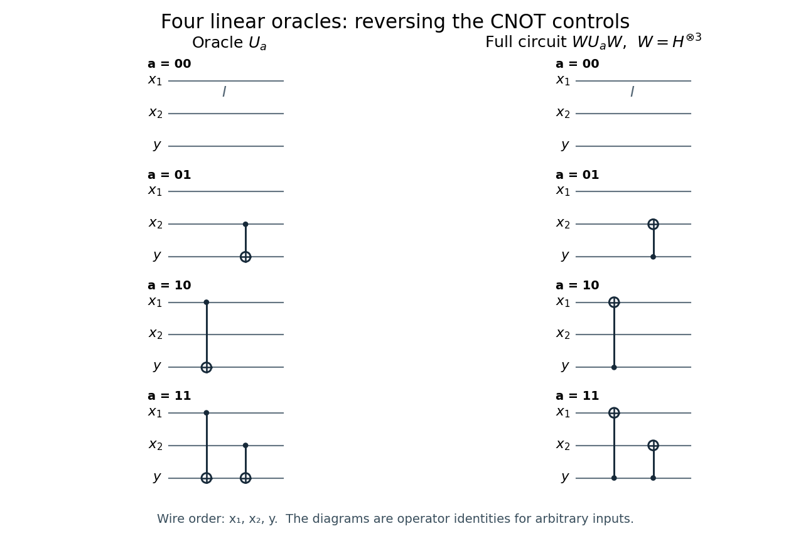

<h1 id="1/solution">Solution</h1>

↑ **Parent:** [1](../1.md)

Write $a=a_1a_2$ and $x=x_1x_2$, with the top wire carrying $x_1$, the middle wire $x_2$, and the bottom wire the [ancilla bit](../../../../ancilla-bit.md) $y$. The [binary inner product](../../../../binary-inner-product.md) is $a\cdot x=a_1x_1\oplus a_2x_2$, where $\oplus$ is [exclusive or](../../../../exclusive-or.md). Let $C_{j\to y}$ denote a [CNOT gate](../../../../controlled-not-gate.md) controlled by wire $j$ and targeting $y$. The four [linear Boolean functions](../../../../linear-boolean-function.md) and their [Boolean quantum oracles](../../../../boolean-quantum-oracle.md) are:

| $a$ | $f_a(x)$ | [Reversible circuit](../../../../reversible-circuit.md) for $U_a$ | $00$ | $0$ | $I$: three unchanged wires | $01$ | $x_2$ | $C_{2\to y}$ | $10$ | $x_1$ | $C_{1\to y}$ | $11$ | $x_1\oplus x_2$ | $C_{2\to y}C_{1\to y}$ |
| --- | --- | --- | --- | --- | --- | --- | --- | --- | --- | --- | --- | --- | --- | --- |

The [CNOT gates](../../../../controlled-not-gate.md) in the last row commute: their common target acquires the [exclusive or](../../../../exclusive-or.md) of the two controls. Each input wire is preserved, and applying any of these [reversible circuits](../../../../reversible-circuit.md) twice restores $y$.

**[Figure 1](#1/image-the-four-two-bit-linear-oracles-and-their-exact-simplifications-after-hadamard-gates-on-all-three-wires-a-filled-dot-is-a-control-and-a-circled-plus-is-a-target). The four two-bit linear oracles and their exact simplifications after Hadamard gates on all three wires; a filled dot is a control and a circled plus is a target**.

For classical [reversible computation](../../../../reversible-computation.md), call the unknown [function oracle](../../../../function-oracle.md) on $|10\rangle|0\rangle$ and $|01\rangle|0\rangle$. The resulting [ancilla bits](../../../../ancilla-bit.md) are respectively $a_1$ and $a_2$:

$$
U_a|10\rangle|0\rangle=|10\rangle|a_1\rangle,
\qquad U_a|01\rangle|0\rangle=|01\rangle|a_2\rangle.
$$

Use a fresh zero [ancilla bit](../../../../ancilla-bit.md) for each call, or preserve the first result in workspace before restoring the target to zero. Thus **two classical calls determine the two-bit string**.

For $n$ input [bits](../../../../bit.md), query the [standard basis](../../../../standard-basis.md) strings $e_j$, since $a\cdot e_j=a_j$. This gives an upper bound of $n$ calls. It is also optimal for exact identification: every classical query reveals at most one new [bit](../../../../bit.md), since $x$ is unchanged and $y\oplus f_a(x)$ reveals just $f_a(x)$ when $y$ is known. A depth-$k$ [decision tree](../../../../decision-tree.md) has at most $2^k$ answer histories, but must distinguish $2^n$ possible hidden strings. Hence $k\ge n$, including adaptive strategies. The [classical query complexity of linear Boolean function identification](../../../../classical-query-complexity-of-linear-boolean-function-identification.md) is therefore

$$
\boxed{D(n)=n\quad(n\ge1).}
$$

## ↑ Ancestors (12)

1. [1](../1.md)
2. [6](../../6-split.md)
3. [2010](../../split.md)
4. [Past exam of the laser science and quantum information processing course of the University of Oxford](../../../split.md)
5. [Laser science and quantum information processing course of the University of Oxford](../../../../laser-science-and-quantum-information-processing-course-of-the-university-of-oxford.md)
6. [Year 4 of the physics course of the University of Oxford](../../../../year-4-of-the-physics-course-of-the-university-of-oxford.md)
7. [Physics course of the University of Oxford](../../../../physics-course-of-the-university-of-oxford.md)
8. [Undergraduate course of the University of Oxford](../../../../undergraduate-course-of-the-university-of-oxford.md)
9. [Course of the University of Oxford](../../../../course-of-the-university-of-oxford.md)
10. [University of Oxford](../../../../university-of-oxford-split.md)
11. [List of universities](../../../../list-of-universities.md)
12. [Codex Wiki](../../../../split.md)
