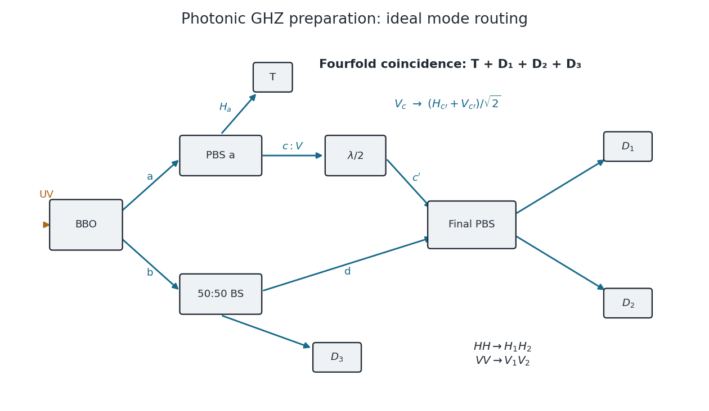

<h1 id="1/solution">Solution</h1>

↑ **Parent:** [1](../1.md)

The [beta barium borate](../../../../beta-barium-borate.md) crystal supplies [spontaneous parametric down-conversion](../../../../spontaneous-parametric-down-conversion.md): a weak [ultraviolet](../../../../ultraviolet.md) pump can produce a pair of lower-frequency [photons](../../../../photon.md), with their frequencies and [wavevectors](../../../../wavevector.md) selected by [conservation of energy](../../../../conservation-of-energy.md) and [phase matching](../../../../phase-matching.md). A suitably aligned and compensated source makes the two polarization alternatives coherent, giving the stated [Bell state](../../../../bell-state-split.md). The crystal alone does not guarantee that every collected pair has that state.

The two [polarizing beam splitters](../../../../polarizing-beam-splitter.md) route [horizontal polarization](../../../../horizontal-polarization.md) and [vertical polarization](../../../../vertical-polarization.md) to different ports. Take $H$ from arm $a$ to the trigger $T$ and $V$ to arm $c$. The ordinary [beam splitter](../../../../beam-splitter.md) in arm $b$ is a lossless, polarization-independent 50:50 splitter, with the unused input in the [vacuum state](../../../../vacuum-state.md). It splits [probability amplitudes](../../../../probability-amplitude.md), rather than measuring which output a photon takes. The [half-wave plate](../../../../half-wave-plate.md) changes the relative phase of its principal polarizations by $\pi$; orient it so that a $V$ photon in $c$ becomes $(H+V)/\sqrt2$ in $c'$, up to a common phase. Finally, [photodetectors](../../../../photodetector.md) absorb arriving [photons](../../../../photon.md) and supply electrical clicks. They need not resolve [photon number](../../../../photon-number.md) for the ideal four-photon, fourfold-coincidence calculation: a click at every detector already requires one photon at each.

**[Figure 1](#1/image-original-mode-diagram-for-photonic-ghz-preparation-by-fourfold-coincidence). Original mode diagram for photonic GHZ preparation by fourfold coincidence**. The paths and polarization conventions used in the calculation. PBS denotes a [polarizing beam splitter](../../../../polarizing-beam-splitter.md); BS is a polarization-independent 50:50 [beam splitter](../../../../beam-splitter.md). A trigger click alone does not guarantee the required one-photon occupation of all three other outputs.

Choose the relative [wave phases](../../../../phase-waves.md) so that the final [polarizing beam splitter](../../../../polarizing-beam-splitter.md) sends $H_{c'}$ to $H_2$, $V_{c'}$ to $V_1$, $H_d$ to $H_1$ and $V_d$ to $V_2$. Such phase conventions must be used consistently: an uncompensated relative phase would give a phase-shifted [GHZ state](../../../../greenberger-horne-zeilinger-state.md).

## ↑ Ancestors (12)

1. [1](../1.md)
2. [8](../../8-split.md)
3. [2010](../../split.md)
4. [Past exam of the laser science and quantum information processing course of the University of Oxford](../../../split.md)
5. [Laser science and quantum information processing course of the University of Oxford](../../../../laser-science-and-quantum-information-processing-course-of-the-university-of-oxford.md)
6. [Year 4 of the physics course of the University of Oxford](../../../../year-4-of-the-physics-course-of-the-university-of-oxford.md)
7. [Physics course of the University of Oxford](../../../../physics-course-of-the-university-of-oxford.md)
8. [Undergraduate course of the University of Oxford](../../../../undergraduate-course-of-the-university-of-oxford.md)
9. [Course of the University of Oxford](../../../../course-of-the-university-of-oxford.md)
10. [University of Oxford](../../../../university-of-oxford-split.md)
11. [List of universities](../../../../list-of-universities.md)
12. [Codex Wiki](../../../../split.md)
