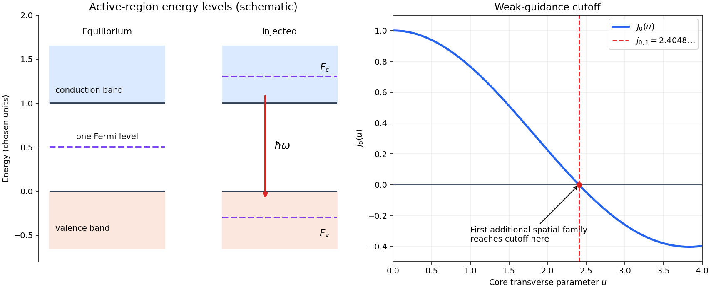
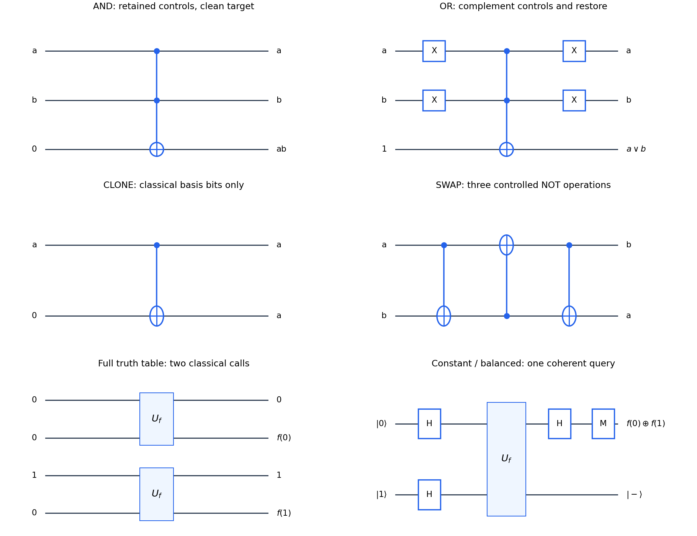
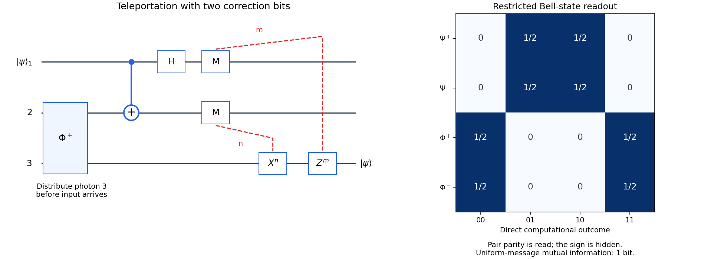
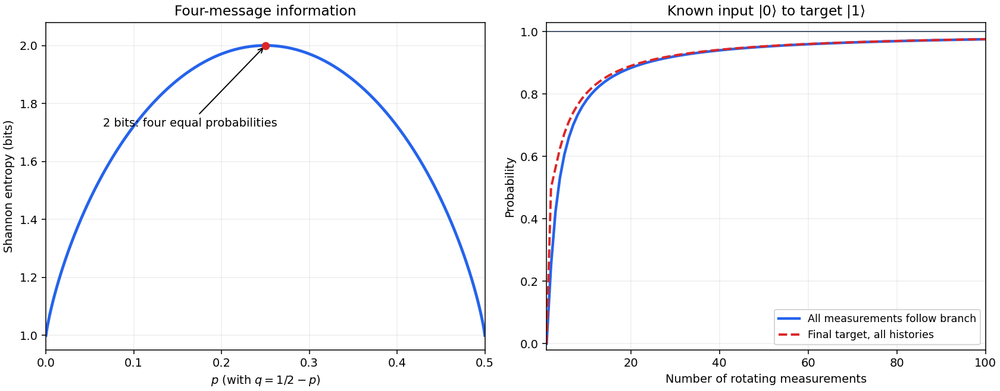

# 2015

↑ **Parent:** [Past exam of the laser science and quantum information processing course of the University of Oxford](../past-exam-of-the-laser-science-and-quantum-information-processing-course-of-the-university-of-oxford.md)

Source paper: [https://www.whatdotheyknow.com/request/oxford_physics_past_papers_2/response/2340696/attach/3/Physics%20Papers%202014.pdf?cookie_passthrough=1](https://www.whatdotheyknow.com/request/oxford_physics_past_papers_2/response/2340696/attach/3/Physics%20Papers%202014.pdf?cookie_passthrough=1)

**Table of contents**

- [1](#1)
  - [a](#1/a)
    - [Solution](#1/a/solution)
  - [b](#1/b)
    - [Solution](#1/b/solution)
  - [c](#1/c)
    - [Solution](#1/c/solution)
  - [d](#1/d)
    - [Solution](#1/d/solution)
- [2](#2)
  - [a](#2/a)
    - [Solution](#2/a/solution)
  - [b](#2/b)
    - [Solution](#2/b/solution)
  - [c](#2/c)
    - [Solution](#2/c/solution)
  - [d](#2/d)
    - [Solution](#2/d/solution)
- [3](#3)
  - [a](#3/a)
    - [Solution](#3/a/solution)
  - [b](#3/b)
    - [Solution](#3/b/solution)
  - [c](#3/c)
    - [Solution](#3/c/solution)
  - [d](#3/d)
    - [Solution](#3/d/solution)
- [4](#4)
  - [a](#4/a)
    - [Solution](#4/a/solution)
  - [b](#4/b)
    - [Solution](#4/b/solution)
  - [c](#4/c)
    - [Solution](#4/c/solution)
- [5](#5)
  - [a](#5/a)
    - [i](#5/a/i)
      - [Solution](#5/a/i/solution)
    - [ii](#5/a/ii)
      - [Solution](#5/a/ii/solution)
    - [iii](#5/a/iii)
      - [Solution](#5/a/iii/solution)
  - [b](#5/b)
    - [Solution](#5/b/solution)
  - [c](#5/c)
    - [Solution](#5/c/solution)
  - [d](#5/d)
    - [Solution](#5/d/solution)
- [6](#6)
  - [a](#6/a)
    - [Solution](#6/a/solution)
  - [b](#6/b)
    - [Solution](#6/b/solution)
  - [c](#6/c)
    - [Solution](#6/c/solution)
- [7](#7)
  - [a](#7/a)
    - [Solution](#7/a/solution)
  - [b](#7/b)
    - [Solution](#7/b/solution)
  - [c](#7/c)
    - [Solution](#7/c/solution)
- [8](#8)
  - [a](#8/a)
    - [Solution](#8/a/solution)
  - [b](#8/b)
    - [Solution](#8/b/solution)
  - [c](#8/c)
    - [Solution](#8/c/solution)

## 1

↑ **Parent:** [2015](2015.md)

<h3 id="1/a">a</h3>

↑ **Parent:** [1](#1)

<h4 id="1/a/solution">Solution</h4>

↑ **Parent:** [A](#1/a)

A forward-biased [p-n junction](../semiconductor.md#p-n-junction) injects [electrons](../physics.md#electron) from its [n-type semiconductor](../semiconductor.md#n-type-semiconductor) and [electron holes](../quantum-mechanics.md#electron-hole) from its [p-type semiconductor](../semiconductor.md#p-type-semiconductor) into an active region. A [direct band gap](../bloch-s-theorem.md#direct-band-gap) allows radiative transitions without a compensating [phonon](../quantum-ideal-gas-statistics.md#phonon), so [stimulated emission](../laser.md#stimulated-emission) can compete effectively with nonradiative processes. At thermal equilibrium there is one [Fermi level](../quantum-ideal-gas-statistics.md#fermi-level); forward injection instead establishes separate electron and valence-electron [quasi-Fermi levels](../chemical-potential.md#quasi-fermi-level) $F_c$ and $F_v$. Sufficient injection makes conduction states more occupied than the corresponding valence states, producing [optical gain](../laser.md#optical-gain).

Two parallel cleaved facets supply an [optical resonator](../optical-instrument.md#optical-cavity). At normal incidence their approximate intensity [reflectance](../radiometry.md#reflectance) follows the [Fresnel equations](../electromagnetic-wave.md#fresnel-equations):

$$
R=\left(\frac{n-1}{n+1}\right)^2=0.3195.
$$

A resonant [normal mode](../wave-equation.md#normal-mode) grows when its round-trip amplification exceeds its losses. For length $L$, material [optical gain](../laser.md#optical-gain) $g$, overlap factor $\Gamma$, internal intensity loss $\alpha_i$ and facet reflectances $R_1,R_2$,

$$
R_1R_2e^{2(\Gamma g-\alpha_i)L}\geq1,
\qquad \boxed{\Gamma g\geq\alpha_i+\frac{1}{2L}\ln\frac1{R_1R_2}.}
$$

The pump supplies the emitted [energy](../energy.md); the facets provide feedback and let some output escape. Positive [optical gain](../laser.md#optical-gain) alone does not establish [laser threshold](../laser.md#laser-threshold).

**[Figure 1](#1/a/image-injected-laser-diode-levels-and-the-first-additional-guided-spatial-mode). Injected laser diode levels and the first additional guided spatial mode**. Original schematic: the left panel uses stipulated energy units to distinguish equilibrium and injected [quasi-Fermi levels](../chemical-potential.md#quasi-fermi-level), with an allowed downward optical transition. The right panel plots $J_0(u)$, whose first zero fixes the weak-guidance spatial-mode cutoff. The separate panels do not represent a shared spatial coordinate.

<h3 id="1/b">b</h3>

↑ **Parent:** [1](#1)

<h4 id="1/b/solution">Solution</h4>

↑ **Parent:** [B](#1/b)

For a vertical interband transition, the [crystal momentum](../bloch-s-theorem.md#crystal-momentum) is effectively unchanged because the [photon momentum](../quantum-mechanics.md#photon-momentum) is small. A stimulated downward transition needs an occupied upper state and an empty lower state, with factor $f_c(E_2)[1-f_v(E_1)]$; upward [photon absorption](../quantum-mechanics.md#photon-absorption) has factor $f_v(E_1)[1-f_c(E_2)]$. The two matrix elements agree by microscopic reversibility. Their difference is therefore

$$
f_c(1-f_v)-f_v(1-f_c)=f_c-f_v,
\qquad \boxed{\alpha(\omega)\propto g_j(\omega)[f_c(E_2)-f_v(E_1)].}
$$

A common slowly varying transition-strength factor is implicit. Broadening replaces the sharp transition by a convolution; multiple valence bands contribute separate terms.

For one isotropic pair of parabolic [energy bands](../bloch-s-theorem.md#energy-band), write

$$
E_2=E_c+\frac{\hbar^2k^2}{2m_e^*},\qquad
E_1=E_v-\frac{\hbar^2k^2}{2m_h^*},\qquad
\frac1{m_r}=\frac1{m_e^*}+\frac1{m_h^*}.
$$

Thus $E_2-E_1=E_g+\hbar^2k^2/(2m_r)$. Including the usual twofold spin degeneracy, the number of paired states per volume inside a sphere of radius $k$ is $k^3/(3\pi^2)$. Differentiating with respect to transition [energy](../energy.md) $E$ gives the [three-dimensional parabolic interband joint density of states](../quantum-ideal-gas-statistics.md#three-dimensional-parabolic-interband-joint-density-of-states)

$$
\boxed{g_j^{(E)}(E)=\frac{1}{2\pi^2}\left(\frac{2m_r}{\hbar^2}\right)^{3/2}\sqrt{E-E_g}\,\Theta(E-E_g).}
$$

For density per [angular frequency](../lagrangian-mechanics.md#angular-frequency), $g_j^{(\omega)}(\omega)=\hbar g_j^{(E)}(\hbar\omega)$. Stating the density convention avoids a missing factor of $\hbar$; other degeneracies multiply the formula.

At a common carrier [temperature](../temperature.md), the [Fermi-Dirac distribution](../quantum-ideal-gas-statistics.md#fermi-dirac-distribution) is a strictly decreasing function of $E-F$. The [direct-gap semiconductor gain condition](../laser.md#direct-gap-semiconductor-gain-condition) follows:

$$
f_c(E_2)>f_v(E_1)
\iff E_2-F_c<E_1-F_v
\iff \boxed{E_g<\hbar\omega<F_c-F_v.}
$$

The lower inequality denotes a transition above the ideal band edge, where the displayed [joint density of states](../quantum-ideal-gas-statistics.md#joint-density-of-states) is nonzero. Thus [quasi-Fermi-level splitting](../chemical-potential.md#quasi-fermi-level-splitting) must exceed the transition [photon energy](../quantum-mechanics.md#photon-energy). Equality is transparency, rather than net amplification; at zero [temperature](../temperature.md) an allowed transition must also lie within the occupied-electron and empty-valence windows.

<h3 id="1/c">c</h3>

↑ **Parent:** [1](#1)

<h4 id="1/c/solution">Solution</h4>

↑ **Parent:** [C](#1/c)

Adjacent [longitudinal cavity modes](../optical-instrument.md#longitudinal-cavity-mode) obey $2nL=m\lambda_0$. Neglecting [optical dispersion](../geometrical-optics.md#dispersion-optics) in estimating their spacing,

$$
\Delta\nu=\frac{c}{2nL}=8.33\times10^{10}\,\mathrm{Hz},\qquad
\Delta\lambda_0\simeq\frac{\lambda_0^2}{2nL}=0.1778\,\mathrm{nm}.
$$

Hence the gain interval accommodates

$$
\boxed{N\simeq\frac{20}{0.1778}=112.5\simeq113}
$$

possible [longitudinal cavity modes](../optical-instrument.md#longitudinal-cavity-mode). The exact integer depends on the positions of the interval endpoints and resonances. This counts available resonances; mode competition and actual [laser threshold](../laser.md#laser-threshold) can reduce the number that oscillates. More accurately, the spacing uses the [group refractive index](../physical-optics.md#group-refractive-index) instead of $n$.

A broad multimode spectrum suffers differential delay through [optical fiber](../optical-instrument.md#optical-fiber) [group velocity dispersion](../dispersion-relation.md#group-velocity-dispersion), broadening transmitted pulses. Near $800\,\mathrm{nm}$, ordinary silica [optical fiber attenuation](../optical-instrument.md#optical-fiber-attenuation) is also larger than in the long-distance windows near $1.3$ and $1.55\,\mu\mathrm m$. These limitations concern this short-wavelength, simple multimode device: suitably engineered single-frequency [semiconductor lasers](../laser.md#semiconductor-laser) at telecommunications [wavelengths](../wave-equation.md#wavelength) are useful communication sources.

<h3 id="1/d">d</h3>

↑ **Parent:** [1](#1)

<h4 id="1/d/solution">Solution</h4>

↑ **Parent:** [D](#1/d)

A [double heterostructure laser](../semiconductor.md#double-heterostructure-laser) places a lower-[band gap](../bloch-s-theorem.md#band-gap) active layer between wider-[band gap](../bloch-s-theorem.md#band-gap) layers with suitable [type-I band alignment](../semiconductor.md#type-i-band-alignment). The [band offsets](../semiconductor.md#band-offset) confine injected [electrons](../physics.md#electron) and [electron holes](../quantum-mechanics.md#electron-hole) in the same small volume, increasing their overlap and reducing escape. Usually the active layer also has larger [refractive index](../electromagnetic-wave.md#refractive-index), so the same sandwich forms an optical [waveguide](../wave.md#waveguide). Optical confinement increases the gain-overlap factor $\Gamma$, while carrier confinement lowers the injection needed to reach the required [quasi-Fermi-level splitting](../chemical-potential.md#quasi-fermi-level-splitting). These two distinct mechanisms reduce threshold current and heating. A [band gap](../bloch-s-theorem.md#band-gap) difference alone does not establish the sign of both confinement barriers; suitable [band offsets](../semiconductor.md#band-offset) are essential.

## 2

↑ **Parent:** [2015](2015.md)

<h3 id="2/a">a</h3>

↑ **Parent:** [2](#2)

<h4 id="2/a/solution">Solution</h4>

↑ **Parent:** [A](#2/a)

Put $b=\mathcal E e^{i(kr-\omega t)}$, allowing $\mathcal E$ to be complex. The Hermitian [electric field](../electric-field.md) is $\hat E=b\hat a+b^*\hat a^\dagger$. The [annihilation operator](../quantum-harmonic-oscillator.md#annihilation-operator) and [creation operator](../quantum-harmonic-oscillator.md#creation-operator) change [photon number](../quantum-harmonic-oscillator.md#photon-number), so their diagonal matrix elements in a [Fock state](../quantum-field-theory.md#fock-state) vanish. Since $\hat a\hat a^\dagger=\hat n+1$ and $\hat a^\dagger\hat a=\hat n$,

$$
\boxed{\langle\hat E\rangle_n=0,\qquad
\langle\hat E^2\rangle_n=(2n+1)|\mathcal E|^2=(\Delta E)^2_n.}
$$

The terms containing $\hat a^2$ or $\hat a^{\dagger2}$ connect orthogonal [number states](../quantum-harmonic-oscillator.md#number-state) and contribute zero. Even as $n$ grows, there is no definite oscillating mean [electric field](../electric-field.md); its quadrature fluctuations grow instead. A [Fock state](../quantum-field-theory.md#fock-state) can represent fixed field [energy](../energy.md), but not a classical sinusoidal wave of prescribed [wave phase](../wave.md#phase-waves). This is distinct from representing a classical field with a randomly averaged phase.

<h3 id="2/b">b</h3>

↑ **Parent:** [2](#2)

<h4 id="2/b/solution">Solution</h4>

↑ **Parent:** [B](#2/b)

Orthogonality of the [number states](../quantum-harmonic-oscillator.md#number-state) makes the [coherent state](../quantum-theory.md#coherent-state) norm an exponential series:

$$
\langle\alpha|\alpha\rangle=e^{-|\alpha|^2}\sum_{n=0}^\infty\frac{|\alpha|^{2n}}{n!}=1.
$$

Using $\hat a|n\rangle=\sqrt n|n-1\rangle$ and reindexing $m=n-1$,

$$
\hat a|\alpha\rangle=e^{-|\alpha|^2/2}\sum_{n=1}^\infty\frac{\alpha^n}{\sqrt{(n-1)!}}|n-1\rangle
=\boxed{\alpha|\alpha\rangle}.
$$

It is not an [eigenstate](../energy-eigenvalue.md#eigenstate) of the [creation operator](../quantum-harmonic-oscillator.md#creation-operator). Indeed its supposed eigenvalue would have to be $\alpha^*$, from its expectation, whereas

$$
\left\|(\hat a^\dagger-\alpha^*)|\alpha\rangle\right\|^2
=\langle\hat a\hat a^\dagger\rangle-|\alpha|^2=1.
$$

This nonzero residual holds even at $\alpha=0$.

<h3 id="2/c">c</h3>

↑ **Parent:** [2](#2)

<h4 id="2/c/solution">Solution</h4>

↑ **Parent:** [C](#2/c)

The [photon number](../quantum-harmonic-oscillator.md#photon-number) probabilities of a [coherent state](../quantum-theory.md#coherent-state) form a [Poisson distribution](../discrete-probability-distribution.md#poisson-distribution) with mean $\mu=|\alpha|^2$. Alternatively normal ordering gives $\langle\hat n(\hat n-1)\rangle=\langle\hat a^{\dagger2}\hat a^2\rangle=|\alpha|^4$. Thus

$$
\boxed{\langle\hat n\rangle=|\alpha|^2,\qquad
\langle\hat n^2\rangle=|\alpha|^4+|\alpha|^2,\qquad
\Delta n=|\alpha|,\qquad
\frac{\Delta n}{\langle\hat n\rangle}=\frac1{|\alpha|}.}
$$

The last ratio is defined only for nonzero $\alpha$. At large $|\alpha|$ the absolute fluctuation grows but its size relative to the mean becomes negligible. This is the deterministic intensity limit within [quantum optics](../quantum-optics.md); it does not assert the disappearance of vacuum-scale quadrature noise.

<h3 id="2/d">d</h3>

↑ **Parent:** [2](#2)

<h4 id="2/d/solution">Solution</h4>

↑ **Parent:** [D](#2/d)

The [annihilation operator](../quantum-harmonic-oscillator.md#annihilation-operator) eigenvalue property gives

$$
\boxed{\langle\hat E(r,t)\rangle_\alpha
=\mathcal E\alpha e^{i(kr-\omega t)}+\mathcal E^*\alpha^*e^{-i(kr-\omega t)}
=2|\mathcal E\alpha|\cos(kr-\omega t+\arg(\mathcal E\alpha)).}
$$

This is a classical monochromatic [electric field](../electric-field.md): the modulus of $\alpha$ fixes the [wave amplitude](../wave.md#wave-amplitude), while its argument fixes the [wave phase](../wave.md#phase-waves) relative to the chosen mode convention. Direct normal ordering also gives $(\Delta E)^2_\alpha=|\mathcal E|^2$, independent of $\alpha$. Hence the fluctuation divided by the peak mean-field amplitude is $1/(2|\alpha|)$, small in the bright [coherent state](../quantum-theory.md#coherent-state) limit. A relative fluctuation evaluated exactly at a field zero is not a useful classicality test.

## 3

↑ **Parent:** [2015](2015.md)

<h3 id="3/a">a</h3>

↑ **Parent:** [3](#3)

<h4 id="3/a/solution">Solution</h4>

↑ **Parent:** [A](#3/a)

Use [mode locking](../laser.md#mode-locking) to phase-lock many [longitudinal cavity modes](../optical-instrument.md#longitudinal-cavity-mode); their repeated constructive interference produces short [optical pulses](../optics.md#optical-pulse). A saturable absorber can select this pulsed operation. A $2\,\mathrm{MHz}$ fundamental repetition rate corresponds to a $500\,\mathrm{ns}$ round trip, or an optical round-trip length $c/R\simeq150\,\mathrm m$; a linear air-filled cavity would therefore be about $75\,\mathrm m$ long. A compact alternative is a faster mode-locked oscillator followed by pulse selection and, if required, amplification. Ordinary [Q-switching](../laser.md#q-switching) alone generally does not provide $350\,\mathrm{fs}$ pulses.[Chapter 7, mode locking: phase-related resonator modes and ultrashort pulses](../physics-bibliography.md#fundamentals-of-photonics-and-quantum-electronics-lecture-notes-by-franz-x-kartner)

<h3 id="3/b">b</h3>

↑ **Parent:** [3](#3)

<h4 id="3/b/solution">Solution</h4>

↑ **Parent:** [B](#3/b)

The incident intensity radius is $w_L=2.5\,\mathrm{mm}$, half the quoted diameter. For an ideal collimated [Gaussian beam](../physical-optics.md#gaussian-beam) focused by a thin [lens](../geometrical-optics.md#lens-optics), the diffraction-limited waist is

$$
w_0\simeq\frac{f\lambda_0}{\pi w_L}=2.037\,\mu\mathrm m.
$$

The incident [Rayleigh range](../physical-optics.md#rayleigh-length) $\pi w_L^2/\lambda_0\simeq24.5\,\mathrm m$ is much larger than $f$, justifying this approximation. The pulse [energy](../energy.md) is $U=P_{\rm av}/R=0.25\,\mu\mathrm J$. Taking its duration as an effective energy-to-peak-power width gives $P_{\rm pk}\simeq U/\tau=7.14\times10^5\,\mathrm W$. Since $I(r)=I_0e^{-2r^2/w_0^2}$ has integrated power $I_0\pi w_0^2/2$,

$$
\boxed{I_{\rm pk}\simeq\frac{2U}{\pi w_0^2\tau}=1.10\times10^{17}\,\mathrm{W\,m^{-2}}=1.10\times10^{13}\,\mathrm{W\,cm^{-2}}.}
$$

If $350\,\mathrm{fs}$ denotes the temporal intensity full width at half maximum of a [Gaussian pulse](../optics.md#gaussian-pulse), the time integral instead gives $P_{\rm pk}=2\sqrt{\ln2}\,U/(\sqrt\pi\tau)$, and $I_{\rm pk}=1.03\times10^{13}\,\mathrm{W\,cm^{-2}}$. The pulse shape is unspecified, so the estimate's order-one convention is explicit. Aberration, clipping and propagation through glass were excluded from this calculation as stipulated.

<h3 id="3/c">c</h3>

↑ **Parent:** [3](#3)

<h4 id="3/c/solution">Solution</h4>

↑ **Parent:** [C](#3/c)

The contrast is weak: $(n_1-n_2)/n_2=0.01$. Use a scalar weak-guidance [Helmholtz equation](../partial-differential-equation.md#helmholtz-equation) for a transverse field component, with longitudinal [wave number](../wave-equation.md#wavenumber) $b$ and vacuum [wave number](../wave-equation.md#wavenumber) $k_0=2\pi/\lambda_0$. Separating variables as $\psi=F_l(r)e^{il\phi}e^{ibz}$ gives

$$
F_l''+\frac1rF_l'+\left(n^2k_0^2-b^2-\frac{l^2}{r^2}\right)F_l=0.
$$

A bound mode requires $n_2k_0<b<n_1k_0$. Define

$$
u=a\sqrt{n_1^2k_0^2-b^2},\qquad
w=a\sqrt{b^2-n_2^2k_0^2},\qquad
V^2=u^2+w^2=a^2k_0^2(n_1^2-n_2^2).
$$

The [step-index fiber normalized frequency](../optical-instrument.md#step-index-fiber-normalized-frequency) is $V$; $u$ is a dimensionless core transverse [wave number](../wave-equation.md#wavenumber). Regularity at $r=0$ selects the [Bessel function of the first kind](../bessel-function.md#bessel-function-of-the-first-kind), while decay at infinity selects the [Modified Bessel function of the second kind](../bessel-function.md#modified-bessel-function-of-the-second-kind):

$$
F_l(r)=\begin{cases}A J_l(ur/a),&r<a,\\B K_l(wr/a),&r>a.\end{cases}
$$

In this scalar approximation, continuity of the field and its radial derivative gives

$$
A J_l(u)=B K_l(w),\qquad
A uJ_l'(u)=B wK_l'(w),\qquad
\frac{uJ_l'(u)}{J_l(u)}=\frac{wK_l'(w)}{K_l(w)}.
$$

At cutoff the [evanescent wave](../elasticity-physics.md#evanescent-wave) extends arbitrarily far into the cladding, so $b\downarrow n_2k_0$, $w\downarrow0$ and $u\to V$. For the first azimuthally varying family $l=1$, the recurrence relations reduce the last equality to

$$
\frac{uJ_0(u)}{J_1(u)}=-\frac{wK_0(w)}{K_1(w)}.
$$

As $w\to0$, $K_1(w)\sim1/w$ and $K_0(w)\sim-\ln w$, making the right side tend to zero. Thus the onset is at the first positive zero of $J_0$:

$$
\boxed{V_c=j_{0,1}=2.404825\ldots\simeq2.4,\qquad
2\pi a\sqrt{n_1^2-n_2^2}>2.4\lambda_0.}
$$

The scalar $l=0$ fundamental family has no positive cutoff. The first additional spatial family is the $l=1$ family just found; the next radial $l=0$ and first $l=2$ families require the larger zero $j_{1,1}\simeq3.832$. This establishes the first multimode boundary rather than merely finding one possible cutoff. The two polarizations of the fundamental family are not counted as two spatial modes. Exact vector interface conditions split some higher-mode degeneracies at finite contrast; the displayed condition is the weak-guidance result intended by the supplied scalar equations.

<h3 id="3/d">d</h3>

↑ **Parent:** [3](#3)

<h4 id="3/d/solution">Solution</h4>

↑ **Parent:** [D](#3/d)

The raised-index region has $n_1=1.01(1.50)=1.515$, whereas $n_2=1.50$. Therefore its [numerical aperture](../point-spread-function.md#numerical-aperture) factor is $\sqrt{n_1^2-n_2^2}=0.212662$. With the printed rounded cutoff,

$$
a_c=\frac{2.4(1.5\,\mu\mathrm m)}{2\pi(0.212662)}=2.6942\,\mu\mathrm m,
\qquad
\log_{10}s_c=\frac{20-2.6942}{6.25}=2.76892.
$$

Thus

$$
\boxed{s_c\simeq5.87\times10^2\,\mathrm{mm\,s^{-1}}.}
$$

Slower scanning increases the written radius and makes the guide multimode; faster scanning makes it single-spatial-mode in this idealization, provided a physically meaningful positive core radius remains. Using $j_{0,1}=2.404825\ldots$ gives $s_c\simeq586.2\,\mathrm{mm\,s^{-1}}$. This numerical threshold extrapolates the supplied empirical radius law; its experimental range is not given.

## 4

↑ **Parent:** [2015](2015.md)

<h3 id="4/a">a</h3>

↑ **Parent:** [4](#4)

<h4 id="4/a/solution">Solution</h4>

↑ **Parent:** [A](#4/a)

For bulk electric-dipole [second-harmonic generation](../optics.md#second-harmonic-generation), the [crystal](../thermodynamics.md#crystal) must lack inversion [symmetry](../physics.md#symmetry-physics) and have a nonzero relevant component of its second-order [nonlinear optical susceptibility](../optics.md#nonlinear-optical-susceptibility). It should transmit both pump and harmonic, tolerate the required intensity, and allow [phase matching](../physical-optics.md#phase-matching) by suitable [birefringence](../maxwell-equations.md#birefringence) or another phase-compensation mechanism. A large nonlinear coefficient, low optical loss and good optical quality are desirable. Noncentrosymmetry permits a response but does not guarantee one in every chosen geometry.

In the undepleted [plane wave](../wave-function.md#plane-wave) limit, contributions from successive layers give a harmonic amplitude proportional to $\int_0^L e^{i\Delta k z}dz$, where $\Delta k=k_{2\omega}-2k_\omega$. Hence

$$
I_{2\omega}\propto d_{\rm eff}^2 I_\omega^2L^2\operatorname{sinc}^2(\Delta kL/2).
$$

Tune orientation, [temperature](../temperature.md) and pump [polarization](../wave.md#polarization-waves) to maximize the nonlinear coupling and cancel [phase mismatch](../physical-optics.md#phase-mismatch). For continuous operation, an impedance-matched enhancement [optical resonator](../optical-instrument.md#optical-cavity), or intracavity doubling, raises the circulating intensity. Focus the [Gaussian beam](../physical-optics.md#gaussian-beam) to balance intensity against [diffraction](../quantum-scattering.md#diffraction) and [spatial walk-off](../optics.md#spatial-walk-off); arbitrarily tight focusing shortens the useful overlap. Antireflection surfaces, stable resonance locking and efficient heat removal reduce avoidable loss and drift.

<h3 id="4/b">b</h3>

↑ **Parent:** [4](#4)

<h4 id="4/b/solution">Solution</h4>

↑ **Parent:** [B](#4/b)

For a fundamental [electric field](../electric-field.md) in the $xy$ plane, $E_z=0$. The specified [tensor](../multilinear-algebra.md#tensor) then gives

$$
P_x=P_y=0,\qquad
P_z(2\omega)=2\epsilon_0d_{36}E_xE_y.
$$

Writing $E_x=E_0\cos\phi$ and $E_y=E_0\sin\phi$ yields

$$
P_z=\epsilon_0d_{36}E_0^2\sin2\phi,\qquad
\boxed{I_{2\omega}\propto\sin^22\phi,\quad\phi=45^\circ\pmod{90^\circ}.}
$$

The source [electric polarization](../electromagnetism.md#polarization-density) is therefore along $z$ and is largest along the in-plane diagonals. A radiated wave also needs a transverse component of this source: propagation along $z$ would not generate a propagating $z$-polarized output. Propagation in the $xy$ plane provides the simple strictly transverse example. For a tilted extraordinary wave, the electric displacement, rather than generally the entire [electric field](../electric-field.md), is perpendicular to the [wave vector](../elasticity-physics.md#wavevector); the tensor source must be projected onto that wave's allowed [polarization](../wave.md#polarization-waves). This distinction matters when using the type-I geometry below.

<h3 id="4/c">c</h3>

↑ **Parent:** [4](#4)

<h4 id="4/c/solution">Solution</h4>

↑ **Parent:** [C](#4/c)

Type-I [phase matching](../physical-optics.md#phase-matching) requires $n_{e,2\omega}(\theta)=n_{o,\omega}$, because both pump [photons](../quantum-mechanics.md#photon) are ordinary and the harmonic is extraordinary. Apply the direction-dependent index equation to the harmonic, not to the pump. Solving gives

$$
\sin^2\theta=
\frac{n_{o,\omega}^{-2}-n_{o,2\omega}^{-2}}
{n_{e,2\omega}^{-2}-n_{o,2\omega}^{-2}}.
$$

For the ruby-laser data this is $0.626210$, whereas the shorter-wavelength data give $0.958873$. Therefore

$$
\boxed{\theta_{694\to347}=52.31^\circ,\qquad
\theta_{515\to257.5}\simeq78.30^\circ.}
$$

The second calculation uses the supplied $257\,\mathrm{nm}$ indices as rounded harmonic data: the exact half-wavelength of $515\,\mathrm{nm}$ is $257.5\,\mathrm{nm}$. The index dispersion between those two ultraviolet values was not supplied.

For an extraordinary wave, its [Poynting vector](../electromagnetic-wave.md#poynting-vector) makes an angle $\theta_S$ with the optic axis satisfying $\tan\theta_S=(n_o^2/n_e^2)\tan\theta$. Thus the [spatial walk-off](../optics.md#spatial-walk-off) angle relative to the [wave vector](../elasticity-physics.md#wavevector) is

$$
\rho=\arctan\left(\frac{n_{o,2\omega}^2}{n_{e,2\omega}^2}\tan\theta\right)-\theta,
\qquad
\boxed{\rho_{347}=1.601^\circ,\quad\rho_{257.5}\simeq0.731^\circ.}
$$

Both angles refer to the harmonic. The ordinary pump does not have this angular walk-off. For beam radius $w_b$, the approximate overlap length is $w_b/\tan\rho$, so the shorter-wavelength geometry has about $2.19$ times the walk-off-limited interaction length.[§§2.8.2–2.8.3, printed pp. 156–158: extraordinary index and energy-flux direction](../physics-bibliography.md#fundamentals-of-photonics-and-quantum-electronics-lecture-notes-by-franz-x-kartner)

To compare coupling, take propagation azimuth $\varphi$ and ordinary unit polarization $(-\sin\varphi,\cos\varphi,0)$. Its quadratic source is $P_z=-\epsilon_0d_{36}E_0^2\sin2\varphi$. Projection onto an extraordinary displacement direction with $z$ component proportional to $\sin\theta$ gives $|d_{\rm eff}|\propto|d_{36}\sin\theta\sin2\varphi|$, up to the small anisotropic normalization correction. The optimal azimuth is $45^\circ$. At equal beam area, interaction length, input power and approximately equal nonlinear coefficients, the shorter pump has both stronger angular coupling and the favorable frequency-squared factor:

$$
\frac{\eta_{515}}{\eta_{694}}\simeq
\left(\frac{694}{515}\right)^2
\frac{\sin^2\theta_{515}}{\sin^2\theta_{694}}
\frac{n_{o,694}^3}{n_{o,515}^3}\simeq2.73.
$$

Here $\eta=P_{2\omega}/P_\omega$ in the small-conversion, equal-area model, with harmonic index phase-matched to the pump. Its smaller [spatial walk-off](../optics.md#spatial-walk-off) further favors the $515\,\mathrm{nm}$ pump in a walk-off-limited geometry. **Equal input power alone does not determine an absolute efficiency ranking**: ultraviolet absorption, wavelength-dependent $d_{36}$, beam size, crystal length and coatings are unspecified. For example, a sufficiently strongly absorbing $257.5\,\mathrm{nm}$ output can reverse the ideal ranking. The stated preference is conditional on comparable transparent crystals and comparable focusing, not a prediction independent of those parameters.

## 5

↑ **Parent:** [2015](2015.md)

<h3 id="5/a">a</h3>

↑ **Parent:** [5](#5)

<h4 id="5/a/i">i</h4>

↑ **Parent:** [A](#5/a)

<h5 id="5/a/i/solution">Solution</h5>

↑ **Parent:** [I](#5/a/i)

The normalized input [density operator](../density-matrix.md) is

$$
\rho=\begin{pmatrix}|\alpha|^2&\alpha\beta^*\\\alpha^*\beta&|\beta|^2\end{pmatrix}.
$$

A [quantum measurement in the computational basis](../quantum-theory.md#quantum-measurement-in-the-computational-basis) has projectors $P_j=|j\rangle\langle j|$. Discarding its recorded outcome gives the [dephasing channel](../quantum-information-theory.md#dephasing-channel)

$$
\boxed{\rho'=P_0\rho P_0+P_1\rho P_1
=|\alpha|^2|0\rangle\langle0|+|\beta|^2|1\rangle\langle1|.}
$$

The original off-diagonal coherence disappears. If the outcome is retained instead, the conditional state is $|0\rangle$ or $|1\rangle$ and the record carries information about which occurred. Thus discarding the record is an essential part of this channel specification.

<h4 id="5/a/ii">ii</h4>

↑ **Parent:** [A](#5/a)

<h5 id="5/a/ii/solution">Solution</h5>

↑ **Parent:** [Ii](#5/a/ii)

A random [Pauli Z gate](../quantum-theory.md#pauli-z-gate) with equal application and nonapplication probabilities gives

$$
\boxed{\rho'=\tfrac12\rho+\tfrac12Z\rho Z
=\begin{pmatrix}|\alpha|^2&0\\0&|\beta|^2\end{pmatrix}.}
$$

This is exactly the same [dephasing channel](../quantum-information-theory.md#dephasing-channel) as the unrecorded measurement, for every input [density operator](../density-matrix.md), including one entangled with an auxiliary system. Individual trials differ: conditioned on the classical random choice, the state is the [pure state](../quantum-theory.md#pure-state) $|\psi\rangle$ or $Z|\psi\rangle$, generally neither a computational [basis vector](../vector-space.md#basis-vector). Knowledge of that choice permits recovery by the same [Pauli Z gate](../quantum-theory.md#pauli-z-gate); a measurement outcome does not restore an unknown destroyed superposition.

<h4 id="5/a/iii">iii</h4>

↑ **Parent:** [A](#5/a)

<h5 id="5/a/iii/solution">Solution</h5>

↑ **Parent:** [Iii](#5/a/iii)

Use the rotation convention $R_z(\phi)=e^{-i\phi Z/2}=\operatorname{diag}(e^{-i\phi/2},e^{i\phi/2})$. For uniform $\phi$ modulo $2\pi$,

$$
\boxed{\rho'=\frac1{2\pi}\int_0^{2\pi}R_z(\phi)\rho R_z(\phi)^\dagger\,d\phi
=\operatorname{diag}(|\alpha|^2,|\beta|^2),}
$$

because the off-diagonal entry acquires $e^{-i\phi}$ with zero average. Each trial retains a [pure state](../quantum-theory.md#pure-state) with a randomly rotated relative phase, reversible if $\phi$ is known. All three procedures therefore give identical statistics for every measurement on the unconditioned system, but their records and conditional ensembles differ. A [density operator](../density-matrix.md) does not identify its preparation ensemble uniquely; access to a record changes which information is available.

<h3 id="5/b">b</h3>

↑ **Parent:** [5](#5)

<h4 id="5/b/solution">Solution</h4>

↑ **Parent:** [B](#5/b)

For short times, survival under [unitary time evolution](../quantum-system.md#unitary-time-evolution) is $1-(\Delta H)^2t^2/\hbar^2+O(t^3)$. Dividing a fixed time into $N$ intervals and projecting back after each gives survival approaching one as $N\to\infty$. This suppression of departure by repeated [projective measurements](../quantum-measurement.md#projective-measurement) is the [quantum Zeno effect](../quantum-measurement.md#quantum-zeno-effect).

For [measurement-guided Zeno transfer](../quantum-measurement.md#measurement-guided-zeno-transfer), rotate the measured basis gradually to transport a known state. Let

$$
|b_j\rangle=\cos\theta_j|0\rangle+\sin\theta_j|1\rangle,\quad
|b_j^\perp\rangle=-\sin\theta_j|0\rangle+\cos\theta_j|1\rangle,\quad
\theta_j=\frac{j\pi}{2N}.
$$

Measure in these orthonormal bases successively for $j=1,\ldots,N$. Starting in $|0\rangle=|b_0\rangle$, the probability to follow the $b_j$ outcome at every step is

$$
\boxed{P_{\rm follow}=\cos^{2N}\left(\frac{\pi}{2N}\right)\longrightarrow1.}
$$

Its final state is $|b_N\rangle=|1\rangle$. If every outcome is retained without postselection, the final probability for $|1\rangle$ is $[1+\cos^N(\pi/N)]/2$, also approaching one; histories with two switches can return to that branch. These two finite-$N$ probabilities should not be confused.

For a general unknown input, the same slowly turning measurements first resolve its amplitudes into the two branches, then drag each branch separately. In the large-$N$ limit, after discarding the records,

$$
\boxed{\rho_{\rm out}\longrightarrow|\alpha|^2|1\rangle\langle1|+|\beta|^2|0\rangle\langle0|.}
$$

The first basis approaches the computational one as $N$ grows. Inserting an initial computational measurement makes this branch decomposition exact at the outset, without changing the limiting result. Relative phase is lost, so this procedure transports a known basis state with high probability rather than implementing a coherent [Pauli X gate](../quantum-theory.md#pauli-x-gate) on an arbitrary [qubit](../quantum-system.md#qubit).

<h3 id="5/c">c</h3>

↑ **Parent:** [5](#5)

<h4 id="5/c/solution">Solution</h4>

↑ **Parent:** [C](#5/c)

[Quantum error correction](../quantum-error-correction.md) detects an error syndrome and actively restores a logical state within a correctable error set. A [decoherence-free subspace](../quantum-error-correction.md#decoherence-free-subspace) instead encodes into a subspace on which every allowed noise operator acts as the same scalar; no relative logical phase or mixing is produced by that noise. It relies on the specified correlation structure, and does not protect against arbitrary independent errors.

For collective rotations $R_z(\phi)\otimes R_z(\phi)$,

$$
|01\rangle\mapsto e^{-i\phi/2}e^{i\phi/2}|01\rangle=|01\rangle,
\qquad |10\rangle\mapsto|10\rangle.
$$

Thus every encoded superposition $\alpha|01\rangle+\beta|10\rangle$ is invariant. Equivalently it lies in the zero-eigenvalue subspace of $Z\otimes I+I\otimes Z$.

By contrast,

$$
\alpha|00\rangle+\beta|11\rangle
\mapsto\alpha e^{-i\phi}|00\rangle+\beta e^{i\phi}|11\rangle.
$$

The relative phase changes by $2\phi$, although $Z\otimes Z$ acts as $+I$ on both basis states. Invariance under one discrete operation does not establish invariance under its continuous rotation family. A concrete counterexample is $\phi=\pi/2$: the equally weighted encoded plus state becomes the encoded minus state, up to a global phase, and is orthogonal to its original state.

<h3 id="5/d">d</h3>

↑ **Parent:** [5](#5)

<h4 id="5/d/solution">Solution</h4>

↑ **Parent:** [D](#5/d)

Let $|\pm\rangle=(|0\rangle\pm|1\rangle)/\sqrt2$ be the [Pauli X eigenstates](../quantum-mechanics.md#pauli-x-eigenstate). Encode

$$
\boxed{|0_L\rangle=|+ -\rangle,\qquad |1_L\rangle=|- +\rangle.}
$$

Both have zero total $X$ eigenvalue, so $R_x(\phi)\otimes R_x(\phi)$ is the identity on their span. This is the [decoherence-free subspace](../quantum-error-correction.md#decoherence-free-subspace) obtained from the previous code by applying a [Hadamard gate](../quantum-theory.md#hadamard-gate) to each physical [qubit](../quantum-system.md#qubit).

Since $Z|+\rangle=|-\rangle$ and $Z|-\rangle=|+\rangle$, a correlated $Z\otimes Z$ error exchanges the codewords. It acts as logical $X_L$, not as harmless identity. The [Pauli Y gate](../quantum-theory.md#pauli-y-gate) obeys $Y|+\rangle=-i|-\rangle$ and $Y|-\rangle=i|+\rangle$, so

$$
\boxed{(Z\otimes Z)|\psi_L\rangle=(Y\otimes Y)|\psi_L\rangle=X_L|\psi_L\rangle.}
$$

The phases cancel within each codeword. Thus either unknown correlated gate gives a logical bit error on a general encoded state, though a logical $X_L$ [eigenstate](../energy-eigenvalue.md#eigenstate) is unchanged as a physical ray. The code prevents collective $x$ rotations, not every possible correlated error.

## 6

↑ **Parent:** [2015](2015.md)

<h3 id="6/a">a</h3>

↑ **Parent:** [6](#6)

<h4 id="6/a/solution">Solution</h4>

↑ **Parent:** [A](#6/a)

Use a classical target bit $t$ and initialized auxiliary bits. The [NOT](../theoretical-computer-science.md#negation) gate maps $t\mapsto1\oplus t$, the [CNOT gate](../quantum-theory.md#controlled-not-gate) maps $(a,t)\mapsto(a,t\oplus a)$, and the [Toffoli gate](../quantum-theory.md#toffoli-gate) maps $(a,b,t)\mapsto(a,b,t\oplus ab)$. They are bijections and are their own inverses. Explicit circuits with their retained input wires are:

- AND: a [Toffoli gate](../quantum-theory.md#toffoli-gate) on $(a,b,0)$ produces $(a,b,ab)$.
- OR: apply [NOT](../theoretical-computer-science.md#negation) to both controls, a [Toffoli gate](../quantum-theory.md#toffoli-gate) with target initialized to $1$, then restore both controls. The target becomes $1\oplus(1-a)(1-b)=a\lor b$.
- CLONE: a [CNOT gate](../quantum-theory.md#controlled-not-gate) on $(a,0)$ gives $(a,a)$.
- SWAP: apply $\operatorname{CNOT}_{a\to b}$, $\operatorname{CNOT}_{b\to a}$ and $\operatorname{CNOT}_{a\to b}$. The successive pairs are $(a,b\oplus a)$, $(b,b\oplus a)$, then $(b,a)$.

These maps also give the truth tables for all input combinations. AND and OR are not themselves reversible maps if the inputs are discarded; the retained inputs are what make their implementations reversible. Classical CLONE copies a known orthogonal [computational basis](../quantum-theory.md#computational-basis) alphabet; the [no-cloning theorem](../quantum-theory.md#no-cloning-theorem) forbids interpreting it as a copier of arbitrary quantum superpositions.

A [Boolean circuit](../theoretical-computer-science.md#boolean-circuit) can express any finite Boolean function using AND, OR and NOT. Replace its operations by the reversible versions, keeping inputs and intermediate bits. Copy the final output into a fresh answer register with [CNOT gates](../quantum-theory.md#controlled-not-gate), then run the entire computing network backward. Intermediate auxiliary bits return to zero, yielding

$$
\boxed{(x,0,y)\longmapsto(x,0,y\oplus f(x)).}
$$

This compute-copy-uncompute construction proves universality in the usual model with initialized auxiliary bits. If $f$ is a reversible permutation, compute $f(x)$, use a reversible implementation of $f^{-1}$ to clear $x$, and swap registers, leaving $f(x)$ with clean auxiliaries. The ancillary-resource qualification matters; a blanket claim about all permutations on an arbitrary fixed number of unassisted wires has parity restrictions.

**[Figure 2](#6/a/image-reversible-boolean-constructions-and-a-one-query-deutsch-algorithm). Reversible Boolean constructions and a one-query Deutsch algorithm**. Original circuits for AND, OR, copying a classical bit and SWAP, with retained inputs and initialized targets shown explicitly. The lower panels show two classical oracle queries for the truth table and the phase-kickback quantum network that obtains only its parity in one query. Circuit operations run from left to right.

<h3 id="6/b">b</h3>

↑ **Parent:** [6](#6)

<h4 id="6/b/solution">Solution</h4>

↑ **Parent:** [B](#6/b)

In the [oracle machine](../theoretical-computer-science.md#oracle-machine) model, a function is accessed through a black box whose internal gate cost is excluded; the resource counted is the number of calls. A reversible classical oracle maps basis inputs as $(x,y)\mapsto(x,y\oplus f(x))$. Its [quantum oracle](../theoretical-computer-science.md#quantum-oracle) extension applies the same permutation coherently to arbitrary superpositions, without measuring its input. A classical random mixture of inputs is not that coherent extension.

Write the two truth-table entries as $f(0)=b$, $f(1)=a\oplus b$. Then $f(x)=ax\oplus b$, with the four cases

$$
\begin{array}{c|c|c|c}
(a,b)&f(0)&f(1)&f(x)\\\hline
(0,0)&0&0&0\\
(0,1)&1&1&1\\
(1,0)&0&1&x\\
(1,1)&1&0&1\oplus x
\end{array}.
$$

Two classical query circuits, $(0,0)\xrightarrow{U_f}(0,f(0))$ and $(1,0)\xrightarrow{U_f}(1,f(1))$, recover the whole function with certainty. One call fixes only one entry, leaving two compatible functions; hence two are necessary classically. Randomization cannot remove this obstruction to certainty.

The minimum for **full exact function identification remains two even with coherent quantum queries**. To see this, expand the oracle target into its $X$ eigenstates: it is identity on $|+\rangle$, and gives phases $(-1)^{f(x)}$ on $|x\rangle|-\rangle$. Any one-query input, including an auxiliary system, has orthogonal sector weights $w_+$, $w_0$ and $w_1$ summing to one. The output overlap between functions differing only at $0$ is $1-2w_0$, so perfect distinction requires $w_0=1/2$; differing only at $1$ likewise requires $w_1=1/2$. Then $w_+=0$, but functions differing at both entries have overlap $1-2(w_0+w_1)=-1$. They are the same ray rather than distinguishable states. Thus one query cannot identify all four functions. The following one-query task recovers only whether the entries agree.

<h3 id="6/c">c</h3>

↑ **Parent:** [6](#6)

<h4 id="6/c/solution">Solution</h4>

↑ **Parent:** [C](#6/c)

A constant function has $f(0)=f(1)$, whereas a balanced one has one zero and one one, so $f(0)\ne f(1)$. The four oracles require only the following circuits:

$$
U_0=I,\qquad U_1=I\otimes X,\qquad
U_x=\operatorname{CNOT},\qquad
U_{1\oplus x}=(I\otimes X)\operatorname{CNOT}.
$$

Prepare $|0\rangle|1\rangle$, apply a [Hadamard gate](../quantum-theory.md#hadamard-gate) to each [qubit](../quantum-system.md#qubit), apply the oracle once, apply another [Hadamard gate](../quantum-theory.md#hadamard-gate) to the first [qubit](../quantum-system.md#qubit), and measure that first wire in the [computational basis](../quantum-theory.md#computational-basis). Immediately before the oracle the state is $|+\rangle|-\rangle$. The identity $X|-\rangle=-|-\rangle$ gives [phase kickback](../quantum-theory.md#phase-kickback):

$$
|+\rangle|-\rangle\xrightarrow{U_f}
\frac{(-1)^{f(0)}|0\rangle+(-1)^{f(1)}|1\rangle}{\sqrt2}|-\rangle
\xrightarrow{H\otimes I}
\boxed{(-1)^{f(0)}|f(0)\oplus f(1)\rangle|-\rangle.}
$$

The output is certainly zero for constant and one for balanced. In circuit terms the target $X$ contributes only a global sign, and a controlled $X$ with target $|-\rangle$ acts as $Z$ on the control; $HZH=X$ then turns that phase into a measured bit. These identities prove the network for all four explicit oracles. The unused sign contains $f(0)$ only as a global phase, consistent with the full-identification lower bound.

## 7

↑ **Parent:** [2015](2015.md)

<h3 id="7/a">a</h3>

↑ **Parent:** [7](#7)

<h4 id="7/a/solution">Solution</h4>

↑ **Parent:** [A](#7/a)

The [quantum bit-flip channel](../quantum-information-theory.md#quantum-bit-flip-channel) has [Kraus operators](../quantum-information-theory.md#kraus-operator)

$$
K_0=\sqrt p\,I,\qquad K_1=\sqrt{1-p}\,X,\qquad
\sum_jK_j^\dagger K_j=I.
$$

Thus

$$
\boxed{\rho_{\rm out}=\mathcal C(\rho_{\rm in})=p\rho_{\rm in}+(1-p)X\rho_{\rm in}X.}
$$

The orthonormal diagonal linear [polarizations](../wave.md#polarization-waves) $|D\rangle=(|H\rangle+|V\rangle)/\sqrt2$ and $|A\rangle=(|H\rangle-|V\rangle)/\sqrt2$ are the [Pauli X eigenstates](../quantum-mechanics.md#pauli-x-eigenstate). Each is transmitted perfectly as a [density operator](../density-matrix.md) for every $p$; the possible minus sign on $|A\rangle$ is global. Encode a classical zero and one as $D$ and $A$, then measure in that basis at the receiver. This sends one classical bit per transmitted [qubit](../quantum-system.md#qubit) without error. General superpositions of $D$ and $A$ need not be preserved, because their relative phase is randomized.

<h3 id="7/b">b</h3>

↑ **Parent:** [7](#7)

<h4 id="7/b/solution">Solution</h4>

↑ **Parent:** [B](#7/b)

Label the unknown input $1$, Alice's resource photon $2$, and Bob's resource photon $3$. First distribute photon $3$ through the channel while keeping photon $2$ with Alice; at $p=1$ this leaves the perfect shared [Bell state](../bell-state.md) $|\Phi^+\rangle_{23}=(|00\rangle+|11\rangle)/\sqrt2$. When the input arrives, the three-qubit state is

$$
|\Omega_0\rangle=\frac{1}{\sqrt2}
\left(\alpha|000\rangle+\alpha|011\rangle+\beta|100\rangle+\beta|111\rangle\right).
$$

Alice applies $\operatorname{CNOT}_{1\to2}$, giving

$$
|\Omega_1\rangle=\frac{1}{\sqrt2}
\left(\alpha|000\rangle+\alpha|011\rangle+\beta|110\rangle+\beta|101\rangle\right).
$$

She next applies $H_1$, producing

$$
|\Omega_2\rangle=\frac12\big(
|00\rangle_{12}|\psi\rangle_3+
|01\rangle_{12}X|\psi\rangle_3+
|10\rangle_{12}Z|\psi\rangle_3+
|11\rangle_{12}XZ|\psi\rangle_3\big).
$$

These two gates followed by computational measurement implement a perfect [Bell state](../bell-state.md) analyzer. For outcome $(m,n)$ the normalized conditional state is $|mn\rangle_{12}X^nZ^m|\psi\rangle_3$, with probability $1/4$. Alice sends the **two classical bits** $m,n$; Bob applies $Z^mX^n$, recovering $|\psi\rangle$ exactly. Averaging before reception of the bits gives Bob $I/2$, independent of the input, so this protocol provides no faster-than-light communication.

For $p=1$, directly sending the original [qubit](../quantum-system.md#qubit) is already perfect. [Quantum teleportation](../bell-state.md#quantum-teleportation) therefore has no fidelity advantage in this ideal case and consumes a shared entangled pair plus classical communication. Its operational advantage is that entanglement can be distributed beforehand: once the unknown input appears, only classical information need travel, and the original input photon need not itself propagate to Bob. The Bell measurement consumes the input; it does not create a second copy.

**[Figure 3](#7/b/image-quantum-teleportation-corrections-and-restricted-superdense-coding-readout). Quantum teleportation corrections and restricted superdense coding readout**. Original teleportation circuit with the distributed resource, two measurement bits and conditional corrections, beside the four Bell-state computational-basis outcome probabilities. The right panel describes direct measurement without a two-qubit Bell decoder, not measurement after an unrestricted decoding circuit.

<h3 id="7/c">c</h3>

↑ **Parent:** [7](#7)

<h4 id="7/c/solution">Solution</h4>

↑ **Parent:** [C](#7/c)

Use the same protocol: distribute one resource photon through $\mathcal C$, and send Alice's two classical bits error-free in the $D,A$ alphabet from part a. At $p=1/2$ the distributed resource is

$$
\rho_{23}=\tfrac12|\Phi^+\rangle\langle\Phi^+|
+\tfrac12|\Psi^+\rangle\langle\Psi^+|,
\qquad |\Psi^+\rangle=(I\otimes X)|\Phi^+\rangle.
$$

For the second component Bob has an extra $X$ before his conditional correction. Conjugation by that correction changes $X$ at most by a sign, which cancels in the [density operator](../density-matrix.md). This [bit-flipped Bell resource teleportation](../bell-state.md#bit-flipped-bell-resource-teleportation) therefore induces the bit-flip map,

$$
\rho_{\rm tel}=\tfrac12|\psi\rangle\langle\psi|+
\tfrac12X|\psi\rangle\langle\psi|X.
$$

Using the squared pure-target [quantum fidelity](../quantum-information-theory.md#fidelity-of-quantum-states) convention,

$$
\boxed{F_\psi=\langle\psi|\rho_{\rm tel}|\psi\rangle
=\frac12\left(1+|\langle\psi|X|\psi\rangle|^2\right)
=\frac12\left(1+4[\operatorname{Re}(\alpha^*\beta)]^2\right).}
$$

The maximum is $1$ precisely for the [Pauli X eigenstates](../quantum-mechanics.md#pauli-x-eigenstate) $D,A$. The minimum is $1/2$ whenever $\operatorname{Re}(\alpha^*\beta)=0$, the great circle with zero $x$ component of the [Bloch vector](../density-matrix.md#bloch-vector), including $H,V$ and both circular [polarizations](../wave.md#polarization-waves). Uniform averaging over pure [qubits](../quantum-system.md#qubit) gives $\overline F=2/3$.

The resource-distribution and classical-encoding assumptions are essential. If a perfect shared pair had already been supplied independently and this channel were used only for the robustly encoded classical bits, teleportation would remain perfect even at $p=1/2$. Conversely, unprotected $H,V$ transmission of Alice's correction bits would add classical errors. The stated expression applies to the resource sent through the given channel and the error-free classical encoding explicitly available in part a.

## 8

↑ **Parent:** [2015](2015.md)

<h3 id="8/a">a</h3>

↑ **Parent:** [8](#8)

<h4 id="8/a/solution">Solution</h4>

↑ **Parent:** [A](#8/a)

Normalization requires $2p+2q=1$, so $q=1/2-p$ and $0\leq p\leq1/2$. With logarithms to base two, the [Shannon entropy](../information-entropy.md) is

$$
\boxed{H(X)=-2p\log_2p-2q\log_2q=1+h_2(2p).}
$$

The convention $0\log0=0$ gives $H=1$ at both endpoints. In the interior,

$$
H'(p)=2\log_2\frac qp,\qquad
H''(p)=-\frac2{\ln2}\left(\frac1p+\frac1q\right)<0.
$$

Hence the unique maximum is $H=2$ bits at $p=q=1/4$. The curve is concave and symmetric about $p=1/4$.

Choose the message assignment $x_1\leftrightarrow\Psi^+$, $x_2\leftrightarrow\Psi^-$, $x_3\leftrightarrow\Phi^+$ and $x_4\leftrightarrow\Phi^-$. Starting from $|\Psi^+\rangle$, apply respectively $I,Z,X,XZ$ to the first [qubit](../quantum-system.md#qubit). This produces those four orthonormal [Bell states](../bell-state.md), up to a physically irrelevant overall sign in the last case. The ensemble [density operator](../density-matrix.md) is

$$
\boxed{\rho_Y=p\Pi_{\Psi^+}+p\Pi_{\Psi^-}+q\Pi_{\Phi^+}+q\Pi_{\Phi^-}
=\operatorname{diag}(q,p,p,q)}
$$

in computational order $00,01,10,11$, where $\Pi_B=|B\rangle\langle B|$. The cancellation of off-diagonal terms follows from the equal probabilities within each sign pair; the individual encoded states remain entangled.

A [Bell basis](../quantum-theory.md#bell-basis) measurement reads the label perfectly because the four code states are orthogonal. Thus this is equivalent to a classical error-free encoding when unrestricted joint measurement is allowed. Each conditional encoded state is pure, so

$$
\boxed{H(Y|X)=\sum_i p_i S(\Pi_i)=0,\qquad
H(X:Y)=S(\rho_Y)-\sum_i p_iS(\Pi_i)=H(X).}
$$

The second formula is the classical-quantum [mutual information](../information-theory.md#mutual-information), here equal to attainable classical information. The first says there is no uncertainty about the joint pure code state once the message is known; it does not say that measuring its individual [qubits](../quantum-system.md#qubit) has deterministic outcomes.

**[Figure 4](#8/a/image-message-shannon-entropy-and-measurement-guided-state-transfer). Message Shannon entropy and measurement-guided state transfer**. Original theoretical curves: $H(X)=1+h_2(2p)$ for the specified four-message distribution, and finite-step Zeno transfer probabilities for a known initial basis state. The conditioned all-following probability and the unconditioned final-target probability differ at finite step count but both tend to one.

<h3 id="8/b">b</h3>

↑ **Parent:** [8](#8)

<h4 id="8/b/solution">Solution</h4>

↑ **Parent:** [B](#8/b)

In [superdense coding](../bell-state.md#superdense-coding), Alice and Bob initially share $|\Psi^+\rangle_{AB}$. Alice selects the same one-qubit [Pauli gate](../quantum-circuit.md#pauli-gate) $I,Z,X,XZ$ according to her message and sends her single encoded [qubit](../quantum-system.md#qubit) to Bob. He now has both halves and measures in the [Bell basis](../quantum-theory.md#bell-basis). For the chosen assignment,

$$
\boxed{\Pr(Y=j\mid X=i)=\delta_{ij},\qquad I(X:Y)=H(X),}
$$

which reaches two bits for the uniform distribution. A circuit implementation first converts the resource convention with $X_B$, then applies $\operatorname{CNOT}_{A\to B}$ and $H_A$, and measures both in the [computational basis](../quantum-theory.md#computational-basis). The four outcomes are distinct; relabeling them restores the selected message order.

Before Alice's transmission, Bob's reduced [density operator](../density-matrix.md) is $I/2$ for every choice of her local operation. Thus distributing the message-independent entangled resource has transmitted no information about the subsequently chosen message. It is nevertheless a real physical resource: the two-bit rate counts the one additional transmitted [qubit](../quantum-system.md#qubit) after entanglement has been shared, not a free initial distribution. The deterministic conditional probabilities above establish perfect correlation rather than merely matching output and input entropies.

<h3 id="8/c">c</h3>

↑ **Parent:** [8](#8)

<h4 id="8/c/solution">Solution</h4>

↑ **Parent:** [C](#8/c)

Interpret the imposed measurement restriction as direct measurement of the encoded two-qubit [Bell state](../bell-state.md) in the [computational basis](../quantum-theory.md#computational-basis), without a preceding entangling Bell decoder. For the uniform messages the conditional probabilities are

$$
\begin{array}{c|cccc}
&00&01&10&11\\\hline
\Psi^+&0&1/2&1/2&0\\
\Psi^-&0&1/2&1/2&0\\
\Phi^+&1/2&0&0&1/2\\
\Phi^-&1/2&0&0&1/2
\end{array}.
$$

Each outcome has probability $1/4$, so $H(Y)=2$ bits, while $H(Y|X)=1$ bit. Therefore

$$
\boxed{I(X:Y)=1\ \text{bit}.}
$$

The outcome reveals even versus odd parity, but none of the plus/minus label. Each outcome is compatible with two equally probable messages.

Now insert an arbitrary single-qubit [unitary operator](../vector-space.md#unitary-operator) $U$ on one wire immediately before measurement. Measuring that wire is equivalent to measuring along a [Bloch vector](../density-matrix.md#bloch-vector) $\boldsymbol n$, with the other wire still measured along $z$. All four [Bell states](../bell-state.md) have zero local means, and $\langle X\otimes Z\rangle=\langle Y\otimes Z\rangle=0$, whereas $\langle Z\otimes Z\rangle=+1$ for $\Phi^\pm$ and $-1$ for $\Psi^\pm$. Hence

$$
\Pr(r,s\mid\Phi^\pm)=\tfrac14(1+rsn_z),\qquad
\Pr(r,s\mid\Psi^\pm)=\tfrac14(1-rsn_z),\qquad r,s=\pm1.
$$

The sign within each pair is still inaccessible, and

$$
\boxed{I_U(X:Y)=1-h_2\left(\frac{1+n_z}{2}\right)\leq1.}
$$

It stays one for a computational-axis measurement, but a [Hadamard gate](../quantum-theory.md#hadamard-gate) makes $n_z=0$ and reduces it to zero. Thus a single local gate can change the information, by reducing it, and cannot increase it above one bit.

There is an important scope qualification: if Bob is allowed the full two-qubit decoder from part b before his final computational measurement, those measurements already identify all four messages and give two bits. The one-bit result refers to restricting the Bell readout itself to product computational measurements. Merely specifying the final detector basis without restricting the decoder would not impose that one-bit limit.

## ↑ Ancestors (9)

1. [Past exam of the laser science and quantum information processing course of the University of Oxford](../past-exam-of-the-laser-science-and-quantum-information-processing-course-of-the-university-of-oxford.md)
2. [Laser science and quantum information processing course of the University of Oxford](../university-of-oxford.md#laser-science-and-quantum-information-processing-course-of-the-university-of-oxford)
3. [Year 4 of the physics course of the University of Oxford](../university-of-oxford.md#year-4-of-the-physics-course-of-the-university-of-oxford)
4. [Physics course of the University of Oxford](../university-of-oxford.md#physics-course-of-the-university-of-oxford)
5. [Undergraduate course of the University of Oxford](../university-of-oxford.md#undergraduate-course-of-the-university-of-oxford)
6. [Course of the University of Oxford](../university-of-oxford.md#course-of-the-university-of-oxford)
7. [University of Oxford](../university-of-oxford.md)
8. [List of universities](../README.md#list-of-universities)
9. [Codex Wiki](../README.md)
