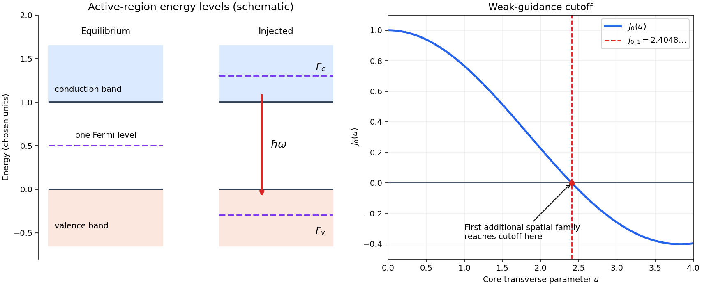

<h1 id="1/a/solution">Solution</h1>

↑ **Parent:** [A](../a.md)

A forward-biased [p-n junction](../../../../p-n-junction.md) injects [electrons](../../../../electron.md) from its [n-type semiconductor](../../../../n-type-semiconductor.md) and [electron holes](../../../../electron-hole.md) from its [p-type semiconductor](../../../../p-type-semiconductor.md) into an active region. A [direct band gap](../../../../direct-band-gap.md) allows radiative transitions without a compensating [phonon](../../../../phonon.md), so [stimulated emission](../../../../stimulated-emission.md) can compete effectively with nonradiative processes. At thermal equilibrium there is one [Fermi level](../../../../fermi-level.md); forward injection instead establishes separate electron and valence-electron [quasi-Fermi levels](../../../../quasi-fermi-level.md) $F_c$ and $F_v$. Sufficient injection makes conduction states more occupied than the corresponding valence states, producing [optical gain](../../../../optical-gain.md).

Two parallel cleaved facets supply an [optical resonator](../../../../optical-cavity.md). At normal incidence their approximate intensity [reflectance](../../../../reflectance.md) follows the [Fresnel equations](../../../../fresnel-equations.md):

$$
R=\left(\frac{n-1}{n+1}\right)^2=0.3195.
$$

A resonant [normal mode](../../../../normal-mode.md) grows when its round-trip amplification exceeds its losses. For length $L$, material [optical gain](../../../../optical-gain.md) $g$, overlap factor $\Gamma$, internal intensity loss $\alpha_i$ and facet reflectances $R_1,R_2$,

$$
R_1R_2e^{2(\Gamma g-\alpha_i)L}\geq1,
\qquad \boxed{\Gamma g\geq\alpha_i+\frac{1}{2L}\ln\frac1{R_1R_2}.}
$$

The pump supplies the emitted [energy](../../../../energy-split.md); the facets provide feedback and let some output escape. Positive [optical gain](../../../../optical-gain.md) alone does not establish [laser threshold](../../../../laser-threshold.md).

**[Figure 1](#1/a/image-injected-laser-diode-levels-and-the-first-additional-guided-spatial-mode). Injected laser diode levels and the first additional guided spatial mode**. Original schematic: the left panel uses stipulated energy units to distinguish equilibrium and injected [quasi-Fermi levels](../../../../quasi-fermi-level.md), with an allowed downward optical transition. The right panel plots $J_0(u)$, whose first zero fixes the weak-guidance spatial-mode cutoff. The separate panels do not represent a shared spatial coordinate.

## ↑ Ancestors (12)

1. [A](../a.md)
2. [1](../../1.md)
3. [2015](../../../2015-split.md)
4. [Past exam of the laser science and quantum information processing course of the University of Oxford](../../../split.md)
5. [Laser science and quantum information processing course of the University of Oxford](../../../../laser-science-and-quantum-information-processing-course-of-the-university-of-oxford.md)
6. [Year 4 of the physics course of the University of Oxford](../../../../year-4-of-the-physics-course-of-the-university-of-oxford.md)
7. [Physics course of the University of Oxford](../../../../physics-course-of-the-university-of-oxford.md)
8. [Undergraduate course of the University of Oxford](../../../../undergraduate-course-of-the-university-of-oxford.md)
9. [Course of the University of Oxford](../../../../course-of-the-university-of-oxford.md)
10. [University of Oxford](../../../../university-of-oxford-split.md)
11. [List of universities](../../../../list-of-universities.md)
12. [Codex Wiki](../../../../split.md)
