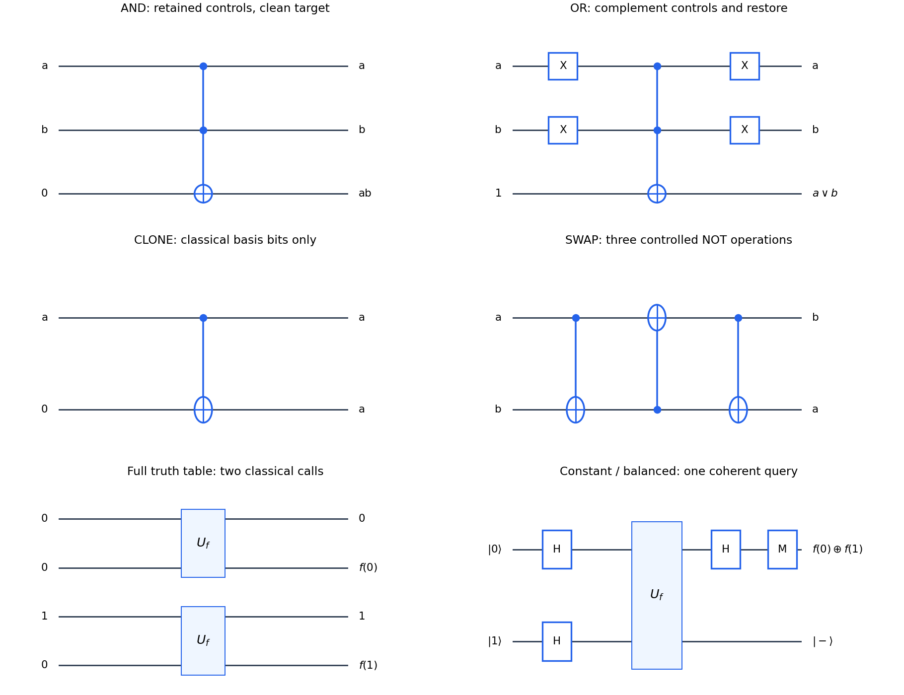

<h1 id="6/a/solution">Solution</h1>

↑ **Parent:** [A](../a.md)

Use a classical target bit $t$ and initialized auxiliary bits. The [NOT](../../../../negation.md) gate maps $t\mapsto1\oplus t$, the [CNOT gate](../../../../controlled-not-gate.md) maps $(a,t)\mapsto(a,t\oplus a)$, and the [Toffoli gate](../../../../toffoli-gate.md) maps $(a,b,t)\mapsto(a,b,t\oplus ab)$. They are bijections and are their own inverses. Explicit circuits with their retained input wires are:

- AND: a [Toffoli gate](../../../../toffoli-gate.md) on $(a,b,0)$ produces $(a,b,ab)$.
- OR: apply [NOT](../../../../negation.md) to both controls, a [Toffoli gate](../../../../toffoli-gate.md) with target initialized to $1$, then restore both controls. The target becomes $1\oplus(1-a)(1-b)=a\lor b$.
- CLONE: a [CNOT gate](../../../../controlled-not-gate.md) on $(a,0)$ gives $(a,a)$.
- SWAP: apply $\operatorname{CNOT}_{a\to b}$, $\operatorname{CNOT}_{b\to a}$ and $\operatorname{CNOT}_{a\to b}$. The successive pairs are $(a,b\oplus a)$, $(b,b\oplus a)$, then $(b,a)$.

These maps also give the truth tables for all input combinations. AND and OR are not themselves reversible maps if the inputs are discarded; the retained inputs are what make their implementations reversible. Classical CLONE copies a known orthogonal [computational basis](../../../../computational-basis.md) alphabet; the [no-cloning theorem](../../../../no-cloning-theorem.md) forbids interpreting it as a copier of arbitrary quantum superpositions.

A [Boolean circuit](../../../../boolean-circuit.md) can express any finite Boolean function using AND, OR and NOT. Replace its operations by the reversible versions, keeping inputs and intermediate bits. Copy the final output into a fresh answer register with [CNOT gates](../../../../controlled-not-gate.md), then run the entire computing network backward. Intermediate auxiliary bits return to zero, yielding

$$
\boxed{(x,0,y)\longmapsto(x,0,y\oplus f(x)).}
$$

This compute-copy-uncompute construction proves universality in the usual model with initialized auxiliary bits. If $f$ is a reversible permutation, compute $f(x)$, use a reversible implementation of $f^{-1}$ to clear $x$, and swap registers, leaving $f(x)$ with clean auxiliaries. The ancillary-resource qualification matters; a blanket claim about all permutations on an arbitrary fixed number of unassisted wires has parity restrictions.

**[Figure 2](#6/a/image-reversible-boolean-constructions-and-a-one-query-deutsch-algorithm). Reversible Boolean constructions and a one-query Deutsch algorithm**. Original circuits for AND, OR, copying a classical bit and SWAP, with retained inputs and initialized targets shown explicitly. The lower panels show two classical oracle queries for the truth table and the phase-kickback quantum network that obtains only its parity in one query. Circuit operations run from left to right.

## ↑ Ancestors (12)

1. [A](../a.md)
2. [6](../../6.md)
3. [2015](../../../2015-split.md)
4. [Past exam of the laser science and quantum information processing course of the University of Oxford](../../../split.md)
5. [Laser science and quantum information processing course of the University of Oxford](../../../../laser-science-and-quantum-information-processing-course-of-the-university-of-oxford.md)
6. [Year 4 of the physics course of the University of Oxford](../../../../year-4-of-the-physics-course-of-the-university-of-oxford.md)
7. [Physics course of the University of Oxford](../../../../physics-course-of-the-university-of-oxford.md)
8. [Undergraduate course of the University of Oxford](../../../../undergraduate-course-of-the-university-of-oxford.md)
9. [Course of the University of Oxford](../../../../course-of-the-university-of-oxford.md)
10. [University of Oxford](../../../../university-of-oxford-split.md)
11. [List of universities](../../../../list-of-universities.md)
12. [Codex Wiki](../../../../split.md)
