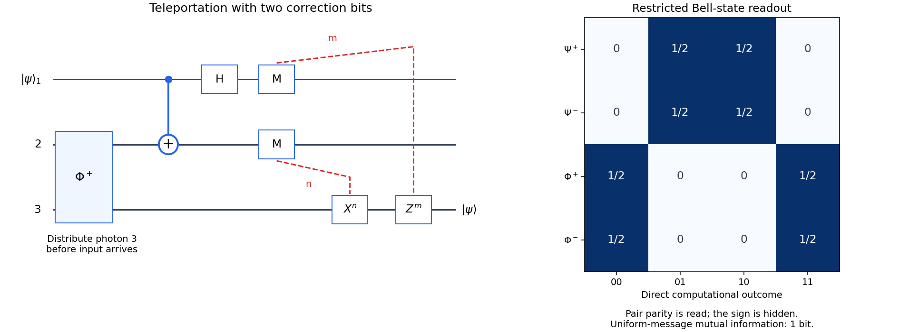

<h1 id="7/b/solution">Solution</h1>

↑ **Parent:** [B](../b.md)

Label the unknown input $1$, Alice's resource photon $2$, and Bob's resource photon $3$. First distribute photon $3$ through the channel while keeping photon $2$ with Alice; at $p=1$ this leaves the perfect shared [Bell state](../../../../bell-state-split.md) $|\Phi^+\rangle_{23}=(|00\rangle+|11\rangle)/\sqrt2$. When the input arrives, the three-qubit state is

$$
|\Omega_0\rangle=\frac{1}{\sqrt2}
\left(\alpha|000\rangle+\alpha|011\rangle+\beta|100\rangle+\beta|111\rangle\right).
$$

Alice applies $\operatorname{CNOT}_{1\to2}$, giving

$$
|\Omega_1\rangle=\frac{1}{\sqrt2}
\left(\alpha|000\rangle+\alpha|011\rangle+\beta|110\rangle+\beta|101\rangle\right).
$$

She next applies $H_1$, producing

$$
|\Omega_2\rangle=\frac12\big(
|00\rangle_{12}|\psi\rangle_3+
|01\rangle_{12}X|\psi\rangle_3+
|10\rangle_{12}Z|\psi\rangle_3+
|11\rangle_{12}XZ|\psi\rangle_3\big).
$$

These two gates followed by computational measurement implement a perfect [Bell state](../../../../bell-state-split.md) analyzer. For outcome $(m,n)$ the normalized conditional state is $|mn\rangle_{12}X^nZ^m|\psi\rangle_3$, with probability $1/4$. Alice sends the **two classical bits** $m,n$; Bob applies $Z^mX^n$, recovering $|\psi\rangle$ exactly. Averaging before reception of the bits gives Bob $I/2$, independent of the input, so this protocol provides no faster-than-light communication.

For $p=1$, directly sending the original [qubit](../../../../qubit.md) is already perfect. [Quantum teleportation](../../../../quantum-teleportation.md) therefore has no fidelity advantage in this ideal case and consumes a shared entangled pair plus classical communication. Its operational advantage is that entanglement can be distributed beforehand: once the unknown input appears, only classical information need travel, and the original input photon need not itself propagate to Bob. The Bell measurement consumes the input; it does not create a second copy.

**[Figure 3](#7/b/image-quantum-teleportation-corrections-and-restricted-superdense-coding-readout). Quantum teleportation corrections and restricted superdense coding readout**. Original teleportation circuit with the distributed resource, two measurement bits and conditional corrections, beside the four Bell-state computational-basis outcome probabilities. The right panel describes direct measurement without a two-qubit Bell decoder, not measurement after an unrestricted decoding circuit.

## ↑ Ancestors (12)

1. [B](../b.md)
2. [7](../../7.md)
3. [2015](../../../2015-split.md)
4. [Past exam of the laser science and quantum information processing course of the University of Oxford](../../../split.md)
5. [Laser science and quantum information processing course of the University of Oxford](../../../../laser-science-and-quantum-information-processing-course-of-the-university-of-oxford.md)
6. [Year 4 of the physics course of the University of Oxford](../../../../year-4-of-the-physics-course-of-the-university-of-oxford.md)
7. [Physics course of the University of Oxford](../../../../physics-course-of-the-university-of-oxford.md)
8. [Undergraduate course of the University of Oxford](../../../../undergraduate-course-of-the-university-of-oxford.md)
9. [Course of the University of Oxford](../../../../course-of-the-university-of-oxford.md)
10. [University of Oxford](../../../../university-of-oxford-split.md)
11. [List of universities](../../../../list-of-universities.md)
12. [Codex Wiki](../../../../split.md)
