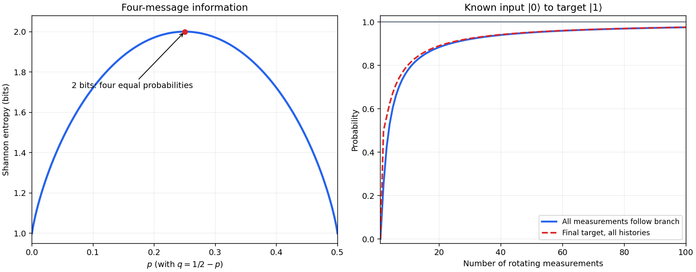

<h1 id="8/a/solution">Solution</h1>

↑ **Parent:** [A](../a.md)

Normalization requires $2p+2q=1$, so $q=1/2-p$ and $0\leq p\leq1/2$. With logarithms to base two, the [Shannon entropy](../../../../information-entropy-split.md) is

$$
\boxed{H(X)=-2p\log_2p-2q\log_2q=1+h_2(2p).}
$$

The convention $0\log0=0$ gives $H=1$ at both endpoints. In the interior,

$$
H'(p)=2\log_2\frac qp,\qquad
H''(p)=-\frac2{\ln2}\left(\frac1p+\frac1q\right)<0.
$$

Hence the unique maximum is $H=2$ bits at $p=q=1/4$. The curve is concave and symmetric about $p=1/4$.

Choose the message assignment $x_1\leftrightarrow\Psi^+$, $x_2\leftrightarrow\Psi^-$, $x_3\leftrightarrow\Phi^+$ and $x_4\leftrightarrow\Phi^-$. Starting from $|\Psi^+\rangle$, apply respectively $I,Z,X,XZ$ to the first [qubit](../../../../qubit.md). This produces those four orthonormal [Bell states](../../../../bell-state-split.md), up to a physically irrelevant overall sign in the last case. The ensemble [density operator](../../../../density-matrix-split.md) is

$$
\boxed{\rho_Y=p\Pi_{\Psi^+}+p\Pi_{\Psi^-}+q\Pi_{\Phi^+}+q\Pi_{\Phi^-}
=\operatorname{diag}(q,p,p,q)}
$$

in computational order $00,01,10,11$, where $\Pi_B=|B\rangle\langle B|$. The cancellation of off-diagonal terms follows from the equal probabilities within each sign pair; the individual encoded states remain entangled.

A [Bell basis](../../../../bell-basis.md) measurement reads the label perfectly because the four code states are orthogonal. Thus this is equivalent to a classical error-free encoding when unrestricted joint measurement is allowed. Each conditional encoded state is pure, so

$$
\boxed{H(Y|X)=\sum_i p_i S(\Pi_i)=0,\qquad
H(X:Y)=S(\rho_Y)-\sum_i p_iS(\Pi_i)=H(X).}
$$

The second formula is the classical-quantum [mutual information](../../../../mutual-information.md), here equal to attainable classical information. The first says there is no uncertainty about the joint pure code state once the message is known; it does not say that measuring its individual [qubits](../../../../qubit.md) has deterministic outcomes.

**[Figure 4](#8/a/image-message-shannon-entropy-and-measurement-guided-state-transfer). Message Shannon entropy and measurement-guided state transfer**. Original theoretical curves: $H(X)=1+h_2(2p)$ for the specified four-message distribution, and finite-step Zeno transfer probabilities for a known initial basis state. The conditioned all-following probability and the unconditioned final-target probability differ at finite step count but both tend to one.

## ↑ Ancestors (12)

1. [A](../a.md)
2. [8](../../8.md)
3. [2015](../../../2015-split.md)
4. [Past exam of the laser science and quantum information processing course of the University of Oxford](../../../split.md)
5. [Laser science and quantum information processing course of the University of Oxford](../../../../laser-science-and-quantum-information-processing-course-of-the-university-of-oxford.md)
6. [Year 4 of the physics course of the University of Oxford](../../../../year-4-of-the-physics-course-of-the-university-of-oxford.md)
7. [Physics course of the University of Oxford](../../../../physics-course-of-the-university-of-oxford.md)
8. [Undergraduate course of the University of Oxford](../../../../undergraduate-course-of-the-university-of-oxford.md)
9. [Course of the University of Oxford](../../../../course-of-the-university-of-oxford.md)
10. [University of Oxford](../../../../university-of-oxford-split.md)
11. [List of universities](../../../../list-of-universities.md)
12. [Codex Wiki](../../../../split.md)
