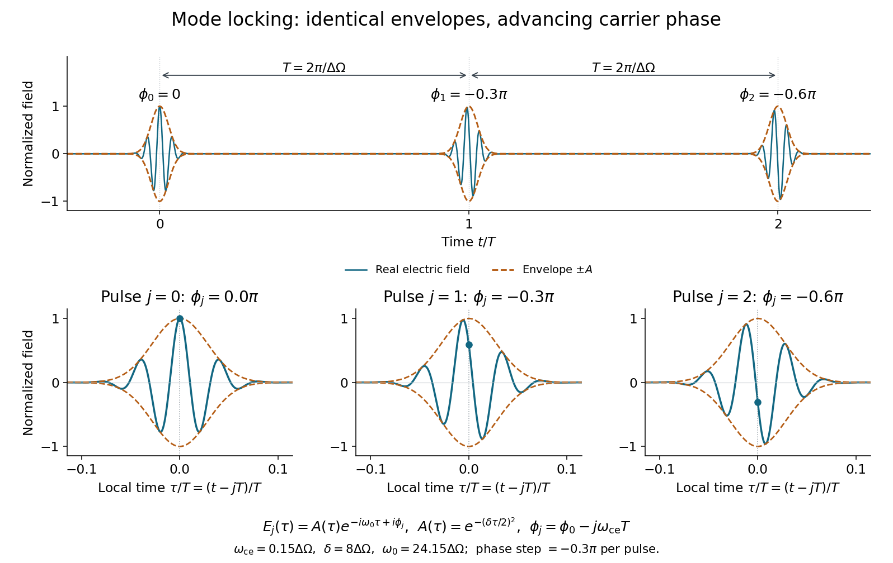

<h1 id="1/solution">Solution</h1>

↑ **Parent:** [1](../1.md)

[Mode locking](../../../mode-locking.md) fixes the relative phases of a laser's [longitudinal cavity modes](../../../longitudinal-cavity-mode.md), so they interfere constructively in a regularly repeating short pulse rather than producing an uncontrolled temporal waveform. [Active mode locking](../../../active-mode-locking.md) uses an externally driven modulation of loss, gain or phase at the cavity repetition frequency; an [electro-optic modulator](../../../electro-optic-modulator.md) acting as a periodic transmission gate is one example. [Passive mode locking](../../../passive-mode-locking.md) uses the pulse itself to select a high-intensity waveform: a [saturable absorber](../../../saturable-absorber.md) has lower loss at the pulse peak and can lock the phases without an external clock. A semiconductor saturable-absorber mirror is a practical example. Gain recovery, dispersion and saturation must support a stable circulating pulse.

Using the complex-field convention in the question, add the fields of all the oscillating modes. Set $m=p-q_0$, so that $\omega_p=\omega_{q_0}+m\Delta\omega$. Then

$$
\boxed{E(t)=e^{-i(\omega_{q_0}t-\phi_{q_0})}\sum_{m=-N/2}^{N/2}e^{-(m\Delta\omega/\delta)^2}e^{-im\Delta\omega t}.}
$$

There are $N+1$ terms with the printed inclusive indexing. The sum is periodic with period

$$
\boxed{T=\frac{2\pi}{\Delta\omega},}
$$

which is the separation of adjacent pulses when many modes contribute. The carrier factor need not repeat over this interval.

To specify the [carrier-envelope phase](../../../carrier-envelope-phase.md) sign, write the real field near pulse $j$, with $\tau=t-jT$, as $A(\tau)\cos(\omega_{q_0}\tau+\varphi_j)$. Its cosine phase is $\varphi_j=\omega_{q_0}jT-\phi_{q_0}$. Since $q_0\Delta\omega T=2\pi q_0$,

$$
\boxed{\varphi_{j+1}-\varphi_j=\omega_{\rm ce}T\pmod{2\pi}.}
$$

Equivalently, the phase $\phi_j$ in the complex convention $E_j=A(\tau)e^{-i\omega_{q_0}\tau+i\phi_j}$ advances by $-\omega_{\rm ce}T$. This is the negative of the cosine phase, not a different physical prediction. The [carrier-envelope offset frequency](../../../carrier-envelope-offset-frequency.md) fixes this pulse-to-pulse slip. It matters for a few-cycle field's peak electric waveform and for locating an optical frequency comb's lines; a stable intensity envelope alone does not fix the slip.

**[Figure 1](#1/image-identical-pulse-envelopes-with-changing-carrier-phase-the-plotted-phase-labels-use-the-complex-field-convention). Identical pulse envelopes with changing carrier phase; the plotted phase labels use the complex-field convention**.

If $\delta/\Delta\omega\gg1$ and $N\Delta\omega/2\gg\delta$, many closely spaced modes lie under the spectral Gaussian and the cutoffs have negligible weight. Near one pulse, replace the sum by its continuum integral:

$$
\sum_m e^{-(m\Delta\omega/\delta)^2}e^{-im\Delta\omega t}\simeq\frac1{\Delta\omega}\int_{-\infty}^{\infty}e^{-\Omega^2/\delta^2}e^{-i\Omega t}\,d\Omega=\sqrt\pi\frac\delta{\Delta\omega}e^{-(\delta t/2)^2}.
$$

The [Fourier transform of a Gaussian](../../../fourier-transform-of-a-gaussian.md) therefore gives

$$
\boxed{E(t)\simeq\sqrt\pi\frac\delta{\Delta\omega}e^{-(\delta t/2)^2}e^{-i(\omega_{q_0}t-\phi_{q_0})}.}
$$

This is a local single-pulse approximation. The discrete spectrum produces its periodic replicas; extending one Gaussian over all time would lose them. The temporal [light intensity](../../../light-intensity.md) is proportional to $e^{-\delta^2t^2/2}$, while the spectral intensity envelope is proportional to $e^{-2\Omega^2/\delta^2}$. Their [full widths at half maximum](../../../full-width-at-half-maximum.md) are

$$
\tau=\frac{2\sqrt{2\ln2}}\delta,\qquad\Delta\omega_L=\delta\sqrt{2\ln2},\qquad\boxed{\Delta\omega_L\tau=4\ln2.}
$$

In ordinary frequency this [time-bandwidth product](../../../time-bandwidth-product.md) is $\Delta\nu_L\tau=2\ln2/\pi\simeq0.441$. The spectral phases are flat, so this is a [transform-limited pulse](../../../transform-limited-pulse.md); [chirp](../../../chirp.md) would generally increase its temporal width.

## ↑ Ancestors (11)

1. [1](../1.md)
2. [2016](../../2016-split.md)
3. [Past exam of the laser science and quantum information processing course of the University of Oxford](../../split.md)
4. [Laser science and quantum information processing course of the University of Oxford](../../../laser-science-and-quantum-information-processing-course-of-the-university-of-oxford.md)
5. [Year 4 of the physics course of the University of Oxford](../../../year-4-of-the-physics-course-of-the-university-of-oxford.md)
6. [Physics course of the University of Oxford](../../../physics-course-of-the-university-of-oxford.md)
7. [Undergraduate course of the University of Oxford](../../../undergraduate-course-of-the-university-of-oxford.md)
8. [Course of the University of Oxford](../../../course-of-the-university-of-oxford.md)
9. [University of Oxford](../../../university-of-oxford-split.md)
10. [List of universities](../../../list-of-universities.md)
11. [Codex Wiki](../../../split.md)
