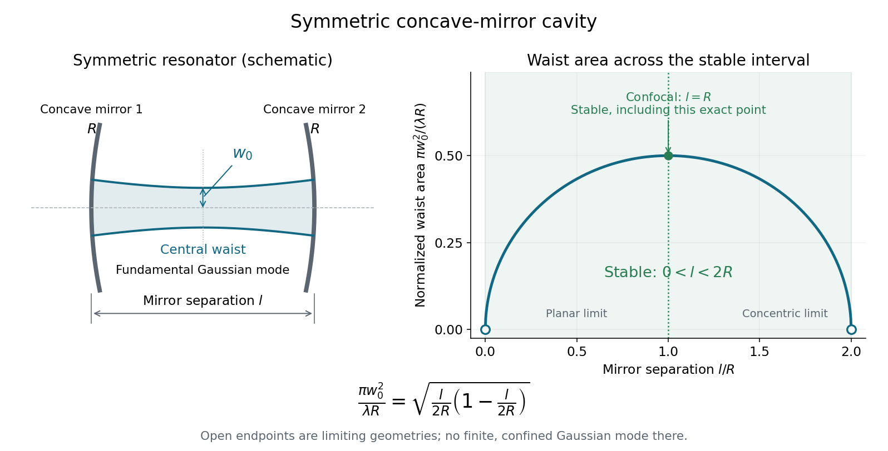

<h1 id="2/solution">Solution</h1>

↑ **Parent:** [2](../2.md)

A longitudinal mode makes an integer round-trip phase accumulation. For the same transverse mode and an empty nondispersive cavity, increasing that integer by one changes the optical frequency by the [free spectral range](../../../free-spectral-range.md)

$$
\boxed{\Delta\nu=\frac{c}{2l},\qquad\Delta\omega=\frac{\pi c}{l}.}
$$

Frequency-dependent mirror phases or a dispersive intracavity medium would change the round-trip group delay used here.

For a paraxial ray, use the height-slope column $(x,\theta)^T$. Free propagation and reflection from a concave mirror are represented, in unfolded coordinates, by

$$
P=\begin{pmatrix}1&l\\0&1\end{pmatrix},\qquad C=\begin{pmatrix}1&0\\-2/R&1\end{pmatrix}.
$$

The reflection changes the slope by $-2x/R$. Because the mirrors are identical, the same half-round-trip matrix is applied repeatedly:

$$
A=CP=\begin{pmatrix}1&l\\-2/R&1-2l/R\end{pmatrix},\qquad\det A=1,\quad\frac12\operatorname{tr}A=1-\frac lR.
$$

Its two [eigenvalues](../../../eigenvalue.md) are reciprocal. They lie on the [unit circle](../../../complex-unit-circle.md) without a growing component when $|1-l/R|<1$, whereas $l>2R$ gives a real eigenvalue of modulus greater than one. At $l=2R$, the repeated eigenvalue has a nontrivial [Jordan block](../../../jordan-block.md) and generic rays drift out. Thus the nondegenerate stable interval is

$$
\boxed{0<l<2R.}
$$

The confocal value $l=R$ is included: there $A^2=-I$, so the repeated round trip is bounded. Applying a strict trace inequality to the full-round-trip matrix without checking this exact matrix would incorrectly discard that point. These are the paraxial conditions for a [symmetric concave-mirror resonator](../../../symmetric-concave-mirror-resonator.md).

Symmetry places the [Gaussian beam](../../../gaussian-beam.md) waist halfway between the mirrors. Its [Rayleigh range](../../../rayleigh-length.md) is $z_R=\pi w_0^2/\lambda$, and its wavefront radius at distance $z$ from the waist is $R_b(z)=z+z_R^2/z$. Matching that wavefront to the mirror at $z=l/2$ gives

$$
R=\frac l2+\frac{z_R^2}{l/2},\qquad z_R^2=\frac l2\left(R-\frac l2\right).
$$

Hence

$$
\boxed{\pi w_0^2=\lambda\sqrt{\frac l2\left(R-\frac l2\right)}.}
$$

A real positive Rayleigh range requires the same stable interval. At its limiting geometries the finite confined Gaussian mode degenerates; the formula is not a way to realize an arbitrarily small physical waist without leaving the paraxial model.

**[Figure 2](#2/image-symmetric-cavity-geometry-and-the-fundamental-waist-across-its-stable-interval-including-the-confocal-point). Symmetric cavity geometry and the fundamental waist across its stable interval, including the confocal point**.

## ↑ Ancestors (11)

1. [2](../2.md)
2. [2016](../../2016-split.md)
3. [Past exam of the laser science and quantum information processing course of the University of Oxford](../../split.md)
4. [Laser science and quantum information processing course of the University of Oxford](../../../laser-science-and-quantum-information-processing-course-of-the-university-of-oxford.md)
5. [Year 4 of the physics course of the University of Oxford](../../../year-4-of-the-physics-course-of-the-university-of-oxford.md)
6. [Physics course of the University of Oxford](../../../physics-course-of-the-university-of-oxford.md)
7. [Undergraduate course of the University of Oxford](../../../undergraduate-course-of-the-university-of-oxford.md)
8. [Course of the University of Oxford](../../../course-of-the-university-of-oxford.md)
9. [University of Oxford](../../../university-of-oxford-split.md)
10. [List of universities](../../../list-of-universities.md)
11. [Codex Wiki](../../../split.md)
