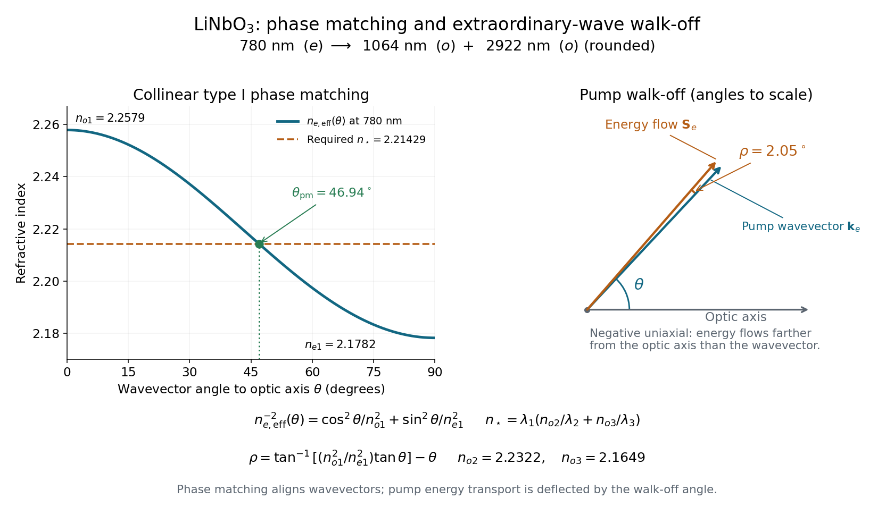

<h1 id="4/solution">Solution</h1>

↑ **Parent:** [4](../4.md)

A crystal needs a nonzero effective second-order [nonlinear optical susceptibility](../../../nonlinear-optical-susceptibility.md) for the chosen polarizations. In the bulk [electric-dipole approximation](../../../electric-dipole-approximation.md), [centrosymmetry](../../../centrosymmetry.md) forbids this response. Transparency at the relevant frequencies and [phase matching](../../../phase-matching.md) over the interaction length permit efficient buildup. Nonzero local generation can occur without exact phase matching, but contributions then tend to cancel as they propagate.

Write $\psi_j=k_jz-\omega_jt+\phi_j$. Expanding the square and using the product-to-sum identity gives

$$
P^{(2)}=\epsilon_0\chi^{(2)}\left[\frac{E_2^2+E_3^2}{2}+\frac{E_2^2}{2}\cos2\psi_2+\frac{E_3^2}{2}\cos2\psi_3+E_2E_3\cos(\psi_2+\psi_3)+E_2E_3\cos(\psi_2-\psi_3)\right].
$$

These are respectively [optical rectification](../../../optical-rectification.md), the two [second-harmonic generation](../../../second-harmonic-generation.md) terms, [sum-frequency generation](../../../sum-frequency-generation.md) and [difference-frequency generation](../../../difference-frequency-generation.md). Their phases and wavevectors are the corresponding sums or differences, not independently adjustable quantities.

For a vector field, $P_i^{(2)}=2\epsilon_0\sum_{jk}d_{ijk}E_jE_k$. In the stated single-frequency amplitude convention, $E_j=(A_je^{i\psi}+A_j^*e^{-i\psi})/2$. If $P_i^{(2\omega)}=[\mathcal P_i e^{2i\psi}+\mathcal P_i^*e^{-2i\psi}]/2$, comparison gives

$$
\boxed{\mathcal P_i=\epsilon_0\sum_{jk}d_{ijk}A_jA_k.}
$$

For a real instantaneous tensor the zero-frequency contribution is $P_i^{(0)}=\epsilon_0\sum_{jk}d_{ijk}\operatorname{Re}(A_jA_k^*)$. In a dispersive treatment, the tensors must carry their respective input and output frequency arguments.

The identical input-frequency pair is symmetric under $j\leftrightarrow k$, allowing [contracted nonlinear susceptibility notation](../../../contracted-nonlinear-susceptibility-notation.md): replace the six pairs $xx,yy,zz,yz,zx,xy$ by $J=1,\ldots,6$. Thus

$$
\mathcal P_i=\epsilon_0\sum_{J=1}^6d_{iJ}\begin{pmatrix}A_x^2\\A_y^2\\A_z^2\\2A_yA_z\\2A_zA_x\\2A_xA_y\end{pmatrix}_{\!J}.
$$

This contraction of a symmetric pair does not turn the physical susceptibility into a rank-two tensor. The factors of two account for both off-diagonal input orderings, and the prefactor follows from the question's explicit $1/2$ field convention.

For the proposed type-I process, energy conservation requires $\omega_1=\omega_2+\omega_3$. Hence

$$
\boxed{\lambda_3=\frac{\lambda_1\lambda_2}{\lambda_2-\lambda_1}=2922.25\ldots\,\mathrm{nm}\simeq2922\,\mathrm{nm}.}
$$

The extraordinary pump and two ordinary output waves can be collinearly phase matched if

$$
\frac{n_{e,\mathrm{eff}}^{\lambda_1}(\theta)}{\lambda_1}=S,\qquad S=\frac{n_o^{\lambda_2}}{\lambda_2}+\frac{n_o^{\lambda_3}}{\lambda_3}.
$$

Put $n_*=\lambda_1S$. Substituting the supplied angular extraordinary index and solving for $\sin^2\theta$ yields

$$
\boxed{\sin^2\theta=\frac{1/n_*^2-1/(n_o^{\lambda_1})^2}{1/(n_e^{\lambda_1})^2-1/(n_o^{\lambda_1})^2}=\frac{(n_e^{\lambda_1}n_o^{\lambda_1})^2-\lambda_1^2(n_e^{\lambda_1})^2S^2}{\lambda_1^2S^2[(n_o^{\lambda_1})^2-(n_e^{\lambda_1})^2]}.}
$$

The required index $n_*\simeq2.2143$ lies between $2.1782$ and $2.2579$, so a real angle exists. Using the rounded 2922 nm wavelength in the supplied data gives $\theta\simeq46.94^\circ$; retaining the energy-conserving 2922.25 nm value gives about $46.98^\circ$. Their common meaningful scale is **about 47 degrees**.

The [spatial walk-off](../../../spatial-walk-off.md) angle is the angle between the extraordinary wave's [Poynting vector](../../../poynting-vector.md) and its wavevector. For an optic-axis angle $\theta$, the extraordinary dispersion surface gives

$$
\tan\psi=\frac{n_o^2}{n_e^2}\tan\theta,\qquad\boxed{\rho=\psi-\theta=\arctan\left(\frac{n_o^2}{n_e^2}\tan\theta\right)-\theta\simeq2.05^\circ.}
$$

Here the indices are those of the 780 nm pump. Since this is a negative uniaxial crystal, its energy flow is farther from the optic axis than its wavevector. The ordinary waves' energy flows follow their wavevectors. The pump therefore drifts out of spatial overlap by roughly $L\tan\rho\simeq0.0357L$, about $36\,\mu\mathrm m$ over a millimetre. This limits the useful nonlinear interaction length even when phase matching is exact.

**[Figure 3](#4/image-type-i-phase-matching-near-forty-seven-degrees-and-the-extraordinary-pump-s-two-degree-spatial-walk-off). Type-I phase matching near forty-seven degrees and the extraordinary pump's two-degree spatial walk-off**.

## ↑ Ancestors (11)

1. [4](../4.md)
2. [2016](../../2016-split.md)
3. [Past exam of the laser science and quantum information processing course of the University of Oxford](../../split.md)
4. [Laser science and quantum information processing course of the University of Oxford](../../../laser-science-and-quantum-information-processing-course-of-the-university-of-oxford.md)
5. [Year 4 of the physics course of the University of Oxford](../../../year-4-of-the-physics-course-of-the-university-of-oxford.md)
6. [Physics course of the University of Oxford](../../../physics-course-of-the-university-of-oxford.md)
7. [Undergraduate course of the University of Oxford](../../../undergraduate-course-of-the-university-of-oxford.md)
8. [Course of the University of Oxford](../../../course-of-the-university-of-oxford.md)
9. [University of Oxford](../../../university-of-oxford-split.md)
10. [List of universities](../../../list-of-universities.md)
11. [Codex Wiki](../../../split.md)
