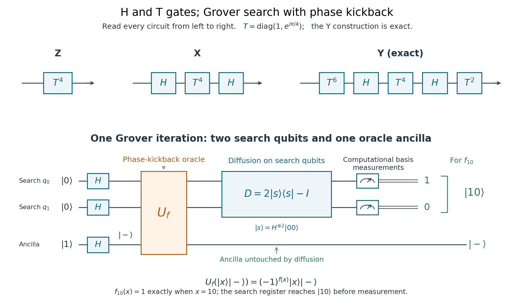

<h1 id="6/solution">Solution</h1>

↑ **Parent:** [6](../6.md)

The [Hadamard gate](../../../hadamard-gate.md) H and [T gate](../../../t-gate.md) $T=\operatorname{diag}(1,e^{i\pi/4})$ form a [universal quantum gate set](../../../universal-quantum-gate-set.md) for single-qubit operations: finite sequences approximate any target single-qubit unitary arbitrarily well, up to a physically irrelevant global phase. Universality is not a claim that every arbitrary rotation has a finite exact H,T word. With products acting right to left, exact Pauli constructions are

$$
\boxed{Z=T^4,\qquad X=HT^4H,\qquad Y=T^2HT^4HT^6.}
$$

Indeed $T^2=S$, $T^6=S^\dagger$, and $SXS^\dagger=Y$.

Initialize the search register in $|00\rangle$ and the output qubit in $|1\rangle$, then apply H to all three. The search state becomes $|s\rangle=(|00\rangle+|01\rangle+|10\rangle+|11\rangle)/2$, and the output becomes $|-\rangle$. The oracle obeys

$$
U_f|x\rangle|-\rangle=(-1)^{f(x)}|x\rangle|-\rangle.
$$

This [phase kickback](../../../phase-kickback.md) leaves the output qubit factored out, so subsequent analysis can use the phase oracle $O_f$ on the two search qubits alone. Apply one [Grover diffusion operator](../../../grover-diffusion-operator.md) $D=2|s\rangle\langle s|-I$, then measure the search register.

**[Figure 4](#6/image-exact-pauli-circuits-from-h-and-t-and-a-two-search-qubit-grover-network-with-a-factored-output-ancilla). Exact Pauli circuits from H and T, and a two-search-qubit Grover network with a factored output ancilla**.

A promise restricts which Boolean functions may be supplied. For the exact one-iteration four-entry search here, promise exactly one marked input. The four functions are $f_{jk}(x)=1$ precisely when $x=jk$, for $jk\in\{00,01,10,11\}$. Other known numbers of marked entries require a correspondingly chosen iteration count; uniqueness is the promise for this particular exact circuit.

In basis order $00,01,10,11$, the requested explicit calculation is

$$
O_{10}=\operatorname{diag}(1,1,-1,1),\qquad D=\frac12\begin{pmatrix}-1&1&1&1\\1&-1&1&1\\1&1&-1&1\\1&1&1&-1\end{pmatrix},
$$

$$
|s\rangle\longmapsto\frac12\begin{pmatrix}1\\1\\-1\\1\end{pmatrix}\longmapsto\boxed{\begin{pmatrix}0\\0\\1\\0\end{pmatrix}=|10\rangle.}
$$

Thus the promised marked entry is found with probability one.

For two weakly coupled spin-half nuclei in [nuclear magnetic resonance](../../../nuclear-magnetic-resonance-split.md), a useful rotating-frame Hamiltonian is

$$
\frac H\hbar=\Omega_1I_z+\Omega_2S_z+2\pi J I_zS_z=\frac{\Omega_1}2Z_1+\frac{\Omega_2}2Z_2+\frac{\pi J}2Z_1Z_2,
$$

where $J$ is in hertz and $I_z=Z_1/2$, $S_z=Z_2/2$. Resonant pulses and refocusing separate local rotations from the scalar coupling. For positive $J$, evolution for $t=1/(2J)$ supplies $e^{-i\pi Z_1Z_2/4}$. Combining it with local Z phases gives the phase oracle

$$
O_{11}=\operatorname{diag}(1,1,1,-1)=e^{-i\pi/4}e^{i\pi Z_1/4}e^{i\pi Z_2/4}e^{-i\pi Z_1Z_2/4}.
$$

The scalar global phase is immaterial. Local $\pi$ pulses interchange zero and one, so

$$
\boxed{O_{00}=(X\otimes X)O_{11}(X\otimes X).}
$$

This implements the desired change of marked input without an additional output qubit.

## ↑ Ancestors (11)

1. [6](../6.md)
2. [2016](../../2016-split.md)
3. [Past exam of the laser science and quantum information processing course of the University of Oxford](../../split.md)
4. [Laser science and quantum information processing course of the University of Oxford](../../../laser-science-and-quantum-information-processing-course-of-the-university-of-oxford.md)
5. [Year 4 of the physics course of the University of Oxford](../../../year-4-of-the-physics-course-of-the-university-of-oxford.md)
6. [Physics course of the University of Oxford](../../../physics-course-of-the-university-of-oxford.md)
7. [Undergraduate course of the University of Oxford](../../../undergraduate-course-of-the-university-of-oxford.md)
8. [Course of the University of Oxford](../../../course-of-the-university-of-oxford.md)
9. [University of Oxford](../../../university-of-oxford-split.md)
10. [List of universities](../../../list-of-universities.md)
11. [Codex Wiki](../../../split.md)
