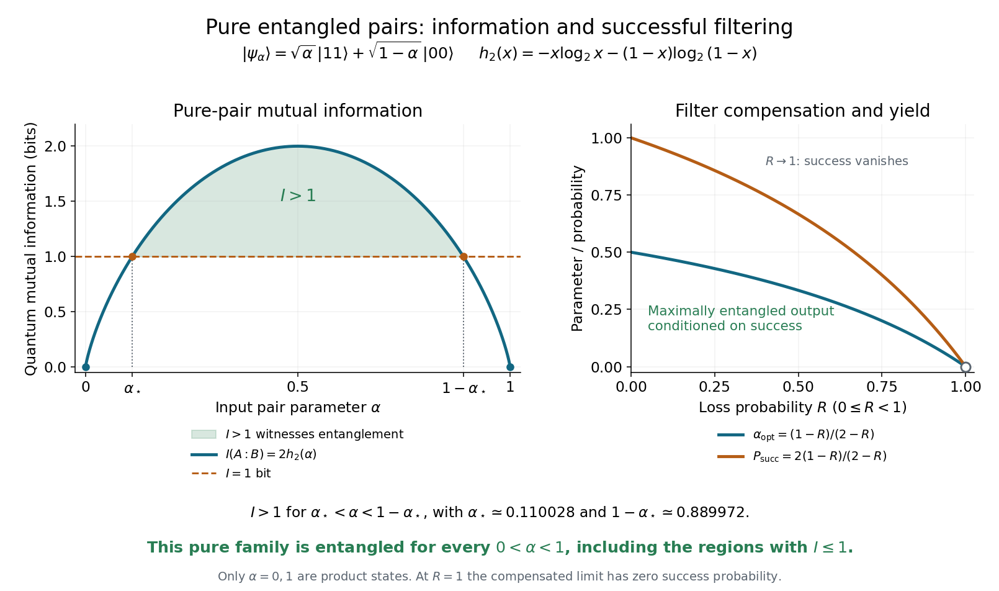

<h1 id="8/solution">Solution</h1>

↑ **Parent:** [8](../8.md)

The transmitted branch is the [Kraus operator](../../../kraus-operator.md)

$$
\boxed{E=\sqrt{1-R}\,|0\rangle\langle0|+|1\rangle\langle1|,\qquad E^\dagger E=\operatorname{diag}(1-R,1).}
$$

For nonzero loss it is not trace preserving: $\operatorname{tr}(E\rho E^\dagger)$ is the transmission probability. A complete channel includes an orthogonal vacuum or erasure flag, with a loss operator $L=\sqrt R\,|\mathrm{vac}\rangle\langle0|$ and $E^\dagger E+L^\dagger L=I$. Postselecting only the first outcome gives the single-operator description in the question.

For $|\pm\rangle$, the unnormalized transmitted vector is $(\sqrt{1-R}|0\rangle\pm|1\rangle)/\sqrt2$. Its norm squared and normalized conditional state are

$$
\boxed{P_{\mathrm{tr}}=1-\frac R2,\qquad|\pm_R\rangle=\frac{\sqrt{1-R}|0\rangle\pm|1\rangle}{\sqrt{2-R}},\qquad P_{\mathrm{loss}}=\frac R2.}
$$

The reduced density matrix of either member of the initial pair has eigenvalues $\alpha,1-\alpha$. Since the joint state is pure, its [Von Neumann entropy](../../../von-neumann-entropy-split.md) is zero. With logarithms to base two and $h_2$ the [binary entropy function](../../../binary-entropy-function.md),

$$
\boxed{S(AB)=0,\qquad S(A)=S(B)=h_2(\alpha),\qquad I(A:B)=2h_2(\alpha).}
$$

The two nonzero [Schmidt coefficients](../../../schmidt-coefficient.md) show that this pure pair is entangled exactly when $0<\alpha<1$. Its mutual information rises from zero to two bits at $\alpha=1/2$ and returns to zero.

For this known pure family, every positive mutual information signals entanglement. For an otherwise unspecified two-qubit state, positive mutual information can also be classical. The [mutual information bound for separable states](../../../mutual-information-bound-for-separable-states.md) gives the stronger general witness $I(A:B)>1$ bit. On this curve it holds for approximately $0.110028<\alpha<0.889972$; the rest of the open interval is still entangled, but that generic one-bit witness alone would not certify it.

**[Figure 5](#8/image-mutual-information-of-the-pure-pair-the-generic-one-bit-entanglement-witness-and-the-optimal-lossy-filter-compensation). Mutual information of the pure pair, the generic one-bit entanglement witness, and the optimal lossy-filter compensation**.

If Bob's qubit passes through the channel, the unnormalized retained state is $\sqrt\alpha|11\rangle+\sqrt{(1-\alpha)(1-R)}|00\rangle$. Thus

$$
\boxed{P_s=\alpha+(1-\alpha)(1-R),\qquad|\psi_s\rangle=\frac{\sqrt\alpha|11\rangle+\sqrt{(1-\alpha)(1-R)}|00\rangle}{\sqrt{P_s}}.}
$$

For $0\le R<1$, equal [Schmidt coefficients](../../../schmidt-coefficient.md) require $\alpha=(1-\alpha)(1-R)$, giving

$$
\boxed{\alpha_{\mathrm{opt}}=\frac{1-R}{2-R},\qquad P_s=\frac{2(1-R)}{2-R},\qquad\text{pair rate}=N\frac{2(1-R)}{2-R}.}
$$

The retained state is then $(|00\rangle+|11\rangle)/\sqrt2$. At $R=1$, this limiting compensation has zero transmission probability and yields no maximally entangled pairs. Conditioning can increase the entanglement of retained pairs, while the discarded fraction accounts for the cost.

## ↑ Ancestors (11)

1. [8](../8.md)
2. [2016](../../2016-split.md)
3. [Past exam of the laser science and quantum information processing course of the University of Oxford](../../split.md)
4. [Laser science and quantum information processing course of the University of Oxford](../../../laser-science-and-quantum-information-processing-course-of-the-university-of-oxford.md)
5. [Year 4 of the physics course of the University of Oxford](../../../year-4-of-the-physics-course-of-the-university-of-oxford.md)
6. [Physics course of the University of Oxford](../../../physics-course-of-the-university-of-oxford.md)
7. [Undergraduate course of the University of Oxford](../../../undergraduate-course-of-the-university-of-oxford.md)
8. [Course of the University of Oxford](../../../course-of-the-university-of-oxford.md)
9. [University of Oxford](../../../university-of-oxford-split.md)
10. [List of universities](../../../list-of-universities.md)
11. [Codex Wiki](../../../split.md)
