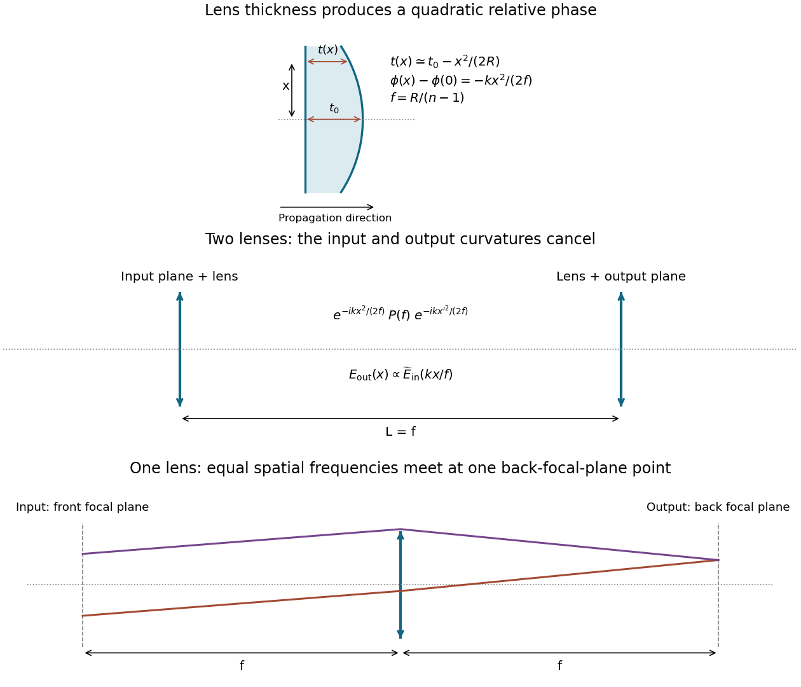
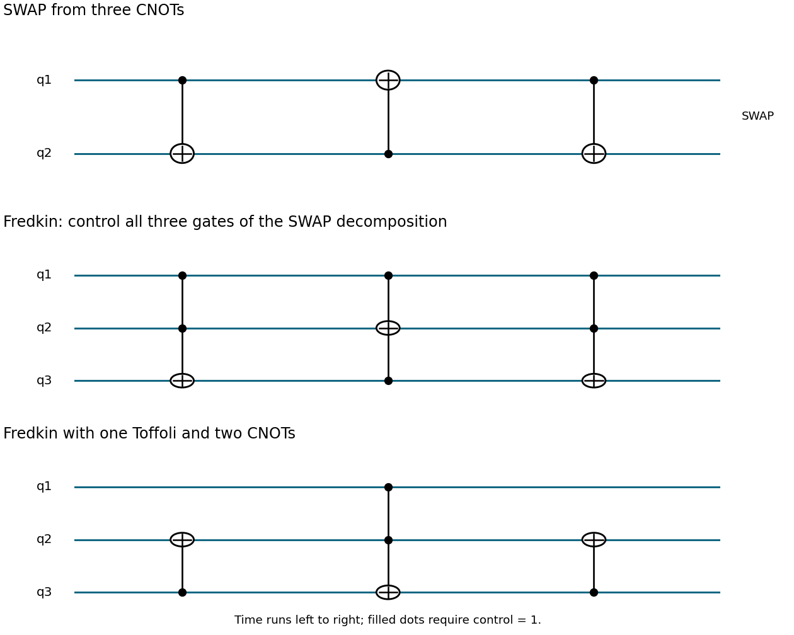
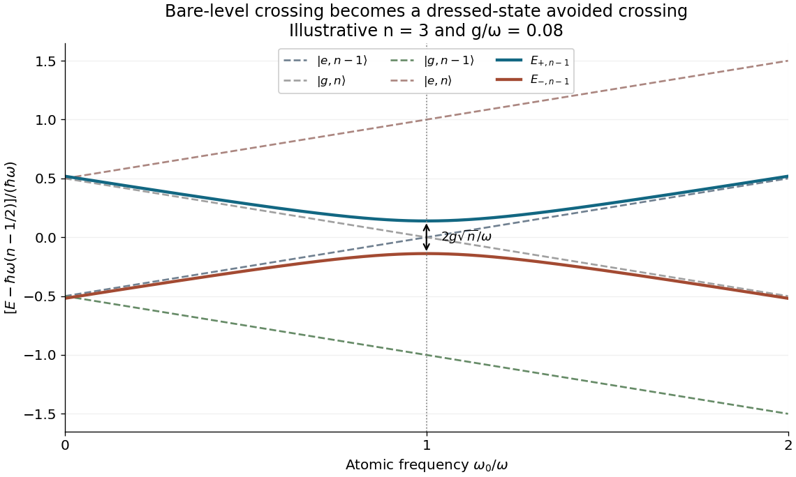

# 2017

↑ **Parent:** [Past exam of the laser science and quantum information processing course of the University of Oxford](../past-exam-of-the-laser-science-and-quantum-information-processing-course-of-the-university-of-oxford.md)

Source paper: [https://www.whatdotheyknow.com/request/oxford_physics_past_papers_2/response/2340696/attach/5/Physics%20Papers%202016.pdf?cookie_passthrough=1.](https://www.whatdotheyknow.com/request/oxford_physics_past_papers_2/response/2340696/attach/5/Physics%20Papers%202016.pdf?cookie_passthrough=1.) The cover dates this paper to Trinity Term 2017, 14 June; the bundle's 2016 filename does not determine its year. The four marked requests in each question are scoped a–d below. [Computational-basis](../quantum-theory.md#computational-basis) vectors use left-to-right [qubit](../quantum-system.md#qubit) order unless another order is explicitly stated.

**Table of contents**

- [1](#1)
  - [a](#1/a)
    - [Solution](#1/a/solution)
  - [b](#1/b)
    - [Solution](#1/b/solution)
  - [c](#1/c)
    - [Solution](#1/c/solution)
  - [d](#1/d)
    - [Solution](#1/d/solution)
- [2](#2)
  - [a](#2/a)
    - [Solution](#2/a/solution)
  - [b](#2/b)
    - [Solution](#2/b/solution)
  - [c](#2/c)
    - [Solution](#2/c/solution)
  - [d](#2/d)
    - [Solution](#2/d/solution)
- [3](#3)
  - [a](#3/a)
    - [Solution](#3/a/solution)
  - [b](#3/b)
    - [Solution](#3/b/solution)
  - [c](#3/c)
    - [Solution](#3/c/solution)
  - [d](#3/d)
    - [Solution](#3/d/solution)
- [4](#4)
  - [a](#4/a)
    - [Solution](#4/a/solution)
  - [b](#4/b)
    - [Solution](#4/b/solution)
  - [c](#4/c)
    - [Solution](#4/c/solution)
  - [d](#4/d)
    - [Solution](#4/d/solution)
- [5](#5)
  - [a](#5/a)
    - [Solution](#5/a/solution)
  - [b](#5/b)
    - [Solution](#5/b/solution)
  - [c](#5/c)
    - [Solution](#5/c/solution)
  - [d](#5/d)
    - [Solution](#5/d/solution)
- [6](#6)
  - [a](#6/a)
    - [Solution](#6/a/solution)
  - [b](#6/b)
    - [Solution](#6/b/solution)
  - [c](#6/c)
    - [Solution](#6/c/solution)
  - [d](#6/d)
    - [Solution](#6/d/solution)

## 1

↑ **Parent:** [2017](2017.md)

<h3 id="1/a">a</h3>

↑ **Parent:** [1](#1)

<h4 id="1/a/solution">Solution</h4>

↑ **Parent:** [A](#1/a)

A [laser relaxation oscillation](../laser.md#laser-relaxation-oscillation) is the damped exchange between stored upper-level excitation and intracavity [photon number](../quantum-harmonic-oscillator.md#photon-number) after a small perturbation of a lasing [steady state](../dynamical-systems.md#steady-state). Extra [photons](../quantum-mechanics.md#photon) increase stimulated depletion of the upper level; the resulting smaller gain then reduces the [photon](../quantum-mechanics.md#photon) population. Pumping subsequently replenishes the inversion, so the two populations overshoot their equilibrium values before damping settles them.

[Laser spiking](../laser.md#laser-spiking) is the corresponding large-signal sequence of intense output pulses, often during switch-on. Excitation first accumulates while the optical field is small. Once gain exceeds loss, rapid [stimulated emission](../laser.md#stimulated-emission) releases this stored [energy](../energy.md) in a spike, depleting the inversion below threshold. Recovery can produce further spikes. This is distinct from an externally imposed [Q-switching](../laser.md#q-switching) cycle, although both draw on stored excitation.

Many solid-state gain media have upper-state lifetimes far longer than the cavity [photon lifetime](../optical-instrument.md#photon-lifetime). The optical [polarization](../wave.md#polarization-waves) relaxes rapidly, leaving the two slow [rate-equation](../laser.md#laser-rate-equation) variables of a class-B [laser](../laser.md). A long-lived population reservoir and a much faster [photon](../quantum-mechanics.md#photon) response make underdamped recovery and pronounced startup spiking common. The criterion and [frequency](../wave.md#frequency) follow from the [linearization](../algebra.md#linearization-of-a-dynamical-system) in part c; they are not universal consequences of the word “solid-state”.

<h3 id="1/b">b</h3>

↑ **Parent:** [1](#1)

<h4 id="1/b/solution">Solution</h4>

↑ **Parent:** [B](#1/b)

Let $v_g\simeq c/n_r$ be the light's [group velocity](../dispersion-relation.md#group-velocity) in the fibre, with unit mode overlap and a uniform transverse mode area. The [fibre-laser gain-volume rate equations](../laser.md#fibre-laser-gain-volume-rate-equations) follow because the upper-level [density](../fluid-mechanics.md#density) is defined per doped volume, whereas the [photon](../quantum-mechanics.md#photon) [density](../fluid-mechanics.md#density) is defined per full cavity volume. [Stimulated emission](../laser.md#stimulated-emission) therefore removes upper-level ions at rate $v_g\sigma_{21}N_2n$ per doped volume, but supplies cavity [photons](../quantum-mechanics.md#photon) at the volume-averaged rate $fv_g\sigma_{21}N_2n$. Thus

$$
\dot N_2=S-v_g\sigma_{21}N_2n-\frac{N_2}{\tau_2},\qquad
\dot n=\left(fv_g\sigma_{21}N_2-\frac1{\tau_c}\right)n.
$$

At threshold the stimulated [photon](../quantum-mechanics.md#photon) growth rate balances the [photon](../quantum-mechanics.md#photon) loss rate, giving

$$
\boxed{N_{\mathrm{th}}=\frac1{fv_g\sigma_{21}\tau_c}\simeq\frac{n_r}{fc\sigma_{21}\tau_c}.}
$$

Using this relation yields the stated equations, including the essential $1/f$ in the ion-depletion term:

$$
\dot N_2=S-\frac1f\frac{N_2}{N_{\mathrm{th}}}\frac n{\tau_c}-\frac{N_2}{\tau_2},\qquad
\dot n=\left(\frac{N_2}{N_{\mathrm{th}}}-1\right)\frac n{\tau_c}.
$$

Above threshold, the nonzero stationary [photon](../quantum-mechanics.md#photon) [density](../fluid-mechanics.md#density) requires $N_{2,\mathrm{ss}}=N_{\mathrm{th}}$. The remaining stationary equation then gives

$$
\boxed{r=\frac{S\tau_2}{N_{\mathrm{th}}}=\frac S{S_{\mathrm{th}}},\qquad
n_{\mathrm{ss}}=(r-1)f\frac{\tau_c}{\tau_2}N_{\mathrm{th}},\qquad S_{\mathrm{th}}=\frac{N_{\mathrm{th}}}{\tau_2}.}
$$

The parameter $r$ is the pump rate in units of its lasing-threshold value. The above-threshold branch requires $r>1$; below threshold the ideal stationary solution is $n=0$, $N_2=S\tau_2$. [Spontaneous emission](../atomic-physics.md#spontaneous-emission) into the lasing mode has been omitted in this deterministic model, so an exactly zero initial field would need a seed or noise to start, even when the zero-field branch is unstable.

<h3 id="1/c">c</h3>

↑ **Parent:** [1](#1)

<h4 id="1/c/solution">Solution</h4>

↑ **Parent:** [C](#1/c)

Write $N_2=N_{\mathrm{th}}+u$ and $n=n_{\mathrm{ss}}+w$. Keeping terms linear in the perturbations gives

$$
\frac d{dt}\begin{pmatrix}u\\w\end{pmatrix}
=\begin{pmatrix}-r/\tau_2&-1/(f\tau_c)\\f(r-1)/\tau_2&0\end{pmatrix}
\begin{pmatrix}u\\w\end{pmatrix}.
$$

Equivalently,

$$
\ddot w+\frac r{\tau_2}\dot w+\frac{r-1}{\tau_c\tau_2}w=0.
$$

The characteristic exponents are

$$
s_\pm=-\frac r{2\tau_2}\pm i\sqrt{\frac{r-1}{\tau_c\tau_2}-\frac{r^2}{4\tau_2^2}}.
$$

Consequently the above-threshold [steady state](../dynamical-systems.md#steady-state) has damped [oscillations](../wave.md#oscillation) precisely when

$$
\boxed{\tau_2>\frac{r^2}{4(r-1)}\tau_c,\qquad r>1.}
$$

Their ordinary [frequency](../wave.md#frequency) is

$$
\boxed{f_{\mathrm{ro}}=\frac1{2\pi}\sqrt{\frac{r-1}{\tau_c\tau_2}-\frac{r^2}{4\tau_2^2}}
\simeq\frac1{2\pi}\sqrt{\frac{r-1}{\tau_c\tau_2}}.}
$$

The approximation neglects the damping correction when $r^2\tau_c\ll4(r-1)\tau_2$. The exponential envelope decays on time $2\tau_2/r$. The doped-volume fraction cancels out of this linear [frequency](../wave.md#frequency) once the pump is expressed through $r$. [MIT 6.974, Chapter 7, [laser](../laser.md) dynamics and relaxation [oscillations](../wave.md#oscillation)](https://ocw.mit.edu/courses/6-974-fundamentals-of-photonics-quantum-electronics-spring-2006/18f30fad63a62ef4dd894d3752b55a60_chapter7.pdf)

<h3 id="1/d">d</h3>

↑ **Parent:** [1](#1)

<h4 id="1/d/solution">Solution</h4>

↑ **Parent:** [D](#1/d)

The upper-state [density](../fluid-mechanics.md#density) is clamped near threshold once the [laser](../laser.md) operates, so excess pumping mainly increases [photon](../quantum-mechanics.md#photon) [density](../fluid-mechanics.md#density) and output [power](../energy.md#power). For approximately pump-independent absorption efficiency, $r=P_p/P_{p,\mathrm{th}}$, and both $P_{\mathrm{out}}$ and $f_{\mathrm{ro}}^2$ should rise approximately linearly with $P_p-P_{p,\mathrm{th}}$.

**The left ordinate is the square of the [frequency](../wave.md#frequency)**, in $\mathrm{kHz}^2$, rather than [frequency](../wave.md#frequency) in kHz. Reading the original triangles gives a threshold near $12$–$13\ \mathrm{mW}$ and a slope about $1.0\ \mathrm{kHz}^2/\mathrm{mW}$. A representative straight-line fit to visually read marker centers gives $P_{p,\mathrm{th}}\simeq12.2\ \mathrm{mW}$ and $A=d f_{\mathrm{ro}}^2/dP_p\simeq1.02\times10^6\ \mathrm{Hz}^2/\mathrm{mW}$. Therefore

$$
A\simeq\frac1{4\pi^2\tau_c\tau_2P_{p,\mathrm{th}}},\qquad
\boxed{\tau_c\simeq\frac1{4\pi^2(0.013)(12.2)(1.02\times10^6)}
\simeq1.6\times10^{-7}\ \mathrm s.}
$$

The displayed precision is limited by graph reading and scatter; a lifetime around $0.15\ \mathrm{\mu s}$ is the meaningful result. The output squares have a compatible threshold and an approximately constant slope above it.

The round-trip time is

$$
t_{\mathrm{rt}}=\frac{2n_rL}{c}=\frac{2(1.46)(7)}c\simeq6.82\times10^{-8}\ \mathrm s.
$$

If mirror transmission is the only appreciable passive loss, [energy](../energy.md) decays by $R_1R_2=e^{-t_{\mathrm{rt}}/\tau_c}$ per round trip. For $R_1=1$,

$$
\boxed{R_2=e^{-t_{\mathrm{rt}}/\tau_c}\simeq0.65,}
$$

a [power](../energy.md#power) [reflectance](../radiometry.md#reflectance) of roughly 65%. The exact exponential is preferable to replacing $1-R_2$ by $t_{\mathrm{rt}}/\tau_c$, since the inferred round-trip loss is not tiny. If distributed fibre loss is appreciable, the lifetime instead fixes the total round-trip retention; without a separate loss measurement, the bare mirror [reflectance](../radiometry.md#reflectance) is not uniquely determined and is at least this retention factor.

## 2

↑ **Parent:** [2017](2017.md)

<h3 id="2/a">a</h3>

↑ **Parent:** [2](#2)

<h4 id="2/a/solution">Solution</h4>

↑ **Parent:** [A](#2/a)

Measure the [phase](../wave.md#phase-waves) relative to propagation through the same geometrical thickness of air. If the [lens](../geometrical-optics.md#lens-optics)'s central thickness is $t_0$, its spherical surface gives

$$
t(x)=t_0-\left[R-\sqrt{R^2-x^2}\right]
\simeq t_0-\frac{x^2}{2R},\qquad |x|\ll R.
$$

The optical-path excess is $(n-1)t(x)$, so the [phase](../wave.md#phase-waves) imparted by the [lens](../geometrical-optics.md#lens-optics) is

$$
\boxed{\phi(x)=k(n-1)t_0-\frac{k(n-1)x^2}{2R}.}
$$

The constant part is a spatially uniform [phase](../wave.md#phase-waves). The physically important [lens](../geometrical-optics.md#lens-optics) transmission is therefore $T_f(x)=\exp[-ikx^2/(2f)]$ with

$$
\boxed{f=\frac R{n-1}.}
$$

One way to identify the focus is to append propagation to the on-axis point a distance $f$ away. Its path [phase](../wave.md#phase-waves) has the paraxial contribution $+kx^2/(2f)$, which cancels the [lens](../geometrical-optics.md#lens-optics) [phase](../wave.md#phase-waves). Thus all incident portions of a plane wave add with the same [phase](../wave.md#phase-waves) at that point. The diagram below shows the thickness change and both Fourier-transform arrangements.

**[Figure 1](#2/a/image-quadratic-thin-lens-phase-and-two-optical-implementations-of-a-scaled-fourier-transform). Quadratic thin-lens phase and two optical implementations of a scaled Fourier transform**.

<h3 id="2/b">b</h3>

↑ **Parent:** [2](#2)

<h4 id="2/b/solution">Solution</h4>

↑ **Parent:** [B](#2/b)

Apply the first [lens](../geometrical-optics.md#lens-optics), propagate, and apply the second [lens](../geometrical-optics.md#lens-optics). Omitting only common prefactors and uniform [phases](../wave.md#phase-waves),

$$
E_{\mathrm{out}}(x)\propto\int dx'\,
\exp\!\left[-\frac{ikx^2}{2f}+\frac{ik(x-x')^2}{2L}-\frac{ikx'^2}{2f}\right]E_{\mathrm{in}}(x').
$$

The coefficients of both $x^2$ and $x'^2$ vanish if and only if $f=L$. The remaining cross term is $-ikxx'/L$, so

$$
\boxed{f=L,\qquad E_{\mathrm{out}}(x)\propto\int dx'\,e^{-i(kx/L)x'}E_{\mathrm{in}}(x')
=\widetilde E_{\mathrm{in}}\!\left(\frac{kx}{L}\right).}
$$

The Fourier convention here is $\widetilde E(q)=\int e^{-iqx}E(x)dx$. Finite clear apertures would truncate the field and limit the spatial-frequency range; the ideal relation assumes the paraxial field fits within both [lenses](../geometrical-optics.md#lens-optics).

<h3 id="2/c">c</h3>

↑ **Parent:** [2](#2)

<h4 id="2/c/solution">Solution</h4>

↑ **Parent:** [C](#2/c)

Free propagation is [convolution](../fourier-analysis.md#convolution) with a chirp, $K_L(x)=C_Le^{ikL}e^{ikx^2/(2L)}$. The [convolution theorem](../fourier-analysis.md#convolution-theorem) therefore turns it into multiplication by its [Fourier transform](../fourier-transform.md). Complete the square:

$$
\frac{kx^2}{2L}-qx=\frac{k}{2L}\left(x-\frac{Lq}{k}\right)^2-\frac{Lq^2}{2k}.
$$

The [Gaussian integral](../integral.md#gaussian-integral) then gives

$$
\widetilde E(q,L)=C_L\sqrt{\frac{2\pi iL}{k}}\,
 e^{ikL-iLq^2/(2k)}\widetilde E(q,0).
$$

Thus the wavevector-dependent [phase](../wave.md#phase-waves) is

$$
\boxed{\varphi(k_\perp)=kL-\frac{Lk_\perp^2}{2k},}
$$

up to an overall [phase](../wave.md#phase-waves) convention; after removing the carrier it is $-Lk_\perp^2/(2k)$. This also follows from $k_z=\sqrt{k^2-k_\perp^2}\simeq k-k_\perp^2/(2k)$.

**[Normalization](../mathematics.md#normalization) qualification:** the source keeps a two-dimensional-style prefactor while integrating over only one transverse coordinate. With its literal $C_L=ik/(2\pi L)$, there is an additional $q$-independent factor, rather than solely a unit-modulus multiplier. A properly normalized one-dimensional [Fresnel propagator](../partial-differential-equation.md#fresnel-propagator) has $C_L=\sqrt{k/(2\pi iL)}$, which cancels the square-root factor above and makes propagation a pure Fourier-domain [phase](../wave.md#phase-waves). For example, the literal source kernel multiplies a plane-wave Fourier mode by a factor of magnitude $\sqrt{k/(2\pi L)}$, not one. The spatially dependent [phase](../wave.md#phase-waves) and the proportional Fourier-transform results remain unchanged. [Wave optics, two-dimensional Fourier optics: optical-path expansion and Fourier-domain diffraction](../physics-bibliography.md#oscillations-and-waves-by-richard-fitzpatrick)

<h3 id="2/d">d</h3>

↑ **Parent:** [2](#2)

<h4 id="2/d/solution">Solution</h4>

↑ **Parent:** [D](#2/d)

Place the input plane one [focal length](../geometrical-optics.md#focal-length) before a single positive [lens](../geometrical-optics.md#lens-optics) and the output plane one [focal length](../geometrical-optics.md#focal-length) after it. The [lens](../geometrical-optics.md#lens-optics) maps each incident transverse spatial [frequency](../wave.md#frequency) to its corresponding point in the back focal plane. Referencing the input to the front focal plane removes the otherwise present output [phase curvature](../partial-differential-equation.md#phase-curvature), giving an exact scaled [Fourier transform](../fourier-transform.md) within the same paraxial model.

A short [ray-matrix](../geometrical-optics.md#ray-transfer-matrix-analysis) check makes the geometry explicit. With free propagation $P(f)$ and [lens](../geometrical-optics.md#lens-optics) [matrix](../vector-space.md#matrix) $L(f)$,

$$
\boxed{P(f)L(f)P(f)=
\begin{pmatrix}1&f\\0&1\end{pmatrix}
\begin{pmatrix}1&0\\-1/f&1\end{pmatrix}
\begin{pmatrix}1&f\\0&1\end{pmatrix}
=\begin{pmatrix}0&f\\-1/f&0\end{pmatrix}.}
$$

The vanishing diagonal entries are the Fourier-plane condition; the output is proportional to $\widetilde E_{\mathrm{in}}(kx/f)$. The final panel of the original diagram in part a shows the two focal distances. A [lens](../geometrical-optics.md#lens-optics) with input immediately on its surface and output at the back focal plane would generally leave a quadratic output [phase](../wave.md#phase-waves); the front-focal-plane choice avoids it.

## 3

↑ **Parent:** [2017](2017.md)

<h3 id="3/a">a</h3>

↑ **Parent:** [3](#3)

<h4 id="3/a/solution">Solution</h4>

↑ **Parent:** [A](#3/a)

Let $p=|\alpha|^2$, so $|\beta|^2=1-p$. The [projective measurement](../quantum-measurement.md#projective-measurement) has outcome 0 with [probability](../probability-theory.md#probability) $p$ and leaves the state $|0\rangle$; outcome 1 has [probability](../probability-theory.md#probability) $1-p$ and leaves $|1\rangle$. Alice knows her actual result, so her conditional description is a [pure state](../quantum-theory.md#pure-state). Her [fidelity of quantum states](../quantum-information-theory.md#fidelity-of-quantum-states) with the initial state is $p$ after outcome 0 or $1-p$ after outcome 1. Its outcome average is $p^2+(1-p)^2$.

Bob knows the preparation but not the outcome, so his [density matrix](../density-matrix.md) is the nonselective postmeasurement state

$$
\boxed{\rho_B=p|0\rangle\langle0|+(1-p)|1\rangle\langle1|,\qquad
F_B=\langle\psi|\rho_B|\psi\rangle=p^2+(1-p)^2.}
$$

It is mixed for $0<p<1$ and pure only at the endpoints. The relative [phase](../wave.md#phase-waves) has disappeared because the classical outcome record is unavailable to him.

The [undisclosed qubit measurement outcome with an unspecified preparation prior](../quantum-measurement.md#undisclosed-qubit-measurement-outcome-with-an-unspecified-preparation-prior) requires care: Charlene has no specified prior over preparations. Consequently the information given does not determine a unique posterior [probability](../probability-theory.md#probability) for the two outcomes. Under a symmetric ignorance or maximum-entropy prior, her best assignment is

$$
\boxed{\rho_C=I/2,\qquad F_C=1/2.}
$$

More generally, if her prior mean of $|\alpha|^2$ is $q$, her assignment is $\rho_C=\operatorname{diag}(q,1-q)$ and its [fidelity of quantum states](../quantum-information-theory.md#fidelity-of-quantum-states) with the actual initial state is $pq+(1-p)(1-q)$. Knowing that a measurement occurred guarantees diagonality in its basis, but does not by itself prove $q=1/2$. Different descriptions here reflect different available records, rather than different physical outcomes. [Sections 2.3–2.4, density matrices, ensembles and measurement information](../physics-bibliography.md#foundations-i-states-and-ensembles-by-john-preskill)

<h3 id="3/b">b</h3>

↑ **Parent:** [3](#3)

<h4 id="3/b/solution">Solution</h4>

↑ **Parent:** [B](#3/b)

Use the common $D_{3/2}$ level to subtract the two upper-state energies. The indicated transition satisfies

$$
\frac1\lambda=\frac1{397\ \mathrm{nm}}+\frac1{850\ \mathrm{nm}}-\frac1{866\ \mathrm{nm}},
\qquad
\boxed{\lambda\simeq393.6\ \mathrm{nm}.}
$$

The value inherits the rounding of the supplied [wavelengths](../wave-equation.md#wavelength). It is shorter than 397 nm because $P_{3/2}$ lies above $P_{1/2}$.

A static electric potential alone cannot confine a charge stably in all three dimensions in a charge-free region. An RF quadrupole [ion trap](../atomic-physics.md#ion-trap) uses a rapidly alternating [electric field](../electric-field.md) to provide effective radial confinement; DC endcap fields can supply axial confinement. Near a stable equilibrium, the [secular motion](../atomic-physics.md#paul-trap-secular-motion) sees an approximately harmonic pseudopotential. It has quantized vibrational levels $E=\sum_i\hbar\omega_i(n_i+1/2)$, with separate [normal modes](../wave-equation.md#normal-mode) along the principal directions. RF [Paul trap micromotion](../atomic-physics.md#paul-trap-micromotion) is superposed on this slower secular [oscillation](../wave.md#oscillation). For several [trapped ions](../atomic-physics.md#trapped-ion), Coulomb interactions instead give collective [normal modes](../wave-equation.md#normal-mode). [Sections III–IV, trapped-ion confinement and quantized motion](../physics-bibliography.md#nobel-lecture-superposition-entanglement-and-raising-schrodinger’s-cat-by-david-j-wineland)

<h3 id="3/c">c</h3>

↑ **Parent:** [3](#3)

<h4 id="3/c/solution">Solution</h4>

↑ **Parent:** [C](#3/c)

The two $D$ states are metastable, so a [quantum superposition](../quantum-system.md#quantum-superposition) can retain its relative [phase](../wave.md#phase-waves) much longer than one involving a rapidly decaying $P$ state. In the stipulated transition diagram they have no allowed downward [electric-dipole transition](../quantum-mechanics.md#electric-dipole-transition); real weaker decay channels limit, rather than eliminate, this lifetime advantage. Their distinct energies permit resolved state-selective optical control.

Both $D$ levels couple to $P_{3/2}$. Apply coherent beams near 850 nm and 854 nm, detuned from that common intermediate level by a large [Rabi detuning](../quantum-system.md#rabi-detuning) $\Delta_R$. Absorption from one beam and [stimulated emission](../laser.md#stimulated-emission) into the other transfer population between the two $D$ states without appreciably populating the short-lived intermediate level. Tune the [frequency](../wave.md#frequency) difference to their splitting, including differential AC Stark shifts. In the far-detuned limit,

$$
\boxed{\Omega_{\mathrm{eff}}\simeq\frac{\Omega_{850}\Omega_{854}^*}{2\Delta_R},\qquad
P_{D_{5/2}}(t)=\sin^2\!\left(\frac{|\Omega_{\mathrm{eff}}|t}{2}\right)}
$$

for an initially pure $D_{3/2}$ state on two-photon resonance. The controllable relative optical [phase](../wave.md#phase-waves) sets the rotation axis; the large [Rabi detuning](../quantum-system.md#rabi-detuning) suppresses spontaneous-scattering errors. Suitable [polarizations](../wave.md#polarization-waves) and a chosen pair of magnetic sublevels are required in an actual experiment.

<h3 id="3/d">d</h3>

↑ **Parent:** [3](#3)

<h4 id="3/d/solution">Solution</h4>

↑ **Parent:** [D](#3/d)

Use state-dependent [fluorescence](../fluorescence.md). With 397 nm light on $S_{1/2}\leftrightarrow P_{1/2}$ and an 866 nm repumper on $D_{3/2}\leftrightarrow P_{1/2}$, an ion initially in $D_{3/2}$ is brought into a bright cycling manifold. The repumper prevents population trapping in $D_{3/2}$. An ion in $D_{5/2}$ remains dark while the 854 nm light is off, since it has no allowed link to this cycle. A detected bright or dark record therefore measures the [qubit](../quantum-system.md#qubit) in its logical basis by [electron shelving](../atomic-physics.md#electron-shelving).

To reset, apply 854 nm light to empty the shelved state, and use 397 nm plus repumping for [Doppler cooling](../atomic-physics.md#doppler-cooling) and internal-state preparation. [Doppler cooling](../atomic-physics.md#doppler-cooling) alone generally does not reach the [ground state](../quantum-mechanics.md#ground-state). In the resolved-sideband and [Lamb-Dicke regime](../atomic-physics.md#lamb-dicke-regime), drive the [red motional Raman sideband](../atomic-physics.md#motional-sideband)

$$
|D_{3/2},n\rangle\longrightarrow|D_{5/2},n-1\rangle
$$

and then optically repump to $D_{3/2}$ with little change in motional occupation. Each cycle removes approximately one vibrational quantum. The $n=0$ state is dark to this red sideband because its [matrix](../vector-space.md#matrix) element contains $\sqrt n$. Repeat with appropriate [wavevector](../elasticity-physics.md#wavevector) projections and [frequency](../wave.md#frequency) differences for all modes to be cooled, then optically pump into the selected $D_{3/2}$ sublevel. Small recoil during repumping is necessary for a high ground-state [probability](../probability-theory.md#probability). [Sections III–IV, fluorescence readout and resolved-sideband control of ion motion](../physics-bibliography.md#nobel-lecture-superposition-entanglement-and-raising-schrodinger’s-cat-by-david-j-wineland)

## 4

↑ **Parent:** [2017](2017.md)

<h3 id="4/a">a</h3>

↑ **Parent:** [4](#4)

<h4 id="4/a/solution">Solution</h4>

↑ **Parent:** [A](#4/a)

Use the time-ordered network $\operatorname{CNOT}_{1\to2}$, $\operatorname{CNOT}_{2\to1}$, $\operatorname{CNOT}_{1\to2}$. On bits $(a,b)$ its successive values are

$$
(a,b)\longmapsto(a,a\oplus b)\longmapsto(b,a\oplus b)\longmapsto(b,a).
$$

Thus the network exchanges the two [computational-basis](../quantum-theory.md#computational-basis) states. Since the gates are linear, this basis proof also establishes [SWAP gate](../quantum-theory.md#swap-gate) on arbitrary quantum states.

The [Bell states](../bell-state.md) $|\Phi^\pm\rangle=(|00\rangle\pm|11\rangle)/\sqrt2$ and $|\Psi^\pm\rangle=(|01\rangle\pm|10\rangle)/\sqrt2$ obey

$$
\boxed{S|\Phi^+\rangle=|\Phi^+\rangle,\quad S|\Phi^-\rangle=|\Phi^-\rangle,\quad
S|\Psi^+\rangle=|\Psi^+\rangle,\quad S|\Psi^-\rangle=-|\Psi^-\rangle.}
$$

The antisymmetric [spin singlet state](../bell-state.md#spin-singlet-state) alone has [eigenvalue](../linear-operator-theory.md#eigenvalue) $-1$. Its standalone sign is a global [phase](../wave.md#phase-waves); a [Fredkin gate](../quantum-theory.md#fredkin-gate) can make that sign observable relative to the control branch, as in part d.

**[Figure 2](#4/a/image-three-controlled-x-gates-for-swap-and-two-decompositions-of-the-fredkin-gate). Three controlled-X gates for SWAP, and two decompositions of the Fredkin gate**.

<h3 id="4/b">b</h3>

↑ **Parent:** [4](#4)

<h4 id="4/b/solution">Solution</h4>

↑ **Parent:** [B](#4/b)

Control all three CNOTs of the [SWAP gate](../quantum-theory.md#swap-gate) decomposition by [qubit](../quantum-system.md#qubit) 1. This gives, in temporal order,

$$
T_{1,2\to3},\qquad T_{1,3\to2},\qquad T_{1,2\to3}.
$$

When the first [qubit](../quantum-system.md#qubit) is 0, all three [Toffoli gates](../quantum-theory.md#toffoli-gate) do nothing. When it is 1, the three lower-wire CNOTs implement [SWAP gate](../quantum-theory.md#swap-gate). The middle panel of the original diagram shows this controlled network.

Only one [Toffoli gate](../quantum-theory.md#toffoli-gate) is actually needed. An equivalent circuit is

$$
\boxed{\operatorname{CNOT}_{3\to2},\qquad T_{1,2\to3},\qquad\operatorname{CNOT}_{3\to2}.}
$$

For input $(c,a,b)$, the first gate forms $a\oplus b$ on wire 2. The second changes wire 3 to $b'=b\oplus c(a\oplus b)$, and the final gate gives wire 2 the value $a'=a\oplus c(a\oplus b)$. For $c=0$ this is $(a,b)$; for $c=1$ it is $(b,a)$. The last panel displays the circuit.

The [Hamming-weight obstruction to Fredkin-only Toffoli synthesis](../quantum-theory.md#hamming-weight-obstruction-to-fredkin-only-toffoli-synthesis) means that a network of [Fredkin gates](../quantum-theory.md#fredkin-gate) alone cannot implement a [Toffoli gate](../quantum-theory.md#toffoli-gate) on the same three wires: each [Fredkin gate](../quantum-theory.md#fredkin-gate) preserves [computational-basis](../quantum-theory.md#computational-basis) [Hamming weight](../coding-theory.md#hamming-weight), whereas [Toffoli gate](../quantum-theory.md#toffoli-gate) maps $110$ to $111$. The same obstruction holds if fixed ancillary bits must be returned unchanged. Conservative classical computation can use extra encoded wires and input-dependent garbage, but that is not an ancilla-free coherent three-qubit [Toffoli gate](../quantum-theory.md#toffoli-gate) operation. The resources and output encoding would need to be specified before making a different universality claim.

<h3 id="4/c">c</h3>

↑ **Parent:** [4](#4)

<h4 id="4/c/solution">Solution</h4>

↑ **Parent:** [C](#4/c)

Use basis order $000,001,010,011,100,101,110,111$, with the ancilla first, and put $x=e^{i\phi_1}$, $y=e^{i\phi_2}$. Initially the ancilla is at the north pole of the [Bloch sphere](../density-matrix.md#bloch-sphere). The other two [qubits](../quantum-system.md#qubit) lie on its equator at azimuths $\phi_1,\phi_2$, with [Bloch vectors](../density-matrix.md#bloch-vector) $(\cos\phi_j,\sin\phi_j,0)$.

The four dotted cuts, in left-to-right order, have the explicit normalized vectors

$$
\boxed{v_0=\frac12(1,y,x,xy,0,0,0,0)^{\mathsf T},}
$$

$$
\boxed{v_1=\frac1{2\sqrt2}(1,y,x,xy,1,y,x,xy)^{\mathsf T},}
$$

$$
\boxed{v_2=\frac1{2\sqrt2}(1,y,x,xy,1,x,y,xy)^{\mathsf T},}
$$

$$
\boxed{v_3=\frac14(2,x+y,x+y,2xy,0,y-x,x-y,0)^{\mathsf T}.}
$$

The first [Hadamard gate](../quantum-theory.md#hadamard-gate) copies the lower-register amplitudes into two control branches; the [Fredkin gate](../quantum-theory.md#fredkin-gate) exchanges them only in the second branch; the final [Hadamard gate](../quantum-theory.md#hadamard-gate) adds and subtracts these branches.

Summing the squared magnitudes of the first four entries of $v_3$ gives

$$
P_0=\frac{8+2|x+y|^2}{16}=\frac34+\frac14\cos(\phi_1-\phi_2).
$$

Meanwhile $\langle\phi_2|\phi_1\rangle=(1+e^{i(\phi_1-\phi_2)})/2$, so

$$
\boxed{P_0=\frac{1+|\langle\phi_2|\phi_1\rangle|^2}{2}.}
$$

Identical input [qubits](../quantum-system.md#qubit) give $P_0=1$; orthogonal equatorial inputs give $P_0=1/2$. The factor one half is an ancilla-interference effect, not a direct [projective measurement](../quantum-measurement.md#projective-measurement) of the lower [qubits](../quantum-system.md#qubit) individually.

<h3 id="4/d">d</h3>

↑ **Parent:** [4](#4)

<h4 id="4/d/solution">Solution</h4>

↑ **Parent:** [D](#4/d)

For any joint lower-register state, the [probability](../probability-theory.md#probability) is $P_0=(1+\langle S\rangle)/2$, where $S$ is its exchange operator. The Bell-state [eigenvalues](../linear-operator-theory.md#eigenvalue) from part a therefore give

$$
\boxed{P_0(\Phi^+)=P_0(\Phi^-)=P_0(\Psi^+)=1,\qquad P_0(\Psi^-)=0.}
$$

For the [spin singlet state](../bell-state.md#spin-singlet-state), controlled exchange adds a minus sign to the control-1 branch, so the final [Hadamard gate](../quantum-theory.md#hadamard-gate) puts the ancilla in $|1\rangle$. For the three symmetric states the ancilla returns to $|0\rangle$.

The product-state overlap formula cannot be applied to arbitrary entangled lower inputs. All four [Bell states](../bell-state.md) have identical one-qubit reduced states $I/2$, yet the [spin singlet state](../bell-state.md#spin-singlet-state) result differs maximally. The network measures exchange symmetry of the joint state, rather than [fidelity of quantum states](../quantum-information-theory.md#fidelity-of-quantum-states) inferred from its two marginals.

## 5

↑ **Parent:** [2017](2017.md)

<h3 id="5/a">a</h3>

↑ **Parent:** [5](#5)

<h4 id="5/a/solution">Solution</h4>

↑ **Parent:** [A](#5/a)

[Wave plates](../maxwell-equations.md#waveplate) and [polarization](../wave.md#polarization-waves) [phase](../wave.md#phase-waves) shifters implement deterministic single-qubit [unitaries](../vector-bundle.md#unitary-connection): a suitable quarter-wave/half-wave/quarter-wave sequence realizes an arbitrary [polarization](../wave.md#polarization-waves) rotation. A deterministic entangling gate on two independently encoded [photons](../quantum-mechanics.md#photon) needs an effective interaction or additional resources that make one [photon](../quantum-mechanics.md#photon)'s logical action conditional on the other. For example, a sufficiently strong conditional [phase](../wave.md#phase-waves) followed by Hadamards on the target implements [CNOT gate](../quantum-theory.md#controlled-not-gate). Ordinary passive [linear optics](../optics.md#linear-optics) alone does not provide this deterministic interaction on independent [polarization](../wave.md#polarization-waves) [qubits](../quantum-system.md#qubit). The practical difficulty is that optical nonlinearities at the single-photon level are weak and commonly accompanied by loss or noise; auxiliary [photons](../quantum-mechanics.md#photon), measurements and feed-forward trade determinism for resource overhead.

The [polarizing beam splitter](../optical-instrument.md#polarizing-beam-splitter) eigenpolarizations at angle $\alpha$ are the orthonormal states

$$
\boxed{|T_\alpha\rangle=\cos\alpha|H\rangle+\sin\alpha|V\rangle,\qquad
|R_\alpha\rangle=-\sin\alpha|H\rangle+\cos\alpha|V\rangle.}
$$

The first is perfectly transmitted and the second perfectly reflected, from either input port. Port-dependent reflection [phases](../wave.md#phase-waves) can be fixed by a consistent optical [phase](../wave.md#phase-waves) convention or compensated locally; they do not alter the transmitted/reflected basis.

<h3 id="5/b">b</h3>

↑ **Parent:** [5](#5)

<h4 id="5/b/solution">Solution</h4>

↑ **Parent:** [B](#5/b)

Before the gates, write the two [Bell states](../bell-state.md) as

$$
|\Phi^+\rangle_{12}|\Phi^+\rangle_{34}
=\frac12\sum_{a,b=0}^1|a\rangle_1|a\rangle_2|b\rangle_3|b\rangle_4.
$$

The [CNOT gate](../quantum-theory.md#controlled-not-gate) sends the last bit to $b\oplus a$. Projection onto outcome 0 on [qubit](../quantum-system.md#qubit) 4 therefore requires $b=a$. After the [Hadamard gate](../quantum-theory.md#hadamard-gate) on [qubit](../quantum-system.md#qubit) 2, projection onto its outcome 0 contributes $1/\sqrt2$ for either remaining value of $a$. The unnormalized surviving state is

$$
\frac{|00\rangle_{13}+|11\rangle_{13}}{2\sqrt2}=\frac12|\Phi^+\rangle_{13}.
$$

Thus

$$
\boxed{|\psi\rangle_{13}=|\Phi^+\rangle_{13},\qquad P(00_{24})=\frac14.}
$$

This is [entanglement swapping](../bell-state.md#entanglement-swapping): [photons](../quantum-mechanics.md#photon) 1 and 3 become entangled even though the joint measurement acts only on their original partners.

<h3 id="5/c">c</h3>

↑ **Parent:** [5](#5)

<h4 id="5/c/solution">Solution</h4>

↑ **Parent:** [C](#5/c)

For [heralded Bell-pair projection with two polarization parity filters](../bell-state.md#heralded-bell-pair-projection-with-two-polarization-parity-filters), a [Hadamard gate](../quantum-theory.md#hadamard-gate) followed by [computational-basis](../quantum-theory.md#computational-basis) detection is a measurement in the diagonal [polarization](../wave.md#polarization-waves) basis $|\pm\rangle=(|H\rangle\pm|V\rangle)/\sqrt2$. It can therefore be realized directly by a [polarizing beam splitter](../optical-instrument.md#polarizing-beam-splitter) at $45^\circ$ with a [photodetector](../optical-instrument.md#photodetector) in each output: its transmitted and reflected clicks label $+$ and $-$. No separate [Hadamard gate](../quantum-theory.md#hadamard-gate) plate is required for this measurement.

Conditioning on one [photon](../quantum-mechanics.md#photon) in each output of the first [polarizing beam splitter](../optical-instrument.md#polarizing-beam-splitter) implements the even $Z$-parity filter

$$
\Pi_Z^{25}=|00\rangle\langle00|+|11\rangle\langle11|=\frac{I+Z_2Z_5}{2}.
$$

The $45^\circ$ [polarizing beam splitter](../optical-instrument.md#polarizing-beam-splitter) similarly implements the even $X$-parity filter $\Pi_X^{46}=(I+X_4X_6)/2$. These are ideal coherent filters, with the optical [phases](../wave.md#phase-waves) chosen consistently. The all-zero [photodetector](../optical-instrument.md#photodetector) record projects the upper outputs onto $\langle++|_{25}$ and the lower outputs onto $\langle00|_{46}$. The two effective bras are

$$
\langle++|\Pi_Z=\frac{\langle00|+\langle11|}{2}=\frac{\langle\Phi^+|}{\sqrt2},\qquad
\langle00|\Pi_X=\frac{\langle00|+\langle11|}{2}=\frac{\langle\Phi^+|}{\sqrt2}.
$$

Therefore the unnormalized retained state is

$$
\begin{aligned}
|\chi\rangle_{13}
&=\frac12\langle\Phi^+|_{25}\langle\Phi^+|_{46}
\bigl(|\Phi^+\rangle_{12}|\Phi^+\rangle_{34}|\Phi^+\rangle_{56}\bigr)\\
&=\frac18|\Phi^+\rangle_{13}.
\end{aligned}
$$

For example, the simultaneous Bell contractions require the three pair bits to coincide, leaving only the $000$ and $111$ terms of the original pair expansion. Each surviving $|00\rangle_{13}$ or $|11\rangle_{13}$ amplitude is $1/(8\sqrt2)$. Consequently

$$
\boxed{|\psi\rangle_{13}=|\Phi^+\rangle_{13},\qquad
P(0000\text{ and valid output paths})=\frac1{64}.}
$$

This [probability](../probability-theory.md#probability) is conditioned on production of all three input pairs, but not yet on successful [polarizing beam splitter](../optical-instrument.md#polarizing-beam-splitter) routing. The routing [probability](../probability-theory.md#probability) itself is $\langle\Pi_Z^{25}\Pi_X^{46}\rangle=1/4$: each nonidentity expectation vanishes on the relevant initial reduced state. Thus, if the question instead regards the routing [postselection](../quantum-measurement.md#postselection) as already performed,

$$
\boxed{P(0000\mid\text{valid output paths})=\frac{1/64}{1/4}=\frac1{16}.}
$$

These two denominators describe different conditioning. Neither includes the [probability](../probability-theory.md#probability) that the three crystals actually emit the required pairs, [photodetector](../optical-instrument.md#photodetector) inefficiency or undesired multipair events.

<h3 id="5/d">d</h3>

↑ **Parent:** [5](#5)

<h4 id="5/d/solution">Solution</h4>

↑ **Parent:** [D](#5/d)

A herald tells the experimenter when an entangled resource has actually been prepared while leaving the two resource [photons](../quantum-mechanics.md#photon) available for subsequent operations. This permits synchronization, conditional storage or switching, and feed-forward. Direct down-conversion emission is probabilistic; inferring that a pair existed by destructively detecting both [photons](../quantum-mechanics.md#photon) does not leave that same pair available as an input resource.

The second network uses passive optical elements, auxiliary [entanglement](../bell-state.md#entangled-state) and detection rather than a strong deterministic [photon](../quantum-mechanics.md#photon)–[photon](../quantum-mechanics.md#photon) [CNOT gate](../quantum-theory.md#controlled-not-gate) interaction. Its smaller success rate can be acceptable if trials are inexpensive and successful events are reliably announced. Heralding is still probabilistic, not deterministic on demand; losses, dark counts and multiple-pair emission can give false or degraded heralds. The ideal $1/64$ result assumes the specified input pairs and valid detection model, so it should not be confused with a complete laboratory production efficiency.

## 6

↑ **Parent:** [2017](2017.md)

<h3 id="6/a">a</h3>

↑ **Parent:** [6](#6)

<h4 id="6/a/solution">Solution</h4>

↑ **Parent:** [A](#6/a)

Use $a|n\rangle=\sqrt n|n-1\rangle$, $a^\dagger|n\rangle=\sqrt{n+1}|n+1\rangle$, $\sigma_z|e\rangle=|e\rangle$ and $\sigma_z|g\rangle=-|g\rangle$. Only one interaction term acts on each of the two [quantum states](../quantum-system.md#quantum-state). Hence

$$
\boxed{\mathcal H|e,n\rangle=\hbar\left(n\omega+\frac{\omega_0}{2}\right)|e,n\rangle
+\hbar g\sqrt{n+1}|g,n+1\rangle,}
$$

$$
\boxed{\mathcal H|g,n+1\rangle=\hbar\left((n+1)\omega-\frac{\omega_0}{2}\right)|g,n+1\rangle
+\hbar g\sqrt{n+1}|e,n\rangle.}
$$

The interaction exchanges one atomic excitation with one field quantum. The square-root factor is the photon-number enhancement of the transition [matrix](../vector-space.md#matrix) element.

<h3 id="6/b">b</h3>

↑ **Parent:** [6](#6)

<h4 id="6/b/solution">Solution</h4>

↑ **Parent:** [B](#6/b)

The total excitation operator $\mathcal N=a^\dagger a+(\sigma_z+1)/2$ commutes with the [Hamiltonian](../hamiltonian-mechanics.md#hamiltonian). Each sector with $\mathcal N=n+1\geq1$ is therefore spanned by $|e,n\rangle,|g,n+1\rangle$, and no term connects it to a sector of different [excitation number](../tensor-product-of-quantum-systems.md#total-excitation-number).

In that ordered basis, with the source's [Rabi detuning](../quantum-system.md#rabi-detuning) $\Delta=\omega-\omega_0$,

$$
\boxed{\mathcal H_n=\hbar\omega\left(n+\frac12\right)I
+\hbar\begin{pmatrix}-\Delta/2&g\sqrt{n+1}\\g\sqrt{n+1}&\Delta/2\end{pmatrix}.}
$$

The first term is the common sector [energy](../energy.md); the remaining diagonal entries record the bare [Rabi detuning](../quantum-system.md#rabi-detuning) and the off-diagonal terms exchange the excitation.

The [isolated ground sector of the Jaynes-Cummings model](../tensor-product-of-quantum-systems.md#isolated-ground-sector-of-the-jaynes-cummings-model) is an important exception to a statement that the _entire_ Hilbert space consists of such pairs: $|g,0\rangle$ has no partner and is annihilated by both interaction terms. It is a one-dimensional invariant sector with [energy](../energy.md) $-\hbar\omega_0/2$. The full decomposition is this one-dimensional sector plus all the two-dimensional sectors above.

<h3 id="6/c">c</h3>

↑ **Parent:** [6](#6)

<h4 id="6/c/solution">Solution</h4>

↑ **Parent:** [C](#6/c)

Subtract the common sector [energy](../energy.md) and call the remaining [eigenvalue](../linear-operator-theory.md#eigenvalue) $\hbar\lambda$. Its characteristic equation is

$$
\lambda^2-\frac{\Delta^2}{4}-g^2(n+1)=0.
$$

The dressed-state energies are consequently

$$
\boxed{E_{\pm n}=\hbar\omega\left(n+\frac12\right)\pm\frac\hbar2\Omega_n,
\qquad\Omega_n=\sqrt{\Delta^2+4g^2(n+1)}.}
$$

On resonance their splitting is $2\hbar|g|\sqrt{n+1}$; far off resonance the [eigenstates](../energy-eigenvalue.md#eigenstate) approach the uncoupled [quantum states](../quantum-system.md#quantum-state) with small dispersive [energy](../energy.md) shifts. The [eigenvalue](../linear-operator-theory.md#eigenvalue) splitting is an angular-frequency difference $\Omega_n$, so an ordinary [frequency](../wave.md#frequency) would be $\Omega_n/(2\pi)$.

<h3 id="6/d">d</h3>

↑ **Parent:** [6](#6)

<h4 id="6/d/solution">Solution</h4>

↑ **Parent:** [D](#6/d)

The requested bare labels require $n\geq1$. Their four energies are

$$
E_{e,n-1}=\hbar\omega(n-1)+\frac{\hbar\omega_0}{2},\quad
E_{g,n-1}=\hbar\omega(n-1)-\frac{\hbar\omega_0}{2},
$$

$$
E_{e,n}=\hbar\omega n+\frac{\hbar\omega_0}{2},\quad
E_{g,n}=\hbar\omega n-\frac{\hbar\omega_0}{2}.
$$

Among these four, the pair that is fully present in one interacting sector is $|e,n-1\rangle,|g,n\rangle$. Its center is $C=\hbar\omega(n-1/2)$ and its dressed branches are

$$
\boxed{E_{\pm,n-1}=C\pm\frac\hbar2\sqrt{(\omega-\omega_0)^2+4g^2n}.}
$$

Their endpoint values at $\omega_0=0$ and $2\omega$ are the same, $C\pm\hbar\sqrt{\omega^2+4g^2n}/2$. At $\omega_0=\omega$ they are $C\pm\hbar|g|\sqrt n$. The [avoided crossing](../bloch-s-theorem.md#avoided-crossing) therefore has resonant gap

$$
\boxed{E_{+,n-1}-E_{-,n-1}=2\hbar|g|\sqrt n.}
$$

At the three horizontal-axis landmarks, the bare energies divided by $\hbar\omega$ are respectively

$$
\begin{array}{c|ccc}
&\omega_0/\omega=0&1&2\\\hline
|e,n-1\rangle&n-1&n-1/2&n\\
|g,n-1\rangle&n-1&n-3/2&n-2\\
|e,n\rangle&n&n+1/2&n+1\\
|g,n\rangle&n&n-1/2&n-1
\end{array}
$$

which specifies the vertical-axis labeling without assigning an unstated numerical $g$. The original plot below uses illustrative $n=3$ and $g/\omega=0.08$ and shows this complete central doublet together with all four bare lines.

**[Figure 3](#6/d/image-four-bare-levels-and-the-complete-dressed-doublet-contained-among-them-in-the-jaynes-cummings-model). Four bare levels and the complete dressed doublet contained among them in the Jaynes-Cummings model**.

**Sector qualification:** the outer displayed state $|e,n\rangle$ couples to $|g,n+1\rangle$, outside the requested bare set. Likewise $|g,n-1\rangle$ couples to $|e,n-2\rangle$ if $n\geq2$; for $n=1$ it is the isolated $|g,0\rangle$. Thus the four-state set cannot be diagonalized as a closed four-dimensional block. If branches associated with these outer states are also desired, complete those neighboring sectors and use the formula in part c with indices $n$ and $n-2$.

Finally, “adjacent [dressed states](../quantum-system.md#dressed-state)” within the shown resonant pair have the gap just boxed. Adjacent _rungs_ of the dressed ladder are not equally spaced: at resonance,

$$
\boxed{E_{\pm,n}-E_{\pm,n-1}=\hbar\omega\pm\hbar|g|(\sqrt{n+1}-\sqrt n).}
$$

When neighboring doublets remain ordered, the gap between their nearest branches is $\hbar\omega-\hbar|g|(\sqrt{n+1}+\sqrt n)$. This distinguishes the within-doublet Rabi splitting from differences between adjacent excitation sectors.

## ↑ Ancestors (9)

1. [Past exam of the laser science and quantum information processing course of the University of Oxford](../past-exam-of-the-laser-science-and-quantum-information-processing-course-of-the-university-of-oxford.md)
2. [Laser science and quantum information processing course of the University of Oxford](../university-of-oxford.md#laser-science-and-quantum-information-processing-course-of-the-university-of-oxford)
3. [Year 4 of the physics course of the University of Oxford](../university-of-oxford.md#year-4-of-the-physics-course-of-the-university-of-oxford)
4. [Physics course of the University of Oxford](../university-of-oxford.md#physics-course-of-the-university-of-oxford)
5. [Undergraduate course of the University of Oxford](../university-of-oxford.md#undergraduate-course-of-the-university-of-oxford)
6. [Course of the University of Oxford](../university-of-oxford.md#course-of-the-university-of-oxford)
7. [University of Oxford](../university-of-oxford.md)
8. [List of universities](../README.md#list-of-universities)
9. [Codex Wiki](../README.md)
