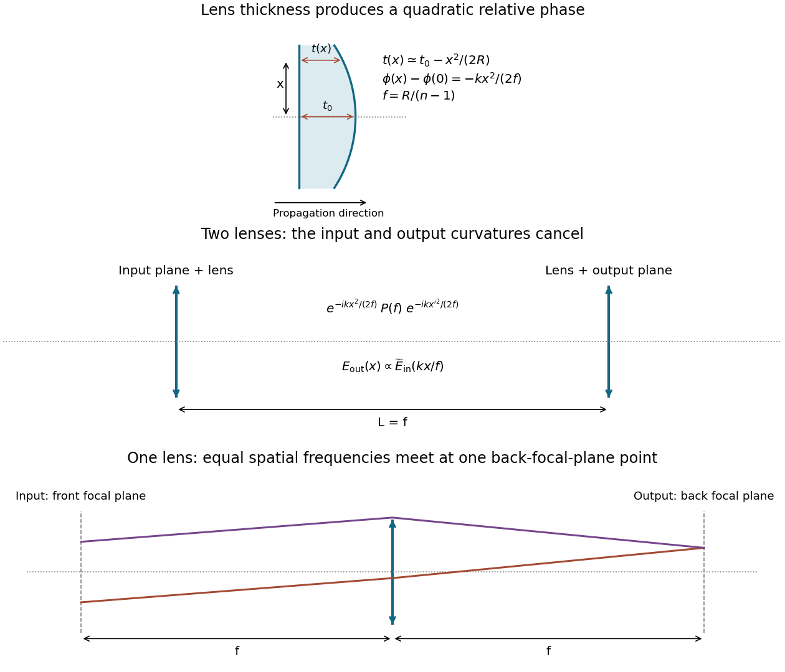

<h1 id="2/a/solution">Solution</h1>

↑ **Parent:** [A](../a.md)

Measure the [phase](../../../../phase-waves.md) relative to propagation through the same geometrical thickness of air. If the [lens](../../../../lens-optics.md)'s central thickness is $t_0$, its spherical surface gives

$$
t(x)=t_0-\left[R-\sqrt{R^2-x^2}\right]
\simeq t_0-\frac{x^2}{2R},\qquad |x|\ll R.
$$

The optical-path excess is $(n-1)t(x)$, so the [phase](../../../../phase-waves.md) imparted by the [lens](../../../../lens-optics.md) is

$$
\boxed{\phi(x)=k(n-1)t_0-\frac{k(n-1)x^2}{2R}.}
$$

The constant part is a spatially uniform [phase](../../../../phase-waves.md). The physically important [lens](../../../../lens-optics.md) transmission is therefore $T_f(x)=\exp[-ikx^2/(2f)]$ with

$$
\boxed{f=\frac R{n-1}.}
$$

One way to identify the focus is to append propagation to the on-axis point a distance $f$ away. Its path [phase](../../../../phase-waves.md) has the paraxial contribution $+kx^2/(2f)$, which cancels the [lens](../../../../lens-optics.md) [phase](../../../../phase-waves.md). Thus all incident portions of a plane wave add with the same [phase](../../../../phase-waves.md) at that point. The diagram below shows the thickness change and both Fourier-transform arrangements.

**[Figure 1](#2/a/image-quadratic-thin-lens-phase-and-two-optical-implementations-of-a-scaled-fourier-transform). Quadratic thin-lens phase and two optical implementations of a scaled Fourier transform**.

## ↑ Ancestors (12)

1. [A](../a.md)
2. [2](../../2.md)
3. [2017](../../../2017-split.md)
4. [Past exam of the laser science and quantum information processing course of the University of Oxford](../../../split.md)
5. [Laser science and quantum information processing course of the University of Oxford](../../../../laser-science-and-quantum-information-processing-course-of-the-university-of-oxford.md)
6. [Year 4 of the physics course of the University of Oxford](../../../../year-4-of-the-physics-course-of-the-university-of-oxford.md)
7. [Physics course of the University of Oxford](../../../../physics-course-of-the-university-of-oxford.md)
8. [Undergraduate course of the University of Oxford](../../../../undergraduate-course-of-the-university-of-oxford.md)
9. [Course of the University of Oxford](../../../../course-of-the-university-of-oxford.md)
10. [University of Oxford](../../../../university-of-oxford-split.md)
11. [List of universities](../../../../list-of-universities.md)
12. [Codex Wiki](../../../../split.md)
