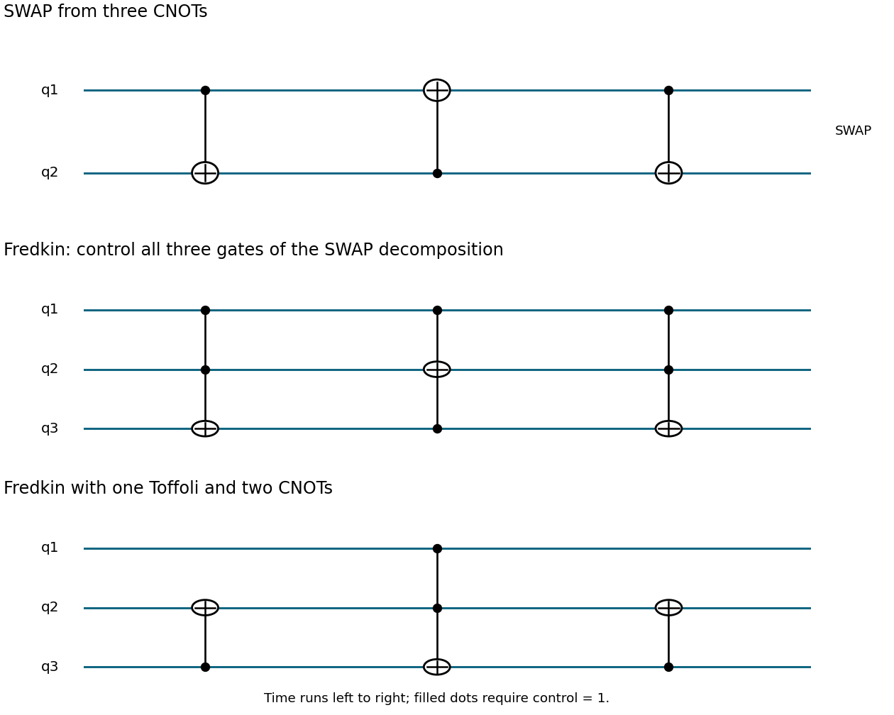

<h1 id="4/a/solution">Solution</h1>

↑ **Parent:** [A](../a.md)

Use the time-ordered network $\operatorname{CNOT}_{1\to2}$, $\operatorname{CNOT}_{2\to1}$, $\operatorname{CNOT}_{1\to2}$. On bits $(a,b)$ its successive values are

$$
(a,b)\longmapsto(a,a\oplus b)\longmapsto(b,a\oplus b)\longmapsto(b,a).
$$

Thus the network exchanges the two [computational-basis](../../../../computational-basis.md) states. Since the gates are linear, this basis proof also establishes [SWAP gate](../../../../swap-gate.md) on arbitrary quantum states.

The [Bell states](../../../../bell-state-split.md) $|\Phi^\pm\rangle=(|00\rangle\pm|11\rangle)/\sqrt2$ and $|\Psi^\pm\rangle=(|01\rangle\pm|10\rangle)/\sqrt2$ obey

$$
\boxed{S|\Phi^+\rangle=|\Phi^+\rangle,\quad S|\Phi^-\rangle=|\Phi^-\rangle,\quad
S|\Psi^+\rangle=|\Psi^+\rangle,\quad S|\Psi^-\rangle=-|\Psi^-\rangle.}
$$

The antisymmetric [spin singlet state](../../../../spin-singlet-state.md) alone has [eigenvalue](../../../../eigenvalue.md) $-1$. Its standalone sign is a global [phase](../../../../phase-waves.md); a [Fredkin gate](../../../../fredkin-gate.md) can make that sign observable relative to the control branch, as in part d.

**[Figure 2](#4/a/image-three-controlled-x-gates-for-swap-and-two-decompositions-of-the-fredkin-gate). Three controlled-X gates for SWAP, and two decompositions of the Fredkin gate**.

## ↑ Ancestors (12)

1. [A](../a.md)
2. [4](../../4.md)
3. [2017](../../../2017-split.md)
4. [Past exam of the laser science and quantum information processing course of the University of Oxford](../../../split.md)
5. [Laser science and quantum information processing course of the University of Oxford](../../../../laser-science-and-quantum-information-processing-course-of-the-university-of-oxford.md)
6. [Year 4 of the physics course of the University of Oxford](../../../../year-4-of-the-physics-course-of-the-university-of-oxford.md)
7. [Physics course of the University of Oxford](../../../../physics-course-of-the-university-of-oxford.md)
8. [Undergraduate course of the University of Oxford](../../../../undergraduate-course-of-the-university-of-oxford.md)
9. [Course of the University of Oxford](../../../../course-of-the-university-of-oxford.md)
10. [University of Oxford](../../../../university-of-oxford-split.md)
11. [List of universities](../../../../list-of-universities.md)
12. [Codex Wiki](../../../../split.md)
